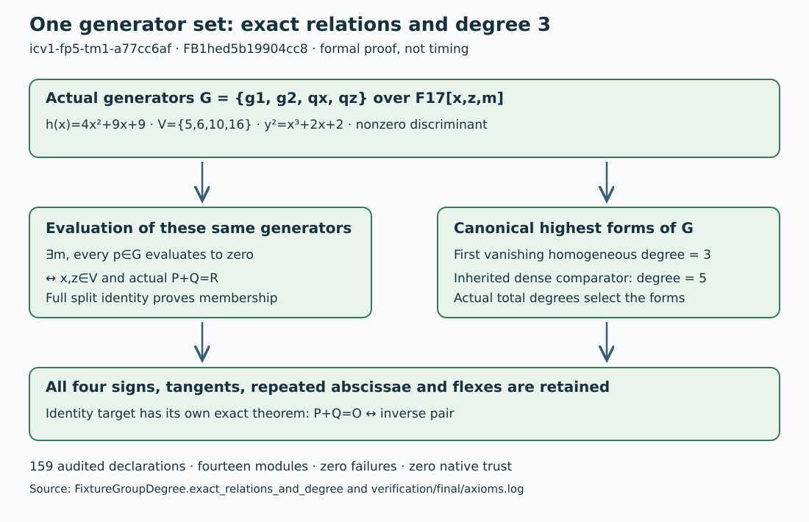

# Concrete relations and canonical degree in one formal statement

Date: 2026-10-31. This continuation proves
`FixtureGroupDegree.exact_relations_and_degree` for the existing F17 fixture,
curve `icv1-fp5-tm1-a77cc6af` and factor base `FB1hed5b19904cc8`.

For every nonsingular finite target and each of the four sign branches, raw
zeroes of the actual polynomial generator set are exactly the signed
factor-base point pairs summing to that target in Mathlib's group. The same
generator set has canonical homogeneous first-vanishing degree 3; the
inherited dense comparator has degree 5. The formal split identity and
nonzero actual discriminant discharge the concrete algebraic assumptions.
Tangent, repeated-abscissa and flex cases remain in the generic proof.
Infinity is handled exactly by inverse pairs.

The unchanged repository auditor checks **159 declarations in fourteen
modules: zero failures, zero native trust**. All transitive axioms are
propext, Classical.choice or Quot.sound. The new module passes warnings as
errors. Separately, all three exact published generic modules rebuilt and
passed warnings-as-errors and a 22-declaration audit, closing the outage gap.
The recovered original group source hashes match the published copies.

Lean 4.19.0 and Mathlib c44e0c8ee63ca166450922a373c7409c5d26b00b are
pinned. All nine Git checkout revisions match the lockfile; thirty source
inputs are hashed. The two earlier Lake projects are used unchanged through
relative dependencies. Their identical shared identity module is not
rewritten. `lean4checker` was unavailable, and no cache-download preflight
pass is asserted. Seven failed development builds precede the successful
build; their source snapshots and complete logs are retained in the archive.

This adds a semantic connection to the earlier canonical degree proof.
It does not measure a new degree, F4 solving degree, relation yield or time.
The dense statement is its existing degree theorem; a new independent dense
S3-to-group equivalence is not part of the claim. Registry metadata and the
FB1 object are unchanged. The figure is an explanatory proof map, not a
quantitative measurement graph.

Sources: [declaration map and proof](../FORMALIZATION.md),
[actual source](../FixtureGroupDegree.lean),
[verification metadata](../verification/metadata.json),
[complete audit](../verification/final/axioms.log),
[immutable fixture](../../secant/fixture.json), the existing identity
certificate `IDC1h621ed1a51b5f3ca8`, and Angdinata–Xu,
[ITP 2023](https://doi.org/10.4230/LIPIcs.ITP.2023.6).

Canonical graphs checked: the study's original `secant/degree.svg`, its
completed F4 comparison figures, `docs/index-calculus-scoreboard.html`, and
`docs/ic/progress-timeline.json` remain unchanged because this continuation
introduces no new quantitative value, curve/base identity or cost row.
The parent README adds the new formal-coverage pointer. Prior sealed records
and their original historical statuses are retained.
