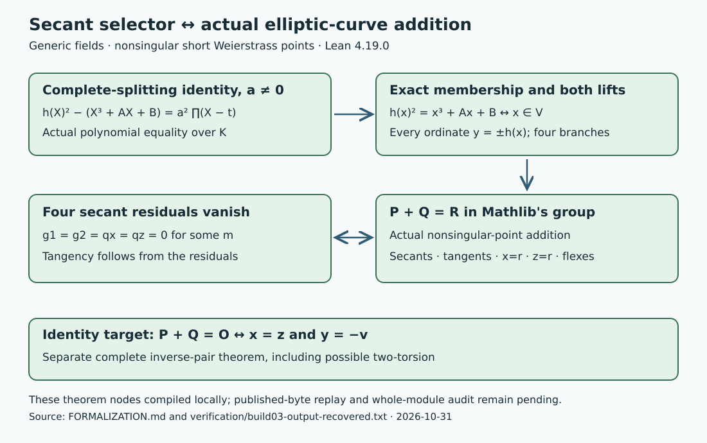

# A checked secant-to-group bridge

Date: 2026-10-31. Scope: generic short Weierstrass curves over fields, finite
nonsingular factor-base inputs and finite or identity targets.

The standalone Lean build proves the exact four-equation secant selector
equivalent to Mathlib's elliptic-curve addition. The finite proof includes
secants, tangents, repeated abscissae and flexes. Identity relations are
exactly inverse pairs. Given a nonzero complete-splitting identity, membership
and both ordinate signs are derived, and all four signed selector branches
are complete.

The two new modules and unchanged identity module compiled under Lean
4.19.0 with Mathlib commit c44e0c8ee63ca166450922a373c7409c5d26b00b.
The twelve central axiom printouts list only standard Lean foundations.
See the [proof map and argument](../FORMALIZATION.md),
[recovered build output](../verification/build03-output-recovered.txt),
[exact custody limits](../verification/CUSTODY.md) and
[published-file metadata](../verification/metadata.json).

The converse uses the full cubic factorization and its linear coefficient;
it does not cancel target-abscissa differences. This is the step that retains
the diagonal cases. Soundness proves the tangent slope from the residuals and
actual nonsingularity rather than assuming that slope.

The original worker became unavailable after the successful standalone
build. Published sources were recovered from recorded edits, with the
identity and dependency pins obtained from merged #3082. No original
pre-outage source checksum was captured. A fresh published-byte build and
the whole-module repository axiom audit remain pending. The optional direct
integration with the existing F17 canonical degree theorem was not completed.
No new experiment or performance comparison was run.

Sources: Angdinata and Xu, ITP 2023,
[10.4230/LIPIcs.ITP.2023.6](https://doi.org/10.4230/LIPIcs.ITP.2023.6);
pinned Mathlib Affine.lean and Group.lean (direct links in the proof map);
the existing secant/graph argument and merged canonical degree formalization.

The SVG is an editable explanatory dependency diagram, not a quantitative
graph. Existing study-local F4 figures and canonical comparison dashboards
are unchanged: this continuation adds formal coverage without a new measured
value, row, curve identity or FB1 object. Historical proof-scope records remain
unchanged; the parent README points to the new coverage.

PDF status: complete Typst source and SVG are supplied. Rendering and page
inspection could not run because no execution environment is available.
No earlier PDF is presented as this continuation's report.
