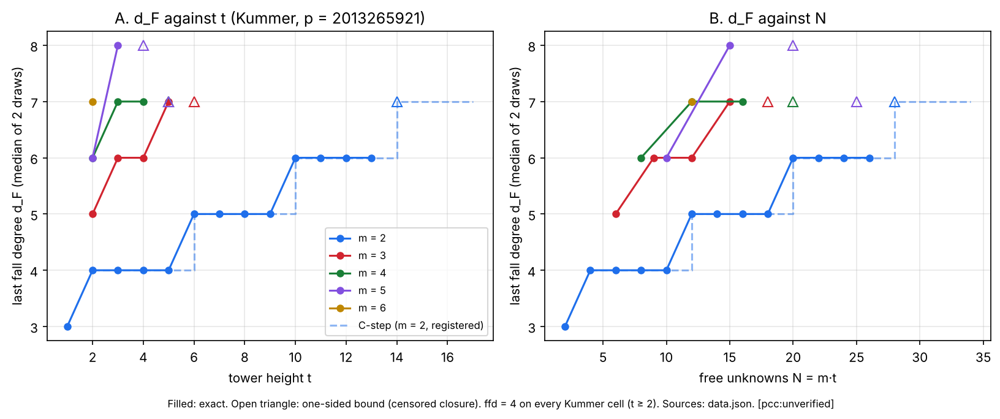

# Growth of the last and first fall degree, PKM Kummer systems over F_p, m = 2–6 (2026-11-15)

Every number here is `[pcc:unverified]`. No pcc claim exists. Values are **measured** (recorded medians of the
registered cells) unless marked **derived**, and each has a source in `data.json`. This report lays out recorded
values. It fits nothing and computes no new result.

## What was measured

- **The study.** `research/prime_fall_degree_20261027/PREREGISTRATION.md`: Kummer tower factor base, prime
  `p = 2013265921`, two random targets per cell, and the exact HKY closure engine with F4 cross-checks.
- **New since 2026-11-14.** Rows came from reserved RunPod pods (Amendments 16–21):
  - stage B, the `m = 3–6` ladders: `research/pkm_falldegree_unblock_20261107/RESULTS_STAGE_B.md`;
  - the `m = 2`, `t = 13` and `t = 14` bracket cells;
  - the `m = 4` cells at `t = 4` and `t = 5`.

*Figure.* The lower median of two draws per cell. Filled markers are exact values; open triangles are one-sided
bounds from censored closures. The dashed line is the registered C-step law for `m = 2` (Amendment 6). Data:
`data.json`, plotted by `plot.py`.

## First fall degree: flat

`ffd = 4` on every Kummer cell with `t ≥ 2`, at every `m = 2–6` and every `t` measured (measured). At `m = 2` this is
theorem D3 (`DERIVED.md`); for `m ≥ 3` it is measured only. On the 2-isogeny tower `ffd = 5` on every cell. The first fall
degree does not grow with `t` or with `m` anywhere it was measured.

## Last fall degree: grows in t and in m

| `m` \ `t` | 1 | 2 | 3 | 4 | 5 | 6 | 7–9 | 10–13 | 14 |
|--:|--:|--:|--:|--:|--:|--:|--:|--:|--:|
| 2 | 3 | 4 | 4 | 4 | 4 | 5 | 5 | 6 | ≥ 7 |
| 3 | | 5 | 6 | 6 | 7 | ≥ 7 | | | |
| 4 | | 6 | 7 | 7 | ≥ 7 | | | | |
| 5 | | 6 | 8 | ≥ 8 | ≥ 7 | | | | |
| 6 | | 7 | | | | | | | |

- **`m = 2`.** Every completed cell from `t = 2` to `t = 13` equals the registered C-step law
  `d_F = 4 + ⌊(t − 2)/4⌋`: 4, 4, 4, 4, 5, 5, 5, 5, 6, 6, 6, 6.
  - At `t = 14`, cap 5 and cap 6 both complete without refuting on both draws, so `d_F ≥ 7`. The degree has stepped
    at `t = 14`, as C-step predicts. That rules out "flat at 6".
  - Whether the value is exactly 7 is decided by the cap-7 runs, launched 2026-11-15 16:45Z (Amendment 7 B).
  - The step is one degree per four tower levels, which is one per eight unknowns (derived).
- **`m = 3`.** 5, 6, 6, 7 over `t = 2–5`, a rise of 2 over 3 levels (derived: 0.67 per level, 2/9 per unknown).
- **`m = 4`.** 6, 7, 7 over `t = 2–4`, then `≥ 7` at `t = 5` (closure complete to degree 6). The exact `t = 5` value needs
  the degree-7 closure, which is scheduled 2026-11-16 at 09:10Z.
- **`m = 5`.** 6 then 8 over `t = 2–3` (derived: 2 per level). Later points are censored.
- **At fixed `t = 2`**, `d_F` is 4, 5, 6, 6, 7 for `m = 2, …, 6`.

**H-gap.** On every cell where both the closure value and the F4 solving degree `D` exist, `d_F = D` (stage A: 22 draws;
stage B: 41 draws). The growth is in the intrinsic last fall degree, not in how F4 happens to run.

**H-FFD.** With `ffd` flat and `d_F = D` rising, `D − ffd` grows on the `m = 2`, `m = 3` and `m = 5` ladders.
- The registered reading is "FFD assumption fails" on those ladders. On `m = 4` it reads "consistent" so far, because
  `t = 5` is censored.
- The first fall degree therefore does not predict the solving degree for these systems.

**Null control.** The shape-matched null equals the Kummer ladder on every completed cell: `m = 3` at `t = 2–5`, and
`m = 4` at `t = 4`. At these sizes the degrees are set by the system's shape, not by the Semaev polynomial's arithmetic.
At the largest `N` both arms are censored, so H-null stays unresolved there.

## Growth law: what the data support

- **`ffd` is a constant**: 4 on the Kummer tower and 5 on the 2-isogeny tower.
- **`d_F` is not constant in `t` at any `m`.**
  - At `m = 2` it follows C-step, one degree per four levels, through `t = 13`. The predicted step at `t = 14` is
    observed as a lower bound.
  - At `m = 3–5` it rises faster per level on the ladders measured, but those ladders end censored after 2–4 points.
  - **No slope for `m ≥ 3` is established.** No law beyond C-step at `m = 2` is stated here.
- **Linear growth in `N` at a fixed `m`** (C-step at `m = 2`) means a fixed solving degree buys no polynomial bound on the
  closure size. The column counts grow like `N^{d_F}`. That is a reading of the recorded column counts, not a cost
  result (§8 of the preregistration).

## What this does not show

- No exponent, no security claim, no `S`, no leaderboard row. Degrees, not costs.
- No proof that `d_F` keeps growing. A `t`-growing lower bound remains open (`research/prime_ic_leads_20261110/growth_law`).
- The censored ends of the `m ≥ 3` ladders limit every statement about `m ≥ 3` to the points listed.
- One prime and two draws per cell; the medians are of two values.

## Pending cells that update this report

- `m = 2`, `t = 14`, cap 7, both draws. If it refutes, `d_F = 7` and C-step holds at the decisive cell. If it completes
  without refuting, `d_F ≥ 8` and C-step is refuted.
- `m = 4`, `t = 5`, degree 7 and `t = 6`, degree 6, both draws (Amendment 8 rise/flat/fall reading).
