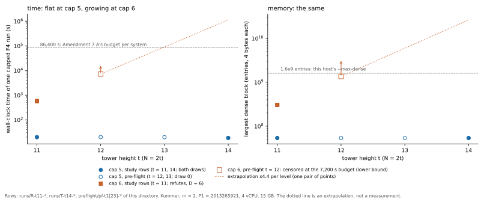

# The t = 14 cell: cap 5 does not refute on either draw (d_F ≥ 6); the decisive cap-6 cell does not fit this host

2026-11-01. Plan frozen at `aa374b555`, before any row (`PLAN.md`). Cell: Kummer tower, `m = 2`,
`P1 = 2013265921`, `t = 14` (`N = 28`), the two random draws of `research/prime_fall_degree_20261027`, against the
registered prediction C-step `d_F = 4 + ⌊(t−2)/4⌋ = 7` (Amendment 6), read by the capped F4 bracket of
Amendment 7 B.

## Result

- **Instrument reproduces the recorded rows (stage R).** Uncapped: `t = 9` gives `D = 5` and `t = 10` gives `D = 6` on
  both draws. `t = 11`: cap 5 does not refute and cap 6 refutes with `D = 6` on both draws. No miss, so the study went
  on.
- **Cap 5 at `t = 14` does not refute on either draw.** Both rows have `inconsistent = false`, are not censored
  (`timed_out = false`, 22 steps, 18.6 s and 18.3 s), and stop with 30,335 critical pairs above the degree bound.
- **Neither draw is decomposable.** `pfd_grid_zeros` finds 0 zeros of `S₃` on `V × V` for both `t = 14` draws (and for
  all eight draws of `t = 9 … 11`), so neither is excluded (Amendment 7 C).
- **Reading under the frozen rules:** `d_F ≥ 6` for each draw at `t = 14`. That is a lower bound. It is consistent with
  C-step (7) and with `d_F = 6`; it does not distinguish them.
- **C-step at `t = 14` (Amendment 7 D5): undecided.** The refuting cell is cap 6 (to test `d_F ≤ 6`); no cap-6 row
  exists at `t = 14`, because it does not fit this host (below). The hosting question is a route gap, not a result.

## 1. Claim classes

| claim | class | basis |
|:--|:--|:--|
| each row's `D`, `inconsistent`, pair, step and matrix counts | exact computation (deterministic in the system) | `runs/*.jsonl` |
| regression: `t = 9, 10` uncapped and `t = 11` cap 5 / cap 6 match the recorded values | exact reproduction | `runs/R-*` |
| cap 5 does not refute at `t = 14`, so `d_F ≥ 6` | bound, under the capped-F4 reading of Amendment 7 B | `runs/T-t14-*`, `runs/G-grid-zeros.jsonl` |
| the cap-6 cost grows with `t` as in the figure | extrapolation from one pair of points (`t = 11`, `t = 12`) | pre-flight rows; not a measurement at `t ≥ 13` |
| C-step is right or wrong at `t = 14` | not established | no cap-6 row |

## 2. Rows

| cell | outcome | `D` reached | wall | peak RSS | widest matrix | dense block |
|:--|:--|--:|--:|--:|--:|--:|
| R `t = 9`, uncapped, both draws | `D = 5` | 5 | 4.7 s, 4.8 s | – | 8,644 cols | 1.3·10⁷ |
| R `t = 10`, uncapped, both draws | `D = 6` | 6 | 47.1 s, 46.6 s | – | 33,446 | 9.4·10⁷ |
| R `t = 11`, cap 5, both draws | no refutation | 5 | 19.9 s, 19.7 s | – | 16,572 | 5.4·10⁷ |
| R `t = 11`, cap 6, both draws | refutes, 28 steps | 6 | 572 s, 576 s | – | 51,909 | 3.1·10⁸ |
| **T `t = 14`, cap 5, draw 0** | **no refutation**, 22 steps | 5 | 18.6 s | – | 16,572 | 5.4·10⁷ |
| **T `t = 14`, cap 5, draw 1** | **no refutation**, 22 steps | 5 | 18.3 s | – | 16,572 | 5.4·10⁷ |
| pre-flight `t = 12`, cap 6, draw 0 | **censored** at the 7,200 s budget, step 28 | – | 7,203 s | 8,214 MiB | 103,785 | 1.4·10⁹ |

Peak RSS was sampled only for the scratch pre-flight runs (`preflight/PEAKS.txt`); the study rows record the matrix
sizes, which are deterministic.

## 3. Figure

Cap 5 is flat in `t` (the same 16,572-column matrix and 5.4·10⁷-entry block at `t = 11, 12, 13, 14`, identical
`muladds`). Cap 6 is not: from `t = 11` to `t = 12` it grew at least 12× in time and 4.4× in the largest dense block (both lower bounds, the run being censored), and
the `t = 12` run did not finish in 7,200 s. The dotted line carries that single ratio two more levels; it is an
extrapolation and not a measurement.

## 4. Reading

- **What cap 5 at `t = 14` adds.** Under the frozen readings a non-refutation at cap 5 gives `d_F ≥ 6`. The same bound
  was already known at `t = 11`, where `D = 6` was measured, so this row confirms that the cap-5 behaviour does not
  change with `t` and nothing more. It excludes `d_F ≤ 5` at `t = 14`.
- **What it does not add.** C-step says 7 at `t = 14` and 6 at `t = 11`; the bound `d_F ≥ 6` does not separate 6
  from 7. Only the cap-6 cell does: if it refutes, `d_F ≤ 6` and C-step is refuted at `t = 14`; if it does not, `d_F ≥ 7`
  and the C-step value is bracketed from below.
- **Cap 6 at `t = 14` on this host.** The pre-flight `t = 12` cell ran 7,202 s without finishing, at 8.2 GiB peak,
  with a 103,785-column matrix and a 1.36·10⁹-entry dense block at the point it was stopped (a lower bound). From
  `t = 11` that is 12.3× the time and 4.4× the dense block. Carrying those two ratios two more levels is
  about 1.1·10⁶ s (13 days at 4 vCPU) and about 2.6·10¹⁰ entries (about 100 GB at 4 bytes each). This is an
  extrapolation from one pair of points and the growth could saturate or steepen. The measured fact is smaller: the
  `t = 12` cell alone is over two hours and already near this host's `--max-dense` (1.6·10⁹). It is a route gap:
  Amendment 7 A's job (112 GiB, 86,400 s per system) is the matching resource.

## 5. Disclosures

- **Off-route.** AGENTS.md §9a sends x86 experiments to Iso Lab on EKS Spot. This container has 4 vCPU and 15 GB and no
  AWS access, so every row here is off-route and is reported separately from Amendment 7 scoring. `D` is a deterministic
  function of the system; the host changes only the odds of censoring.
- **The pre-flight rows are scratch.** `pf-t11…t13` were run on draw 0 before the plan was frozen to size the cells; they
  are not study rows and are not counted as such. The `t = 12` cap-6 pre-flight is the only evidence of the cap-6 growth.
- **The `t = 12, 13` cap-5 pre-flight cells ran on draw 0 only.**
- **No independent `review-run` record exists** for these rows.
- Binary hashes, `rustc` and the host are in `commit.txt`.

## 6. Next, and what the owner can decide

Route `run_cells.sh T 6 0` and `run_cells.sh T 6 1` to Iso Lab (112 GiB, 86,400 s per system; `BUDGET=86400
DENSE=<set for that request> VMEM_KB=<unset>`). Those two rows decide C-step at `t = 14`. Until they exist the
reading above stays "undecided" and no claim about the shape of `d_F(t)` beyond `t = 11` is made.

## 7. Sources

`research/prime_fall_degree_20261027/PREREGISTRATION.md` (Amendments 6 and 7); `research/prime_fall_degree_t14_20261101/PLAN.md`;
`examples/pkm_tower_pilot.rs`, `examples/pfd_grid_zeros.rs`; Petit–Kosters–Messeng, PKC 2016 (the tower factor bases).

## 8. Reproduce

`cargo build --release --example pkm_tower_pilot --example pfd_grid_zeros`; `run_cells.sh R`, `run_cells.sh T 5 0`,
`run_cells.sh T 5 1`, `run_cells.sh G`; `plot_cost.py` rebuilds `cost_vs_t.svg` and `cost_vs_t.png` from the rows.
