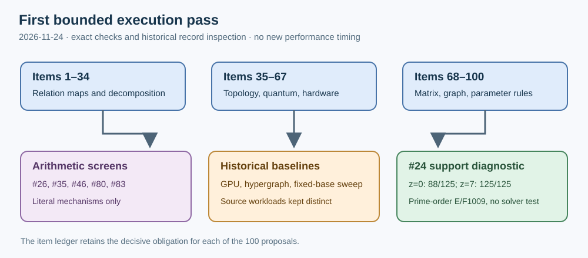

# Parallel EC experiment follow-up

Date: 2026-11-24. Scope: the [100 source proposals](IDEAS.md) and their [item-by-item assessment](README.md), with the owner's selected target `E(F_p)`. Three parallel workstreams examined items 1–34, 35–67, and 68–100. This report separates mathematical screens, historical records, executed bounded EC checks, and proposals lacking an executable point-relation construction. The executed controls share several scripts and do not constitute 100 independent experiments. Full-cost studies need separate frozen workloads.

Publication status (2026-11-27): PR #5165 merged on 2026-11-26 with the earlier audit and controls. The later second-curve and natural-matrix follow-ups below were copied byte-for-byte from the local staged batch onto a successor branch. Their new PCC claim files and divergent ledger extension were excluded because they do not meet the current coordinate-input and unverified-debt gates. Their source, raw outputs, failed attempts, and receipts remain linked here as unsigned producer evidence. References below to the original draft PR describe the historical state when those runs were frozen.

Rendering status (2026-11-27): this Markdown report and `PROGRESS.typ` contain the current completion pass. The tracked `PROGRESS.pdf` is the earlier rendering: the updated 14-page PDF exceeds the repository's 64 KiB artifact threshold, and this checkout has no configured artifact remote for migration. The updated PDF was compiled and SHA-256 checked locally, but is not part of the successor commit. Regenerate it with `typst compile PROGRESS.typ PROGRESS.pdf` after configuring the artifact store.

## Direct mathematical checks

These are **derived counterexamples to the literal proposed mechanism**, not impossibility theorems for every variant.

| Item | Check | Consequence |
|---:|---|---|
| 26 | A subfield of `F_p` has cardinality `p^d` for a divisor `d` of `1`; the only choice is `d=1`. | A proper-subfield sieve cannot run inside `F_p` itself. An extension and norm need a separate costed construction. |
| 35 | Let three edge rows on a triangle be `A = [[1,1,0],[0,1,1],[1,0,1]]`. The underlying graph has a one-cycle, while `det(A)=2`, so `A` has full rank modulo `5`. | Topological cycle detection alone does not identify a modular row dependency. A coefficient-preserving cycle-to-row map is required. |
| 46 | In `F_23^×`, `2^11 = 1` and `13^11 = 1`, while neither base is `1`; since `11` is prime, each element has order `11`. Multiplication by either element permutes the 22 nonzero field elements in two 11-cycles, giving the same spectrum. With integer smoothness bound `B=3`, canonical representatives `2` and `13` have different smoothness. | Phase information from the multiplication operator's spectrum cannot alone decide representative `B`-smoothness. A separate factorization predicate is needed. |
| 80 | The binary order-two de Bruijn cycle `0011` has length-two windows `00, 01, 11, 10`, interpreted as `0,1,3,2`. Reduction modulo `3` yields `0,1,0,2`. | Window uniqueness does not imply distinct field residues. A candidate-map injectivity proof is needed before claiming nonredundant coverage. |
| 83 | The one-entry matrix `[2]` has rank one over the reals and rank zero over `F_2`. | Real SVD cannot certify finite-field rank without an exact modular reconstruction step. |

The #35 check also shows why the repository's **coefficient-aware** large-prime cycle filtering matters: the graph topology alone omits row coefficients and the subgroup modulus. These arithmetic checks are short enough to replay directly from the displayed values. They are not general algebraic identity claims or performance measurements.

## Historical evidence checked against proposed work

| Items | Existing record and bounded reading | Next discriminating step |
|---|---|---|
| 24 | The [technique inventory](../../docs/ic/ECDLP_RESEARCH_TECHNIQUES.md) reports dense `S4`/`S5` construction and a 40-bit diagnostic with 125/125 and 6561/6561 nonzero coefficients; [KN-OPEN-004](https://github.com/isogeny-labs/crypto-autoresearcher/blob/main/knowledge/open-problems/KN-OPEN-004.md) already poses the sparse-support question. A bounded exact GP diagnostic below found a special-coordinate support reduction on a prime-order curve. | Freeze a matched elimination and relation-collection protocol before any performance claim. Test whether the support reduction survives coordinate changes and lowers exact solver cost, then check independent relation rank. |
| 53–60 | The [A100 kernel record](../../benchmarks/records/20261112T2313Z-ic-gpu-cards.json) reports SpMV 0.008175 → 0.0005398 s, `n=5`, equal CPU digests. The [complete-solve record](../../benchmarks/records/20261115T2002Z-ic-gpu-rootfind-la-r3.json) reports a 39-bit, factor-base-size-4096 GPU solve 1.541 → 0.305 s, `n=6`, with a 0.0866 s matched rho reference. Both records are historical and `[pcc:unverified]`; the former is a kernel result, the latter is a complete solver result on its recorded workload. The complete candidate time is about 3.52 times that reference. | Profile the actual limiting stage in a current, frozen run, then compare exact GPU queue, arithmetic, and memory-layout variants with the same input and transfer accounting. No new GPU run was made here. |
| 75–76, 84 | The [technique inventory](../../docs/ic/ECDLP_RESEARCH_TECHNIQUES.md) identifies an existing coefficient-aware multi-large-prime hypergraph filter, CADO-style filtering, and block Wiedemann. The [graph-theory study](https://github.com/isogeny-labs/workspace/pull/59) reports that structured Gauss changed little in its tested prime cells, where linear algebra was 0.03–0.14% of recorded total GAE `[pcc:unverified]`. | Replay current verified partial-relation streams through the existing filter and a proposed separator/rank variant, retaining source-row witnesses, modular rank, target column, and complete cost. |
| 96–97 | The [graph-theory study](https://github.com/isogeny-labs/workspace/pull/59) reports a 24-repeat frozen base-size sweep on prime 16-bit and 18-bit instances. Its recorded `S` for `m=2` is 13.460 at base size 16 versus 19.620 at size 40, and 12.839 at size 32 versus 20.389 at size 63 `[pcc:unverified]`. These are **fixed-base** comparisons; they do not test a dynamic controller or target descent. | Compare a predeclared online resizing policy with the best frozen base on held-out, time-ordered relation streams, including tuning, setup, rank, solve, and target descent. No suitable interval trace was found in the selected study for #97. |

The observed GPU ratios and frozen-base values belong to their source workloads. We made no new performance measurement and did not transfer those numbers to a different curve or hardware. The [GPU audit](../../docs/perf/20261112-ic-gpu-audit.md) and the source records contain the original methods and limits.

## #24 exact support diagnostic

The committed [PARI/GP source](S4_SUPPORT_GP.gp) and [raw output](S4_SUPPORT_GP.txt) use GP 2.17.3 on arm64. The source computes the standard short-Weierstrass `S3`, takes `Res_t(S3(x,y,t), S3(t,w,z))` modulo 1009, and enumerates every coefficient in the degree-four box. The fixed `z` values are listed in the source; no random seed or timing is involved. The wrapper separately checks group cardinality, primality, and the order of the point with `x=0`.

Reproduce with `gp -q < S4_SUPPORT_GP.gp`; compare stdout byte-for-byte with `S4_SUPPORT_GP.txt` and reject any GP `***` error line. This source and raw output are a structural diagnostic, not a frozen performance protocol.

**Native corroboration protocol, frozen before invocation.** Run the existing `semaev_prime_structure` example from the checked-out commit with Rust 1.99.1, `--p 1009 --a 1 --b 14 --m 3 --zs 3 --lines 0 --seed 20261124`. Its three seeded `z` values are not selected by hand. Accept only parseable JSON rows with `p=1009`, `m=3`, and `support_max=125`; independently recompute their support counts with GP before interpreting agreement. Record the command, toolchain, exact rows, and any build failure. Do not use elapsed time from this local correctness check as a benchmark. The tracked `panel.json` dependency was materialized from `isogeny/main` after a first sparse-checkout build could not find it; its bytes were not edited. The final release build succeeded and the committed [native output](S4_SUPPORT_RUST.txt) has `z=750,620,320`, each with `125/125` support and nonzero box corners. The GP source was extended to check those exact returned values independently; its output agrees on all three counts. `--lines 0` means this run did not test irreducibility. The example printed a short execution time, which is excluded from cost comparisons.

| Curve over `F_1009` | Fixed `z` | Nonzero coefficients / 125 | Nonzero box corners / 8 | `#E`; order of point at `x=0` |
|---|---:|---:|---:|---|
| `y²=x³+2x+3` | 7, 17, 29 | 125 each | 8 each | 1068; 267 |
| `y²=x³+2x+3` | 0 | 88 | 4 | 1068; 267 |
| `y²=x³+3` | 0 | 37 | 1 | 948; 3 |
| `y²=x³+2x` | 0 | 35 | 4 | 980; 2 |
| `y²=x³+x+14` | 0 | 88 | 4 | **1013 prime; 1013** |
| `y²=x³+x+14` | 7 | 125 | 8 | 1013 prime; 1013 |
| `y²=x³+x+14` | 320, 620, 750 | 125 each | 8 each | 1013 prime; 1013 |

The last pair shows that a special-coordinate support reduction occurs even when the whole curve group is prime-order. All specialized resultants in this panel retain degree four in each free variable. This is a **structural component observation**: fewer nonzero coefficients need not imply lower elimination degree, lower decomposition time, more independent rows, or lower full solve cost. The 40-bit inventory result and this 1009-field panel have different curves and specializations. The original Rust example was attempted first but could not compile on this merged checkout because `research/ecbench_phased_panel_20261117/panel.json` was missing; the GP calculation supplies an independent bounded diagnostic, not a Rust performance comparison. An initial version of the GP script also had a multiline `for` parse error after printing support rows; the point-order block was rewritten as a function and the final raw output was regenerated without GP error lines.

## Target-domain boundary for the requested EC scope

The owner selected discrete logarithms in `E(F_p)` as the target for this pursuit. Many source proposals describe multiplicative smoothness in `F_p^×`; those screens are assessments of the attachment's literal premise, not EC point-relation results. For the #24 diagnostic curve over `F_1009`, the exact group count recorded in `S4_SUPPORT_GP.txt` is prime `1013`, while `|F_1009^×|=1008` and `gcd(1008,1013)=1`. Every group homomorphism between these two particular finite groups is therefore trivial, because its image order divides both group orders. A proposal using multiplicative relations needs a separate, explicit construction that yields checked point relations for this EC target. This arithmetic boundary is specific to the diagnostic curve and does not rule out other constructions on other curves. `[pcc:unverified]`

## Second parallel pass: exact checks and execution boundaries

Each of the [1–34](WORKSTREAM_001_034.md), [35–67](WORKSTREAM_35_67.md), and [68–100](WORKSTREAM_68_100.md) workstreams now has one item-specific outcome or missing construction per proposal. These are bounded producer analyses `[pcc:unverified]`; an item with a stated gate has not thereby been experimentally validated.

| Workstream | New bounded result | Execution boundary |
|---|---|---|
| 1–34 | Derived exact gates for the direct EC translations, including trivial valuations on `F_p^×` (#1), the absence of exceptional divisors when blowing up a smooth point of `P¹` (#4), and the character-evaluation circularity on a prime-order EC subgroup (#11). A matched #24 protocol fixes the prime-order curve `y²=x³+x+14` over `F_1009`, on-curve `z=0` and `z=320`, one 16-coordinate factor base, and all 16³ ordered triples per target. | The required S3 checkpoint upload returned HTTP 403 with `InvalidAccessKeyId` on token and profile paths. The #24 decomposition/rank/cost comparison was not launched. |
| 35–67 | The same triangle support gives rank 3 or 2 over `F_5` depending on coefficients (#35–39). The point `P=(0,425)` on the diagnostic EC doubles to `Q=(991,641)`, so a direct group check accepts `Q−2P=O` and rejects `Q−P=O` (#61–62). Abstract quantum and matrix checks specify missing exact EC output maps; historical A100 numbers remain tied to their source workloads. | No matching GPU or specialized hardware was available for a fresh device comparison. Scratch Python outputs were excluded under the repository's native-language rule; the displayed arithmetic is hand-checkable. |
| 68–100 | A coefficient-aware three-row example cancels all large-prime columns while retaining source rank 3 and only one completed small row (#75–76); two additional independent small rows are needed to pin its target. The prior fixed-base sweep gives controls for #96, not an adaptive result. | Selected historical records lack locally accessible immutable partial relation rows, and the native filter test build stopped on missing sparse-checkout fixtures. The aggregate base-size CSV has no interval-order trace for #97. |

The 35–67 and 68–100 small matrices are algebraic controls, not recorded EC relation streams. The #61–62 point identity is an EC group check; it does not establish a new collector. No new benchmark timing or full-cost comparison is claimed from this pass.

## Coverage of all 100 items

Every numbered item remains in the [assessment ledger](README.md), with its stated decisive check. The three parallel workstreams refined those checks by range: 1–34 require a relation-preserving construction or a costed sieve comparison; 35–67 require exact modular output or an exactly checked relation predicate before hardware or learning cost can be compared; 68–100 require exact rank/coverage or a sound map from proposed representations to point relations. The five arithmetic counterexamples above close only their **literal premises**. The source-list, ledger, and this report together distinguish `screened`, `historical evidence inspected`, `diagnostic completed`, and `future experiment` statuses. No result is silently promoted by a screen.

## Next controlled batch

### Executed bounded native runs and admission status

Following the request to execute experiments, three distinct public-EC checks were frozen and launched in parallel. #24 uses [PARI/GP source and report](S4_MATCHED_REPORT.md) for `z=0` versus `z=320` on `E/F_1009`; #35–39 use a [same-support rank protocol](EC_GRAPH_RANK_PROTOCOL.md) with six checked point equations; #75/#76/#84 use a [native Rust filter protocol](WS68_FILTER_PROTOCOL.md) on `E/F_17`. The raw receipts, corrected source revisions, and independent verification artifacts are linked from those records. All results below are producer claims `[pcc:unverified]` pending the repository's signed verification process.

The required `scripts/checkpoint.sh gate` returned HTTP 403, and all three configured AWS profiles failed identity checks. After this was disclosed, the owner explicitly authorized these bounded local runs without the S3 checkpoint. Each protocol records that exception. The first GP attempts for #24 and #35–39 failed because multiline top-level input did not parse; their stdout, stderr, exit files and original sources are preserved. A separately amended V2 GP source for each kept the mathematical inputs and acceptance checks fixed, and the V2 stderr files are empty. The first Rust compile attempt failed on an inferred crate name containing a dot; the second added an explicit crate name without changing the source. These failed attempts remain part of the record.

| Item(s) | Bounded outcome | Interpretation limit |
|---|---|---|
| 24 | On the same prime-order `E/F_1009` and 16-point base, exact `S4` zero checks agreed with signed EC sums for all 4096 triples at each target. At `z=0`, 24 triples yielded 24 signed rows of rank 4/17; at `z=320`, 33 yielded 33 rows of rank 6/17. Support was 88/125 versus 125/125, while the pair-specialized Horner proxy was 16,320 versus 16,352 multiplications and 15,728 versus 16,320 additions. [Raw V2 output](S4_MATCHED_V2_STDOUT.txt) and a [distinct row/rank verifier](EC_S4_V2_INDEPENDENT.stdout.txt) agree on the emitted rows and ranks. | The 29.6% support reduction corresponded to only about 0.20% fewer proxy multiplications and 3.63% fewer proxy additions. Resultant construction and specialization, wall time, and full collection cost were not measured. The two target identities differ, so their yield and rank differences cannot be attributed to support alone. |
| 35–39 | Two matrices with identical triangle support had ranks 3 and 2 modulo the EC subgroup order 1013. All six row equations held for the recorded EC points. [GP V2 output](EC_GRAPH_RANK_GP_V2.stdout.txt) and a [distinct native verifier](WS68_EC_GRAPH_V2_VERIFY.stdout) agree. | This falsifies support-only rank inference on these planted matrices; it does not measure a relation collector, topology-guided filter, or complete solve. |
| 75/76/84 | A native exact control on `E/F_17` checked three partial EC point rows, coefficient-aware cancellation to one small row, source rank 3, small rank 3 only after two additional known rows, target log 12, and a disjoint block of rank 2. [Native stdout](WS68_FILTER_REPLAY.attempt2.stdout) and a separate read-only point/rank audit agree. | The rows and two unit equations are planted with known logs. This measures exactness and target coverage in a fixed control, not naturally collected relation yield, filter speed, or scale. |

#### Independent readback

The #24 [independent verifier](EC_S4_V2_INDEPENDENT.md) checked all 57 emitted point rows and recomputed both ranks; it did not independently enumerate `S4` zeros or support counts. Separate checks reproduced the six #35–39 point rows and the #75/#76/#84 fixed rows and hashes. None is a signed PCC verdict.

1. Restore valid checkpoint credentials for subsequent experiments. For #24, freeze a comparison that separates target identity and resultant construction cost from coefficient support; the present two-target arithmetic proxy does not isolate those effects.
2. Obtain one immutable set of independently checked EC full and partial relations for #75/#76/#84, including source-row witnesses and target column; then freeze a matched filter replay. Stop if source-row combinations or target-column recovery fail.
3. Obtain time-ordered relation and descent traces, then freeze the #96/#97 policy panel against the best fixed controls. Include tuning, setup, rank, solve, and artifact budgets.
4. Profile a current exact GPU end-to-end run before allocating #54/#55/#57 engineering, since the historical kernel and complete-solve records identify different boundaries.

These bounded passes are incomplete relative to experimental pursuit of all 100 proposals. Many descriptions need a defined EC point-relation mechanism before an executable experiment exists; their exact missing obligations are retained in the assessment ledger and the three workstream reports.

## Resumed parallel local runs — 2026-11-24

After the owner reversed the earlier stop, the three workstreams resumed bounded `E(F_p)` checks in parallel. The latest checkpoint attempt stopped before S3 upload because `.resume/RESUME.md` is absent in this sparse checkout; the earlier HTTP 403 remains a distinct failure. The owner's earlier explicit local-bypass instruction and renewed run instruction are recorded in the dated [session log](../../docs/session-logs/2026-11-24.md). All new runs used public generated curves and local resources. Unsigned execution claims `PCC-20261125-ae7fe0`, `PCC-20261125-7814bd`, and `PCC-20261125-b190d1` pin their raw outputs by workstream; the results remain producer observations `[pcc:unverified]`. Compiled Rust executables remain local with SHA-256 hashes in the committed post-call receipts because the PR artifact store previously returned HTTP 403 on executable objects.

| Items with an executed control | Frozen source, raw output, and bounded observation | Limit |
|---|---|---|
| #6, #16, #21, #29 | The [GP protocol](EC_LEADS_001_034_PROTOCOL.md), [source](EC_LEADS_001_034_GP.gp), and [raw output](EC_LEADS_001_034.stdout.txt) record a 240/506 failure of `x→x+1` to preserve liftability, a valid order-three CM automorphism control, and a counterexample to coordinate product/sum representing point addition. Four equal-cost signed-point blocks selected on four training targets gave 31 hits on four held-out targets versus 27 for fixed block 1. | One curve and small fixed panel; no general PGL2 or CM lift algorithm, isogeny path, RL policy, rank gain, or complete cost. The CM check is related to #8 but does not test its proposed filter. |
| #27, #31 | The [Rust protocol](EC_CLASSIFIER_001_034_PROTOCOL.md), [source](EC_CLASSIFIER_001_034.rs), and [raw output](EC_CLASSIFIER_001_034.stdout.txt) use the same exact EC candidate labels. A Hamming one-neighbor selector found 28 held-out hits versus 31 for a simpler trained best-block control and 27 for fixed block 1. A bit-threshold classifier had TP 5, FP 3, FN 4, TN 4; false-negative cells held 33 exact relation hits. | Charged labels require 131,072 training target comparisons; four held-out targets do not establish a learned collector. No GNN or transformer was trained. |
| #35, #36, #39, #40, #42, #45, #47 | The [first GP protocol](EC_LEADS_35_47_PROTOCOL.md), [raw output](EC_LEADS_35_47.stdout.txt), and earlier [same-support EC rows](EC_GRAPH_RANK_PROTOCOL.md) check graph components and exact modular ranks of the #24 rows, an ideal group-equality oracle with 2 marked candidates among 16, an invertible row operation, and operator-Schmidt ranks 1 versus 16 for equally sparse abstract matrices. A separate [guarded #42 run](EC_LEADS_42_61_PROTOCOL.md) computes rank 1 over the rationals versus rank 0 modulo 1013 for `[1013]`, while exact `1/2` reduces to `507` modulo 1013. | The Grover probabilities have no reversible circuit or device cost; the tensor matrices are not the actual relation matrix; graph components do not price filtering. The first #42 line was printed without a guard and is superseded by the guarded run. |
| #55, #61, #62 | The [guarded GP protocol](EC_LEADS_42_61_PROTOCOL.md) and [raw output](EC_LEADS_42_61.stdout.txt) check the unsigned INT8 to signed INT32 worst-case dot cap of 33,025 terms and directly accept all 57 emitted EC relations while rejecting all 57 after one coefficient is changed. | Arithmetic and public direct verification only; no GPU timing, network cost, or private-witness proof. |
| #68, #75, #76, #77, #79, #80, #82, #83, #84, #88, #89, #93, #98, #100 | The earlier [filter run](WS68_FILTER_PROTOCOL.md) and new native [support/rank](WS68_SUPPORT_RANK.stdout), [structural](WS68_STRUCTURAL.stdout), and [window/CG](WS68_WINDOW_CG.stdout) raw records check exact row identities, support and matching, finite-field rank, point-column retention, a repeated on-curve de Bruijn image, and a conjugate-gradient zero denominator on a nonsingular EC row system. | These are structural controls on small, mostly planted relation systems. They do not implement the proposed graph learner, quantum method, pairing transfer, or full modular solver. |
| #96 | The [unanchored V1 raw panel](WS68_BASE_POLICY.stdout) preserved all 24 cells censored at 512 trials: without a known-log anchor, the pair equations did not pin a target despite relation hits. The separately frozen [anchored V2 source](WS68_BASE_POLICY_V2.rs), [raw output](WS68_BASE_POLICY_V2.stdout), and [post-call receipt](WS68_BASE_POLICY_V2.post-call.json) used the same eight targets and three base-size policies. All 24 anchored cells pinned and scalar-checked their targets. Expanding from base 8 to 16 at trial 128 beat the better fixed size in counted group additions on 0/8 targets and tied on one. | Planted target panel and component accounting only: lift tests and pair-table setup are separate, while modular elimination, wall time, and complete target descent are unpriced. The per-target better fixed choice is a hindsight comparator. |

Together with #24 above, these controls touch **32 proposal numbers** across shared scripts; they are not 32 independently measured methods. The other descriptions retain their item-specific mathematical or input-map gates in the [1–34](WORKSTREAM_001_034.md), [35–67](WORKSTREAM_35_67.md), and [68–100](WORKSTREAM_68_100.md) workstreams. In particular, **#97 was not tested**: the generated candidate stream has trial order but no sieve intervals, interval-size action, or interval cost. The present batch has no wall-time ranking or complete same-target solver comparison.

## Item-by-item completion audit and next bounded checks

The renewed goal is to run until every one of the 100 descriptions has been addressed. The stricter [1–34](EC_ITEMS_001_034_MATRIX.md), [35–67](EC_LEADS_35_67_EVIDENCE.md), and [68–100](WS68_100_EVIDENCE_MATRIX.md) evidence matrices contain exactly one numbered row per proposal, with the original mechanism, the available EC construction, the actual source/raw receipt or mathematical screen, and the decisive missing input. A row is **addressed as an audit item**, not automatically as an executed version of the proposed algorithm. A direct row count found 34 + 33 + 33 distinct numbers with no omission or duplicate. The primary labels in those rows are 2 bounded original-mechanism executions (#24 at Semaev specialization scope; #73 at record-repair scope), 32 partial controls, 16 literal-premise screens, and 50 descriptions without a runnable EC construction or matching input. These are producer classifications `[pcc:unverified]`.

Five further bounded local runs were frozen separately and retained with their raw outputs. Their unsigned execution claims are `PCC-20261125-9d087f`, `PCC-20261125-50a713`, `PCC-20261125-b31d12`, `PCC-20261125-df4a41`, and `PCC-20261125-be5ecf`; no signed verdict is claimed.

| Item | Exact new observation and receipt | Boundary |
|---:|---|---|
| #14 | A [matched-budget Voronoi adaptation](EC_VORONOI_014_PROTOCOL.md) selected 764 factor-base index triples per arm from the frozen #24 grid. At `z=0`, the boundary arm had 0 witness triples/rank 0 versus 2/rank 2 for a fixed-hash arm. At `z=320`, the arms had 12/rank 2 versus 3/rank 2. [Raw output](EC_VORONOI_014.stdout.txt). | The target-dependent reversal does not establish a stable geometric bias; index-space sites and a fixed slab are an adaptation, not a number-field Voronoi sieve. S4 evaluation wall time and complete costs were not measured. `[pcc:unverified]` |
| #16 | A [nonidentity 2-isogeny control](EC_ISOGENY_016_PROTOCOL.md) on supersingular `E/F_1019` checked the point homomorphism and kernel coset. For the frozen points, `x(φ(P))x(φ(2P))=390` while `x(φ(3P))=687` modulo 1019. [Raw output](EC_ISOGENY_016.stdout.txt). | One edge and one coordinate-product counterexample; no path-based relation collector or complete cost. `[pcc:unverified]` |
| #43/#44/#48 | An exact [EC sign-energy control](EC_SIGN_ENERGY_PROTOCOL.md) had two marked masks among 16. Its unique multilinear indicator had degree 3 with three terms above quadratic; six nonmatching masks lacked a strictly better one-bit neighbor. [Raw output](EC_SIGN_ENERGY.stdout.txt). | An encoding/landscape prerequisite, with no VQE, adiabatic device, or annealing trajectory. `[pcc:unverified]` |
| #73 | A [nonsystematic RS(6,4) record-repair run](WS68_RS_RECORD.post-call.json) recovered all six checked EC rows under two fixed erasures and, separately, one fixed error; each reconstructed group identity held. Checksum-only detected six raw errors but recovered no erasures. [Raw output](WS68_RS_RECORD.stdout). | Storage was 6 field symbols per row versus 4 raw and 5 with checksum; encoding counted 18 field multiplications and 18 additions per row, while decode field work was unpriced. It repairs existing records and does not generate new relations. The frozen source's erroneous “systematic” comment is corrected in the receipt. `[pcc:unverified]` |
| #98 | With supplied `log(P₀)=1`, a [native substitution check](WS68_KNOWNLOG_SUBSTITUTE.post-call.json) preserved all six EC rows, reduced both matrices from 6 to 4 nonzeros and retained rank 2 and target coverage. Blind deletion invalidated four rows. [Raw output](WS68_KNOWNLOG_SUBSTITUTE.stdout). | The known log, prime-selection policy, collection, elimination, and wall time are unpriced. This is not an exhausted-prime optimizer. `[pcc:unverified]` |

The item matrices identify what would make each remaining proposal executable on `E(F_p)`. The active goal remains open: an analytical obstruction or narrow control does not finish a proposal whose stated EC mechanism, full cost, or required hardware has not been exercised. The next substantive batch should prioritize an exact relation stream for #75/#76/#84 and a time-ordered interval action for #97, with same-target controls and all stage costs.

## Next parallel batch: same-target setup, annealing, and interval control

Three further bounded local public-EC experiments were frozen and run in parallel. Their raw outputs and protocols remain in the worktree, and unsigned execution claims `PCC-20261125-34ff7d`, `PCC-20261125-c35277`, and `PCC-20261125-e6787f` pin the producer records. All findings below remain `[pcc:unverified]`.

| Item | Executed result | Claim boundary |
|---:|---|---|
| #24 | A [same-target S4 construction comparison](S4_SAME_TARGET_PROTOCOL.md) used one `E/F_1009` target, the same 16-point base and all 4096 triples. Generic four-variable construction followed by `Z=0` and direct `Z=0` construction both found 24 signed rows of rank 4/17 in four ABBA passes. Generic total CPU was 74 and 84 ms; direct total CPU was 74 and 74 ms. [Raw output](S4_SAME_TARGET.stdout.txt). | Setup, evaluation, exact group validation and rank are charged within this bounded S4-grid component. Construction registered about 1 ms generic and below 1 ms direct, while verification dominated. Two passes per arm and timing noise do not establish a runtime gain; full collection, descent and same-target rho were not measured. |
| #48 | A [simulated-annealing EC adaptation](EC_ANNEAL48_PROTOCOL.md) used a fixed four-spin group-equation energy, 128 seeds and a 16-evaluation cap. Annealing hit in 90 trials with 1083 EC checks versus uniform sampling's 116 hits with 926 checks. The Metropolis branch proposed 582 uphill moves and accepted 262. [V2 raw output](EC_ANNEAL48_V2.stdout.txt). | The first GP source failed parsing before any trial; its source, stderr and exit are preserved. V2 repaired one quote with no mathematical change. The negative result concerns this small energy and schedule, not other annealers or complete solver cost. |
| #97 | A [scalar-interval feedback control](WS68_INTERVAL_POLICY.post-call.json) scanned the same 512 contiguous `Q+[a]G` candidates for each of eight targets, comparing fixed widths 8/32 with a yield-feedback PID width. All 24 arms pinned their targets. Counted group additions totaled 2104/2200/2114 for fixed8/fixed32/PID; PID beat the better fixed arm on 2/8 targets and lost on 6/8. [Exact raw-output custody](WS68_INTERVAL_POLICY_CUSTODY.md). | This schedules scalar probes through an exact EC pair-sum oracle, not a Semaev or smoothness sieve interval. Frozen stream construction, modular elimination and wall time are outside the counted totals. A true #97 sieve interval still needs construction. |

The updated item matrices still contain exactly 100 numbered rows. With #48 moving from partial control to bounded original-mechanism execution and #97 moving from missing input to partial scalar-interval control, the primary labels are now **3 bounded original-mechanism executions, 32 partial controls, 16 literal-premise screens, and 49 without a runnable EC construction or matching input**. #24, #48 and #73 have executed only the bounded scopes above, not a complete same-target index-calculus pipeline. The active 100-item goal and draft PR remain open.

## Further EC controls: automorphism quotient, annealing replication, base feedback

Three more public-curve runs were frozen and preserved under the recorded local checkpoint bypass. Their unsigned execution claims are `PCC-20261125-f05501`, `PCC-20261125-cf3bcc`, and `PCC-20261125-31b457`. The last pins eight per-target shards whose concatenation exactly reproduces the 331,949-byte raw output. All are producer evidence `[pcc:unverified]`.

| Item | New observation | Boundary |
|---:|---|---|
| #6 | A [valid order-three EC automorphism quotient](EC_AUTOMORPHISM_006_PROTOCOL.md) on `E/F_1009:y²=x³+3`, subgroup 79, used one fixed 12-point base and target. Full and quotient searches recovered the same 153 signed witnesses and ranks 12/4 (full/projected); an independent scalar replay checked all 12 point anchors, witness mask and ranks. Candidate-sum additions fell from 27,648 to 9,216, while target comparisons remained 13,824 and quotient orbit setup took 5 ms. | This is a finite automorphism subgroup, not the proposed full `PGL₂`. Measured collection was 24/25 ms CPU/wall full versus 24/24 ms quotient, with unequal validation work; there is no observed wall gain. Initial common `ζ/G/λ` search was outside the timer. Both a producer V1 and first independent qualifier hit GP parse errors and are preserved before their separate repairs. |
| #48 | A [two-curve annealing replication](EC_ANNEAL48_REPL_PROTOCOL.md) fixed 128 seeds and a 16-check cap per public curve. On `E/F_1009`, annealing had 74 hits/1345 EC evaluations versus uniform 81/1279; on `E/F_1019`, annealing had 46/1528 versus uniform 81/1279. Both had one marked sign mask among 16. | Both targets were planted; the second group order was composite (1032). Shared setup and EC additions were counted, while field arithmetic, randomness, and Metropolis calculations were not fully priced. The frozen schedule lost to uniform on these two panels, without a broader annealing or solver claim. |
| #96 | A [yield-triggered B8→B16 policy](WS68_YIELD_BASE.post-call.json) expanded at trial 64 when fewer than two hits had arrived, against fixed B8/B16 on identical 512-candidate streams for eight targets. All 24 arms pinned their target. Feedback expanded five times and stayed three times; counted group additions were 23,774 feedback, 28,130 B8 and 16,519 B16. It tied the better fixed arm on 2/8 targets and lost on 6/8. [Exact raw-output custody](WS68_YIELD_BASE_CUSTODY.md). | This is a same-stream component result; the streams were used in an earlier V2 panel. Factor-base scans are reported separately, while modular elimination, wall time and descent remain unpriced. A held-out policy panel and cold full-cost comparison remain open. |

The three evidence matrices retain exactly 100 rows and the 3/32/16/49 primary-label split. These runs strengthen particular rows without changing the unresolved EC constructions for the remaining proposals. The active goal and draft PR remain open.

## Complete bounded S4 target solve and natural relation follow-up

Three further frozen public `E(F_p)` runs advanced the original EC work: a complete small-curve #24 S4 relation pipeline with matched same-target rho, a coefficient-aware component filter on natural exact EC rows relevant to #39, and natural one-/two-large-point relation collection and elimination relevant to #75/#76/#84. Their unsigned execution claims are `PCC-20261125-d8d145`, `PCC-20261125-a735ef`, and `PCC-20261125-921c05`. All remain producer findings `[pcc:unverified]`.

| Item | Exact result | Scope and remaining cost |
|---:|---|---|
| #24 | A [frozen S4 pipeline](EC_S4_PIPELINE_024_PROTOCOL.md) on public prime-order `E/F_1009` used one fixed `G=(0,425)`, `Q=(42,259)` target, 16-point base, seven resultants and 28,672 exact S4 evaluations. Seventeen independent signed rows gave rank 17/17 and `log_G(Q)=906`; a [separate accepted-row replay](EC_S4_PIPELINE_024_QUALIFIER.stdout.txt) rechecked all 17 point/S4 identities, solved logs and target. Matched Floyd rho on the same `G,Q` also returned and checked 906. Relation cold total was 415 ms CPU/692 ms wall and 458,752 candidate-sum additions; rho used 23 iterations, 69 walk plus one initial addition, with 0 ms CPU/1 ms wall reported at GP timer resolution. | This is a complete bounded relation/solve/control on one small public curve. The independent replay validates selected rows but does not re-enumerate all 28,672 grid cells. Rho ran second; its 1 ms wall reading cannot support a stable ratio or scaling extrapolation. The counted work strongly favors rho on this fixed instance. |
| #39 | On the previously emitted 57 exact signed EC rows, a [graph component filter and active-column matched control](EC_GRAPH_SOLVER_V2_PROTOCOL.md) checked base-only ranks 4 and 6. With inactive columns removed in both arms, `z=0`'s two components reduced modular elimination from 192 to 108 multiply/add operations and 212 to 106 pivot scans. `z=320`'s one component showed identical 333/348 counts. | Both arms scanned 384 or 528 matrix cells for setup; graph grouping/union overhead is not priced compatibly. The target column reconnects components and neither original matrix has full factor-base rank. This is not spectral clustering or a complete solve gain. |
| #75/#76/#84 | A [natural partial EC collector](WS68_NATURAL_PARTIAL.post-call.json) made 512 `aG+bQ` probes with `Q` supplied as a point, collecting 17 full, 68 one-large and 67 two-large rows. Exact large-column elimination on 152 source rows produced 136 complete rows using 187 merges; an [independent verifier](WS68_NATURAL_PARTIAL_VERIFY.stdout) checked all 169 source identities across both arms and the source-matrix ranks. The same-stream full-only control made 17 complete rows. Both arms reached base/augmented ranks 8/9 and recovered the checked validation scalar 701. | The extra partial rows gave no rank or target-coverage gain in this run. The target was planted for validation, although its scalar was not supplied to collection. Two compile failures remain preserved. The frozen stdout printed zero lookups due a reporting bug; the post-call receipt derives 512 lookups per arm without changing raw bytes. The graph-cycle and block-Krylov follow-ups appear below; partitioned block Lanczos, complete field-operation pricing and full wall comparison remain open. |

The 100-row matrices still classify 3 bounded original-mechanism executions, 32 partial controls, 16 literal-premise screens and 49 entries without a runnable EC construction or matching input. This first #24 run establishes an exact same-target result on its fixed public curve; a second-curve replication follows below. The active goal and draft PR remain open.

## Second-curve replication and natural-matrix solver checks

Three further bounded public `E(F_p)` experiments used distinct frozen protocols. They extend #24, #39/#76, and #84 on exact point-relation inputs. All observations below are `[pcc:unverified]`; the raw source, failures, stdout, stderr, exits, and hashes are adjacent to their linked protocols.

| Item | Measured result | Scope |
|---:|---|---|
| #24 | An independent [second-curve S4 replication](EC_S4_REPLICATION_024_PROTOCOL.md) selected prime-order `E/F_1019:y²=x³+x+20`, `G=(0,64)`, `Q=(38,245)` before measurement. Eleven resultants, 45,056 S4 evaluations, and 720,896 candidate-sum additions gave 17 independent rows and `log_G(Q)=316`. A separately frozen [accepted-row qualifier](EC_S4_REPLICATION_024_QUALIFIER.stdout.txt) checked all 17 signed point/S4 identities and logs; root reran it. Same-target Floyd rho independently checked 316 in seven iterations/22 additions. | Relation cold total was 600 ms CPU/637 ms wall; rho clock was below GP's integer-millisecond resolution. Both public curve panels favor rho in counted work, with no stable runtime ratio or scaling inference. Accepted-row replay does not independently rescan every S4 grid cell. |
| #27 | A frozen [one-hop typed EC message-passing model](EC_GNN_027_PROTOCOL.md) trained on E/F1009 exact labels and ranked candidates for disjoint E/F1019. At 8,192 exact checks per target, it found 51 relations, covered 4/8 targets and reached rank 9/24, versus untrained static block 1's 61, 7/8 and rank 22/24. Training cost 262,144 label comparisons and 1,044 updates; model inference scored all 262,144 held-out candidates. A [separate scalar replay](EC_GNN_027_VERIFY_PROTOCOL.md) checked the emitted selected IDs: 51 hits/rank 9 versus the full grid's 223 hits/rank 22. | This small one-hop EC adaptation is not the proposed integer shared-factor GNN. It missed 172 true relations and 13 rank dimensions on one held-out curve. The replay independently checks labels/ranks for emitted IDs, but does not reconstruct model weights or score ordering from original raw. No per-arm wall or complete target-solve claim follows. |
| #29 | A [finite-state reward-driven planner](EC_PLANNER_029_PROTOCOL.md) paid 262,144 training signed patterns on `E/F_1009`, then selected one of four 8,192-pattern blocks for each of eight held-out `E/F_1019` targets. Choices changed after feedback and yielded 54 exact witnesses, 7/8 target coverage and rank 20/24. Fixed training-best gave 54/rank 21; untrained static block 1 gave 61/rank 22; a seeded upper-bit comparator gave 64/rank 22. An [independent scalar replay](EC_PLANNER_029_QUALIFIER.stdout.txt) checked all selected rewards and ranks; root reran it. | Every held-out arm used 65,536 patterns; adaptive/train-best also paid the training cost. The V1 low-bit seeded control's four-cycle and V2 amendment are both preserved. This finite-state policy lost to static on the fixed held-out curve. It is not deep RL, a true sieve interval, or a complete target solve; serial one-process wall times were not isolated. |
| #39/#76 | A [graph-cycle comparison on 152 natural source rows](EC_GRAPH_CYCLE_V4_PROTOCOL.md) checked every source point identity and every completed-row identity. Ordinary and component filters each gave 136 rows; cycle closure gave 126. All retained base/augmented ranks 8/9 and recovered checked scalar 701. Cycle filtering used 6,682 modular additions, 13,364 multiplications and 257 inversions versus ordinary elimination's 4,862/5,278/16. | The graph had one component, so component grouping could not reduce filter arithmetic. Cycle closure lost ten rows while preserving rank and target here. The 512-candidate collection and table costs are separate; point arithmetic in this filter is not fully priced. V1 compile, V2 point-check and V3 rank-input failures are preserved. Spectral clustering did not run. |
| #40 | A [classical abstract-oracle Grover simulation](EC_GROVER_040_PROTOCOL.md) checked all 16 signed EC candidate sums, marked masks 5 and 14, and verified work/flag uncomputation for every basis state. At two iterations, simulated success was 0.9453125, matching the closed-form expression; classical without-replacement probability was 0.2416667 after two queries. The simulator counted two logical phase oracles, four abstract predicate computations including uncomputation, and 64 classical EC branch evaluations. Root replayed the stdout hash. | The abstract permutation is a classical state-vector simulation. It does not synthesize reversible EC arithmetic gates, price qubits/Toffolis/readout, run quantum hardware, or establish a practical relation-search advantage. |
| #47 | A [four-core exact F1013 tensor train](EC_TENSOR_047_PROTOCOL.md) selected nine coefficient-independent rows from the 136-row natural EC matrix, checked their point identities/rank/target scalar 701, and reshaped the 9×9 matrix (zero padded to 16×16) as a 4×4×4×4 tensor. Exact TT bond ranks were [1,3,9,4,1]; all 256 entries reconstructed. The representation stored 280 field elements versus 256 padded dense entries and 81 original coefficients. A frozen-vector contraction matched direct output but used 364 modular additions and 364 multiplications versus direct 81 each. Root replayed the stdout hash. | Factorization cost 708 adds/1060 multiplications/16 inversions and row selection cost more; original relation collection/filtering is additional. This reshape offered no compression or contraction gain. It did not implement a tensor-based kernel solver or test other tensorizations. |
| #76 | An [online linear-matroid row filter](EC_MATROID_076_PROTOCOL.md) verified all 152 natural source EC identities, retained 25 rank-increasing augmented rows and dropped 127 with IDs recorded. Subsequent elimination gave nine complete rows, base/augmented ranks 8/9 and checked target scalar 701, matching ordinary elimination's 136 complete rows. Root replayed the deterministic output. Online retain/filter/rank used 16,770 modular additions, 18,278 multiplications and 58 inversions versus ordinary filter/rank 21,502/22,360/33. | This is coefficient-aware row-span retention after relation verification. It trades fewer adds/multiplies for more inversions and fewer complete rows on this fixed stream. Candidate generation, group arithmetic, memory and wall cost are external; no early removal of unverified non-relations or broader matroid decomposition was tested. |
| #84 | A [three-lane block-Krylov projection](WS68_BLOCK_SOLVER.post-call.json) independently reconstructed 136 complete EC rows, selected the first full-rank 9×9 subsystem (22 nonzeros), and solved the same matrix as direct Gaussian. Both recovered scalar 701 and checked it on all 137 completed rows including the anchor. The block arm used 15 sparse matvecs/330 visited nonzeros plus its projection solve, versus direct Gaussian's 72 additions/126 multiplications/9 inversions. | This is block iterative projection on one small square core, not block Lanczos diagonalization or partitioning. Its counted field work exceeds Gaussian on this instance. Single-call microsecond wall values and incomplete group-verification accounting do not support a full-cost speed claim. |
| #93 | A frozen [MOV-style pairing transfer](WS68_PAIRING_093/PROTOCOL.md) on public `E/F_43:y²=x³+x`, subgroup order 11 and embedding degree 2 used a nontrivial Weil pairing into `F_(43²)^×`. Extension-field `fflog` returned scalar 7 for fixed `G=(31,18)`, `H=(13,24)`; the inverse EC point check passed. Matched same-target Floyd rho also recovered 7 after 15 EC transitions. A [separate verifier](WS68_PAIRING_093/verify.stdout.txt) enumerated the curve order and unique target scalar; root reran it. | This is the established small-embedding-degree pairing reduction, not the proposed general varying-field cascade. Pairing and finite-field log internals are charged as black-box elapsed work, with coarse millisecond timing and no scaling claim. Two failed GP attempts are preserved. |
| #96 | A [held-out yield-feedback panel](WS68_YIELD_HELDOUT.post-call.json) applied the previously frozen 64-trial/<2-hit B8→B16 rule to eight new public F1009 target streams in 24 fresh-process arms. Fixed B8/B16/feedback pinned 7/8, 8/8, 7/8 targets; B8 and feedback were censored at target 887. Feedback expanded once, and had zero strict group-addition wins, one tie and seven losses against the per-target better fixed arm. Group-add totals were 30,393/17,982/30,364 for B8/B16/feedback. A [separate native verifier](WS68_YIELD_HELDOUT_VERIFY.post-call.json) checked all 24 point, stream, relation-hit, rank and pin states; root reran it. | Base y tests (62,872/209,064/89,005) and modular rank costs are separate; the group-add totals include cold target/pair/candidate/source checks. Single-call microsecond wall readings, unpriced field internals and absent target descent prevent a single full-cost winner or scaling claim. Two compile failures are preserved and neither censored arm was silently completed. |

These checks add depth to existing item rows; they do not change the 100-row primary-label split. The later batch's source, raw outputs, and failed attempts are on the successor worktree pending its own publication gate; they were not part of merged PR #5165.

## 2026-11-27 completion pass and ranked directions

The three [item matrices](EC_ITEMS_001_034_MATRIX.md) ([35–67](EC_LEADS_35_67_EVIDENCE.md), [68–100](WS68_100_EVIDENCE_MATRIX.md)) still contain exactly 100 unique numbered rows, with no broken local links. The current primary dispositions are **4 bounded original-mechanism executions, 32 partial EC controls, 16 literal-premise screens, and 48 proposals lacking a runnable EC construction or matching input**. Rows #6, #16 and #21 have both an analytical screen and a narrower executed control; each is counted once under partial controls. These are dispositions of the supplied descriptions, not 100 executions or impossibility theorems for future variants. Earlier counts in this chronological report describe earlier checkpoints. All new observations below are unsigned `[pcc:unverified]`; no new PCC claim or ledger entry was carried onto the successor branch.

| Item | New decisive evidence | Boundary |
|---:|---|---|
| #24 | An [independent full-grid verifier](EC_S4_FULLGRID_VERIFY_024_PROTOCOL.md) recomputed the second curve's EC law and quadratic resultant. For all 45,056 triples and 360,448 signed patterns on the same 11 target points, `S4=0` if and only if a signed point sum matched. The producer's 11 per-target counts matched: 364 zero triples and 411 signed witnesses. Root recompiled and reproduced the verifier's exact stdout hash. | This closes the rejected-grid replay gap on one fixed public curve. The prior accepted-row qualifier supplies rank/target checks. Relation work still exceeds matched rho by counted operations; no scaling result follows. |
| #39 | A frozen [spectral Fiedler partition](EC_SPECTRAL_039_V3_PROTOCOL.md) replayed 152 natural source and 136 completed EC identities, then preserved rank 9 and checked target 701 under spectral, fixed and seeded column orders. Weighted cuts were 39/39/31; exact modular solve adds were 3440/3840/4100 and muls 3530/3930/4190. Root recompiled and reproduced the exact V3 stdout hash. | The bounded spectral partition stage ran. All 39 spectral crossing rows carried the target, so the cut did not yield independent solves; the seeded cut was smaller. Graph construction, 82 Jacobi rotations and all collection/filter costs remain additional. |
| #68 | [Exact coefficient-aware singleton message passing](WS68_LDPC_068/PROTOCOL.md) assigned all nine unknowns and checked target 701 on both the 17-row full-only and 136-row partial-filter natural EC matrices. Both had base/augmented rank 8/9. The full-only peeling core used 113 adds/122 muls/9 invs versus 627/636/9 after partial filtering; same-matrix Gaussian cores used 75/129/9 and 72/126/9. Root replayed every output field except one-shot wall readings. | This is a peeling control, not probabilistic LDPC belief propagation. Full-only rows already sufficed, and added partial rows did not improve target coverage. Setup, collection and filter costs are separate. |
| #13 | The current [chained-transfer implementation](https://github.com/isogeny-labs/crypto/tree/c1f7a4ee411f653a90de83d4c8707c34352f3a8c/src/cryptanalysis/chained_transfer) has explicit same-field EC/Jacobian pullback, pushforward, and a compatible solver with [16/16 checked small-curve certificates](https://github.com/isogeny-labs/crypto/blob/c1f7a4ee411f653a90de83d4c8707c34352f3a8c/research/chained_prime_transfer_20261111/V3.md). The [pushforward study](https://github.com/isogeny-labs/crypto/blob/c1f7a4ee411f653a90de83d4c8707c34352f3a8c/research/cover_pushforward_20261112/PUSHFORWARD.md) found whole-fibre split divisors, which project to `[2]R=R+R`; the complementary quotient kills the target image. | The earlier matrix statement that no certified transfer exists was wrong and is corrected. A non-fibre slice producing independent projected EC relations is still missing. Reported IC/rho ratios exclude transfer setup and price linear algebra separately. |

The [four-target #75/#76 natural partial-relation panel](WS68_PARTIAL_PANEL_075_076/PROTOCOL.md) used matched 512-probe streams on four disjoint public `E(F_1009)` targets. A separate verifier rebuilt every candidate and decomposition table, checked every accepted and completed EC point identity, and reproduced each rank and target; root reran its four outputs exactly. Full-only versus partial base/augmented ranks were 8/9 versus 8/9 on three targets and 7/8 versus 8/9 on one. Both arms pinned all four targets, so partial rows added one base-rank dimension but no target-coverage gain. Charged group additions across the panel were 63,980 full-only and 96,863 partial, with 174,589 additional modular multiplications in partial filtering; matched same-target rho used 532 group additions. Base scans and EC field internals are reported separately, and one curve/seed does not establish scaling. One verifier compile failure was preserved and amended before four successful replays. `[pcc:unverified]`

### Highest-impact next directions

| Priority | Direction and reason | Decisive next experiment or construction |
|---:|---|---|
| 1 | **#24, exact S4 relation generation.** It addresses the primary relation bottleneck for ordinary `E(F_p)` and already has two complete bounded same-target pipelines. [Semaev's construction](https://eprint.iacr.org/2004/031.pdf) supplies the exact polynomial relation criterion; our fixed-instance work favors rho. | Freeze larger public prime-order curves, factor bases, targets and order of arms. Independently replay all accepted and rejected grid cells, then charge cold resultant construction, candidate search, EC checks, rank, solve, descent and matched same-target rho. Retire a proposed speed claim if total cost fails to approach rho across the panel. |
| 2 | **#13, a non-fibre EC-to-Jacobian slice.** Certified maps and a destination solver already exist, but the tested split fibres return tautologies. A genuinely distinct projected relation would change the mathematical picture. | Predeclare a slice/candidate stream and prove every accepted divisor pushes to a signed relation among distinct EC points. Measure projected rank and target recovery; charge cover, map, collection, linear algebra, failures and source-point verification against cold rho. Stop this route if all accepted classes remain whole fibres or project to zero target rank. |
| 3 | **#75/#76/#84 with #39/#68, natural relation processing.** Exact partial relations and solver inputs exist. The original 512-probe stream gained neither rank nor target coverage; a four-target panel gained one base-rank dimension on one target but no coverage, while partial filtering cost more. Spectral cuts did not separate the target. | Test larger, disjoint frozen streams with identical full-only and one/two-large-point candidate probes, coefficient-aware filtering, exact solve and same-target rho. Price every stage and preserve censored arms. Advance matrix accelerators only when the extra rank changes target coverage or full cold cost. |
| 4 | **#6, valid automorphism orbits on special curves.** A certified order-three quotient reduced candidate-sum additions, while setup and orbit checks erased a clear wall benefit. | Repeat on independent eligible curves with cold setup and full target solve; require end-to-end gain over matched rho before generalizing. |
| 5 | **#53–#57 hardware and #27/#29/#96/#97 adaptive policies.** These can reduce a measured component cost but currently have no positive complete-cost EC result; several held-out policy arms lost to static controls. | Profile a real relation or solver bottleneck first, then freeze a hardware or pre-oracle feature intervention and compare verified target solves including transfer, training and failure costs. |

## 2026-11-28 larger-curve continuation

The [frozen #24 two-curve panel](EC_S4_LARGER_024/PROTOCOL.md) selected the first eligible public prime-order curves under a fixed scan: `E/F_10007:y²=x³+3x+6` of order 10039 and `E/F_20011:y²=x³+3x+11` of order 20089. The primary relation arms were **censored under the predeclared phase-0 base-rank gate**, at 15/16 and 12/16. They evaluated 282,624 and 479,232 S4 cells and used 4,913 and 8,248 ms cold wall. Matched same-target Floyd rho used 139 and 364 group additions; its 0/1 ms wall readings are below a useful timing resolution. A separate [native full-grid replay](EC_S4_LARGER_024/VERIFY_PROTOCOL.md) checked every one of the combined 761,856 S4 cells and 6,094,848 signed point patterns, all accepted rows and ranks, and the rho scalars. Later combined rows reached rank 17; the verifier's **diagnostic** solve point-verified target logs 5123 and 8806. That post-run diagnostic does not change the frozen primary censor status. Root recompiled the verifier and matched its stdout byte-for-byte. `[pcc:unverified]`

The [larger #75/#76 partial-relation panel](WS68_LP_SCALE_075_076_084/PROTOCOL.md) used public `E/F_4001:y²=x³+x+27`, prime order 4019, four target coordinates and three independent coefficient streams, for 12 matched cases of 768 probes. Full-only pinned 10/12 targets; exact coefficient-aware partial filtering pinned 12/12. Cases 2 and 6 remained censored in the full-only arm. Same-target rho pinned 12/12. Charged group additions were 329,929 full-only, 373,579 partial, and 4,500 rho; partial filtering additionally used 79,885 modular multiplications. A separate verifier regenerated all 9,216 candidate records and checked source identities, completed rows, ranks, targets and rho results. Root recompiled it and matched all 12 verifier outputs byte-for-byte. The two-case target-coverage gain is measured at higher counted work on this panel. #84 has additional exact matrix inputs here; block Lanczos was not executed. `[pcc:unverified]`

The [frozen #13 complementary-coset slice](EC_JACOBIAN_COSET_013_PROTOCOL.md) on a public order-109 subgroup over `F_211` generated 72 accepted non-fibre signed EC relations from 128 candidate pairs; none was a whole fibre. The preconstructed natural base had 84 columns and the rows had base/target ranks 42/43. An independent PARI/GP verifier checked all 72 point identities and a four-row certificate (trials 12, 51, 55, 70) whose base terms cancel and whose target equation is `Q=8G`; root regenerated the verifier output exactly. The same candidate stream had a direct source-point collision at trial 26 that already gives `Q=8G`. The non-fibre relation construction is measured on this fixed small group, while its target recovery cannot be credited as an advantage over direct collision. The slice cold wall was 1,891,459 ns versus 51,625 ns for matched rho in one diagnostic run, with different internal operations. Failed toolchain and GP parser attempts are preserved. `[pcc:unverified]`

The highest-impact next direction is now a larger-group #13 panel where the frozen candidate cap stays below the generic source-collision threshold and non-fibre relations must pin the target before any direct collision, with every cover/map and solve cost charged. #75/#76 follows: repeat the two-case coverage gain on independent larger curves and assess unified cold cost. #24 needs a new predeclared relation-generation or rank-stop variant that reaches full base rank under cap; the current larger primary arms were censored. #84 block Lanczos remains unexecuted on the new exact matrices.
