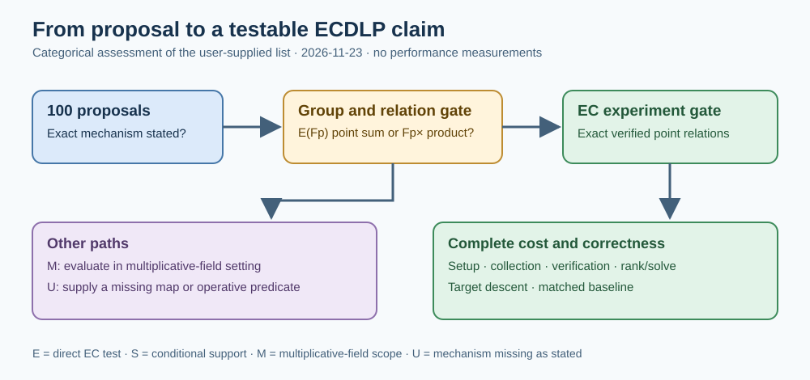

# One hundred prime-field index-calculus proposals: research ledger

Date: 2026-11-23. Source: the [100 numbered proposals](IDEAS.md) extracted from the user-supplied attachment. The repeated text after item 100 is excluded from the proposal set. This is a desk assessment; no curve, subgroup, target, or experimental run was selected. The item codes below classify the supplied descriptions and do not assert novelty.

The diagram shows the decision path. It is categorical, with no performance data. The canonical scoreboards and performance graphs were checked for applicability; this assessment adds no measured value or new curve edge, so they are unchanged.

## Scope and decision rule

The active research question here is ECDLP in the group of points **E(F_p)**. Several proposals instead address discrete logs in **F_p^×**, where integer or ideal smoothness can supply relations. A gain in that multiplicative group does not transfer to E(F_p) without an explicit map that preserves the required relation and whose construction and inversion costs are charged. For ECDLP, a useful relation must be an exactly checked identity such as `aP+bQ = P1+...+Pm`, with the right-hand points in the chosen factor base.

Codes: **E** = direct elliptic-curve experiment; **S** = supporting experiment conditional on a valid relation pipeline; **M** = principally multiplicative-field or NFS engineering; **U** = no usable mechanism as stated. These are assessments of the *descriptions supplied*, not impossibility results about every future variant. A status of S or M is not an ECDLP performance claim.

The minimum comparison for an E or S experiment is complete setup + relation collection + exact verification + rank/linear solve + target descent, against a tuned Pollard rho baseline on the same group and hardware. Preserve unsuccessful candidates and timeouts, not just successful relations. Report independent matrix rank and target coverage separately from raw relation count.

## Item-by-item assessment
### Items 1–25

| # | Code | Assessment and next check |
|---:|:---:|---|
| 1 | U | Tropical valuations on a finite field are trivial; define a relation-preserving lift first. |
| 2 | U | A p-adic lift or integral supplies no established smoothness predicate for EC points. |
| 3 | U | Hyperbolic distance has no specified link to factorization or point sums. |
| 4 | U | Blowing up a smooth projective line does not create EC group relations. |
| 5 | U | Arakelov height depends on an arithmetic lift; no relation generator is given. |
| 6 | U | PGL2 orbits generally do not preserve EC addition; prove an action on the actual curve and base. |
| 7 | U | Sheaf consistency can encode recorded relations but does not produce them. |
| 8 | S | CM may help on special curves; require an explicit transfer map, inverse, and total cost. |
| 9 | U | Knot analogies lack an algebraic map to exact finite-field relations. |
| 10 | U | Tate–Shafarevich obstructions do not provide smooth point decompositions. |
| 11 | U | A dual-space shortest vector would need known characters; those encode the unknown log. |
| 12 | S | Hecke coefficients need an explicit, efficient relation-preserving map to the chosen E. |
| 13 | S | Highly split Jacobian divisors matter only with certified E-to-J transfer and descent. |
| 14 | M | Lattice/Voronoi partitioning is a possible sieve optimization; boundary smoothness needs measurement. |
| 15 | U | Discrete smoothness has no defined ODE gradient or invariant. |
| 16 | S | Isogenies transport point groups; coordinate products are not point-sum relations. Test a certified path. |
| 17 | M | LLL can find small norms in multiplicative-field sieving but cannot guarantee smoothness. |
| 18 | U | Braid identities are not finite-field factorization identities. |
| 19 | U | A quasiperiodic tiling gives no demonstrated smoothness bias. |
| 20 | U | The trace formula has no stated bridge to the needed relation density. |
| 21 | M | Rational reconstruction can find small residues mod p; it does not decompose EC points. |
| 22 | U | No useful homomorphism to Iwasawa power series is specified. |
| 23 | U | The proposed cohomology obstruction is not a smoothness test. |
| 24 | E | Sparse resultants can implement Semaev elimination. Compare exact decompositions and cost with current F4/root-finding routes. |
| 25 | U | Arithmetic progressions alone do not imply dense smooth relations. |

### Items 26–50

| # | Code | Assessment and next check |
|---:|:---:|---|
| 26 | U | F_p has no proper subfield; an extension norm needs a costed transfer and useful splitting law. |
| 27 | S | A GNN could rank known candidates; compare verified yield per total cost with cheap arithmetic features. |
| 28 | S | A GAN needs exact relation verification and a disjoint-curve holdout. |
| 29 | S | Scheduling can be tested if interval yields vary; compare full cost with static and random scheduling. |
| 30 | S | Learned embeddings need predictive features that generalize across disjoint primes/curves. |
| 31 | S | A classifier may prioritize trial division but cannot replace exact verification. |
| 32 | U | Neural ODEs do not define smoothness dynamics. |
| 33 | S | Hyperbolic embedding is a version of #30; charge training and inference. |
| 34 | M | Galois orbit scheduling can help number-field sieving when automorphisms are explicit. |
| 35 | U | A persistent-homology cycle is not generally an exponent-vector dependency. |
| 36 | S | A topology-based stop rule must be checked against exact modular rank and solve success. |
| 37 | S | Distributed sheaf consistency should be benchmarked against joins plus checksums. |
| 38 | S | Mapper clusters require measured relation yield beyond random or standard partitioning. |
| 39 | S | Spectral partitioning may affect communication; measure full sparse solve and cut size. |
| 40 | S | Amplitude amplification needs a reversible affordable relation predicate and full quantum resources. |
| 41 | U | Quantum walk needs a defined graph, oracle, marked fraction, and hitting bound. |
| 42 | U | HHL returns an approximate quantum state, not the exact modular coefficients needed here. |
| 43 | U | VQE requires a costed exact encoding of relation search and verified outputs. |
| 44 | U | Adiabatic optimization has the same encoding and output gap as #43. |
| 45 | U | Clifford circuits alone specify no effective rank-preserving modular preconditioner. |
| 46 | U | Multiplication-operator phase information does not test integer smoothness. |
| 47 | S | Tensor-network contraction is testable only if measured exact modular bond width stays small. |
| 48 | U | An annealing objective must encode the exact relation predicate; none is supplied. |
| 49 | U | Analog memristive output needs exact modular recovery and verification. |
| 50 | U | Fluid or particle attraction has no defined smoothness-correlated feature. |

### Items 51–75

| # | Code | Assessment and next check |
|---:|:---:|---|
| 51 | U | Soliton alignment supplies no map to exact relations. |
| 52 | U | A spin-glass nullspace encoding needs exact decoding and a full cost advantage. |
| 53 | S | FPGA block Krylov operations are benchmarkable on real modular matrices, including transfers. |
| 54 | S | GPU queues: measure verified relations per second and joule with parsing and transfers included. |
| 55 | S | Tensor cores: prove limb arithmetic exact, then compare whole modular kernel with integer CUDA. |
| 56 | U | Optical approximate matvec needs exact modular reconstruction at competitive cost. |
| 57 | S | HBM layout: profile real sparse matrices and compare complete block-solver time. |
| 58 | S | PIM needs accessible hardware and a specified exact operation before cost comparison. |
| 59 | U | Spiking outputs have no defined exact relation predicate. |
| 60 | S | Direct storage helps only if measured I/O is limiting; profile before prototyping. |
| 61 | S | Peer distribution is an operations design; compare verified throughput and network overhead. |
| 62 | S | Direct arithmetic usually verifies a submitted relation; require a real secrecy need for ZK. |
| 63 | S | MPC requires a defined private input and charged communication for exact sparse solving. |
| 64 | S | FHE requires a secrecy requirement and a measured exact predicate cost. |
| 65 | S | Content addressing aids integrity and replication; compare read latency/cost with object storage. |
| 66 | S | Federated tuning must beat centralized tuning in total cost and verified yield. |
| 67 | S | Serverless workers need a cost comparison including starts, transfer, and idle time. |
| 68 | U | Belief propagation is approximate; an exact F_n kernel is still required. |
| 69 | U | Candidate residues are not sparse linear measurements of unknown factor exponents. |
| 70 | U | Polar-channel labels supply no relation-yield or rank theorem. |
| 71 | U | A CVP encoding does not make missing exact relations efficiently findable. |
| 72 | U | Prime bitwise Hamming distance does not control smoothness probability. |
| 73 | S | Error/erasure decoding can repair records only with explicit redundancy; test masked records. |
| 74 | U | Generic sieve records lack the cyclic structure assumed by BCH decoding. |
| 75 | S | Hypergraph filtering can combine partial point relations; measure verified full rows and rank per cost. |

### Items 76–100

| # | Code | Assessment and next check |
|---:|:---:|---|
| 76 | S | Exact matroid/rank filtering can remove redundant rows; compare full solve time and RHS preservation. |
| 77 | S | Max-cut may increase cross-partition traffic; compare with standard graph partitioners. |
| 78 | M | A prime-factor spanning tree does not guide EC point decomposition as stated. |
| 79 | S | Message passing needs disjoint-curve validation and a full-cost arithmetic baseline. |
| 80 | U | De Bruijn substring coverage does not imply unique residues or smoothness bias. |
| 81 | U | No continuous labeled simplex meeting Sperner's hypotheses is supplied. |
| 82 | S | Matching after factoring must beat direct filtering while preserving rank. |
| 83 | U | Real randomized SVD does not preserve finite-field rank/kernel. |
| 84 | S | Exact connected components and separators may localize solve; measure the giant core and full solve. |
| 85 | U | ADMM solves continuous optimization, not exact finite-field equations. |
| 86 | U | Real/complex Arnoldi eigenvalues do not give the finite-field kernel. |
| 87 | U | Chebyshev spectral ordering has no direct analogue over a finite field. |
| 88 | U | Conjugate gradient/Jacobi assumptions do not fit the exact modular system. |
| 89 | U | Nonlinear feature maps do not preserve the required linear dependencies. |
| 90 | U | Generic sparse matrices lack the structured long-range kernel needed for FMM. |
| 91 | M | NFS/FFS relations are not automatically composable, and neither supplies EC relations. |
| 92 | U | Approximate holographic vectors cannot certify exact modular relations. |
| 93 | U | Field extension does not turn E(F_p) DLP into F_(p^k)^× DLP; pairing transfer has conditions. |
| 94 | M | Residue slicing is standard sieve engineering; compare with segmented/multimodular baselines. |
| 95 | U | No lattice map from short vectors to EC relations is defined. |
| 96 | S | Factor-base resizing is measurable; charge collection, matrix width, rank, and target descent. |
| 97 | S | Interval autotuning is measurable; compare tuned fixed intervals with complete wall time. |
| 98 | S | Dropping primes can lose coverage; require exact rank, retained records, and target descent. |
| 99 | M | MCMC needs a cheap smoothness-correlated score and mixing; compare with a conventional sieve. |
| 100 | S | Entropy selection needs features available before collection; compare rank per cost with frequency rules. |

## First parallel experiments worth running

1. **#24, decomposition engine.** This is an extension of existing dense Semaev resultant and line-resultant code, not a newly identified method. The local [technique inventory](../../docs/ic/ECDLP_RESEARCH_TECHNIQUES.md) records dense `S₄`/`S₅` construction, a line-resultant oracle on extension fields, and a Newton-polytope fullness check; [KN-OPEN-004](https://github.com/isogeny-labs/crypto-autoresearcher/blob/main/knowledge/open-problems/KN-OPEN-004.md) asks whether sparse support changes prime-field elimination cost. Freeze curve, subgroup, factor base, targets, and arity. Compare exact decompositions and full relation cost with current root-finding/F4 methods, retaining failures and target descent.
2. **#75 + #76 + #84, relation matrix.** The repository already has an [integrated multi-large-prime hypergraph filter](../../src/cryptanalysis/large_prime_filter.rs), CADO-style filtering, and block Wiedemann; #75 is a controlled evaluation or collector-adapter task, not a new filter. Take one immutable set of exactly checked full and partial EC relations. Compare existing filtering with rank-aware and separator-based variants. Preserve row witnesses and RHS. Report rank, matrix width, nonzeros, memory, and total modular solve time.
3. **#96 + #97, parameter control.** On disjoint frozen instances, compare static factor-base sizes and intervals with an adaptive controller. Include tuning overhead and target coverage. Treat #29/#66 as extensions only if simple controls leave reproducible heterogeneous yield to exploit.
4. **#54/#55/#57, hardware.** Profile an existing end-to-end bottleneck first, then benchmark exact GPU kernels on representative workloads. Include device transfer, parsing, reduction/carry correction, and verification. Hardware throughput without a valid EC relation source is a component result.

These experiments can run concurrently on distinct immutable input sets and separate worktrees. Shared curve/target manifests and a common cost schema are prerequisites for comparing their outcomes. The mathematical gate for any proposal is an exact relation map and the cost of obtaining it.

## Grounding

- [Semaev, *Summation Polynomials and the Discrete Logarithm Problem on Elliptic Curves*](https://eprint.iacr.org/2004/031.pdf): point decomposition and resultant construction.
- [Petit, Kosters and Messeng, *Algebraic approaches for the Elliptic Curve Discrete Logarithm Problem over Prime Fields*](https://www.iacr.org/archive/pkc2016/96140156/96140156.pdf): prime-field algebraic approaches.
- [Technique inventory](../../docs/ic/ECDLP_RESEARCH_TECHNIQUES.md), especially prime-field Semaev specifics and the integrated large-prime filter. Its implementation status is a current-checkout observation, not a performance claim.
- Sources checked (KB): `paper:1cab0ae675996cdba6393b1e369a22113fd2e74bcf1223595743dc140631c7d6` (`research-pdfs:files/semaev-2004-031.pdf`) established the summation-polynomial relation; `source:a9212eb47b2dee6ab0db114f8b9c40a4` (`crypto-autoresearcher:knowledge/open-problems/KN-OPEN-004.md`) made #24 a follow-up to a recorded sparse-elimination question; `source:4548c0e85d47f9299ddc900c047c266d` (`crypto:docs/ic/ECDLP_RESEARCH_TECHNIQUES.md`) corrected #75 from a proposed new filter to an integrated component. KB revision `752f945c662745959e4516205d027b5e` was last refreshed 2026-11-22, so the checked local files govern implementation status.

This document records proposed experiments, not experimental results.
