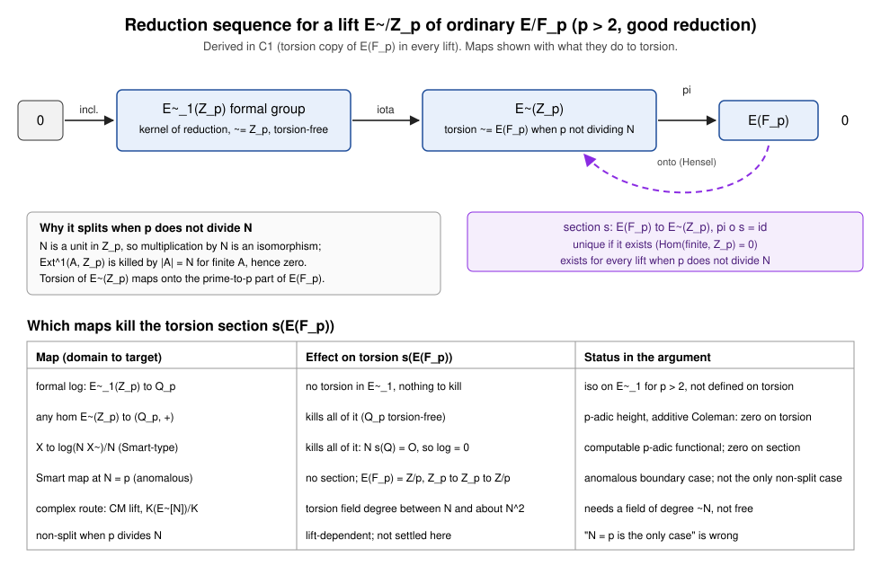

# C1: the torsion copy of E(F_p) in every lift

Lead C1 of `research/notes/ecdlp-general/RESEARCH_PRIME_FIELD_LEADS_20261031.md`, pre-registered in
`research/prime_field_leads_20261031/PLAN.md`. Decision: **closes** (the atlas statement needed a
strengthening; see Section 4). No experiment was run; this is a derivation with a diagram.
Metrics: none measured. No wall-time claim is made.

Status labels: the splitting argument is **derived** here; the Smart-case and P256 comparisons are
**derived from the cited notes and code**; nothing is **independently verified** by a run.

## 1. The two paragraphs for the L1 note

**Splitting on every lift.** Let p > 2, let E/F_p be ordinary, let N = #E(F_p), and let Ẽ/Z_p be any
smooth (good-reduction) lift of E. Reduction gives an exact sequence of abelian groups
0 → Ẽ₁(Z_p) → Ẽ(Z_p) → E(F_p) → 0, where Ẽ₁(Z_p) is the kernel of reduction and surjectivity is Hensel's
lemma on the smooth model. For p > 2 the formal logarithm is a group isomorphism Ẽ₁(pZ_p) ≅ pZ_p ≅ Z_p,
so Ẽ₁(Z_p) is torsion-free (the step needs e = 1 < p − 1, which is p > 2; for p = 2 it can fail).
If p ∤ N, then E(F_p) is finite of order prime to p, so Ext¹(E(F_p), Z_p) is killed by |E(F_p)| = N,
which is a unit in Z_p, hence Ext¹ = 0 and the sequence splits for every lift. The splitting is a
unique homomorphism s: E(F_p) → Ẽ(Z_p) with π∘s = id: uniqueness holds because a difference of two
sections is a homomorphism from a finite group to the torsion-free group Z_p, hence zero. Its image is
Ẽ(Z_p)_tors, which maps isomorphically onto E(F_p). So each lift carries its own homomorphic copy of
E(F_p) inside Ẽ(Z_p). The Serre–Tate canonical lift adds CM and algebraicity, but the copy itself does
not depend on the lift being canonical: it exists on every lift when p ∤ N, and different lifts give
different copies.

**Why no homomorphism to Q_p sees it.** Q_p with addition is torsion-free, so every group homomorphism
Ẽ(Z_p) → (Q_p, +) (p-adic height, an additive Coleman-type functional) vanishes on the finite group
s(E(F_p)). The formal logarithm is defined on Ẽ₁ only, where there is no torsion; its usable extension to
the whole group is the Smart-type functional X ↦ log(N·X̃)/N. For X̃ = s(Q) one has N·s(Q) = s(NQ) = O,
so this functional is identically zero on the torsion section, for every lift. The complex route does not
supply the torsion for free either: for a CM lift, the field generated over K by a point of exact order N
has degree between about N and about |(O_K/N)^×| ~ N² (not "about N" uniformly; the claim in the lead
text should read N^{1 to 2}). The Smart case is a boundary of the argument, not its only failure: when
p | N the sequence need not split, the failure depends on the lift, and this was not settled here. For
N = p (anomalous) the p-part is all of E(F_p) ≅ Z/p, and for torsion-free lifts Z_p → Z_p → Z/p is
non-split. Hence "N = p is the one case where the sequence does not split" is not correct as stated.

## 2. Step-by-step check

| Step | Claim | Check | Hypothesis needed |
|---|---|---|---|
| Hensel | π: Ẽ(Z_p) → E(F_p) onto | smooth proper model | good reduction |
| Ẽ₁ torsion-free | Ẽ₁(Z_p) ≅ Z_p | formal log iso on pZ_p | p > 2 |
| Ext vanishing | sequence splits when p ∤ N | Ext¹(A, Z_p) killed by |A| | p ∤ N, A finite |
| Uniqueness | at most one homomorphic section | Hom(finite, Z_p) = 0 | none beyond finiteness |
| "Canonical" | copy is canonical | unique given the lift; varies with lift | drop "canonical" |
| Torsion kills | any hom to Q_p kills torsion | Q_p torsion-free | none |
| Smart-type | X ↦ log(N X̃)/N zero on section | N s(Q) = O | none |
| Non-split | "only N = p" | fails: non-split whenever p | N, lift-dependent | corrected |

Corrections to the lead text: (i) "canonical homomorphic copy" should be "unique homomorphic copy per
lift"; (ii) "the one case N = p" should be "p | N, lift-dependent; N = p is the anomalous instance";
(iii) "p ∤ N" is the hypothesis for splitting on every lift; "ordinary" is not enough, since
p | N is possible for ordinary curves (N ≡ 0 mod p iff t ≡ 1 mod p).

## 3. Cross-check against the cm_canonical_lift falsification (RESEARCH_P256.md)

Agreement on the bottom line: a torsion-section lift gives no signal. RESEARCH_P256.md (around
lines 456–460) says the torsion-lift case has T = 0 and [n]·P̂ = 0, which kills the signal. This is
consistent with s(E(F_p)) being homomorphic and with the functional above vanishing on it.

Disagreements (both are wording and scope, not a contradicted result):
1. RESEARCH_P256.md line 302 says forcing T = 0 "would need to lift P and Q as canonical lifts". Our
   argument gives T = 0 on the torsion section for every lift of the curve when p ∤ N. The requirement is
   the choice of section, not canonicity of the lift.
2. RESEARCH_P256.md says the noise term n·log_F(T) "is a unit mod p for any choice of lifts". The code
   (`src/cryptanalysis/cm_canonical_lift.rs` lines 38–43) states this conditionally: noise is a unit when
   v_p(log_F T) = 1, a generic conjecture, and is negligible otherwise. Since T ∈ Ẽ₁ and log_F(T) ∈ pZ_p,
   the valuation is at least 1 always; the "any lift" unit claim therefore needs the valuation-1 hypothesis.
3. Both the torsion section (T = 0 exactly) and the formal-log-ratio relation kill the signal by different
   mechanisms; the note does not separate them. The C1 argument separates them.

## 4. Atlas

`LEAD-TRF-padic-canonical-section` obstruction statement: the theorem line does not say "holds for every
lift"; its scope line says "all lifts of E", but the theorem itself does not. The phrase
"holds for every lift, not only the canonical one" is absent, and the statement is silent on p | N.
Hence the strengthening is needed and the decision is **closes** (a card edit proposed, not made).
Proposed edit is in `atlas_update.md`.

## 5. Diagram

`sequence_torsion.svg` shows the exact sequence with the splitting condition, the section s, and a table
of which maps kill s(E(F_p)). Source is the SVG itself (hand-written, no data file: no quantities are
plotted). `REPORT.pdf` is built from this file with pandoc and typst (see Section 6).

## 6. Rendering and limits

- The worktree symlink `.claude/skills/research-visuals` points to `.agents/skills/research-visuals`, which
  does not exist in this worktree (broken link). The available copy
  (`/Volumes/SSD990-2/wt-c866/.agents/skills/research-visuals/SKILL.md`) has no "Rendering" section; it
  names Pandoc, Typst or LaTeX for the PDF. Pandoc with typst was used; `pdflatex` is not installed.
- No experiment ran. No counted metric is reported. No speedup or exponent change is claimed.
- The CLAUDE.md session-log rule (`docs/session-logs/YYYY-MM-DD.md`) was not followed because this
  lead's write scope is limited to its output directory and `atlas_update.md`. The synthesis step should
  record it.
- Not checked: the p = 2 case beyond noting failure; the exact criterion for splitting when p | N; any
  lift-dependent computation of the Ext class.

## Reading

The lead's splitting claim holds on every lift once p > 2 and p ∤ N, and the reason is algebraic (Ext
vanishing and Hom to a torsion-free group), not canonicity. The corrected Smart boundary is p | N, not N = p
alone. The P256 note agrees on the outcome but ties T = 0 to canonical lifts and states a unit-noise claim
more broadly than the code's conditional does.
