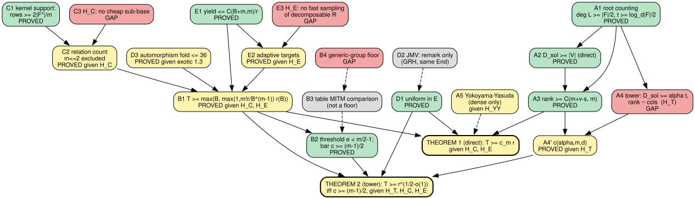
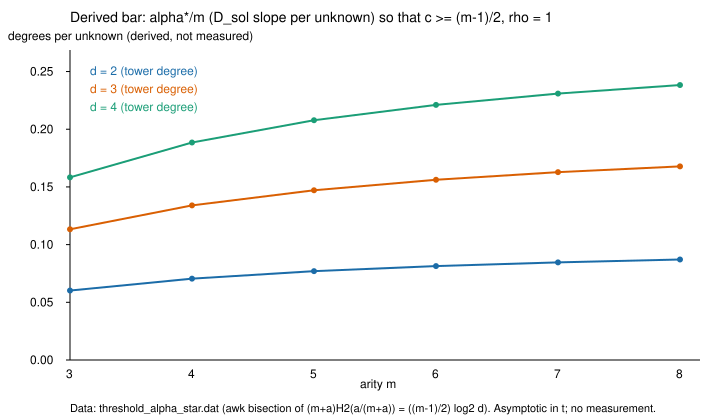

# L1: conditional lower bound for algebraic index calculus over F_p (theorem draft)

Date 2026-10-31. Kind: derivation, no experiment. Full text:
`research/notes/ecdlp-general/RESEARCH_ALGEBRAIC_IC_LOWER_BOUND.md`.
Status labels: P = PROVED, Pg = PROVED given a named hypothesis, G = GAP.

## What closed

- **A1** (P): deg L >= |F|/2 (root counting, not Bezout); tower has t >= log_d(|F|/2) levels
- **A2, A3** (P): direct presentation: D_sol >= |V|, rank >= C(m+v-s, m)
- **A4** (**G**): tower: `D_sol >= alpha t` and `rank ~ cols` (H_T)
- **A4'** (Pg (H_T)): `c = rho (m+alpha) H2(alpha/(m+alpha))/log2 d`
- **A5** (remark): Yokoyama-Yasuda covers the dense system only, under its Conjecture 10; not towers
- **B1** (Pg (H_C, H_E)): `T >= max(B, max(1, m! r/B^(m-1)) r(B))`
- **B2** (P): threshold `e < m/2 - 1` at `B = r^(1/m)`; over all B the bar is `c >= (m-1)/2`
- **B3** (comparison): table MITM comparison: `r^(1/2+1/m)` even m, `r^(1/2+1/(2m))` odd m (lead-note formula conservative for odd m)
- **B4** (**G**): generic-group floor matching B3
- **C1, C2** (P / Pg H_C): rows >= 2|F*|/m; m <= 2 excluded by relation count
- **C3** (**G**): no cheap proper sub-base (H_C)
- **D1** (P): all lemmas uniform in E, so CM-panel / volcano variants are covered without transfer
- **D2** (remark): JMV is GRH + same End only; large-prime conductor gap open; not used
- **D3** (Pg (exotic 1.3)): automorphism fold changes the bound by at most 36
- **E1** (P): yield `<= C(B+m,m)/r` for any base, uniform target (the direction a lower bound needs)
- **E3** (**G**): adaptive target selection (H_E)

Theorem 1 (direct presentation): `T >= c_m r`, given H_C and H_E. Theorem 2 (tower):
`T >= r^(1/2-o(1))` iff `c >= (m-1)/2`, given H_T, H_C, H_E. So the brief's
statement "`>= p^(1/2-o(1))` for every m" is reduced to H_T, not proved.

## Corrections to the task's framing (observations)

* (e) as stated (equality with `(1+o(1))`) is not what a lower bound needs; the
  upper bound on yield is exact double counting (E1). The equality is C4's
  conjecture and only affects tightness.
* (a) "Bezout" is root counting; the per-attempt cost is rank, and the tower case
  has no proved growing lower bound on `D_sol`.
* (d) JMV does not give uniformity over a whole isogeny class; D1 avoids needing it.
* The sufficient bar is `c >= (m-1)/2` (worst case `B = r^(1/(m-1))`), stricter than
  the `m/2 - 1` of the single point `B = r^(1/m)`.

## Derived values (not measured)

`threshold_alpha_star.dat`: slope bar `alpha*` (and per unknown) for d = 2, 3, 4,
m = 3..8; for d = 2 the bar is 0.060 to 0.087 degrees per unknown. Quoted
repository slopes (measured elsewhere, few noisy cells, `N <= 20`) are of the same order.
No claim is made about whether they persist or whether rank equals columns.

## Graphs

* `proof_dependency.svg` (source `proof_dependency.dot`): proof dependency graph,
  green = PROVED, yellow = PROVED given H, red = GAP, grey = remark / comparison.
* `threshold_bar.svg` (data `threshold_alpha_star.dat`): derived bar vs arity.

## Attempted cells

None run (no experiment). Not attempted: a rank (as opposed to column) count
for any tower system; reading `prime_fall_degree_20261027/DERIVED.md` (absent from
this worktree and from `/Volumes/SSD990-2/crypto`); re-reading CHW 2026/384 and
DKM 2025/783 (cited through the atlas card only).

## Reading

Within the model the dense presentation is closed (cost `Omega(r)` given two
bookkeeping hypotheses); the tower presentation is closed exactly when its solving-degree
slope clears an explicit bar, which no record here proves or refutes.

## Rendering

`.claude/skills/research-visuals` is a dangling symlink in this worktree
(`../../.agents/skills/research-visuals` does not exist); the skill text was read from
`/Volumes/SSD990-2/wt-fb-quasi/.agents/skills/research-visuals/SKILL.md`. PDF built
with pandoc + Typst (`/opt/homebrew/bin`) into this directory, not via the skill's
/tmp venv (disk rule). Result: see `REPORT.pdf`.
