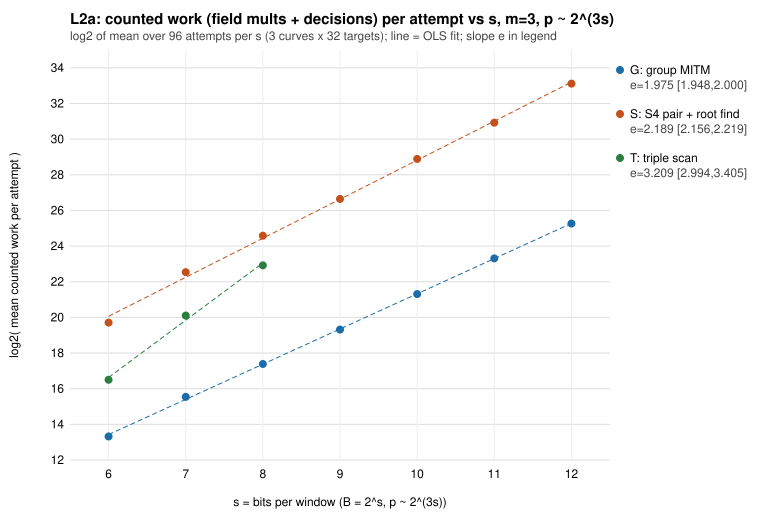
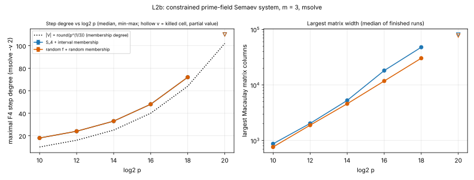
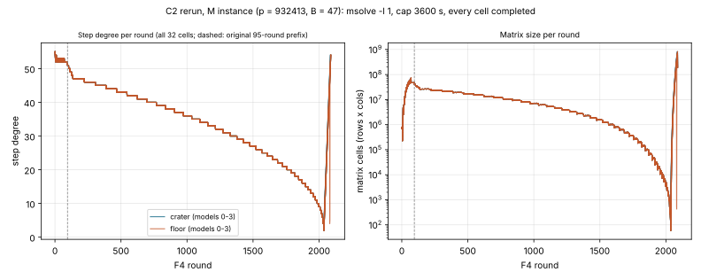

# Prime-field leads 20261031: reruns of L2a, L2b and C2 (msolve leg)

**Date.** 2026-11-01. **Plan.** `RERUN_PLAN.md`, frozen before any data, with
amendments A1 to A5 and deviation D1. **Execution.** Four task cards compiled by the
experiment-director tier (`cards/`), each run with `tools/task_card.py run` from a
checkout detached at the pinned commit; receipts in `receipts/`. The director's
assessment (`ASSESSMENT.md`) classifies all four as executed as specified: every
command exit 0 inside its timeout, every receipt digest and declared output
present, branch copies byte-identical to the run outputs. `RERUN_PLAN.md` gained
deviation D1 after the runs, so its digest on the branch no longer matches the one
the cards bind; the runs used the bound version. **Host.** One cloud
container, 4 vCPU x86-64, 15 GiB, no other workload. All metrics are counted
(field multiplications, F4 step degrees, matrix sizes, round counts); wall time
appears only as the kill caps. No speedup, exponent change or scoreboard change is
claimed.

## Outcome

| Lead | Before this rerun | Now | Decision (frozen rule) |
|---|---|---|---|
| L2a | partial, s = 6..11 | complete, s = 6..12, every attempt inside the guard | does not reopen; G closes (e = 1.97 [1.95, 2.00]); S at 2.19 [2.16, 2.22], above 2 |
| L2b | 1 ladder cell, no decision | 70 cells, 68 completed | null_confirmed: trajectory ratio 4.00 (real) and 4.00 (control) |
| C2, msolve leg on M | 5 of 16 cells completed, prefix comparison | 16 of 16 completed (plus 16 extra cells) | not separated at completion and on the 95-round prefix: C2 stays null_confirmed |

## Instrument parity (stage 0)

The original host ran Homebrew msolve of unrecorded version on macOS arm64. This host
runs msolve 0.6.5 (Ubuntu package). Building a newer msolve from source was refused
by the session's permission policy.

| Check | Cells | Result |
|---|---|---|
| First P1 attempt, default kernel (`attempt1_msolve065_l2/`) | 32 C2 S cells | every cell segfaulted in its first F4 round (characteristic 105037 > 2^16) |
| First P2 attempt, default kernel | 3 L2b probes (p < 2^16) | identical to the original in every column |
| P1 with `-l 1` (amendment A5) | 32 C2 S cells | rounds, maximal degree, largest matrix and summed cells identical to the original; all 32 reduced bases identical |
| P2 with `-l 1` | 3 L2b probes | identical in every column |
| C2 M reproduction (stage 2) | 16 original M records | identical over every round the original recorded (5 completed, 11 cut at 420 s) |
| L2b ladder reproduction (stage 1) | 1 original ladder cell (p = 65521, control, seeds 1/1) | identical |
| L2a reproduction (stage 3) | 45 committed per-(arm, class, s) rows, s = 6..11 | identical (attempt counts, mean work, mean pairs, multiplications per pair) |

So the instrument here is the instrument of the original run, to every recorded digit.

## L2a: slope e of counted work per attempt at m = 3 (s = 6..12)

Harness `../L2a_slope_e_m3/src/l2a.rs`, seeds unchanged; 3 curves × 32 targets per s;
arms G (group meet-in-the-middle), S (algebraic S₄ root finding), T (triple scan,
s ≤ 8). Fit `../L2a_slope_e_m3/src/stats.rs`: OLS of log₂ mean work on s,
hierarchical bootstrap (curves, then attempts), 4000 replicates. Files: `L2a/attempts.csv`,
`L2a/results/fit.csv`, `L2a/results/per_s_means.csv`, graph `L2a/results/L2a_work_vs_s.svg`.

| s | log₂ p | G mean work | S mean work | S multiplications per pair |
|---|---|---|---|---|
| 6 | 18.66 | 1.02·10⁴ | 8.56·10⁵ | 2143 |
| 7 | 21.54 | 4.77·10⁴ | 6.09·10⁶ | 2832 |
| 8 | 24.86 | 1.71·10⁵ | 2.51·10⁷ | 3118 |
| 9 | 27.19 | 6.53·10⁵ | 1.05·10⁸ | 3341 |
| 10 | 30.42 | 2.60·10⁶ | 4.97·10⁸ | 3992 |
| 11 | 33.38 | 1.04·10⁷ | 2.04·10⁹ | 4037 |
| 12 | 36.68 | 4.03·10⁷ | 9.29·10⁹ | 4804 |

| Arm | Class | Points | e | 95 % interval |
|---|---|---|---|---|
| G | all | 7 | 1.97 | [1.95, 2.00] |
| G | satisfiable | 7 | 1.98 | [1.82, 2.22] |
| G | unsatisfiable | 7 | 1.97 | [1.94, 2.00] |
| S | all | 7 | 2.19 | [2.16, 2.22] |
| S | satisfiable | 7 | 2.18 | [2.02, 2.43] |
| S | unsatisfiable | 7 | 2.19 | [2.15, 2.21] |
| T | all | 3 | 3.21 | [2.99, 3.40] |

Attempts: 672 G, 672 S, 288 T, all `OK`; no target was cut by the 20-minute guard
(the longest cell, S at s = 12, curve 1, took 621 s). With s = 12 added, the intervals
moved by at most 0.02 from the s = 6..11 values reported earlier
(G 1.98 [1.94, 2.01], S 2.21 [2.16, 2.24]).

**Decision.** Reopen needs an interval entirely below 0.5: not met on any arm or
class. Close needs an interval containing 2: met for G (all and unsatisfiable;
satisfiable [1.82, 2.22] too). S lies above 2 and is recorded as observed. Null
prediction e ≥ 1: met everywhere.

## L2b: d_reg trajectory of the constrained prime-field Semaev system (catalogue M008)

Ladder exactly as `../L2b_dreg_trajectory/run_ladder.sh` lists it (amendment A2: long
cells 2 in parallel, short cells 4 in parallel, cap 1500 s and 6 GiB per run). Files:
`L2b/results/cells.csv` (one row per cell; header in
`../L2b_dreg_trajectory/results_header.txt`), `L2b/results/summary.csv`,
`L2b/results/instances.jsonl`, gzipped msolve logs in `L2b/work/`; graph
`L2b/dreg_vs_log2p.svg`.

| p | log₂ p | N | arm | runs | completed | median max degree | median widest matrix | median total rows | rounds (range) |
|---|---|---|---|---|---|---|---|---|---|
| 1021 | 10.0 | 10 | real | 8 | 8 | 18 | 867 × 872 | 10191 | 101–104 |
| 1021 | 10.0 | 10 | control | 8 | 8 | 18 | 725 × 764 | 8078 | 23–37 |
| 4093 | 12.0 | 16 | real | 8 | 8 | 24 | 2059 × 2033 | 39534 | 252–274 |
| 4093 | 12.0 | 16 | control | 8 | 8 | 24 | 1844 × 1890 | 24235 | 35–55 |
| 16381 | 14.0 | 25 | real | 8 | 8 | 33 | 3413 × 5267 | 146060 | 557–588 |
| 16381 | 14.0 | 25 | control | 8 | 8 | 33 | 4480 × 4587 | 78402 | 53–84 |
| 65521 | 16.0 | 40 | real | 8 | 8 | 48 | 18227 × 18181 | 1449769 | 1584–1630 |
| 65521 | 16.0 | 40 | control | 8 | 8 | 48 | 11744 × 11790 | 287213 | 83–126 |
| 262139 | 18.0 | 64 | real | 2 | 2 | 72 | 35553 × 47832 | 9.95·10⁶ | 4068–4135 |
| 262139 | 18.0 | 64 | control | 2 | 2 | 72 | 7223 × 30330 | 4.60·10⁵ | 131 |
| 1048573 | 20.0 | 102 | real | 1 | 0 (cap 1500 s) | 110 reached | 18822 × 81222 reached | 2.64·10⁷ reached | 2211 at kill |
| 1048573 | 20.0 | 102 | control | 1 | 0 (cap 1500 s) | 110 reached | 15794 × 77355 reached | 1.24·10⁶ reached | 119 at kill |

**Decision (PREREG.md).** Largest p where both arms completed every run: 262139.
Trajectory ratio (median maximal degree there over the same at p = 1021):
real 72 / 18 = 4.00, control 72 / 18 = 4.00. The reopen clause (real < 1.5 while
control ≥ 2) is not met; the two ratios agree within 25 % (they are equal), so the
decision is **null_confirmed**. In every completed cell of either arm the maximal step
degree is N + 8, which `PREREG.md` said to expect from the membership polynomials.

**Observed, not decided.** The real arm does more F4 work than the control at every
rung, and the gap grows with p: the real-to-control ratio of median total rows is 1.26, 1.63, 1.86,
5.05 and 21.6 from p = 1021 to p = 262139, and the real arm takes about 3 to 31 times as many
rounds (median 104 against 37 at p = 1021, about 4100 against 131 at p = 262139). The interval-constrained S₄ system is harder for F4 than a random system of the
same shape, not easier. The two p = 1048573 cells were stopped by the time cap; no cell reached the 6 GiB
memory cap (peak memory was not recorded).

## C2: msolve leg on the M instance (crater against floor)

The 32 committed M inputs (`../C2_volcano/M/msolve/*.ms`, hashes in
`C2_M/inputs.sha256`), msolve `-l 1`, 4 threads, cap 3600 s (amendment A3). Files:
`C2_M/msolve_summary.csv`, `C2_M/msolve_trajectories.csv`, `C2_M/msolve/*.out`;
graph `C2_M/graph_msolve_trajectory.svg` (script `plot_c2m.py`, recorded values only).
The frozen rule uses the 16 cells of models 0 to 3; the 16 cells of models 4 to 7 ran
because the driver copied every committed input (deviation D1) and enter no decision.

| Cells | Side | Completed | Max step degree | Rounds | Summed matrix cells | Widest matrix (columns) |
|---|---|---|---|---|---|---|
| models 0–3 (decision) | crater | 8 / 8 | 55 in every cell | 2037–2089 | 2.06·10¹⁰ – 2.78·10¹⁰ | 17380 – 28506 |
| models 0–3 (decision) | floor | 8 / 8 | 55 in every cell | 2037–2089 | 2.06·10¹⁰ – 2.78·10¹⁰ | 17380 – 28506 |
| models 4–7 (extra) | crater | 8 / 8 | 55 | 2037–2089 | 2.06·10¹⁰ – 2.78·10¹⁰ | 17380 – 28506 |
| models 4–7 (extra) | floor | 8 / 8 | 55 | 2037–2089 | 2.06·10¹⁰ – 2.78·10¹⁰ | 17380 – 28506 |

**Decision (frozen rule).** (a) Common prefix, as frozen: over the first 95 rounds the
summed matrix cells are 3079461630 in 15 of the 16 decision cells and 3079459926 in
crater_3_t1, maximal degree 55 in all, as originally reported. (b) At completion: every
crater cell and every floor cell has maximal step degree 55, and the round counts and
matrix profiles span the same ranges on both sides. No crater cell differs from every
floor cell by one degree, so the msolve leg is **not separated** under both readings.
With the counted-work leg unchanged (crater-to-floor ratio 0.9998 on M), C2 stays
**null_confirmed**, now with all 16 msolve cells completed instead of 5.

## Graphs

## Deviations and limits

- Route: not Iso Lab (`RERUN_PLAN.md`, "Host and route"). The resume checkpoint went
  to the branch, not S3; launches carried `CHECKPOINT_SKIP` with that reason.
- Execution tier: the main session ran the cards through the task-card tool instead
  of relaying them to the mechanical executor, whose background launch the checkpoint
  hook would refuse here. The tool, not a model, executed every command.
- msolve kernel `-l 1` throughout (A5); parity above shows it reproduces the original
  records on 35 + 16 + 1 cells.
- L2b memory cap 6 GiB instead of 16 GiB (A2); no cell reached it.
- C2 M ran 32 cells instead of 16 (D1); the extra 16 enter no decision.
- L2a: one prime per s and three curves per prime, as frozen; the SAT/SMT decomposers
  named in the lead text remain unmeasured.

## Reading

The three open cells of the round are closed in the direction the round predicted.
At m = 3 the counted cost per decomposition attempt grows as B² for the group
meet-in-the-middle and slightly faster for the algebraic S₄ arm, four times the
exponent that would beat rho. The constrained Semaev system's step degree tracks the
membership degree exactly as a random system's does, and F4 does more work on it than
on the random control. On one volcano the crater and floor curves give identical F4
profiles. None of this moves the index-calculus baseline. Distance remaining to rho at m = 3:
the measured slope is e ≈ 2.0 against the e < 0.5 that §2 of the leads note requires,
a gap of about 1.5 in e, unchanged by s = 12.
