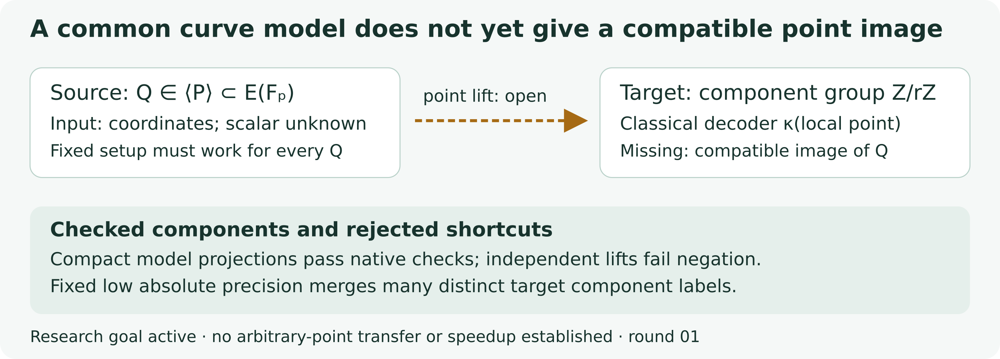
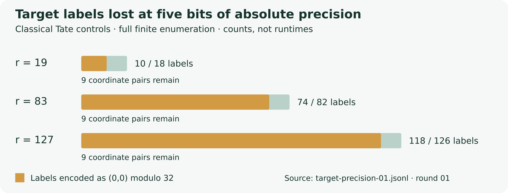

The goal is an efficient map from an arbitrary public point on a prime-field
curve to a demonstrably easier target, preserving the unknown scalar.
**That map has not been constructed; the goal remains active.** This round
checks one curve-model component and rejects two specific shortcuts.
[pcc:unverified]

{width=90%}

## A concrete incompatible pair

On the rational curve $y^2+xy=x^3-64x+288$, use $S=(4,8)$ and $T=(2,12)$.
Its split multiplicative component group at 2 is $\mathbf Z/5\mathbf Z$.
Cremona's consistent component labels are $\kappa(S)=2$, $\kappa(T)=1$.
At the good source prime 59, the group has 65 points and cofactor 13:

| Encoded source point | Independently lifted component label |
| --- | --- |
| $P=\operatorname{red}_{59}([13]S)=(11,28)$ | $1$ |
| $Q=\operatorname{red}_{59}([13]T)=(11,20)=-P$ | $3$ |

Both source points have order five. A homomorphism sending $P$ to $1$ must
send $Q$ to $-1=4$, so these labels fail. The exact rational kernel witness
$U=[13](T-[4]S)$ reduces to $O$ at 59 but has component label $4$.
Lean checks the literal source points, orders, negation and label
incompatibility. The component interpretation is a written argument using
the classical local map. [pcc:unverified]

## The model constructor is a separate component

For an odd source prime $p$ and public order $r$, store an integral model as
$A_1=1+2^{r+1}c_1$, $A_i=2^{r+1}c_i$ for $i=2,3,4$, and $A_6=2^r c_6$.
The small $c_i$ are chosen by modular arithmetic, with $c_6$ odd. The model
reduces to the specified source coefficients; its classical local type at 2
is split $I_r$. Its component quotient has order $r$, rather than being an
elliptic point group over $\mathbf F_2$. [pcc:unverified]

Checks cover three bounded models, six rejected mutations and one 256-bit
coefficient projection against OpenSSL. Expanding $2^r$ takes $r+1$ bits;
no point lift is provided.
[pcc:unverified]

\newpage

## Target precision must retain the component label

The next candidate would extract a label from a consistently selected torsion
branch. A fixed low-precision coordinate pair is insufficient for that target.
The separate classical Tate control has period $q=2^r$ and auditor parameters
$u=2^k$, $1\le k<r$. These are target-side known labels, never an evaluator
for unknown source scalars. [pcc:unverified]

{width=100%}

At absolute precision $N$, every label $N\le k\le r-N$ has both coordinates
zero modulo $2^N$. All nine predeclared native cases, $r\in\{19,83,127\}$ and
$N\in\{3,5,8\}$, match the predicted collision counts. The chart shows the
three $N=5$ cases. Every enumerated residue is also checked against the
reduced cubic. No runtime is measured. [pcc:unverified]

This rejects only fixed low absolute precision as a faithful encoding.
Valuations stored separately or a direct component-label extractor remain
open possibilities. A usable extractor must match the **same global torsion
branch and places for every input**, without reconstructing the scalar or
silently changing the target's orientation.

## Evidence and next obligation

The unchanged local Lean gate audits **16 theorems, zero failing, zero
trusted native exceptions**. The explicit axiom audit uses only the standard
foundations. Claim `PCC-20261116-a3e9e1` concerns the concrete label
incompatibility; `PCC-20261116-4d7a4e` and `PCC-20261116-3bd2b2` retain native
observations. All remain unsigned. The nodal polynomial identity has native
receipt `IDC1hcad63e1a0fbc75b5` and an exact Lean proof pointer; the issuer is
a producer check, not independent Rust replay. [pcc:unverified]

The next obligation is a component extractor over an actual torsion algebra
with source-branch data, followed by all-input orientation controls and
growing-order costs. A compact description of an algebraic root alone does
not implement its valuation at another prime. This round establishes no
novel efficient map, general impossibility theorem or practical attack.

Sources: [Cremona (2008), sections 1–2](https://johncremona.github.io/papers/component.pdf);
[Silverman's lifting framework](https://www.math.brown.edu/~jhs/Presentations/ECC4FacesOfLifts.pdf);
[Gaudry–Hess–Smart](https://www.kantmath.de/publications/papers/weil_descent.pdf);
the committed CT83–94 notes. Full sources, commands, raw receipts and proof
boundaries are in the study's [README](../README.md), [GOAL](../GOAL.md),
[proof map](../PROOF-MAP.md), and [receipts](../receipts/round-01/).
