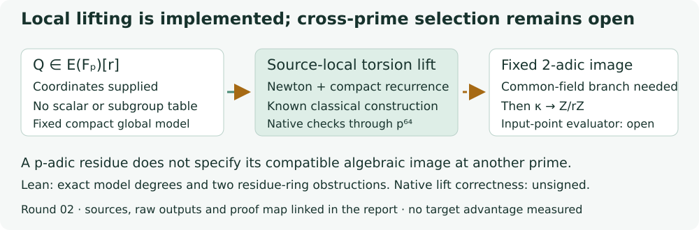
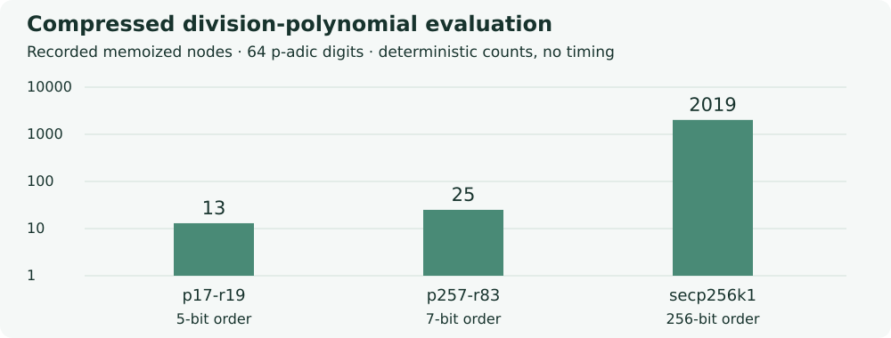

The native evaluator now lifts public source points to their unique local
r-torsion branch on the compact model, without the input scalar or subgroup
lookup. The full planned correctness suite completes. This is the classical
source-local lifting step; the same-point image at the second prime remains
the transfer obligation. **Scientific standing: unsigned**
PCC-20261116-391259. [pcc:unverified]

| Source / subgroup | Public inputs per precision | Digits N | Memoized nodes |
| --- | ---: | --- | ---: |
| F17, y²=x³+2x+2, r=19 | all 18 nonidentity points | 1,2,4,8,16,32,64 | 13 |
| F257, y²=x³+23x+11, r=83 | all 82 nonidentity points | 1,2,4,8,16,32,64 | 25 |
| secp256k1 | 4 hash-derived public points | 1,2,4,8,16,32,64 | 2019 |

The evaluator receives the fixed model, Q coordinates and N. GMP modular
exponentiation projects its symbolic coefficients, and a memoized classical
division recurrence propagates values and derivatives for Newton lifting.
The ordinate is selected by its source residue. Dense polynomials and the
secp256k1 global coefficients are never expanded. These are coverage and node
counts, not runtimes or attack-cost estimates. [pcc:unverified]

## Checks and mathematical scope

A separately implemented Jacobian group law checks r times each lift is O,
and checks four small multiplication formulas. All small-fixture scalar
relations pass. At 64 digits the four secp256k1 points pass negation and
addition of the fixed source generator. OpenSSL separately checks source
membership, order and addition. Scalar enumeration is restricted to the small
fixture auditor; the four secp256k1 inputs have no supplied generating scalar.
This is producer development evidence, not independently signed execution.
[pcc:unverified]

The written scalar-preservation argument is classical uniqueness of
prime-to-p torsion lifts: the good-reduction kernel has no r-torsion for
r≠p. Thus lifts of Q=[k]P satisfy the same relation in E(Qp). Implementing
that local lift does not specify the algebraic embedding at the second prime.

Lean applies existing Mathlib laws to the exact integral models and checks
division-polynomial degrees 180 and 3444. It also checks there is no unital
ring hom ZMod(17^64)→ZMod2 or ZMod(257^64)→ZMod2. The unchanged proof gate
passes 20 theorems, zero trusted native exceptions. Four explicit axiom
audits use standard foundations only. These endpoints formalize the degree
and residue-ring statements; the native Newton implementation and the
cross-prime bridge are not formally proved. Claims 75ba98,25851b,ec6bcb,
fe3335 carry the PCC-20261116 prefix and remain unsigned. [pcc:unverified]

## Failures and provenance retained

Launch01 failed before arithmetic because the read-only binary lacked
execute permission. Aggregate call02 and isolated secp256k1 call03 hit the
frozen 60-second timeout; call03 completed through 32 digits. The unchanged
suite completes when partitioned by public point, each still limited to
60 seconds. Distinct build/pre-call/post-call manifests and immutable
qualifier hashes preserve those failures. No independent preregistration,
cloud run, runtime comparison or leaderboard promotion is claimed.
[pcc:unverified]

The earlier small-degree restriction was already in CT95 and is reused.
CT124's two-prime chimera warning remains relevant: satisfying two local
root equations does not certify one global torsion point. The next candidate
must provide a common-field branch certificate and allow evaluation of the
oriented component label at the fixed second place without discovering k
first. No novel efficient transfer or demonstrated target advantage is
established by this round. [pcc:unverified]

## Evidence and sources

- [Full result and proof map](../round-02/RESULT.md),
  [protocol and source links](../round-02/PROTOCOL.md),
  [native source](../round-02/local_torsion.cpp),
  [raw receipts](../receipts/round-02/).
- Read CT85,95,97,123,124; Silverman, *Four Faces of Lifting*, pp.11–14;
  Cremona, *Computing in Component Groups*, §2; Sage division-polynomial
  documentation; pinned Mathlib4 v4.24.0 degree and characteristic laws.
- KB and Conductor unavailable; Rust workspace tests not run. Local native
  development only. No novelty/absence claim from the unavailable KB.
- PR4378 merged externally at 02:30:36Z (66d1727b4). A read-only audit
  finds both journal histories preserved, but the external resolution does
  not preserve the prior published ledger prefix. That historical issue is
  recorded, not repaired. This new round publishes from fresh main with
  unchanged claim files and a fresh prefix check. The goal remains active.
  [pcc:unverified]
