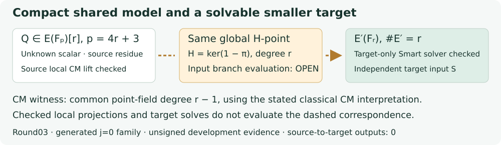
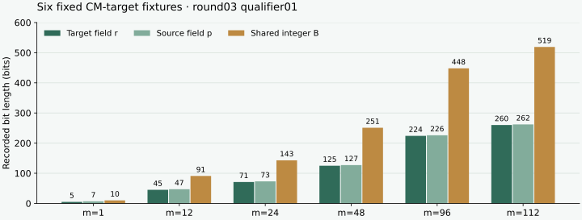

Six fixed development fixtures now have a compact shared integer model,
a source of order4r over Fp with p=4r+3, and an anomalous target of order r
over the smaller field Fr. A classical Smart solver recovers target-only
scalars and OpenSSL replays each answer. **Unsigned native claim
PCC-20261116-99cae8.** These are generated j=0 curves. [pcc:unverified]

Put u=d·2^m+1, b=2u−1, r=3u(u−1)+1. In Q(omega), omega²+omega+1=0,
pi=u+b·omega has norm r and trace1; alpha=1+2(1−pi) has norm p and
trace4. Choose the two sextic twists and an ordinary integer coefficient B
by CRT. The common model is y²=x³+B. The cover [1−pi] has proposed
kernel H of order r, with injective reductions at the selected source and
target primes under the classical CM interpretation.

All six declared bins complete, with subgroup sizes5,45,71,125,224,260
bits and source sizes7,47,73,127,226,262 bits. The largest B has519 bits.
No native bin is omitted, empty or timed out. This records correctness and
representation sizes, not scaling or performance evidence. [pcc:unverified]

## Common field and the missing evaluator

Each fixture has an auxiliary good split prime ell≤257 whose computed CM
Frobenius eigenvalue on H has exact order r−1. Exact small-field counts
and the full factorization of r−1 qualify the witness. Under the stated CM
identification, the Galois image is F_r^×, so every nonzero H-point
generates the same cyclic point field of degree r−1. The native witness is
arithmetic evidence; the full CM-to-Galois bridge is a written argument.
[pcc:unverified]

Fixed primes in that field define abstract scalar-preserving reductions.
The required evaluator must take an arbitrary encoded source Q and return
the residue of its **same** H-point at the target prime. The program does
not perform this operation: source-to-target outputs are0. Independent
local root checks do not select a common global point (CT124). Dense degree
is not itself a lower bound on compressed evaluation.

## Target solver and controls

Smart's classical map uses an r² lift and the formal parameter
lambda(P)=((-XZ/Y mod r²)/r) mod r of [r]P. It recovers k as a ratio of
target lambdas, without a supplied target scalar. The canonical j=0 lift
gives lambda=0 on all42 tested target inputs. The declared noncanonical
lift a4=r, a6=B gives a nonzero generator lambda in every case. OpenSSL
checks all24 public target answers and rejects k+1. Target addition also
respects lambda. [pcc:unverified]

One source/target CM contraction at p²/r² passes84 local projection checks.
There are42 checked points per side: four public inputs per bin and18
small-fixture auditor points. Public source points remain unmapped.
Native Pocklington and elliptic primality witness arithmetic is retained;
it is not a formally proved primality checker. [pcc:unverified]

## Lean, provenance and next step

Nine named Lean endpoints apply Mathlib norm/ring laws to the actual small
and large parameters, small orientations and two exact polynomial identities.
The unchanged proof gate audits33 theorems with zero trusted native
exceptions; explicit axioms use standard foundations. The endpoints do not
formalize CM Galois theory, the native solver or a transfer evaluator.
All nine claim IDs and statement bindings are in lean-claims-01.json;
standing is unsigned. [pcc:unverified]

Failed compiler/preparation attempts, immutable qualifiers and distinct
pre/post manifests are retained. No performance experiment, cloud spend,
independent execution proof or novelty claim. KB, Conductor and Cargo are
unavailable. Original round02 inputs and migrated PNGs are preserved.
PR4388 is merged and its monitor stopped; its external published-ledger
prefix discrepancy is recorded without repairing history. [pcc:unverified]

Next: evaluate the oriented common-field branch from Q, with source-relation
and chimera controls and complete field/selection/solve costs. Applicability
to arbitrary prime-field curves remains open.

**Evidence:** [full result and proof map](../round-03/RESULT.md),
[protocol and source links](../round-03/PROTOCOL.md),
[raw receipts](../receipts/round-03/). Primary sources: Leprévost et al.,
*Generating Anomalous Elliptic Curves*, §§2–4; Morain (1991), primality
criteria; Galbraith, chapter25, isogenies. Editable SVGs and recorded-data
plot source accompany this report.
