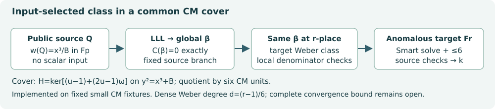
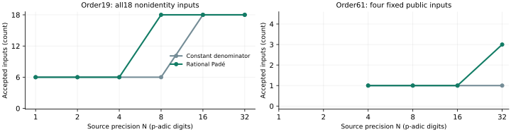

The evaluator now selects compatible **global** Weber roots from public
source coordinates. Rational Padé recognition transfers all18 nonidentity
order19 inputs from F79 to an anomalous F19 target at tested8/16/32 source
digits, and3/4 fixed public order61 inputs from F1531 to F61 at32 digits.
**Native claim PCC-20261116-fb2ab0, unsigned.** [pcc:unverified]

For u=3 or5, b=2u−1 and r=3u(u−1)+1. In K=Q(ω), ω²+ω+1=0,
the CM cover [(u−1)+bω] on y²=x³+B has kernel H of order r under the
written CM interpretation. Quotient its nonzero points by the six units
using w=x³/B. The common field is K[W]/C, degree d=(r−1)/6. Fixed primes
send the **same** formal W to the source and target generator classes.

| Completed model | Source / subgroup / cofactor | Weaker target | Dense degree |
| --- | --- | --- | --- |
| B659 | F79 /19 /4 | anomalous F19 |3|
| B2 | F1531 /61 /25 | anomalous F61 |10|

The recognizer takes model,Q,N only. It lifts w(Q), runs exact LLL on the
source congruence A(W)−w(Q)B(W), and accepts only a certified global root
β=A/B matching that source branch. It evaluates β at the fixed target
place, with local denominator cancellation where required. No source
scalar, point table or orbit label is supplied. [pcc:unverified]

Against the constant-denominator version, rational candidates improve the
observed order19 complete-coverage bin from16 to8 digits and order61 N32
coverage from1/4 to3/4. Untested precisions are not minimum-precision
results. The fourth order61 input remains unrecognized. [pcc:unverified]

## Exact certificate and scalar recovery

The actual order19 kernel is
C(W)=W³−(36+24ω)W²−48(1+ω)W+(-128+192ω)/19. Its reduction at7,ω=2
is the irreducible cubic W³+3W+5. Source roots are58,67,46; target roots
are2,14,17. One recognized root is
β=(16+44ω)/9−(175+20ω)W/9+(10−13ω)W²/36. Native exact division
displays C(β)=C(W)q(W). The Lean endpoint proves this polynomial identity
and its vanishing in the principal-ideal quotient. [pcc:unverified]

Under the written CM specialization argument, Q=[k]P selects the global
Weber class of [k]T, hence the target class w([k]R). Decompression gives a
target point S=[εk]R for one of six CM units ε. Smart's classical
anomalous-curve solver obtains εk; at most six source multiplications
recover k. Weber coordinates themselves are not additive. Every accepted
answer is checked with OpenSSL on the source and target. [pcc:unverified]

**Public example:** Q=(746,1002) over F1531 yields target Weber25 and
recovered scalar35 at N32. A second input (21,818) yields42 and57. These
scalars are outputs of target decoding, not inputs to recognition.
[pcc:unverified]

## Checks, retained limits and formal scope

Nine named Lean endpoints cover the two emitted global-root multiples,
their quotient vanishing and cleared identities, auxiliary irreducibility
and source/target factorizations. The unchanged gate audits55 theorems,
zero failing and zero trusted native exceptions; explicit axiom output
uses standard foundations only. Four final IDC1 component records each
accept32 samples and reject four mutations. Claim
**PCC-20261116-be69df, unsigned.** Full CM theory, oriented specialization
and native LLL/Smart correctness are not formalized. [pcc:unverified]

Controls reject a two-prime CRT chimera despite both local fits, a genuine
wrong global root at the source, conjugate orientation/pole, β+1 and k+1.
All16 qualification calls finish, including zero-acceptance calls. Of nine
setup calls across three preserved constructors, five produce models and
four time out at60seconds. No order127 model or public-point image is
reported. Compiler, issuer and Lean failures remain archived. Two large
compiler logs stay local with tracked hashes/excerpts under the artifact
policy. No PNG previews or direct data uploads are added. [pcc:unverified]

## Costs and next obligation

Charge kernel construction and fixture admission, p-adic precision,
LLL in dimension2d+2, global inversion/root checks, local evaluation,
target solving and source comparisons. These are local correctness
trials: no timing, scaling, strongest-tool or independent execution
comparison. The explicit field degree grows with r; it is an
implementation cost, not a lower bound on compressed evaluation.

The next obligation is a compact evaluator with a height/precision bound
and full costs, extending beyond the generated CM family. The original
arbitrary-curve goal remains open. This example uses established CM,
LLL and Smart methods; no novelty claim. KB, Conductor and Cargo are
unavailable. Mathlib4.24 is pinned to f897ebcf72cd16f89ab4577d0c826cd14afaafc7.

**Evidence:** [full construction, scalar argument and costs](../round-04/RESULT.md),
[protocol](../round-04/PROTOCOL.md), [six-field proof map](../round-04/PROOF-MAP.md),
[raw receipts and statement bindings](../receipts/round-04/).
Primary sources: Lenstra–Lenstra–Lovász1982 §§1–2;
Bourdon–Clark arXiv1612.03229; Lauter–Stange arXiv0803.0728;
FLINT3.3.1 polynomial-GCD source; repository CT84/115/116/119/124.
