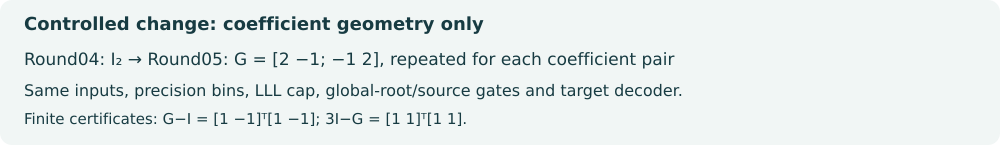
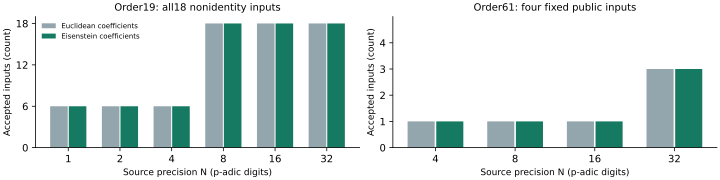

Replacing Euclidean coefficient geometry with the classical Eisenstein
metric gives **no observed coverage gain** in the fixed round04 bins.
All five declared calls finish with their global-root, source, target
and scalar controls intact. Native claim **PCC-20261116-fc5aeb is unsigned**.
This is a bounded local correctness trial, with no timing, performance or
novelty claim. [pcc:unverified]

For coefficient pairs (a,b),(c,d), the new bilinear form is
2ac−ad−bc+2bd. Exact Gram–Schmidt initialization and final recomputation
both use this metric; the original integer lattice, unimodular change
certificate, delta3/4,10000-step cap and reduced-basis-row inspection stay
the same. The core still receives model,Q,N only, with no source scalar,
subgroup lookup or orbit label. This change leaves the dense field degree
d=(r−1)/6 and lattice dimension2d+2 unchanged.

Order19 accepts6/18 at tested1/2/4 digits and18/18 at8/16/32. Order61
accepts1/4 public inputs at4/8/16 digits and3/4 at32. The same fourth
public input remains uncovered. Every call has the original60-second cap;
none times out. No order127 setup is repeated, and all earlier constructor
failures remain preserved. Do not infer minimum precision or untested input
coverage from these counts. [pcc:unverified]

Five new Lean endpoints concern the literal real2x2 matrix with rational entries:
its two displayed factorizations, their positive-semidefinite consequences
and positive definiteness. They apply existing Mathlib matrix laws. They
do not formalize native LLL, vector encoding, CM specialization, the target
solver or full scalar transfer. The first sources fail on a missing notation
scope and are archived unchanged; V4 explicitly imports the existing real star-order instance and writes the scalar matrix explicitly. Final axiom
and proof-gate records accompany the declaration bindings. [pcc:unverified]

The tested coverage is unchanged. In particular, a classical
norm/separation criterion for rejecting false relations is different from
an existence bound for a small representative of every input. Next is a
useful a priori representation-height/precision guarantee and a compact
evaluator, beyond tuning one uncovered fixture. The original arbitrary-curve
goal remains active.

**Evidence:** [protocol](../round-05/PROTOCOL.md),
[six-field instance gate](../round-05/PROOF-MAP.md),
[raw calls and claims](../receipts/round-05/), and
[round04 construction and scalar argument](../round-04/RESULT.md).
Prior art: original LLL1982 §§1–2 and repository CT84. KB/Conductor/Cargo
remain unavailable. Mathlib4.24 revision f897ebcf72cd16f89ab4577d0c826cd14afaafc7;
one Lake process, no limit overrides or native_decide. All86 older scientific
pins remain unchanged; no PNG or direct artifact upload is added.
