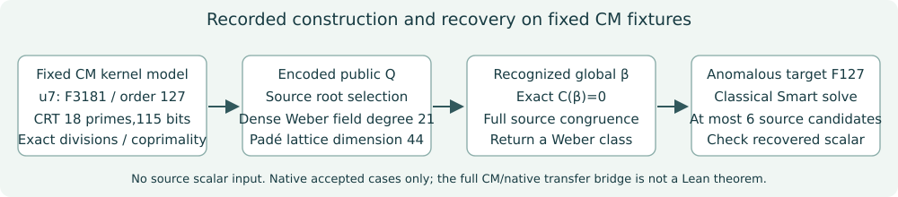
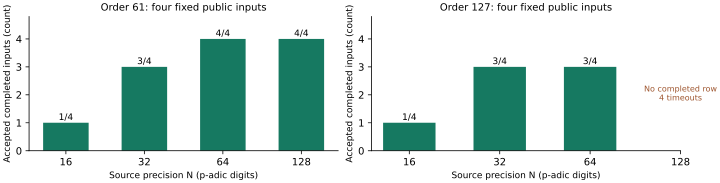

The classical modular constructor supplies the previously missing **order 127
Weber model**, with exact global divisions and a good-prime coprimality check
before acceptance. Fixed public-input qualification then recovers **4/4
order 61 scalars at64/128 digits and3/4 order 127 scalars at32/64 digits**.
Constructor claim **PCC-20261116-37e825** and public claim
**PCC-20261116-e0d875** are unsigned. [pcc:unverified]

The new generated model is y²=x³+B with shared integer B=264925:
source F3181 has reduced coefficient 902 and subgroup order 127/cofactor25;
the target over F127 has coefficient 3 and anomalous order 127. The Weber
field has degree 21. Setup uses 18 CRT primes/115 modulus bits; the final
certificate prime is199 with roots 106 and 92. The old order 19/order 61
models and complete order 19 qualification bytes are reproduced unchanged.
These are local development checks, with no timing or performance comparison.
[pcc:unverified]

| Source → anomalous target | N16 | N32 | N64 | N128 | Whole-process exits |
| --- | --- | --- | --- | --- | --- |
| F1531 → F61, four fixed public inputs | 1/4 | 3/4 | 4/4 | 4/4 | four 0 |
| F3181 → F127, four fixed public inputs | 1/4 | 3/4 | 3/4 | unknown | four 124 |

Version07 declares precisions16/32/64/128 and LLL step cap80000 before
calls; every point process retains 60 seconds. All four order 127 processes
time out during128-digit work, without completed128 rows. Their complete
lower-precision rows remain evidence; raw partial final lines remain intact.
The tested budget change is not a minimum-precision theorem or a causal
comparison isolating precision from the step cap. [pcc:unverified]

## Exact scope, checks and formal component

Raw division-function numerators are constructed without intermediate exact
rational-polynomial GCD normalization. Two conjugate split-prime GCDs give
Eisenstein coefficient residues; CRT and rational reconstruction propose a
monic degree-d factor. Acceptance requires exact division of both original
numerators and degree-preserving coprimality of their quotient factors and
the relevant denominators at a good prime. The torsion prime is excluded.
This is classical modular-GCD construction; a modular fit alone does not
accept. The written good-reduction bridge is not a formal native-code proof.
[pcc:unverified]

For public Q, the unchanged rational Padé recognizer takes model,Q,N,
uses a 2d+2-dimensional integer lattice and exact LLL, and inspects only
reduced rows. It checks C(β)=0 globally and the full source branch before
specializing the same β. The output is a Weber class with sixfold CM-unit
ambiguity. Target Smart solving and at most six OpenSSL source comparisons
recover the scalar; this is not an oriented additive point map. Accepted
completed rows retain global/source/chimera controls and target/source
arithmetic checks. Both setup and every failed candidate remain costs of
this route. [pcc:unverified]

Twelve named Lean endpoints in **SplitPrime199V1** concern the actual final
certificate prime: two roots of T²+T+1, the inverse matrices
P=[[1,106],[1,92]] and D=[[164,36],[128,71]], vector round trips,
injectivity/surjectivity, and four exact integer row identities. They apply
Mathlib matrix and inverse-function laws after literal finite certificates.
Four IDC1 records bind the integer row statements (ids in identity-run-01.stdout),
with native producer issuance only; they are not an independent Rust replay.
Gate01 audits77 theorems with0 failures and0 trusted-native exceptions;
PCC-20261116-cff31a is unsigned. Explicit axioms and statement-bound claims
are in the receipts. All claims remain unsigned. [pcc:unverified]

| Requirement | Status and remaining dependency |
| --- | --- |
| Growing fixed CM setup and public inputs | Native records retained; partial coverage and four timeouts reported |
| Finite split-prime formal component | Checked Lean instance; gate and axioms retained, unsigned standing |
| Full native construction and transfer theorem | Partial: CRT reconstruction, exact-GCD bridge, CM kernel and specialization interfaces missing |
| Complete oriented evaluator / a priori precision | Saved leads only; uniform-bound draft unproved, coordinate-ratio evaluator unimplemented |
| Arbitrary-curve applicability and efficient complete costs | Original goal remains active; this study uses selected CM fixtures |

**Flow:** three setup calls and two order 19 regressions complete; eight
public processes are attempted, four complete and four time out. This is 13
recognizer processes, plus one separate fixed-row identity-issuer call.
All earlier setup timeouts, compiler/preparation failures and old evidence
remain preserved. No unchanged recognizer is rerun for report packaging.
Original 109 published scientific input pins remain unchanged.
[pcc:unverified]

**Evidence and sources:** [protocol](../round-06/PROTOCOL.md),
[prospective amendment](../round-06/AMENDMENT-01.md),
[six-field proof map](../round-06/PROOF-MAP.md),
[raw records / manifests / claim bindings](../receipts/round-06/),
[round04 written scalar argument](../round-04/RESULT.md).
The original LLL1982 §§1–2, FLINT modular-GCD source and repository CT84
inform the established methods. KB and Conductor remain unavailable;
Mathlib4.24 is pinned at f897ebcf72cd16f89ab4577d0c826cd14afaafc7. Every final
PDF page is inspected; SVG and recorded plot sources accompany this report.
Old canonical graphs remain historical because no performance/leaderboard
result is promoted. No PNG preview or direct artifact upload is added.
