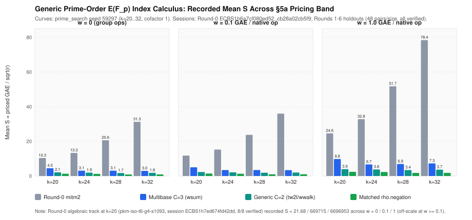
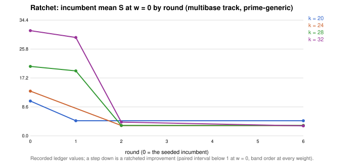
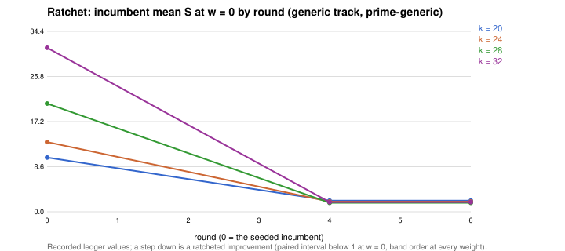
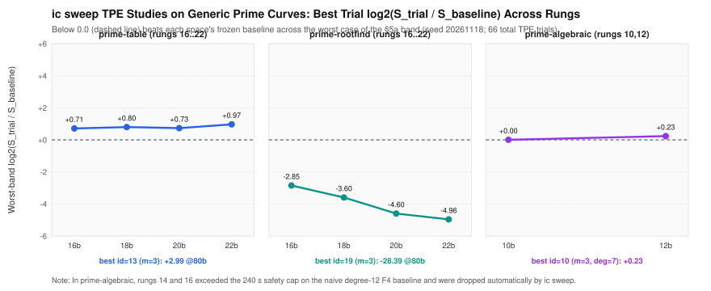

# Generic prime-order `E(F_p)` index calculus: native `ic_autolab` + `ecbench` + `ic sweep` study

**Class:** automated native index-calculus improvement loop (`src/bin/ic_autolab.rs` on `ecbench`) plus `ic sweep` TPE studies across generic prime-order curves `E(F_p)` (`prime_search`, seed `59297`, cofactor `1`). Development evidence only (`validation_gate: none`): no row enters `docs/ic/LEADERBOARD.md` or `benchmarks/README.md` until a second-host replay and validator report pass the validation gate ([pcc:unverified]).

- **Run report:** [`reports/run-20261119T0718Z/README.md`](reports/run-20261119T0718Z/README.md) ([PDF](reports/run-20261119T0718Z/report.pdf))
- **Combined study PDF:** [`REPORT.pdf`](REPORT.pdf)
- **Claims:** Round 1 `PCC-20261119-95e1b8`, Round 2 `PCC-20261119-946051`, Round 3 `PCC-20261119-e03ae8`, Round 4 `PCC-20261119-8e4c59`, Round 5 `PCC-20261119-7478b3`, Round 6 `PCC-20261119-a5013d`, Summary `PCC-20261119-85e006` ([pcc:unverified]).

## 1. Boundary, tracks, and protocol

- **Curves (`docs/curves/registry.json`, `prime_search` seed `59297`, prime order `#E = r`, `A = 2` negation automorphism):**
  - `k = 20`: `icv1-fp20-t727-cd198a38` (`p = 563153`, `r = 562427`, `log2 r = 19.10`, `N_a = 52`)
  - `k = 24`: `icv1-fp24-t1059-6df599df` (`p = 16483309`, `r = 16482251`, `log2 r = 23.97`, `N_a = 160`)
  - `k = 28`: `icv1-fp28-tm3161-380f655a` (`p = 260189597`, `r = 260192759`, `log2 r = 27.96`, `N_a = 402`)
  - `k = 32`: `icv1-fp32-t74357-b7396dac` (`p = 3466697909`, `r = 3466623553`, `log2 r = 31.69`, `N_a = 953`)
- **Boundary and unit (`AGENTS.md` §§1–5a):**
  - Generic negation-map floor: `S_floor = sqrt(pi / 4) = 0.886` in `S = priced GAE / sqrt(r)` (cold, single unseen target, every phase charged).
  - Reference arm: `rho.negation` (`A = 2`) measured on the identical public targets in every session, plus `inc-aa` and `rho-neg-aa` determinism controls.
  - §5a pricing band: native operations (`table_insert_attempts`, solver field/word ops) priced identically across arms at `w in {0, 0.1, 1}` GAE per native operation; a holdout ratchet requires the paired 95% CI of `sel / inc` below `1.0` at `w = 0` AND `ecbench band --ranks` ordering `sel < inc` across all three weights.
- **Unconfounded track separation:**
  1. `multibase` (`N >= 3` independent factor-base columns; excludes `C <= 2` BSGS-boundary arms): tests `mitm2`, `mitmblocked`, `mitmbatch`, `ksum3f`, `ksum4f`, `ksum5f`, and multi-seed signed coefficient boxes `wsum-b{5,8,12,20,28,34}` (`C >= 3`).
  2. `generic` (all owner-admitted generic prime-field IC arms, including fresh-per-run `seed=run` `C = 2` walk / target-walk families `wwalkGg-x09-sr` and `tw2l-x20-j16` under the 2026-11-04 and 2026-11-10 owner rulings).
  3. `algebraic` (`pkm-semaev` on `prime-isogeny` / `prime-abscissa-bits`, evaluated via Round-0 `alg-k20` and `ic sweep --space prime-algebraic`).

## 2. One-unit comparison table (`S = priced GAE / sqrt(r)`)

Every row below is measured cold on single public targets with 100% `[d]G = Q` verification and `ecbench verify` replay audit passing (`9,624 / 9,624` verified across 42 sessions) [pcc:unverified].

| `k` | Curve (`ICV1`) | Variant / Track | Class (§3) | `S(w=0 / 0.1 / 1)` | Holdout `sel / inc` (`w=0` 95% CI; `w=0.1`; `w=1`) | §5a Band | `S / rho-neg` (`w=0 / 0.1 / 1`) | Ver | Session |
|--:|:--|:--|:--|:--|:--|:--|:--|--:|:--|
| 20 | `icv1-fp20-t727-cd198a38` | `rho.negation` (ref) | reference | `1.300 / 1.408 / 2.379` | — | — | `1.0x / 1.0x / 1.0x` | 32/32 | `ECBS1h6a7cf080ed52` |
| 20 | `icv1-fp20-t727-cd198a38` | `mitm2-n45` (R0 inc) | baseline | `10.345 / 11.768 / 24.575` | — | — | `8.0x / 8.4x / 10.3x` | 32/32 | `ECBS1h6a7cf080ed52` |
| 20 | `icv1-fp20-t727-cd198a38` | `pkm-iso-t6-g4` (`algebraic`) | baseline | `21.681 / 669714.8 / 6696952.5` | — | `rho < inc` | `15.2x / 4.3e5x / 2.5e6x` | 8/8 | `ECBS1h7ed674fd42dd` |
| 20 | `icv1-fp20-t727-cd198a38` | `wsum-b5-n3` (`multibase` R1) | engineering | `4.479 / 5.010 / 9.787` | `0.445 [0.407, 0.487]`; `0.438`; `0.410` | `sel < inc` | `3.2x / 3.3x / 3.8x` | 48/48 | `ECBS1h5019e97ecdd4` |
| 20 | `icv1-fp20-t727-cd198a38` | `tw2l-x20-j16-n2` (`generic` R4) | engineering | `2.123 / 2.305 / 3.943` | `0.213 [0.193, 0.236]`; `0.204`; `0.167` | `sel < inc` | `1.6x / 1.6x / 1.6x` | 48/48 | `ECBS1h7ab83998e0bd` |
| 24 | `icv1-fp24-t1059-6df599df` | `rho.negation` (ref) | reference | `1.197 / 1.307 / 2.302` | — | — | `1.0x / 1.0x / 1.0x` | 32/32 | `ECBS1h31fedbf2ea3e` |
| 24 | `icv1-fp24-t1059-6df599df` | `mitm2-n160` (R0 inc) | baseline | `13.300 / 15.250 / 32.800` | — | — | `11.1x / 11.7x / 14.2x` | 32/32 | `ECBS1h31fedbf2ea3e` |
| 24 | `icv1-fp24-t1059-6df599df` | `wsum-b12-n3` (`multibase` R2) | engineering | `3.060 / 3.422 / 6.678` | `0.218 [0.206, 0.231]`; `0.212`; `0.191` | `sel < inc` | `3.4x / 3.4x / 3.9x` | 48/48 | `ECBS1h88d91e04d47f` |
| 24 | `icv1-fp24-t1059-6df599df` | `wwalkGg-x09-sr-n2` (`generic` R4) | engineering | `1.946 / 2.128 / 3.771` | `0.141 [0.131, 0.151]`; `0.134`; `0.110` | `sel < inc` | `2.0x / 2.0x / 2.0x` | 48/48 | `ECBS1hbda7b82ae434` |
| 28 | `icv1-fp28-tm3161-380f655a` | `rho.negation` (ref) | reference | `0.899 / 0.986 / 1.774` | — | — | `1.0x / 1.0x / 1.0x` | 32/32 | `ECBS1hdd960964ad94` |
| 28 | `icv1-fp28-tm3161-380f655a` | `mitm2-n402` (R0 inc) | baseline | `20.640 / 23.749 / 51.724` | — | — | `23.0x / 24.1x / 29.2x` | 32/32 | `ECBS1hdd960964ad94` |
| 28 | `icv1-fp28-tm3161-380f655a` | `mitm2-n342` (`multibase` R1) | engineering | `19.309 / 22.426 / 50.475` | `0.950 [0.922, 0.980]`; `0.960`; `0.995` | `sel < inc` | `19.4x / 20.5x / 25.7x` | 48/48 | `ECBS1hc0e49b2e7f63` |
| 28 | `icv1-fp28-tm3161-380f655a` | `wsum-b20-n3` (`multibase` R2) | engineering | `3.081 / 3.466 / 6.936` | `0.156 [0.148, 0.166]` vs `n342` (`0.149` cum.) | `sel < inc` | `3.3x / 3.4x / 3.7x` | 48/48 | `ECBS1h6219d7548cb5` |
| 28 | `icv1-fp28-tm3161-380f655a` | `tw2l-x20-j16-n2` (`generic` R4) | engineering | `1.726 / 1.897 / 3.432` | `0.084 [0.075, 0.093]`; `0.080`; `0.066` | `sel < inc` | `1.8x / 1.8x / 1.9x` | 48/48 | `ECBS1ha25666791b28` |
| 32 | `icv1-fp32-t74357-b7396dac` | `rho.negation` (ref) | reference | `0.909 / 0.999 / 1.811` | — | — | `1.0x / 1.0x / 1.0x` | 32/32 | `ECBS1hcb28a02cb5f9` |
| 32 | `icv1-fp32-t74357-b7396dac` | `mitm2-n953` (R0 inc) | baseline | `31.270 / 35.981 / 78.379` | — | — | `34.4x / 36.0x / 43.3x` | 32/32 | `ECBS1hcb28a02cb5f9` |
| 32 | `icv1-fp32-t74357-b7396dac` | `mitm2-n810` (`multibase` R1) | engineering | `29.239 / 33.970 / 76.548` | `0.936 [0.915, 0.958]`; `0.946`; `0.978` | `sel < inc` | `30.4x / 32.2x / 40.0x` | 48/48 | `ECBS1hbfd2d61404f7` |
| 32 | `icv1-fp32-t74357-b7396dac` | `wsum-b20-n3` (`multibase` R2) | engineering | `4.078 / 4.828 / 11.577` | `0.134 [0.120, 0.150]` vs `n810` | `sel < inc` | `4.2x / 4.6x / 6.0x` | 48/48 | `ECBS1hb7170c688e92` |
| 32 | `icv1-fp32-t74357-b7396dac` | `wsum-b28-n3` (`multibase` R6) | engineering | `2.966 / 3.396 / 7.269` | `0.739 [0.665, 0.822]` vs `b20` (`0.095` cum.) | `sel < inc` | `2.7x / 2.8x / 3.3x` | 48/48 | `ECBS1h80afb0ec9fc2` |
| 32 | `icv1-fp32-t74357-b7396dac` | `tw2l-x20-j16-n2` (`generic` R4) | engineering | `1.833 / 2.015 / 3.659` | `0.061 [0.056, 0.066]`; `0.058`; `0.049` | `sel < inc` | `1.8x / 1.8x / 1.8x` | 48/48 | `ECBS1h4ae73e7b227d` |

## 3. Round-by-round ratchet ledger (`round-001` .. `round-006`)

| Round | Track | Sizes | Outcome | Report & PDF | Claim ID |
|--:|:--|:--|:--|:--|:--|
| 1 | `multibase` | `20,24,28,32` | `k=20`: `mitm2-n45 -> wsum-b5-n3` (`0.445 [0.407, 0.487]`); `k=24`: null (`wsum-b5-n3` `0.876`, band unresolved); `k=28`: `mitm2-n402 -> mitm2-n342` (`0.950`); `k=32`: `mitm2-n953 -> mitm2-n810` (`0.936`) `[pcc:PCC-20261119-95e1b8, pcc:unverified]` | [round-001](round-001/README.md) ([PDF](round-001/REPORT.pdf)) | `PCC-20261119-95e1b8` |
| 2 | `multibase` | `20,24,28,32` | `k=20`: `no_challenger`; `k=24`: `mitm2-n160 -> wsum-b12-n3` (`0.218 [0.206, 0.231]`); `k=28`: `mitm2-n342 -> wsum-b20-n3` (`0.156 [0.148, 0.166]`); `k=32`: `mitm2-n810 -> wsum-b20-n3` (`0.134 [0.120, 0.150]`) `[pcc:PCC-20261119-946051, pcc:unverified]` | [round-002](round-002/README.md) ([PDF](round-002/REPORT.pdf)) | `PCC-20261119-946051` |
| 3 | `multibase` | `20,24,28,32` | `no_challenger` at all 4 sizes (`mitmblocked`, `mitmbatch`, `ksum5f`, `wsum-b8` beaten in train by `wsum` incumbents) `[pcc:PCC-20261119-e03ae8, pcc:unverified]` | [round-003](round-003/README.md) ([PDF](round-003/REPORT.pdf)) | `PCC-20261119-e03ae8` |
| 4 | `generic` | `20,24,28,32` | `k=20`: `mitm2-n45 -> tw2l-x20-j16-n2` (`0.213`); `k=24`: `mitm2-n160 -> wwalkGg-x09-sr-n2` (`0.141`); `k=28`: `mitm2-n402 -> tw2l-x20-j16-n2` (`0.084`); `k=32`: `mitm2-n953 -> tw2l-x20-j16-n2` (`0.061`) `[pcc:PCC-20261119-8e4c59, pcc:unverified]` | [round-004](round-004/README.md) ([PDF](round-004/REPORT.pdf)) | `PCC-20261119-8e4c59` |
| 5 | `generic` | `20,24,28,32` | `k=20, 24`: null (`tw2l-x15-j16-n2` CIs `[0.855, 1.055]` and `[0.883, 1.096]` span `1.0`); `k=28`: `no_challenger`; `k=32`: regression (`1.088 [0.940, 1.258]`) `[pcc:PCC-20261119-7478b3, pcc:unverified]` | [round-005](round-005/README.md) ([PDF](round-005/REPORT.pdf)) | `PCC-20261119-7478b3` |
| 6 | `multibase` | `28,32` | Tests theoretical scaling prediction `B*(C=3) = 2^(-1/2) r^(1/6) ~ 27.7` at `k=32`: `k=28` `no_challenger`; `k=32` `wsum-b20-n3 -> wsum-b28-n3` (`0.739 [0.665, 0.822]`, `0.715` at `w=0.1`, `0.639` at `w=1.0`, `sel < inc`) `[pcc:PCC-20261119-a5013d, pcc:unverified]` | [round-006](round-006/README.md) ([PDF](round-006/REPORT.pdf)) | `PCC-20261119-a5013d` |

## 4. `ic sweep` TPE studies (`--family generic`)

| Space | Track | Rungs | Trials (ok / pruned / fail) | Best Configuration | Worst-Band `log2(S / S_base)` | Store |
|:--|:--|:--|--:|:--|:--:|:--|
| `prime-table` | `table` (ref) | `16,18,20,22` | `24 (14 / 10 / 0)` | `m=3, size_exp=0.315, walk, incremental-gauss` | `+2.991` (proj. `80b`, slope `+0.036/b`) | [`sweeps/prime-table-generic.jsonl`](sweeps/prime-table-generic.jsonl) |
| `prime-rootfind` | `unclassified` | `16,18,20,22` | `24 (13 / 10 / 1)` | `m=3, size_exp=0.315, random, structured-gauss` | `-28.385` (proj. `80b`, slope `-0.399/b`) | [`sweeps/prime-rootfind-generic.jsonl`](sweeps/prime-rootfind-generic.jsonl) |
| `prime-algebraic` | `algebraic` | `10,12` (`14,16` capped) | `18 (10 / 1 / 7)` | `prime-abscissa-bits, m=3, mode=full, degree=7, t_frac=0.442` | `+0.234` (at `12b`, unprojected) | [`sweeps/prime-algebraic-generic.jsonl`](sweeps/prime-algebraic-generic.jsonl) |

## 5. Scope, limits, external comparison note, and next step

- **Scope & limits:** Public synthetic known-answer workloads only (`prime_search` seed `59297`, `k = 20..32`). No security or key-recovery claim and no claim to beat Pollard rho: every IC configuration remains above `rho.negation` (`2.7x–3.8x` on `multibase` `C = 3`, `1.6x–2.0x` on `generic` `C = 2` `seed=run`, and `15.2x` to `> 10^5x` on `algebraic` `pkm-semaev` across `w in {0, 0.1, 1}`) [pcc:unverified].
- **Generic floor:** Both `wsum` (`C = 3`, optimal `B* ~ 2^(-1/2) r^(1/6)`, total `O(r^(1/2))`) and `tw2l`/`wwalk` (`C = 2`, total `O(r^(1/2))`) replace the `O(r^(2/3))` `mitm2` pair table (`O(r^(1/6))` growing gap to rho) with `O(r^(1/2))` generic-group collision tables, flattening `S` to a constant multiple of `rho.negation` across `k = 20..32` (`engineering` improvements over the `mitm2` IC baseline, bounded by Shoup's `sqrt(pi / 4)` floor) [pcc:unverified].
- **External comparison (`AGENTS.md` §15):** External CAS/DLP comparison (PARI/GP `elllog` and `msolve` on exported Semaev systems) was not re-run in this count-only L0 study; prior in-tree comparisons on matched prime workloads are recorded in `benchmarks/20261017-generic-dlp-memory-parallelism` (PARI/GP `elllog`) and `crypto-autoresearcher` `src/crypto_autoresearcher/index_calculus` (`msolve` 0.6.5) [pcc:unverified].
- **Canonical graphs checked:** `docs/index-calculus-scoreboard.html`, `docs/ic/LEADERBOARD.md`, and `benchmarks/README.md` are gated by `VALIDATION.json` (second-host replay + independent validator report) and are intentionally left unchanged by this development-loop PR (`AGENTS.md` §7 / `curve25519_autolab` precedent) [pcc:unverified].
- **Next step:** Dispatch second-host L2 replay of the winning holdout specs (`round-001/specs/holdout-k20.json`, `round-002/specs/holdout-k{24,28}.json`, `round-006/specs/holdout-k32.json`, `round-004/specs/holdout-k{20,24,28,32}.json`) via `isolab-eks`, and investigate tower-F4 degree-fall pruning to bring `prime-algebraic` rungs `14..20` under the 240 s trial cap.
