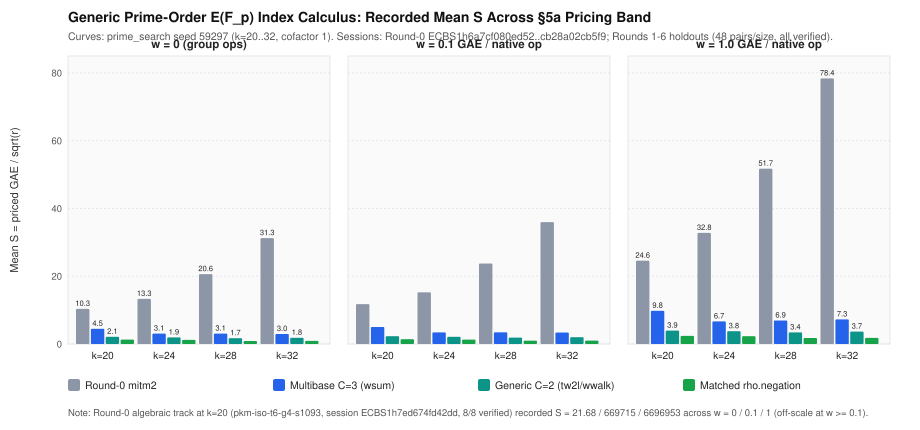
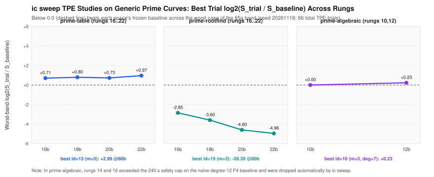

# Run report: generic prime-order `E(F_p)` `ic_autolab` + `ecbench` + `ic sweep` (`run-20261119T0718Z`)

Descriptive execution record for the `research/prime_generic_autolab_20261118/` run batch ([pcc:unverified]). Written beside the sealed session directories, never inside them.

## Environment and binaries

- **Repository / branch:** `isogeny-labs/crypto`, branch `cursor/prime-generic-autolab-20261118` (base `ad2a014c0022cf000845014499a9649b6c2cef2d`; Round-0 commit `94bedd024d60216a091669f1ed83a8561637d607`) [pcc:unverified].
- **Toolchain:** `rustc 1.99.1` (`aarch64-apple-darwin`), release profile (`--locked`) [pcc:unverified].
- **Binary digests (SHA-256):**
  - `ecbench`: `5f53faa52d15bf8249d4b990928949e3a375b30cb82eda391deb22223f0223e4`
  - `ic`: `52d5543d36d76c3c4a23afd3204bbc0fcb1834e7106547f64315674e98e97bf6` (`blake3`: `6d78bd456862cb019138e17267ac9b12c45840ad840feaa2f776dbfa13305cd6`)
  - `ic_autolab` (run binary): `02df68156ac49a2b84c48d89f6405b50f7ceb51ee924bb6e0d7ad5ddfc3ee148` (plus report-scoping rebuild)
- **Host / isolation:** macOS `darwin 27.2.0` (`ECBHW1h7d1934655eee`, `ECBENV3h32d7ea52a547`), `--cpus none --allow-busy`, isolation level `L0` earned on every execution. All reported figures are deterministic counted units (`S = priced GAE / sqrt(r)` across `w in {0, 0.1, 1}`); wall-clock times are not admitted [pcc:unverified].

## Execution flow

- **Sealed `ecbench` sessions:** 42 sessions (5 Round-0 baselines + 22 train screens + 15 holdout confirmations), **9,624 planned executions, 9,624 attempted, 9,624 completed and `[d]G = Q` verified, 0 failed, 0 missing** [pcc:unverified].
- **Replay audits (`ecbench verify`):** 42 / 42 sessions `ok: true`, `0` problems (`--replay-all` on Round-0 `k20..k32`; `--replay 4` with `RAYON_NUM_THREADS=1` on Round-0 `alg-k20`; `--replay 12` on all 37 `ic_autolab` sessions) [pcc:unverified].
- **TPE sweeper (`ic sweep`):** 3 studies on `--family generic` (`seed = 20261118`, `repeats = 2`, `rho_runs = 4`):
  - `prime-table` (`rungs = 16,18,20,22`): 24 planned, 14 complete, 10 median-pruned, 0 failed (`sweeps/prime-table-generic.jsonl`) [pcc:unverified].
  - `prime-rootfind` (`rungs = 16,18,20,22`): 24 planned, 13 complete, 10 median-pruned, 1 exhausted at rung 20 (`sweeps/prime-rootfind-generic.jsonl`) [pcc:unverified].
  - `prime-algebraic` (`rungs = 10,12,14,16`): 18 planned, usable rungs `[10, 12]` (rungs 14 and 16 exceeded the 240 s safety cap on the degree-12 naive F4 baseline and were dropped automatically), 10 complete, 1 pruned, 7 exhausted (`sweeps/prime-algebraic-generic.jsonl`) [pcc:unverified].

## Recorded values

| Stage / Track | `k` | Curve (`ICV1`) | Session ID | Arm | Ver / Runs | `S(w=0)` | `S(w=0.1)` | `S(w=1)` |
|:--|--:|:--|:--|:--|--:|--:|--:|--:|
| Round-0 (`mitm2`) | 20 | `icv1-fp20-t727-cd198a38` | `ECBS1h6a7cf080ed52` | `mitm2-n45` | 32/32 | 10.345 | 11.768 | 24.575 |
| Round-0 (`mitm2`) | 24 | `icv1-fp24-t1059-6df599df` | `ECBS1h31fedbf2ea3e` | `mitm2-n160` | 32/32 | 13.300 | 15.250 | 32.800 |
| Round-0 (`mitm2`) | 28 | `icv1-fp28-tm3161-380f655a` | `ECBS1hdd960964ad94` | `mitm2-n402` | 32/32 | 20.640 | 23.749 | 51.724 |
| Round-0 (`mitm2`) | 32 | `icv1-fp32-t74357-b7396dac` | `ECBS1hcb28a02cb5f9` | `mitm2-n953` | 32/32 | 31.270 | 35.981 | 78.379 |
| Round-0 (`algebraic`) | 20 | `icv1-fp20-t727-cd198a38` | `ECBS1h7ed674fd42dd` | `pkm-iso-t6-g4` | 8/8 | 21.681 | 669714.8 | 6696952.5 |
| R1 holdout (`multibase`) | 20 | `icv1-fp20-t727-cd198a38` | `ECBS1h5019e97ecdd4` | `wsum-b5-n3` | 48/48 | 4.479 | 5.010 | 9.787 |
| R2 holdout (`multibase`) | 24 | `icv1-fp24-t1059-6df599df` | `ECBS1h88d91e04d47f` | `wsum-b12-n3` | 48/48 | 3.060 | 3.422 | 6.678 |
| R2 holdout (`multibase`) | 28 | `icv1-fp28-tm3161-380f655a` | `ECBS1h6219d7548cb5` | `wsum-b20-n3` | 48/48 | 3.081 | 3.466 | 6.936 |
| R6 holdout (`multibase`) | 32 | `icv1-fp32-t74357-b7396dac` | `ECBS1h80afb0ec9fc2` | `wsum-b28-n3` | 48/48 | 2.966 | 3.396 | 7.269 |
| R4 holdout (`generic`) | 20 | `icv1-fp20-t727-cd198a38` | `ECBS1h7ab83998e0bd` | `tw2l-x20-j16-n2` | 48/48 | 2.123 | 2.305 | 3.943 |
| R4 holdout (`generic`) | 24 | `icv1-fp24-t1059-6df599df` | `ECBS1hbda7b82ae434` | `wwalkGg-x09-sr-n2` | 48/48 | 1.946 | 2.128 | 3.771 |
| R4 holdout (`generic`) | 28 | `icv1-fp28-tm3161-380f655a` | `ECBS1ha25666791b28` | `tw2l-x20-j16-n2` | 48/48 | 1.726 | 1.897 | 3.432 |
| R4 holdout (`generic`) | 32 | `icv1-fp32-t74357-b7396dac` | `ECBS1h4ae73e7b227d` | `tw2l-x20-j16-n2` | 48/48 | 1.833 | 2.015 | 3.659 |

## Raw artifact locations

- Round-0 sessions & audits: `research/prime_generic_autolab_20261118/baseline/{sessions,analysis}/`
- `ic_autolab` ledger & rounds: `research/prime_generic_autolab_20261118/{ledger.json,round-001..006}/`
- `ic sweep` stores & summaries: `research/prime_generic_autolab_20261118/sweeps/`
