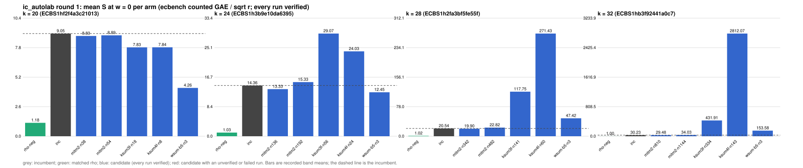
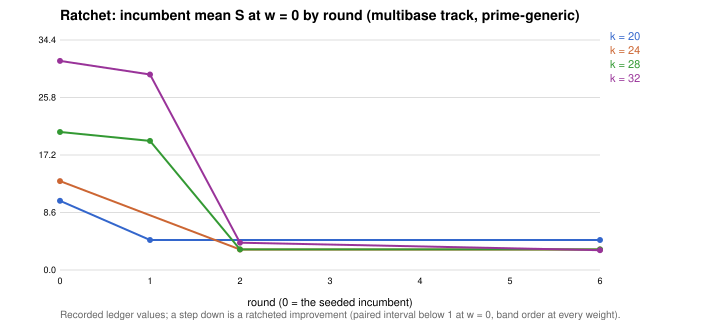

# ic_autolab round 1 (multibase track): report

Protocol: [PROTOCOL.md](PROTOCOL.md), frozen 2026-11-19T07:18:34Z at git `94bedd024d60216a091669f1ed83a8561637d607`; route `local`. Counted GAE only (deterministic, host independent); no wall-time claim; development loop, no validation-gate row. Loop home: [`../`](../README.md); ledger: [`../ledger.json`](../ledger.json).

Claim record: `PCC-20261119-95e1b8` (`python3 tools/pcc/pcc.py standing PCC-20261119-95e1b8`). Until a signed replay and recompute exist, this round's outcome is an unverified assertion [pcc:unverified].

## Outcome

| k | class | sel | sel / inc at w = 0 [95%] | w = 0.1 | w = 1 | band | S sel (w = 0 / 0.1 / 1) | S inc | S rho-neg | distance sel / rho |
|--:|:--|:--|:--|:--|:--|:--|:--|:--|:--|:--|
| 20 | **improvement** | wsum-b5-n3 | 0.445 [0.407, 0.487] | 0.438 [0.399, 0.481] | 0.410 [0.367, 0.458] | sel < inc | 4.479 / 5.010 / 9.787 | 10.067 / 11.449 / 23.886 | 1.392 / 1.509 / 2.564 | 3.2x / 3.3x / 3.8x |
| 24 | **null** | wsum-b5-n3 | 0.876 [0.745, 1.029] | 0.908 [0.771, 1.068] | 1.023 [0.865, 1.209] | unresolved inside the band | 11.973 / 14.245 / 34.690 | 13.671 / 15.695 / 33.907 | 1.165 / 1.273 / 2.239 | 10.3x / 11.2x / 15.5x |
| 28 | **improvement** | mitm2-n342 | 0.950 [0.922, 0.980] | 0.960 [0.930, 0.991] | 0.995 [0.960, 1.031] | sel < inc | 19.309 / 22.426 / 50.475 | 20.316 / 23.360 / 50.754 | 0.995 / 1.092 / 1.966 | 19.4x / 20.5x / 25.7x |
| 32 | **improvement** | mitm2-n810 | 0.936 [0.915, 0.958] | 0.946 [0.924, 0.968] | 0.978 [0.953, 1.004] | sel < inc | 29.239 / 33.970 / 76.548 | 31.222 / 35.924 / 78.237 | 0.961 / 1.056 / 1.915 | 30.4x / 32.2x / 40.0x |

Classes follow the protocol's decision rule. Distance to rho is the distance remaining, not a gate. The reasons per size:

- k = 20: compare ops.status = ok, admissible = true; sel / inc = 0.4450 [0.407, 0.487] at w = 0; band: sel < inc; A/A inc-aa / inc interval [1.000, 1.000] contains 1
- k = 24: compare ops.status = ok, admissible = true; sel / inc = 0.8758 [0.745, 1.029] at w = 0; band: unresolved inside the band; A/A inc-aa / inc interval [1.000, 1.000] contains 1
- k = 28: compare ops.status = ok, admissible = true; sel / inc = 0.9504 [0.922, 0.980] at w = 0; band: sel < inc; A/A inc-aa / inc interval [1.000, 1.000] contains 1
- k = 32: compare ops.status = ok, admissible = true; sel / inc = 0.9365 [0.915, 0.958] at w = 0; band: sel < inc; A/A inc-aa / inc interval [1.000, 1.000] contains 1

## Train (development screen, in sample)

### k = 20: session `ECBS1hf2f4a3c21013` (run exit 0, verify exit 0, receipt sha256 `7c3c91d1df862aca021118e83e8c0dda6a51dc48c262aa8b637b10a10a34a699`)

| arm | family | N | factor base | oracle | runs | verified | S (w = 0 / 0.1 / 1) | reason proposed |
|:--|:--|--:|:--|:--|--:|--:|:--|:--|
| `rho-neg` | rho | - | `-` | `rho.negation` | 12 | 12 | 1.180 / 1.276 / 2.143 | matched reference |
| `inc` | mitm2 | 45 | `prime-abscissa:size=45` | `mitm:negation_folded=1` | 12 | 12 | 9.047 / 10.254 / 21.115 | incumbent |
| `mitm2-n38` | mitm2 | 38 | `prime-abscissa:size=38` | `mitm:negation_folded=1` | 12 | 12 | 8.834 / 10.058 / 21.076 | incumbent neighbourhood: N = 0.85 x 45 |
| `mitm2-n54` | mitm2 | 54 | `prime-abscissa:size=54` | `mitm:negation_folded=1` | 12 | 12 | 8.890 / 9.999 / 19.979 | incumbent neighbourhood: N = 1.2 x 45 |
| `ksum3f-n18` | ksum3f | 18 | `prime-abscissa:size=18` | `ksum:m=3,free=1` | 12 | 12 | 7.831 / 8.669 / 16.212 | exploration: family ksum3f untried at k = 20, N = 0.35 x N_a |
| `ksum4f-n8` | ksum4f | 8 | `prime-abscissa:size=8` | `ksum:m=4,free=1` | 12 | 12 | 7.835 / 8.892 / 18.404 | exploration: family ksum4f untried at k = 20, N = 0.15 x N_a |
| `wsum-b5-n3` | wsum-b5 | 3 | `prime-abscissa:size=3` | `wsum:coef=5,free=1` | 12 | 12 | 4.258 / 4.747 / 9.148 | exploration: family wsum-b5 untried at k = 20, N = 0.0001 x N_a |

### k = 24: session `ECBS1h3b9e10da6395` (run exit 0, verify exit 0, receipt sha256 `f6f3fb1e5081b2b14158a9b1712a62a37a509a94ff5c128fa88c41bc5e9ab9e7`)

| arm | family | N | factor base | oracle | runs | verified | S (w = 0 / 0.1 / 1) | reason proposed |
|:--|:--|--:|:--|:--|--:|--:|:--|:--|
| `rho-neg` | rho | - | `-` | `rho.negation` | 12 | 12 | 1.027 / 1.120 / 1.962 | matched reference |
| `inc` | mitm2 | 160 | `prime-abscissa:size=160` | `mitm:negation_folded=1` | 12 | 12 | 14.363 / 16.523 / 35.961 | incumbent |
| `mitm2-n136` | mitm2 | 136 | `prime-abscissa:size=136` | `mitm:negation_folded=1` | 12 | 12 | 13.327 / 15.449 / 34.547 | incumbent neighbourhood: N = 0.85 x 160 |
| `mitm2-n192` | mitm2 | 192 | `prime-abscissa:size=192` | `mitm:negation_folded=1` | 12 | 12 | 15.328 / 17.410 / 36.154 | incumbent neighbourhood: N = 1.2 x 160 |
| `ksum3f-n56` | ksum3f | 56 | `prime-abscissa:size=56` | `ksum:m=3,free=1` | 12 | 12 | 29.067 / 32.955 / 67.944 | exploration: family ksum3f untried at k = 24, N = 0.35 x N_a |
| `ksum4f-n24` | ksum4f | 24 | `prime-abscissa:size=24` | `ksum:m=4,free=1` | 12 | 12 | 24.025 / 26.550 / 49.273 | exploration: family ksum4f untried at k = 24, N = 0.15 x N_a |
| `wsum-b5-n3` | wsum-b5 | 3 | `prime-abscissa:size=3` | `wsum:coef=5,free=1` | 12 | 12 | 12.445 / 14.808 / 36.069 | exploration: family wsum-b5 untried at k = 24, N = 0.0001 x N_a |

### k = 28: session `ECBS1h2fa3bf5fe55f` (run exit 0, verify exit 0, receipt sha256 `9a9fcd043a29af4c83df64882ee78728434671f95cb83602b4da04a17949118c`)

| arm | family | N | factor base | oracle | runs | verified | S (w = 0 / 0.1 / 1) | reason proposed |
|:--|:--|--:|:--|:--|--:|--:|:--|:--|
| `rho-neg` | rho | - | `-` | `rho.negation` | 12 | 12 | 1.016 / 1.115 / 2.008 | matched reference |
| `inc` | mitm2 | 402 | `prime-abscissa:size=402` | `mitm:negation_folded=1` | 12 | 12 | 20.541 / 23.629 / 51.426 | incumbent |
| `mitm2-n342` | mitm2 | 342 | `prime-abscissa:size=342` | `mitm:negation_folded=1` | 12 | 12 | 19.898 / 23.134 / 52.251 | incumbent neighbourhood: N = 0.85 x 402 |
| `mitm2-n482` | mitm2 | 482 | `prime-abscissa:size=482` | `mitm:negation_folded=1` | 12 | 12 | 22.815 / 25.923 / 53.892 | incumbent neighbourhood: N = 1.2 x 402 |
| `ksum3f-n141` | ksum3f | 141 | `prime-abscissa:size=141` | `ksum:m=3,free=1` | 12 | 12 | 117.748 / 131.966 / 259.922 | exploration: family ksum3f untried at k = 28, N = 0.35 x N_a |
| `ksum4f-n60` | ksum4f | 60 | `prime-abscissa:size=60` | `ksum:m=4,free=1` | 12 | 12 | 271.430 / 303.858 / 595.711 | exploration: family ksum4f untried at k = 28, N = 0.15 x N_a |
| `wsum-b5-n3` | wsum-b5 | 3 | `prime-abscissa:size=3` | `wsum:coef=5,free=1` | 12 | 12 | 47.425 / 56.865 / 141.826 | exploration: family wsum-b5 untried at k = 28, N = 0.0001 x N_a |

### k = 32: session `ECBS1hb3f92441a0c7` (run exit 0, verify exit 0, receipt sha256 `a001036e2819e40cd656b998562eec0f8c5fd8f0b05568dd9b954992641d3336`)

| arm | family | N | factor base | oracle | runs | verified | S (w = 0 / 0.1 / 1) | reason proposed |
|:--|:--|--:|:--|:--|--:|--:|:--|:--|
| `rho-neg` | rho | - | `-` | `rho.negation` | 12 | 12 | 1.005 / 1.105 / 2.003 | matched reference |
| `inc` | mitm2 | 953 | `prime-abscissa:size=953` | `mitm:negation_folded=1` | 12 | 12 | 30.228 / 34.729 / 75.241 | incumbent |
| `mitm2-n810` | mitm2 | 810 | `prime-abscissa:size=810` | `mitm:negation_folded=1` | 12 | 12 | 29.485 / 34.265 / 77.286 | incumbent neighbourhood: N = 0.85 x 953 |
| `mitm2-n1144` | mitm2 | 1144 | `prime-abscissa:size=1144` | `mitm:negation_folded=1` | 12 | 12 | 34.033 / 38.617 / 79.872 | incumbent neighbourhood: N = 1.2 x 953 |
| `ksum3f-n334` | ksum3f | 334 | `prime-abscissa:size=334` | `ksum:m=3,free=1` | 12 | 12 | 431.909 / 482.064 / 933.461 | exploration: family ksum3f untried at k = 32, N = 0.35 x N_a |
| `ksum4f-n143` | ksum4f | 143 | `prime-abscissa:size=143` | `ksum:m=4,free=1` | 12 | 12 | 2812.070 / 3238.120 / 7072.571 | exploration: family ksum4f untried at k = 32, N = 0.15 x N_a |
| `wsum-b5-n3` | wsum-b5 | 3 | `prime-abscissa:size=3` | `wsum:coef=5,free=1` | 12 | 12 | 153.579 / 184.263 / 460.414 | exploration: family wsum-b5 untried at k = 32, N = 0.0001 x N_a |

## Selection

- k = 20: challenger `wsum-b5-n3` (Pareto alternative at w = 1: `wsum-b5-n3`)
- k = 24: challenger `wsum-b5-n3` (Pareto alternative at w = 1: `mitm2-n136`)
- k = 28: challenger `mitm2-n342` (Pareto alternative at w = 1: `mitm2-n342`)
- k = 32: challenger `mitm2-n810` (Pareto alternative at w = 1: `mitm2-n810`)

## Holdout sessions

| k | session | run exit | verify exit | receipt sha256 | levels |
|--:|:--|--:|--:|:--|:--|
| 20 | `ECBS1h5019e97ecdd4` | 0 | 0 | `effaa311cf6c6b7c1017f8e492291a9548e5b63ddbfb6a9c07fbaa9a5717b8d3` | {"verified":360} |
| 24 | `ECBS1h3226eafee9ac` | 0 | 0 | `66cc0b67a7f525a02f534cd074a1752d241b5b87207f0fe00e6e5fd5cc8213e8` | {"verified":360} |
| 28 | `ECBS1hc0e49b2e7f63` | 0 | 0 | `e7f286da84416a681f865936574ed5d3a72ab9f81c765fe2cc6ac1b6b29cc151` | {"verified":360} |
| 32 | `ECBS1hbfd2d61404f7` | 0 | 0 | `cec70e71326dac965bf46705d9471bec2f8ee87eb775c7daeee4d68ee3f5bd4b` | {"verified":360} |

## Ledger after this round

| k | incumbent | since round | S (w = 0 / 0.1 / 1) | distance to rho |
|--:|:--|--:|:--|:--|
| 20 | `wsum-b5-n3` (`prime-abscissa:size=3` + `wsum:coef=5,free=1`) | 1 | 4.479 / 5.010 / 9.787 | 3.2x / 3.3x / 3.8x |
| 24 | `wsum-b12-n3` (`prime-abscissa:size=3` + `wsum:coef=12,free=1`) | 2 | 3.060 / 3.422 / 6.678 | 3.4x / 3.4x / 3.9x |
| 28 | `wsum-b20-n3` (`prime-abscissa:size=3` + `wsum:coef=20,free=1`) | 2 | 3.081 / 3.466 / 6.936 | 3.3x / 3.4x / 3.7x |
| 32 | `wsum-b28-n3` (`prime-abscissa:size=3` + `wsum:coef=28,free=1`) | 6 | 2.966 / 3.396 / 7.269 | 2.7x / 2.8x / 3.3x |

## Evidence and deviations

- ecbench binary sha256: `5f53faa52d15bf8249d4b990928949e3a375b30cb82eda391deb22223f0223e4`; `--cpus none`, allow_busy = true; `verify --replay 12` per session; audit receipts in `analysis/`; sessions in `sessions/` (records in the artifact store when large).
- Route: the local route is an explicitly requested development screen, not the Iso Lab EKS default; counts are deterministic and replayed, wall time is not claimed. No row of this round enters the IC leaderboard or `benchmarks/README.md` (validation gate).
- Train selection is in sample (disclosed); the holdout is fresh (new `target_seed`, excluded exposures). Failed, timed-out and regressing arms are retained above.
