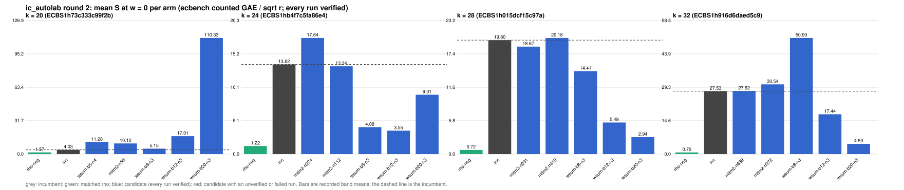
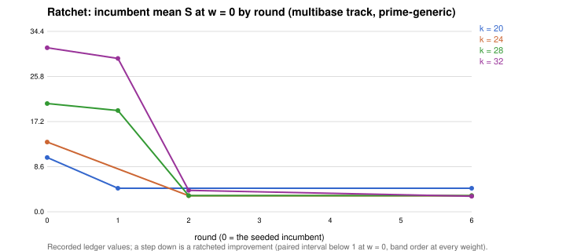

# ic_autolab round 2 (multibase track): report

Protocol: [PROTOCOL.md](PROTOCOL.md), frozen 2026-11-19T07:33:20Z at git `94bedd024d60216a091669f1ed83a8561637d607`; route `local`. Counted GAE only (deterministic, host independent); no wall-time claim; development loop, no validation-gate row. Loop home: [`../`](../README.md); ledger: [`../ledger.json`](../ledger.json).

Claim record: `PCC-20261119-946051` (`python3 tools/pcc/pcc.py standing PCC-20261119-946051`). Until a signed replay and recompute exist, this round's outcome is an unverified assertion [pcc:unverified].

## Outcome

| k | class | sel | sel / inc at w = 0 [95%] | w = 0.1 | w = 1 | band | S sel (w = 0 / 0.1 / 1) | S inc | S rho-neg | distance sel / rho |
|--:|:--|:--|:--|:--|:--|:--|:--|:--|:--|:--|
| 20 | **no_challenger** | none (best candidate `wsum-b8-n3`, train S 5.146 / 5.608 / 9.769) | - | - | - | - | - | 4.028 / 4.493 / 8.676 | 1.572 / 1.707 / 2.925 | inc: 2.6x / 2.6x / 3.0x |
| 24 | **improvement** | wsum-b12-n3 | 0.218 [0.206, 0.231] | 0.212 [0.200, 0.225] | 0.191 [0.178, 0.205] | sel < inc | 3.060 / 3.422 / 6.678 | 14.028 / 16.122 / 34.971 | 0.912 / 0.994 / 1.733 | 3.4x / 3.4x / 3.9x |
| 28 | **improvement** | wsum-b20-n3 | 0.156 [0.148, 0.166] | 0.151 [0.142, 0.161] | 0.134 [0.125, 0.145] | sel < inc | 3.081 / 3.466 / 6.936 | 19.700 / 22.895 / 51.648 | 0.941 / 1.032 / 1.857 | 3.3x / 3.4x / 3.7x |
| 32 | **improvement** | wsum-b20-n3 | 0.134 [0.120, 0.150] | 0.137 [0.122, 0.153] | 0.145 [0.129, 0.163] | sel < inc | 4.078 / 4.828 / 11.577 | 30.364 / 35.321 / 79.931 | 0.962 / 1.057 / 1.917 | 4.2x / 4.6x / 6.0x |

Classes follow the protocol's decision rule. Distance to rho is the distance remaining, not a gate. The reasons per size:

- k = 20: no_challenger
- k = 24: compare ops.status = ok, admissible = true; sel / inc = 0.2181 [0.206, 0.231] at w = 0; band: sel < inc; A/A inc-aa / inc interval [1.000, 1.000] contains 1
- k = 28: compare ops.status = ok, admissible = true; sel / inc = 0.1564 [0.148, 0.166] at w = 0; band: sel < inc; A/A inc-aa / inc interval [1.000, 1.000] contains 1
- k = 32: compare ops.status = ok, admissible = true; sel / inc = 0.1343 [0.120, 0.150] at w = 0; band: sel < inc; A/A inc-aa / inc interval [1.000, 1.000] contains 1

## Train (development screen, in sample)

### k = 20: session `ECBS1h73c333c99f2b` (run exit 0, verify exit 0, receipt sha256 `f617cdcb2dbeb98485960e1bb73c3678a750110f1a18ccfdab6063421490f75e`)

| arm | family | N | factor base | oracle | runs | verified | S (w = 0 / 0.1 / 1) | reason proposed |
|:--|:--|--:|:--|:--|--:|--:|:--|:--|
| `rho-neg` | rho | - | `-` | `rho.negation` | 12 | 12 | 1.572 / 1.707 / 2.925 | matched reference |
| `inc` | wsum-b5 | 3 | `prime-abscissa:size=3` | `wsum:coef=5,free=1` | 12 | 12 | 4.028 / 4.493 / 8.676 | incumbent |
| `wsum-b5-n4` | wsum-b5 | 4 | `prime-abscissa:size=4` | `wsum:coef=5,free=1` | 12 | 12 | 11.277 / 12.322 / 21.728 | incumbent neighbourhood: N = 1.2 x 3 |
| `mitm2-n56` | mitm2 | 56 | `prime-abscissa:size=56` | `mitm:negation_folded=1` | 12 | 12 | 10.121 / 11.450 / 23.418 | cross-size transfer: mitm2 is incumbent at 3 sizes; ln N fitted on log2 r (slope 0.210) and extrapolated |
| `wsum-b8-n3` | wsum-b8 | 3 | `prime-abscissa:size=3` | `wsum:coef=8,free=1` | 12 | 12 | 5.146 / 5.608 / 9.769 | exploration: family wsum-b8 untried at k = 20, N = 0.0001 x N_a |
| `wsum-b12-n3` | wsum-b12 | 3 | `prime-abscissa:size=3` | `wsum:coef=12,free=1` | 12 | 12 | 17.013 / 18.623 / 33.117 | exploration: family wsum-b12 untried at k = 20, N = 0.0001 x N_a |
| `wsum-b20-n3` | wsum-b20 | 3 | `prime-abscissa:size=3` | `wsum:coef=20,free=1` | 12 | 12 | 110.333 / 121.574 / 222.738 | exploration: family wsum-b20 untried at k = 20, N = 0.0001 x N_a |

### k = 24: session `ECBS1hb4f7c5fa86e4` (run exit 0, verify exit 0, receipt sha256 `90dadb575b897399c2bbf171b53835255fac1bc94a749f65f1a87a87f70f2369`)

| arm | family | N | factor base | oracle | runs | verified | S (w = 0 / 0.1 / 1) | reason proposed |
|:--|:--|--:|:--|:--|--:|--:|:--|:--|
| `rho-neg` | rho | - | `-` | `rho.negation` | 12 | 12 | 1.221 / 1.334 / 2.350 | matched reference |
| `inc` | mitm2 | 160 | `prime-abscissa:size=160` | `mitm:negation_folded=1` | 12 | 12 | 13.615 / 15.627 / 33.734 | incumbent |
| `mitm2-n224` | mitm2 | 224 | `prime-abscissa:size=224` | `mitm:negation_folded=1` | 12 | 12 | 17.643 / 19.877 / 39.983 | incumbent neighbourhood: N = 1.4 x 160 |
| `mitm2-n112` | mitm2 | 112 | `prime-abscissa:size=112` | `mitm:negation_folded=1` | 12 | 12 | 13.339 / 15.605 / 35.996 | incumbent neighbourhood: N = 0.7 x 160 |
| `wsum-b8-n3` | wsum-b8 | 3 | `prime-abscissa:size=3` | `wsum:coef=8,free=1` | 12 | 12 | 4.084 / 4.767 / 10.917 | exploration: family wsum-b8 untried at k = 24, N = 0.0001 x N_a |
| `wsum-b12-n3` | wsum-b12 | 3 | `prime-abscissa:size=3` | `wsum:coef=12,free=1` | 12 | 12 | 3.548 / 4.006 / 8.124 | exploration: family wsum-b12 untried at k = 24, N = 0.0001 x N_a |
| `wsum-b20-n3` | wsum-b20 | 3 | `prime-abscissa:size=3` | `wsum:coef=20,free=1` | 12 | 12 | 9.010 / 9.907 / 17.978 | exploration: family wsum-b20 untried at k = 24, N = 0.0001 x N_a |

### k = 28: session `ECBS1h015dcf15c97a` (run exit 0, verify exit 0, receipt sha256 `0614db42a4952379164a68f8fe288dc5ca1c57c7ac902aa1936750187ec1624e`)

| arm | family | N | factor base | oracle | runs | verified | S (w = 0 / 0.1 / 1) | reason proposed |
|:--|:--|--:|:--|:--|--:|--:|:--|:--|
| `rho-neg` | rho | - | `-` | `rho.negation` | 12 | 12 | 0.723 / 0.792 / 1.421 | matched reference |
| `inc` | mitm2 | 342 | `prime-abscissa:size=342` | `mitm:negation_folded=1` | 12 | 12 | 19.796 / 23.012 / 51.951 | incumbent |
| `mitm2-n291` | mitm2 | 291 | `prime-abscissa:size=291` | `mitm:negation_folded=1` | 12 | 12 | 18.674 / 21.863 / 50.557 | incumbent neighbourhood: N = 0.85 x 342 |
| `mitm2-n410` | mitm2 | 410 | `prime-abscissa:size=410` | `mitm:negation_folded=1` | 12 | 12 | 20.181 / 23.157 / 49.942 | incumbent neighbourhood: N = 1.2 x 342 |
| `wsum-b8-n3` | wsum-b8 | 3 | `prime-abscissa:size=3` | `wsum:coef=8,free=1` | 12 | 12 | 14.414 / 17.249 / 42.767 | exploration: family wsum-b8 untried at k = 28, N = 0.0001 x N_a |
| `wsum-b12-n3` | wsum-b12 | 3 | `prime-abscissa:size=3` | `wsum:coef=12,free=1` | 12 | 12 | 5.486 / 6.509 / 15.717 | exploration: family wsum-b12 untried at k = 28, N = 0.0001 x N_a |
| `wsum-b20-n3` | wsum-b20 | 3 | `prime-abscissa:size=3` | `wsum:coef=20,free=1` | 12 | 12 | 2.944 / 3.302 / 6.525 | exploration: family wsum-b20 untried at k = 28, N = 0.0001 x N_a |

### k = 32: session `ECBS1h916d6daed5c9` (run exit 0, verify exit 0, receipt sha256 `5aedd495f23bf4ce8fcbefd108c3aab1b94b63e690f1ca791675efb13bc11ccc`)

| arm | family | N | factor base | oracle | runs | verified | S (w = 0 / 0.1 / 1) | reason proposed |
|:--|:--|--:|:--|:--|--:|--:|:--|:--|
| `rho-neg` | rho | - | `-` | `rho.negation` | 12 | 12 | 0.703 / 0.772 / 1.399 | matched reference |
| `inc` | mitm2 | 810 | `prime-abscissa:size=810` | `mitm:negation_folded=1` | 12 | 12 | 27.526 / 31.914 / 71.402 | incumbent |
| `mitm2-n689` | mitm2 | 689 | `prime-abscissa:size=689` | `mitm:negation_folded=1` | 12 | 12 | 27.625 / 32.339 / 74.765 | incumbent neighbourhood: N = 0.85 x 810 |
| `mitm2-n972` | mitm2 | 972 | `prime-abscissa:size=972` | `mitm:negation_folded=1` | 12 | 12 | 30.545 / 35.048 / 75.581 | incumbent neighbourhood: N = 1.2 x 810 |
| `wsum-b8-n3` | wsum-b8 | 3 | `prime-abscissa:size=3` | `wsum:coef=8,free=1` | 12 | 12 | 50.902 / 61.066 / 152.538 | exploration: family wsum-b8 untried at k = 32, N = 0.0001 x N_a |
| `wsum-b12-n3` | wsum-b12 | 3 | `prime-abscissa:size=3` | `wsum:coef=12,free=1` | 12 | 12 | 17.438 / 20.902 / 52.076 | exploration: family wsum-b12 untried at k = 32, N = 0.0001 x N_a |
| `wsum-b20-n3` | wsum-b20 | 3 | `prime-abscissa:size=3` | `wsum:coef=20,free=1` | 12 | 12 | 4.496 / 5.330 / 12.830 | exploration: family wsum-b20 untried at k = 32, N = 0.0001 x N_a |

## Selection

- k = 20: no_challenger  (Pareto alternative at w = 1: `wsum-b8-n3`)
- k = 24: challenger `wsum-b12-n3` (Pareto alternative at w = 1: `wsum-b12-n3`)
- k = 28: challenger `wsum-b20-n3` (Pareto alternative at w = 1: `wsum-b20-n3`)
- k = 32: challenger `wsum-b20-n3` (Pareto alternative at w = 1: `wsum-b20-n3`)

## Holdout sessions

| k | session | run exit | verify exit | receipt sha256 | levels |
|--:|:--|--:|--:|:--|:--|
| 24 | `ECBS1h88d91e04d47f` | 0 | 0 | `4604206ee37c7910877acba44ba84f8cb5747f4688eca05322ef24bfd5c68591` | {"verified":360} |
| 28 | `ECBS1h6219d7548cb5` | 0 | 0 | `d258b8f43d747e612ecdaa130918a870d2be058e2e1515d3fc65118b8b123b62` | {"verified":360} |
| 32 | `ECBS1hb7170c688e92` | 0 | 0 | `2419a28c2f189a006d24b6dc5fa0a07f899fa431945bd5a6548e7fb067b2b2be` | {"verified":360} |

## Ledger after this round

| k | incumbent | since round | S (w = 0 / 0.1 / 1) | distance to rho |
|--:|:--|--:|:--|:--|
| 20 | `wsum-b5-n3` (`prime-abscissa:size=3` + `wsum:coef=5,free=1`) | 1 | 4.479 / 5.010 / 9.787 | 3.2x / 3.3x / 3.8x |
| 24 | `wsum-b12-n3` (`prime-abscissa:size=3` + `wsum:coef=12,free=1`) | 2 | 3.060 / 3.422 / 6.678 | 3.4x / 3.4x / 3.9x |
| 28 | `wsum-b20-n3` (`prime-abscissa:size=3` + `wsum:coef=20,free=1`) | 2 | 3.081 / 3.466 / 6.936 | 3.3x / 3.4x / 3.7x |
| 32 | `wsum-b28-n3` (`prime-abscissa:size=3` + `wsum:coef=28,free=1`) | 6 | 2.966 / 3.396 / 7.269 | 2.7x / 2.8x / 3.3x |

## Evidence and deviations

- ecbench binary sha256: `5f53faa52d15bf8249d4b990928949e3a375b30cb82eda391deb22223f0223e4`; `--cpus none`, allow_busy = true; `verify --replay 12` per session; audit receipts in `analysis/`; sessions in `sessions/` (records in the artifact store when large).
- Route: the local route is an explicitly requested development screen, not the Iso Lab EKS default; counts are deterministic and replayed, wall time is not claimed. No row of this round enters the IC leaderboard or `benchmarks/README.md` (validation gate).
- Train selection is in sample (disclosed); the holdout is fresh (new `target_seed`, excluded exposures). Failed, timed-out and regressing arms are retained above.
