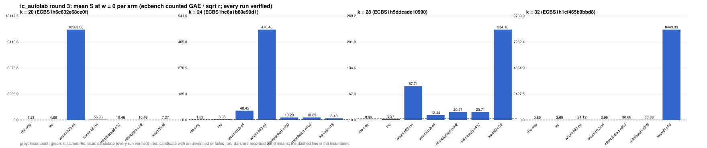
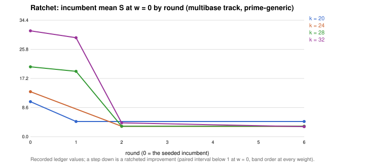

# ic_autolab round 3 (multibase track): report

Protocol: [PROTOCOL.md](PROTOCOL.md), frozen 2026-11-19T07:35:17Z at git `94bedd024d60216a091669f1ed83a8561637d607`; route `local`. Counted GAE only (deterministic, host independent); no wall-time claim; development loop, no validation-gate row. Loop home: [`../`](../README.md); ledger: [`../ledger.json`](../ledger.json).

Claim record: `PCC-20261119-e03ae8` (`python3 tools/pcc/pcc.py standing PCC-20261119-e03ae8`). Until a signed replay and recompute exist, this round's outcome is an unverified assertion [pcc:unverified].

## Outcome

| k | class | sel | sel / inc at w = 0 [95%] | w = 0.1 | w = 1 | band | S sel (w = 0 / 0.1 / 1) | S inc | S rho-neg | distance sel / rho |
|--:|:--|:--|:--|:--|:--|:--|:--|:--|:--|:--|
| 20 | **no_challenger** | none (best candidate `ksum5f-n8`, train S 7.372 / 8.201 / 15.661) | - | - | - | - | - | 4.877 / 5.479 / 10.895 | 1.208 / 1.307 / 2.196 | inc: 4.0x / 4.2x / 5.0x |
| 24 | **no_challenger** | none (best candidate `ksum5f-n13`, train S 8.479 / 9.273 / 16.423) | - | - | - | - | - | 3.059 / 3.420 / 6.663 | 1.517 / 1.659 / 2.942 | inc: 2.0x / 2.1x / 2.3x |
| 28 | **no_challenger** | none (best candidate `wsum-b12-n4`, train S 12.437 / 13.697 / 25.036) | - | - | - | - | - | 3.273 / 3.696 / 7.509 | 0.995 / 1.092 / 1.966 | inc: 3.3x / 3.4x / 3.8x |
| 32 | **no_challenger** | none (best candidate `wsum-b12-n4`, train S 3.952 / 4.406 / 8.486) | - | - | - | - | - | 3.686 / 4.358 / 10.403 | 0.887 / 0.975 / 1.767 | inc: 4.2x / 4.5x / 5.9x |

Classes follow the protocol's decision rule. Distance to rho is the distance remaining, not a gate. The reasons per size:

- k = 20: no_challenger
- k = 24: no_challenger
- k = 28: no_challenger
- k = 32: no_challenger

## Train (development screen, in sample)

### k = 20: session `ECBS1h6c632e68ce0f` (run exit 0, verify exit 0, receipt sha256 `818bf91daf2c2b87d0db0ce1e66dc1f904a6f2ae3284b8c43b694228637143a2`)

| arm | family | N | factor base | oracle | runs | verified | S (w = 0 / 0.1 / 1) | reason proposed |
|:--|:--|--:|:--|:--|--:|--:|:--|:--|
| `rho-neg` | rho | - | `-` | `rho.negation` | 12 | 12 | 1.208 / 1.307 / 2.196 | matched reference |
| `inc` | wsum-b5 | 3 | `prime-abscissa:size=3` | `wsum:coef=5,free=1` | 12 | 12 | 4.877 / 5.479 / 10.895 | incumbent |
| `wsum-b20-n4` | wsum-b20 | 4 | `prime-abscissa:size=4` | `wsum:coef=20,free=1` | 12 | 12 | 10563.064 / 12076.555 / 25697.971 | cross-size transfer neighbourhood: N = 1.2 x 3 (wsum-b20 from k = 28) |
| `wsum-b8-n4` | wsum-b8 | 4 | `prime-abscissa:size=4` | `wsum:coef=8,free=1` | 12 | 12 | 56.964 / 62.555 / 112.875 | alternative wsum-b8 (best S(0) 5.146 at N = 3): N = 1.2 x 3 |
| `mitmblocked-n52` | mitmblocked | 52 | `prime-abscissa:size=52` | `mitm-prime-blocked:m=2` | 12 | 12 | 10.461 / 11.839 / 24.244 | exploration: family mitmblocked untried at k = 20, N = 1 x N_a |
| `mitmbatch-n52` | mitmbatch | 52 | `prime-abscissa:size=52` | `mitm-prime-batch:m=2` | 12 | 12 | 10.461 / 11.839 / 24.244 | exploration: family mitmbatch untried at k = 20, N = 1 x N_a |
| `ksum5f-n8` | ksum5f | 8 | `prime-abscissa:size=8` | `ksum:m=5,free=1` | 12 | 12 | 7.372 / 8.201 / 15.661 | exploration: family ksum5f untried at k = 20, N = 0.08 x N_a |

### k = 24: session `ECBS1hc6a1b80e90d1` (run exit 0, verify exit 0, receipt sha256 `87b7a9b8e20443309e0f416a8b29e8e97712af545e130c61e6f770dfb175424e`)

| arm | family | N | factor base | oracle | runs | verified | S (w = 0 / 0.1 / 1) | reason proposed |
|:--|:--|--:|:--|:--|--:|--:|:--|:--|
| `rho-neg` | rho | - | `-` | `rho.negation` | 12 | 12 | 1.517 / 1.659 / 2.942 | matched reference |
| `inc` | wsum-b12 | 3 | `prime-abscissa:size=3` | `wsum:coef=12,free=1` | 12 | 12 | 3.059 / 3.420 / 6.663 | incumbent |
| `wsum-b12-n4` | wsum-b12 | 4 | `prime-abscissa:size=4` | `wsum:coef=12,free=1` | 12 | 12 | 48.452 / 53.275 / 96.686 | incumbent neighbourhood: N = 1.2 x 3 |
| `wsum-b20-n4` | wsum-b20 | 4 | `prime-abscissa:size=4` | `wsum:coef=20,free=1` | 12 | 12 | 470.458 / 515.801 / 923.894 | cross-size transfer neighbourhood: N = 1.2 x 3 (wsum-b20 from k = 28) |
| `mitmblocked-n160` | mitmblocked | 160 | `prime-abscissa:size=160` | `mitm-prime-blocked:m=2` | 12 | 12 | 13.289 / 15.236 / 32.751 | exploration: family mitmblocked untried at k = 24, N = 1 x N_a |
| `mitmbatch-n160` | mitmbatch | 160 | `prime-abscissa:size=160` | `mitm-prime-batch:m=2` | 12 | 12 | 13.289 / 15.236 / 32.751 | exploration: family mitmbatch untried at k = 24, N = 1 x N_a |
| `ksum5f-n13` | ksum5f | 13 | `prime-abscissa:size=13` | `ksum:m=5,free=1` | 12 | 12 | 8.479 / 9.273 / 16.423 | exploration: family ksum5f untried at k = 24, N = 0.08 x N_a |

### k = 28: session `ECBS1h5ddcade10990` (run exit 0, verify exit 0, receipt sha256 `b6d7da90bd7f93e259bafbc6b0ab0f9721829641202b3779ef78ce26282f18b2`)

| arm | family | N | factor base | oracle | runs | verified | S (w = 0 / 0.1 / 1) | reason proposed |
|:--|:--|--:|:--|:--|--:|--:|:--|:--|
| `rho-neg` | rho | - | `-` | `rho.negation` | 12 | 12 | 0.995 / 1.092 / 1.966 | matched reference |
| `inc` | wsum-b20 | 3 | `prime-abscissa:size=3` | `wsum:coef=20,free=1` | 12 | 12 | 3.273 / 3.696 / 7.509 | incumbent |
| `wsum-b20-n4` | wsum-b20 | 4 | `prime-abscissa:size=4` | `wsum:coef=20,free=1` | 12 | 12 | 87.706 / 96.472 / 175.362 | incumbent neighbourhood: N = 1.2 x 3 |
| `wsum-b12-n4` | wsum-b12 | 4 | `prime-abscissa:size=4` | `wsum:coef=12,free=1` | 12 | 12 | 12.437 / 13.697 / 25.036 | cross-size transfer: wsum-b12-n3 is the k = 24 incumbent at N / N_a = 0.019 |
| `mitmblocked-n402` | mitmblocked | 402 | `prime-abscissa:size=402` | `mitm-prime-blocked:m=2` | 12 | 12 | 20.713 / 23.835 / 51.927 | exploration: family mitmblocked untried at k = 28, N = 1 x N_a |
| `mitmbatch-n402` | mitmbatch | 402 | `prime-abscissa:size=402` | `mitm-prime-batch:m=2` | 12 | 12 | 20.713 / 23.835 / 51.927 | exploration: family mitmbatch untried at k = 28, N = 1 x N_a |
| `ksum5f-n32` | ksum5f | 32 | `prime-abscissa:size=32` | `ksum:m=5,free=1` | 12 | 12 | 234.099 / 259.345 / 486.555 | exploration: family ksum5f untried at k = 28, N = 0.08 x N_a |

### k = 32: session `ECBS1h1cf465b9bbd8` (run exit 0, verify exit 0, receipt sha256 `d86304dc3d1701ae12a8a842cff9558e6fa351dac959321a2f453c5660939492`)

| arm | family | N | factor base | oracle | runs | verified | S (w = 0 / 0.1 / 1) | reason proposed |
|:--|:--|--:|:--|:--|--:|--:|:--|:--|
| `rho-neg` | rho | - | `-` | `rho.negation` | 12 | 12 | 0.887 / 0.975 / 1.767 | matched reference |
| `inc` | wsum-b20 | 3 | `prime-abscissa:size=3` | `wsum:coef=20,free=1` | 12 | 12 | 3.686 / 4.358 / 10.403 | incumbent |
| `wsum-b20-n4` | wsum-b20 | 4 | `prime-abscissa:size=4` | `wsum:coef=20,free=1` | 12 | 12 | 24.124 / 26.544 / 48.323 | incumbent neighbourhood: N = 1.2 x 3 |
| `wsum-b12-n4` | wsum-b12 | 4 | `prime-abscissa:size=4` | `wsum:coef=12,free=1` | 12 | 12 | 3.952 / 4.406 / 8.486 | cross-size transfer: wsum-b12-n3 is the k = 24 incumbent at N / N_a = 0.019 |
| `mitmblocked-n953` | mitmblocked | 953 | `prime-abscissa:size=953` | `mitm-prime-blocked:m=2` | 12 | 12 | 30.877 / 35.509 / 77.194 | exploration: family mitmblocked untried at k = 32, N = 1 x N_a |
| `mitmbatch-n953` | mitmbatch | 953 | `prime-abscissa:size=953` | `mitm-prime-batch:m=2` | 12 | 12 | 30.877 / 35.509 / 77.194 | exploration: family mitmbatch untried at k = 32, N = 1 x N_a |
| `ksum5f-n76` | ksum5f | 76 | `prime-abscissa:size=76` | `ksum:m=5,free=1` | 12 | 12 | 8443.386 / 10087.381 / 24883.336 | exploration: family ksum5f untried at k = 32, N = 0.08 x N_a |

## Selection

- k = 20: no_challenger  (Pareto alternative at w = 1: `ksum5f-n8`)
- k = 24: no_challenger  (Pareto alternative at w = 1: `ksum5f-n13`)
- k = 28: no_challenger  (Pareto alternative at w = 1: `wsum-b12-n4`)
- k = 32: no_challenger  (Pareto alternative at w = 1: `wsum-b12-n4`)

## Ledger after this round

| k | incumbent | since round | S (w = 0 / 0.1 / 1) | distance to rho |
|--:|:--|--:|:--|:--|
| 20 | `wsum-b5-n3` (`prime-abscissa:size=3` + `wsum:coef=5,free=1`) | 1 | 4.479 / 5.010 / 9.787 | 3.2x / 3.3x / 3.8x |
| 24 | `wsum-b12-n3` (`prime-abscissa:size=3` + `wsum:coef=12,free=1`) | 2 | 3.060 / 3.422 / 6.678 | 3.4x / 3.4x / 3.9x |
| 28 | `wsum-b20-n3` (`prime-abscissa:size=3` + `wsum:coef=20,free=1`) | 2 | 3.081 / 3.466 / 6.936 | 3.3x / 3.4x / 3.7x |
| 32 | `wsum-b28-n3` (`prime-abscissa:size=3` + `wsum:coef=28,free=1`) | 6 | 2.966 / 3.396 / 7.269 | 2.7x / 2.8x / 3.3x |

## Evidence and deviations

- ecbench binary sha256: `5f53faa52d15bf8249d4b990928949e3a375b30cb82eda391deb22223f0223e4`; `--cpus none`, allow_busy = true; `verify --replay 12` per session; audit receipts in `analysis/`; sessions in `sessions/` (records in the artifact store when large).
- Route: the local route is an explicitly requested development screen, not the Iso Lab EKS default; counts are deterministic and replayed, wall time is not claimed. No row of this round enters the IC leaderboard or `benchmarks/README.md` (validation gate).
- Train selection is in sample (disclosed); the holdout is fresh (new `target_seed`, excluded exposures). Failed, timed-out and regressing arms are retained above.
