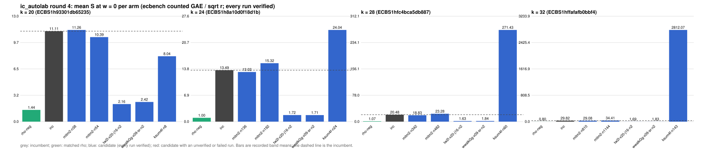
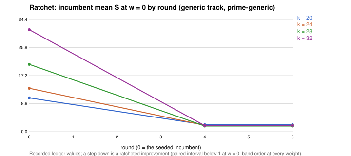

# ic_autolab round 4 (generic track): report

Protocol: [PROTOCOL.md](PROTOCOL.md), frozen 2026-11-19T08:08:20Z at git `94bedd024d60216a091669f1ed83a8561637d607`; route `local`. Counted GAE only (deterministic, host independent); no wall-time claim; development loop, no validation-gate row. Loop home: [`../`](../README.md); ledger: [`../ledger.json`](../ledger.json).

Claim record: `PCC-20261119-8e4c59` (`python3 tools/pcc/pcc.py standing PCC-20261119-8e4c59`). Until a signed replay and recompute exist, this round's outcome is an unverified assertion [pcc:unverified].

## Outcome

| k | class | sel | sel / inc at w = 0 [95%] | w = 0.1 | w = 1 | band | S sel (w = 0 / 0.1 / 1) | S inc | S rho-neg | distance sel / rho |
|--:|:--|:--|:--|:--|:--|:--|:--|:--|:--|:--|
| 20 | **improvement** | tw2l-x20-j16-n2 | 0.213 [0.193, 0.236] | 0.204 [0.184, 0.226] | 0.167 [0.150, 0.187] | sel < inc | 2.123 / 2.305 / 3.943 | 9.957 / 11.321 / 23.595 | 1.321 / 1.431 / 2.423 | 1.6x / 1.6x / 1.6x |
| 24 | **improvement** | wwalkGg-x09-sr-n2 | 0.141 [0.131, 0.151] | 0.134 [0.125, 0.144] | 0.110 [0.102, 0.118] | sel < inc | 1.946 / 2.128 / 3.771 | 13.847 / 15.906 / 34.433 | 0.994 / 1.084 / 1.896 | 2.0x / 2.0x / 2.0x |
| 28 | **improvement** | tw2l-x20-j16-n2 | 0.084 [0.075, 0.093] | 0.080 [0.072, 0.089] | 0.066 [0.060, 0.074] | sel < inc | 1.726 / 1.897 / 3.432 | 20.656 / 23.768 / 51.777 | 0.934 / 1.025 / 1.845 | 1.8x / 1.8x / 1.9x |
| 32 | **improvement** | tw2l-x20-j16-n2 | 0.061 [0.056, 0.066] | 0.058 [0.053, 0.063] | 0.049 [0.045, 0.053] | sel < inc | 1.833 / 2.015 / 3.659 | 30.241 / 34.745 / 75.281 | 1.016 / 1.117 / 2.025 | 1.8x / 1.8x / 1.8x |

Classes follow the protocol's decision rule. Distance to rho is the distance remaining, not a gate. The reasons per size:

- k = 20: compare ops.status = ok, admissible = true; sel / inc = 0.2132 [0.193, 0.236] at w = 0; band: sel < inc; A/A inc-aa / inc interval [1.000, 1.000] contains 1
- k = 24: compare ops.status = ok, admissible = true; sel / inc = 0.1405 [0.131, 0.151] at w = 0; band: sel < inc; A/A inc-aa / inc interval [1.000, 1.000] contains 1
- k = 28: compare ops.status = ok, admissible = true; sel / inc = 0.0836 [0.075, 0.093] at w = 0; band: sel < inc; A/A inc-aa / inc interval [1.000, 1.000] contains 1
- k = 32: compare ops.status = ok, admissible = true; sel / inc = 0.0606 [0.056, 0.066] at w = 0; band: sel < inc; A/A inc-aa / inc interval [1.000, 1.000] contains 1

## Train (development screen, in sample)

### k = 20: session `ECBS1h93301db65235` (run exit 0, verify exit 0, receipt sha256 `8b5af72817f266674a64bd8c2cd7bf60e260fc1b3a37826a5bded742bb1b738b`)

| arm | family | N | factor base | oracle | runs | verified | S (w = 0 / 0.1 / 1) | reason proposed |
|:--|:--|--:|:--|:--|--:|--:|:--|:--|
| `rho-neg` | rho | - | `-` | `rho.negation` | 12 | 12 | 1.438 / 1.560 / 2.659 | matched reference |
| `inc` | mitm2 | 45 | `prime-abscissa:size=45` | `mitm:negation_folded=1` | 12 | 12 | 11.114 / 12.671 / 26.685 | incumbent |
| `mitm2-n38` | mitm2 | 38 | `prime-abscissa:size=38` | `mitm:negation_folded=1` | 12 | 12 | 11.262 / 12.897 / 27.608 | incumbent neighbourhood: N = 0.85 x 45 |
| `mitm2-n54` | mitm2 | 54 | `prime-abscissa:size=54` | `mitm:negation_folded=1` | 12 | 12 | 10.388 / 11.750 / 24.013 | incumbent neighbourhood: N = 1.2 x 45 |
| `tw2l-x20-j16-n2` | tw2l-x20-j16 | 2 | `prime-abscissa:size=2` | `wwalk:x=2.0,jumps=16,g=1,grow=2,tw=2,cj=1,lazy=1,seed=run` | 12 | 12 | 2.158 / 2.344 / 4.015 | exploration: family tw2l-x20-j16 untried at k = 20, N = 0.0001 x N_a |
| `wwalkGg-x09-sr-n2` | wwalkGg-x09-sr | 2 | `prime-abscissa:size=2` | `wwalk:x=0.9,g=1,grow=2,seed=run` | 12 | 12 | 2.417 / 2.607 / 4.318 | exploration: family wwalkGg-x09-sr untried at k = 20, N = 0.0001 x N_a |
| `ksum4f-n8` | ksum4f | 8 | `prime-abscissa:size=8` | `ksum:m=4,free=1` | 12 | 12 | 8.036 / 9.132 / 18.996 | exploration: family ksum4f untried at k = 20, N = 0.15 x N_a |

### k = 24: session `ECBS1h8a10d0f18d1b` (run exit 0, verify exit 0, receipt sha256 `ea843f41463728a151db00332a1c84026dc83045f554aa4c5152186c0203f6d4`)

| arm | family | N | factor base | oracle | runs | verified | S (w = 0 / 0.1 / 1) | reason proposed |
|:--|:--|--:|:--|:--|--:|--:|:--|:--|
| `rho-neg` | rho | - | `-` | `rho.negation` | 12 | 12 | 1.003 / 1.095 / 1.916 | matched reference |
| `inc` | mitm2 | 160 | `prime-abscissa:size=160` | `mitm:negation_folded=1` | 12 | 12 | 13.492 / 15.476 / 33.333 | incumbent |
| `mitm2-n136` | mitm2 | 136 | `prime-abscissa:size=136` | `mitm:negation_folded=1` | 12 | 12 | 13.015 / 15.075 / 33.611 | incumbent neighbourhood: N = 0.85 x 160 |
| `mitm2-n192` | mitm2 | 192 | `prime-abscissa:size=192` | `mitm:negation_folded=1` | 12 | 12 | 15.319 / 17.400 / 36.130 | incumbent neighbourhood: N = 1.2 x 160 |
| `tw2l-x20-j16-n2` | tw2l-x20-j16 | 2 | `prime-abscissa:size=2` | `wwalk:x=2.0,jumps=16,g=1,grow=2,tw=2,cj=1,lazy=1,seed=run` | 12 | 12 | 1.717 / 1.882 / 3.364 | exploration: family tw2l-x20-j16 untried at k = 24, N = 0.0001 x N_a |
| `wwalkGg-x09-sr-n2` | wwalkGg-x09-sr | 2 | `prime-abscissa:size=2` | `wwalk:x=0.9,g=1,grow=2,seed=run` | 12 | 12 | 1.712 / 1.872 / 3.306 | exploration: family wwalkGg-x09-sr untried at k = 24, N = 0.0001 x N_a |
| `ksum4f-n24` | ksum4f | 24 | `prime-abscissa:size=24` | `ksum:m=4,free=1` | 12 | 12 | 24.035 / 26.562 / 49.299 | exploration: family ksum4f untried at k = 24, N = 0.15 x N_a |

### k = 28: session `ECBS1hfc4bca5db887` (run exit 0, verify exit 0, receipt sha256 `4c29ea481d78bf6e0fd38928363908b2645d1328462fe0d59c4d3fb064bd3cda`)

| arm | family | N | factor base | oracle | runs | verified | S (w = 0 / 0.1 / 1) | reason proposed |
|:--|:--|--:|:--|:--|--:|--:|:--|:--|
| `rho-neg` | rho | - | `-` | `rho.negation` | 12 | 12 | 1.070 / 1.175 / 2.117 | matched reference |
| `inc` | mitm2 | 402 | `prime-abscissa:size=402` | `mitm:negation_folded=1` | 12 | 12 | 20.483 / 23.560 / 51.249 | incumbent |
| `mitm2-n342` | mitm2 | 342 | `prime-abscissa:size=342` | `mitm:negation_folded=1` | 12 | 12 | 18.827 / 21.846 / 49.019 | incumbent neighbourhood: N = 0.85 x 402 |
| `mitm2-n482` | mitm2 | 482 | `prime-abscissa:size=482` | `mitm:negation_folded=1` | 12 | 12 | 23.282 / 26.484 / 55.302 | incumbent neighbourhood: N = 1.2 x 402 |
| `tw2l-x20-j16-n2` | tw2l-x20-j16 | 2 | `prime-abscissa:size=2` | `wwalk:x=2.0,jumps=16,g=1,grow=2,tw=2,cj=1,lazy=1,seed=run` | 12 | 12 | 1.632 / 1.793 / 3.243 | exploration: family tw2l-x20-j16 untried at k = 28, N = 0.0001 x N_a |
| `wwalkGg-x09-sr-n2` | wwalkGg-x09-sr | 2 | `prime-abscissa:size=2` | `wwalk:x=0.9,g=1,grow=2,seed=run` | 12 | 12 | 1.838 / 2.018 / 3.639 | exploration: family wwalkGg-x09-sr untried at k = 28, N = 0.0001 x N_a |
| `ksum4f-n60` | ksum4f | 60 | `prime-abscissa:size=60` | `ksum:m=4,free=1` | 12 | 12 | 271.430 / 303.858 / 595.710 | exploration: family ksum4f untried at k = 28, N = 0.15 x N_a |

### k = 32: session `ECBS1hffafafb0bbf4` (run exit 0, verify exit 0, receipt sha256 `eb5dec21ccc45b1f9072f4fb33711a79c091dfa90238086b95917e2c4e02596d`)

| arm | family | N | factor base | oracle | runs | verified | S (w = 0 / 0.1 / 1) | reason proposed |
|:--|:--|--:|:--|:--|--:|--:|:--|:--|
| `rho-neg` | rho | - | `-` | `rho.negation` | 12 | 12 | 0.798 / 0.878 / 1.590 | matched reference |
| `inc` | mitm2 | 953 | `prime-abscissa:size=953` | `mitm:negation_folded=1` | 12 | 12 | 29.823 / 34.244 / 74.035 | incumbent |
| `mitm2-n810` | mitm2 | 810 | `prime-abscissa:size=810` | `mitm:negation_folded=1` | 12 | 12 | 29.079 / 33.778 / 76.073 | incumbent neighbourhood: N = 0.85 x 953 |
| `mitm2-n1144` | mitm2 | 1144 | `prime-abscissa:size=1144` | `mitm:negation_folded=1` | 12 | 12 | 34.412 / 39.072 / 81.015 | incumbent neighbourhood: N = 1.2 x 953 |
| `tw2l-x20-j16-n2` | tw2l-x20-j16 | 2 | `prime-abscissa:size=2` | `wwalk:x=2.0,jumps=16,g=1,grow=2,tw=2,cj=1,lazy=1,seed=run` | 12 | 12 | 1.694 / 1.863 / 3.381 | exploration: family tw2l-x20-j16 untried at k = 32, N = 0.0001 x N_a |
| `wwalkGg-x09-sr-n2` | wwalkGg-x09-sr | 2 | `prime-abscissa:size=2` | `wwalk:x=0.9,g=1,grow=2,seed=run` | 12 | 12 | 1.833 / 2.015 / 3.654 | exploration: family wwalkGg-x09-sr untried at k = 32, N = 0.0001 x N_a |
| `ksum4f-n143` | ksum4f | 143 | `prime-abscissa:size=143` | `ksum:m=4,free=1` | 12 | 12 | 2812.070 / 3238.120 / 7072.571 | exploration: family ksum4f untried at k = 32, N = 0.15 x N_a |

## Selection

- k = 20: challenger `tw2l-x20-j16-n2` (Pareto alternative at w = 1: `tw2l-x20-j16-n2`)
- k = 24: challenger `wwalkGg-x09-sr-n2` (Pareto alternative at w = 1: `wwalkGg-x09-sr-n2`)
- k = 28: challenger `tw2l-x20-j16-n2` (Pareto alternative at w = 1: `tw2l-x20-j16-n2`)
- k = 32: challenger `tw2l-x20-j16-n2` (Pareto alternative at w = 1: `tw2l-x20-j16-n2`)

## Holdout sessions

| k | session | run exit | verify exit | receipt sha256 | levels |
|--:|:--|--:|--:|:--|:--|
| 20 | `ECBS1h7ab83998e0bd` | 0 | 0 | `6f34053c49261e39b93c4368cd85076123f07ea2f8c37a89ab2a06e3ecac279b` | {"verified":360} |
| 24 | `ECBS1hbda7b82ae434` | 0 | 0 | `1b27074672f345252f83d8437abcbb89b4d81fa30202f51ddffa713aea33aa83` | {"verified":360} |
| 28 | `ECBS1ha25666791b28` | 0 | 0 | `c0b672269afd02038f3d555f70e189c6e597bdf1543c4c791ebca43c53504212` | {"verified":360} |
| 32 | `ECBS1h4ae73e7b227d` | 0 | 0 | `de3ce0cb233939d03a7812a5eeb5f8b7df6a375762b528f7e488ffa1c1a16408` | {"verified":360} |

## Ledger after this round

| k | incumbent | since round | S (w = 0 / 0.1 / 1) | distance to rho |
|--:|:--|--:|:--|:--|
| 20 | `tw2l-x20-j16-n2` (`prime-abscissa:size=2` + `wwalk:x=2.0,jumps=16,g=1,grow=2,tw=2,cj=1,lazy=1,seed=run`) | 4 | 2.123 / 2.305 / 3.943 | 1.6x / 1.6x / 1.6x |
| 24 | `wwalkGg-x09-sr-n2` (`prime-abscissa:size=2` + `wwalk:x=0.9,g=1,grow=2,seed=run`) | 4 | 1.946 / 2.128 / 3.771 | 2.0x / 2.0x / 2.0x |
| 28 | `tw2l-x20-j16-n2` (`prime-abscissa:size=2` + `wwalk:x=2.0,jumps=16,g=1,grow=2,tw=2,cj=1,lazy=1,seed=run`) | 4 | 1.726 / 1.897 / 3.432 | 1.8x / 1.8x / 1.9x |
| 32 | `tw2l-x20-j16-n2` (`prime-abscissa:size=2` + `wwalk:x=2.0,jumps=16,g=1,grow=2,tw=2,cj=1,lazy=1,seed=run`) | 4 | 1.833 / 2.015 / 3.659 | 1.8x / 1.8x / 1.8x |

## Evidence and deviations

- ecbench binary sha256: `5f53faa52d15bf8249d4b990928949e3a375b30cb82eda391deb22223f0223e4`; `--cpus none`, allow_busy = true; `verify --replay 12` per session; audit receipts in `analysis/`; sessions in `sessions/` (records in the artifact store when large).
- Route: the local route is an explicitly requested development screen, not the Iso Lab EKS default; counts are deterministic and replayed, wall time is not claimed. No row of this round enters the IC leaderboard or `benchmarks/README.md` (validation gate).
- Train selection is in sample (disclosed); the holdout is fresh (new `target_seed`, excluded exposures). Failed, timed-out and regressing arms are retained above.
