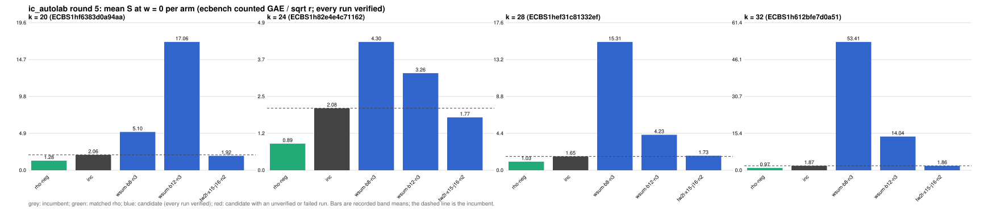
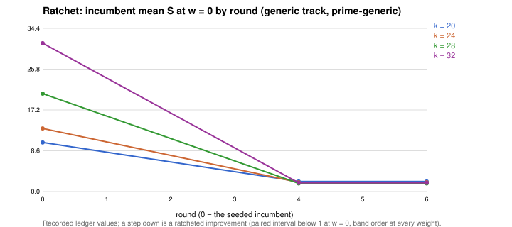

# ic_autolab round 5 (generic track): report

Protocol: [PROTOCOL.md](PROTOCOL.md), frozen 2026-11-19T08:20:20Z at git `94bedd024d60216a091669f1ed83a8561637d607`; route `local`. Counted GAE only (deterministic, host independent); no wall-time claim; development loop, no validation-gate row. Loop home: [`../`](../README.md); ledger: [`../ledger.json`](../ledger.json).

Claim record: `PCC-20261119-7478b3` (`python3 tools/pcc/pcc.py standing PCC-20261119-7478b3`). Until a signed replay and recompute exist, this round's outcome is an unverified assertion [pcc:unverified].

## Outcome

| k | class | sel | sel / inc at w = 0 [95%] | w = 0.1 | w = 1 | band | S sel (w = 0 / 0.1 / 1) | S inc | S rho-neg | distance sel / rho |
|--:|:--|:--|:--|:--|:--|:--|:--|:--|:--|:--|
| 20 | **null** | tw2l-x15-j16-n2 | 0.950 [0.855, 1.055] | 0.950 [0.853, 1.056] | 0.948 [0.846, 1.061] | sel < inc | 2.072 / 2.249 / 3.846 | 2.181 / 2.369 / 4.058 | 1.409 / 1.528 / 2.598 | 1.5x / 1.5x / 1.5x |
| 24 | **null** | tw2l-x15-j16-n2 | 0.984 [0.883, 1.096] | 0.986 [0.885, 1.099] | 0.997 [0.893, 1.114] | sel < inc | 1.878 / 2.058 / 3.686 | 1.909 / 2.088 / 3.695 | 1.006 / 1.097 / 1.920 | 1.9x / 1.9x / 1.9x |
| 28 | **no_challenger** | none (best candidate `tw2l-x15-j16-n2`, train S 1.735 / 1.906 / 3.449) | - | - | - | - | - | 1.652 / 1.815 / 3.282 | 1.031 / 1.132 / 2.038 | inc: 1.6x / 1.6x / 1.6x |
| 32 | **regression** | tw2l-x15-j16-n2 | 1.088 [0.940, 1.258] | 1.088 [0.940, 1.259] | 1.088 [0.940, 1.259] | inc < sel | 1.797 / 1.976 / 3.588 | 1.652 / 1.817 / 3.298 | 0.921 / 1.013 / 1.836 | 2.0x / 2.0x / 2.0x |

Classes follow the protocol's decision rule. Distance to rho is the distance remaining, not a gate. The reasons per size:

- k = 20: compare ops.status = ok, admissible = true; sel / inc = 0.9499 [0.855, 1.055] at w = 0; band: sel < inc; A/A inc-aa / inc interval [1.000, 1.000] contains 1
- k = 24: compare ops.status = ok, admissible = true; sel / inc = 0.9835 [0.883, 1.096] at w = 0; band: sel < inc; A/A inc-aa / inc interval [1.000, 1.000] contains 1
- k = 28: no_challenger
- k = 32: compare ops.status = ok, admissible = true; sel / inc = 1.0876 [0.940, 1.258] at w = 0; band: inc < sel; A/A inc-aa / inc interval [1.000, 1.000] contains 1

## Train (development screen, in sample)

### k = 20: session `ECBS1hf6383d0a94aa` (run exit 0, verify exit 0, receipt sha256 `fe8c4b8dee3308518d498c28fa40e110ec8595cd314828f471e864c12f804127`)

| arm | family | N | factor base | oracle | runs | verified | S (w = 0 / 0.1 / 1) | reason proposed |
|:--|:--|--:|:--|:--|--:|--:|:--|:--|
| `rho-neg` | rho | - | `-` | `rho.negation` | 12 | 12 | 1.275 / 1.381 / 2.337 | matched reference |
| `inc` | tw2l-x20-j16 | 2 | `prime-abscissa:size=2` | `wwalk:x=2.0,jumps=16,g=1,grow=2,tw=2,cj=1,lazy=1,seed=run` | 12 | 12 | 2.055 / 2.231 / 3.811 | incumbent |
| `wsum-b8-n3` | wsum-b8 | 3 | `prime-abscissa:size=3` | `wsum:coef=8,free=1` | 12 | 12 | 5.097 / 5.549 / 9.618 | exploration: family wsum-b8 untried at k = 20, N = 0.0001 x N_a |
| `wsum-b12-n3` | wsum-b12 | 3 | `prime-abscissa:size=3` | `wsum:coef=12,free=1` | 12 | 12 | 17.065 / 18.687 / 33.282 | exploration: family wsum-b12 untried at k = 20, N = 0.0001 x N_a |
| `tw2l-x15-j16-n2` | tw2l-x15-j16 | 2 | `prime-abscissa:size=2` | `wwalk:x=1.5,jumps=16,g=1,grow=2,tw=2,cj=1,lazy=1,seed=run` | 12 | 12 | 1.915 / 2.077 / 3.534 | exploration: family tw2l-x15-j16 untried at k = 20, N = 0.0001 x N_a |

### k = 24: session `ECBS1h82e4e4c71162` (run exit 0, verify exit 0, receipt sha256 `3cf9a1b398fd1712c6ab2fbe22f79ac060e1264c8cd674b0cdd2b97837a735c1`)

| arm | family | N | factor base | oracle | runs | verified | S (w = 0 / 0.1 / 1) | reason proposed |
|:--|:--|--:|:--|:--|--:|--:|:--|:--|
| `rho-neg` | rho | - | `-` | `rho.negation` | 12 | 12 | 0.892 / 0.972 / 1.693 | matched reference |
| `inc` | wwalkGg-x09-sr | 2 | `prime-abscissa:size=2` | `wwalk:x=0.9,g=1,grow=2,seed=run` | 12 | 12 | 2.081 / 2.276 / 4.038 | incumbent |
| `wsum-b8-n3` | wsum-b8 | 3 | `prime-abscissa:size=3` | `wsum:coef=8,free=1` | 12 | 12 | 4.304 / 5.027 / 11.536 | exploration: family wsum-b8 untried at k = 24, N = 0.0001 x N_a |
| `wsum-b12-n3` | wsum-b12 | 3 | `prime-abscissa:size=3` | `wsum:coef=12,free=1` | 12 | 12 | 3.257 / 3.658 / 7.262 | exploration: family wsum-b12 untried at k = 24, N = 0.0001 x N_a |
| `tw2l-x15-j16-n2` | tw2l-x15-j16 | 2 | `prime-abscissa:size=2` | `wwalk:x=1.5,jumps=16,g=1,grow=2,tw=2,cj=1,lazy=1,seed=run` | 12 | 12 | 1.775 / 1.945 / 3.480 | exploration: family tw2l-x15-j16 untried at k = 24, N = 0.0001 x N_a |

### k = 28: session `ECBS1hef31c81332ef` (run exit 0, verify exit 0, receipt sha256 `75b23c90209e56f277512a3b0024ee2982ae30184177ef02f5a98718eb7d88dd`)

| arm | family | N | factor base | oracle | runs | verified | S (w = 0 / 0.1 / 1) | reason proposed |
|:--|:--|--:|:--|:--|--:|--:|:--|:--|
| `rho-neg` | rho | - | `-` | `rho.negation` | 12 | 12 | 1.031 / 1.132 / 2.038 | matched reference |
| `inc` | tw2l-x20-j16 | 2 | `prime-abscissa:size=2` | `wwalk:x=2.0,jumps=16,g=1,grow=2,tw=2,cj=1,lazy=1,seed=run` | 12 | 12 | 1.652 / 1.815 / 3.282 | incumbent |
| `wsum-b8-n3` | wsum-b8 | 3 | `prime-abscissa:size=3` | `wsum:coef=8,free=1` | 12 | 12 | 15.307 / 18.321 / 45.449 | exploration: family wsum-b8 untried at k = 28, N = 0.0001 x N_a |
| `wsum-b12-n3` | wsum-b12 | 3 | `prime-abscissa:size=3` | `wsum:coef=12,free=1` | 12 | 12 | 4.232 / 5.007 / 11.981 | exploration: family wsum-b12 untried at k = 28, N = 0.0001 x N_a |
| `tw2l-x15-j16-n2` | tw2l-x15-j16 | 2 | `prime-abscissa:size=2` | `wwalk:x=1.5,jumps=16,g=1,grow=2,tw=2,cj=1,lazy=1,seed=run` | 12 | 12 | 1.735 / 1.906 / 3.449 | exploration: family tw2l-x15-j16 untried at k = 28, N = 0.0001 x N_a |

### k = 32: session `ECBS1h612bfe7d0a51` (run exit 0, verify exit 0, receipt sha256 `f5be35ef0d9ce76f739a316a8d36b266d90ce0205de69aca0089a6809b9161fd`)

| arm | family | N | factor base | oracle | runs | verified | S (w = 0 / 0.1 / 1) | reason proposed |
|:--|:--|--:|:--|:--|--:|--:|:--|:--|
| `rho-neg` | rho | - | `-` | `rho.negation` | 12 | 12 | 0.970 / 1.066 / 1.933 | matched reference |
| `inc` | tw2l-x20-j16 | 2 | `prime-abscissa:size=2` | `wwalk:x=2.0,jumps=16,g=1,grow=2,tw=2,cj=1,lazy=1,seed=run` | 12 | 12 | 1.868 / 2.054 / 3.730 | incumbent |
| `wsum-b8-n3` | wsum-b8 | 3 | `prime-abscissa:size=3` | `wsum:coef=8,free=1` | 12 | 12 | 53.406 / 64.071 / 160.051 | exploration: family wsum-b8 untried at k = 32, N = 0.0001 x N_a |
| `wsum-b12-n3` | wsum-b12 | 3 | `prime-abscissa:size=3` | `wsum:coef=12,free=1` | 12 | 12 | 14.040 / 16.824 / 41.883 | exploration: family wsum-b12 untried at k = 32, N = 0.0001 x N_a |
| `tw2l-x15-j16-n2` | tw2l-x15-j16 | 2 | `prime-abscissa:size=2` | `wwalk:x=1.5,jumps=16,g=1,grow=2,tw=2,cj=1,lazy=1,seed=run` | 12 | 12 | 1.856 / 2.041 / 3.706 | exploration: family tw2l-x15-j16 untried at k = 32, N = 0.0001 x N_a |

## Selection

- k = 20: challenger `tw2l-x15-j16-n2` (Pareto alternative at w = 1: `tw2l-x15-j16-n2`)
- k = 24: challenger `tw2l-x15-j16-n2` (Pareto alternative at w = 1: `tw2l-x15-j16-n2`)
- k = 28: no_challenger  (Pareto alternative at w = 1: `tw2l-x15-j16-n2`)
- k = 32: challenger `tw2l-x15-j16-n2` (Pareto alternative at w = 1: `tw2l-x15-j16-n2`)

## Holdout sessions

| k | session | run exit | verify exit | receipt sha256 | levels |
|--:|:--|--:|--:|:--|:--|
| 20 | `ECBS1hb187eef21ba4` | 0 | 0 | `1491a725628fcd7fbfad7c7d6b4e165b448372f8112d8432d5bbb8d88a24ab1f` | {"verified":360} |
| 24 | `ECBS1hd38ea9f01806` | 0 | 0 | `467a8ab4351f3187ea5f5a3b57a5e6501d520b28fadb1c38e178a2c5ac8bb047` | {"verified":360} |
| 32 | `ECBS1h9d1a3b127622` | 0 | 0 | `1b8ba7756e743f577e57376b057ff9129c0f455e6033ade00c9d74e03f1fb884` | {"verified":360} |

## Ledger after this round

| k | incumbent | since round | S (w = 0 / 0.1 / 1) | distance to rho |
|--:|:--|--:|:--|:--|
| 20 | `tw2l-x20-j16-n2` (`prime-abscissa:size=2` + `wwalk:x=2.0,jumps=16,g=1,grow=2,tw=2,cj=1,lazy=1,seed=run`) | 4 | 2.123 / 2.305 / 3.943 | 1.6x / 1.6x / 1.6x |
| 24 | `wwalkGg-x09-sr-n2` (`prime-abscissa:size=2` + `wwalk:x=0.9,g=1,grow=2,seed=run`) | 4 | 1.946 / 2.128 / 3.771 | 2.0x / 2.0x / 2.0x |
| 28 | `tw2l-x20-j16-n2` (`prime-abscissa:size=2` + `wwalk:x=2.0,jumps=16,g=1,grow=2,tw=2,cj=1,lazy=1,seed=run`) | 4 | 1.726 / 1.897 / 3.432 | 1.8x / 1.8x / 1.9x |
| 32 | `tw2l-x20-j16-n2` (`prime-abscissa:size=2` + `wwalk:x=2.0,jumps=16,g=1,grow=2,tw=2,cj=1,lazy=1,seed=run`) | 4 | 1.833 / 2.015 / 3.659 | 1.8x / 1.8x / 1.8x |

## Evidence and deviations

- ecbench binary sha256: `5f53faa52d15bf8249d4b990928949e3a375b30cb82eda391deb22223f0223e4`; `--cpus none`, allow_busy = true; `verify --replay 12` per session; audit receipts in `analysis/`; sessions in `sessions/` (records in the artifact store when large).
- Route: the local route is an explicitly requested development screen, not the Iso Lab EKS default; counts are deterministic and replayed, wall time is not claimed. No row of this round enters the IC leaderboard or `benchmarks/README.md` (validation gate).
- Train selection is in sample (disclosed); the holdout is fresh (new `target_seed`, excluded exposures). Failed, timed-out and regressing arms are retained above.
