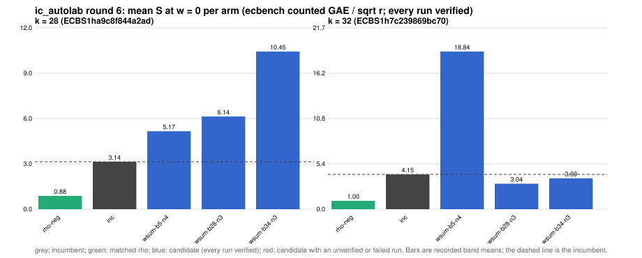
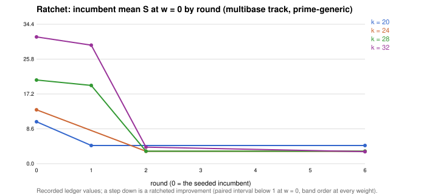

# ic_autolab round 6 (multibase track): report

Protocol: [PROTOCOL.md](PROTOCOL.md), frozen 2026-11-19T08:43:46Z at git `94bedd024d60216a091669f1ed83a8561637d607`; route `local`. Counted GAE only (deterministic, host independent); no wall-time claim; development loop, no validation-gate row. Loop home: [`../`](../README.md); ledger: [`../ledger.json`](../ledger.json).

Claim record: `PCC-20261119-a5013d` (`python3 tools/pcc/pcc.py standing PCC-20261119-a5013d`). Until a signed replay and recompute exist, this round's outcome is an unverified assertion [pcc:unverified].

## Outcome

| k | class | sel | sel / inc at w = 0 [95%] | w = 0.1 | w = 1 | band | S sel (w = 0 / 0.1 / 1) | S inc | S rho-neg | distance sel / rho |
|--:|:--|:--|:--|:--|:--|:--|:--|:--|:--|:--|
| 28 | **no_challenger** | none (best candidate `wsum-b5-n4`, train S 5.168 / 6.131 / 14.805) | - | - | - | - | - | 3.144 / 3.542 / 7.122 | 0.883 / 0.969 / 1.742 | inc: 3.6x / 3.7x / 4.1x |
| 32 | **improvement** | wsum-b28-n3 | 0.739 [0.665, 0.822] | 0.715 [0.642, 0.796] | 0.639 [0.570, 0.716] | sel < inc | 2.966 / 3.396 / 7.269 | 4.013 / 4.749 / 11.381 | 1.103 / 1.213 / 2.200 | 2.7x / 2.8x / 3.3x |

Classes follow the protocol's decision rule. Distance to rho is the distance remaining, not a gate. The reasons per size:

- k = 28: no_challenger
- k = 32: compare ops.status = ok, admissible = true; sel / inc = 0.7392 [0.665, 0.822] at w = 0; band: sel < inc; A/A inc-aa / inc interval [1.000, 1.000] contains 1

## Train (development screen, in sample)

### k = 28: session `ECBS1ha9c8f844a2ad` (run exit 0, verify exit 0, receipt sha256 `14815156be2618768c3e352fd9672fe1c70558b46fb9ab394504841696d09f2e`)

| arm | family | N | factor base | oracle | runs | verified | S (w = 0 / 0.1 / 1) | reason proposed |
|:--|:--|--:|:--|:--|--:|--:|:--|:--|
| `rho-neg` | rho | - | `-` | `rho.negation` | 12 | 12 | 0.883 / 0.969 / 1.742 | matched reference |
| `inc` | wsum-b20 | 3 | `prime-abscissa:size=3` | `wsum:coef=20,free=1` | 12 | 12 | 3.144 / 3.542 / 7.122 | incumbent |
| `wsum-b5-n4` | wsum-b5 | 4 | `prime-abscissa:size=4` | `wsum:coef=5,free=1` | 12 | 12 | 5.168 / 6.131 / 14.805 | cross-size transfer: wsum-b5-n3 is the k = 20 incumbent at N / N_a = 0.058 |
| `wsum-b28-n3` | wsum-b28 | 3 | `prime-abscissa:size=3` | `wsum:coef=28,free=1` | 12 | 12 | 6.144 / 6.782 / 12.525 | exploration: family wsum-b28 untried at k = 28, N = 0.0001 x N_a |
| `wsum-b34-n3` | wsum-b34 | 3 | `prime-abscissa:size=3` | `wsum:coef=34,free=1` | 12 | 12 | 10.452 / 11.508 / 21.008 | exploration: family wsum-b34 untried at k = 28, N = 0.0001 x N_a |

### k = 32: session `ECBS1h7c239869bc70` (run exit 0, verify exit 0, receipt sha256 `551d94aff2926ba0ed186771fe217c54755736f04ccad1277fdf4f0d2c710347`)

| arm | family | N | factor base | oracle | runs | verified | S (w = 0 / 0.1 / 1) | reason proposed |
|:--|:--|--:|:--|:--|--:|--:|:--|:--|
| `rho-neg` | rho | - | `-` | `rho.negation` | 12 | 12 | 1.000 / 1.099 / 1.992 | matched reference |
| `inc` | wsum-b20 | 3 | `prime-abscissa:size=3` | `wsum:coef=20,free=1` | 12 | 12 | 4.154 / 4.919 / 11.804 | incumbent |
| `wsum-b5-n4` | wsum-b5 | 4 | `prime-abscissa:size=4` | `wsum:coef=5,free=1` | 12 | 12 | 18.836 / 22.580 / 56.280 | cross-size transfer: wsum-b5-n3 is the k = 20 incumbent at N / N_a = 0.058 |
| `wsum-b28-n3` | wsum-b28 | 3 | `prime-abscissa:size=3` | `wsum:coef=28,free=1` | 12 | 12 | 3.043 / 3.489 / 7.499 | exploration: family wsum-b28 untried at k = 32, N = 0.0001 x N_a |
| `wsum-b34-n3` | wsum-b34 | 3 | `prime-abscissa:size=3` | `wsum:coef=34,free=1` | 12 | 12 | 3.692 / 4.146 / 8.232 | exploration: family wsum-b34 untried at k = 32, N = 0.0001 x N_a |

## Selection

- k = 28: no_challenger  (Pareto alternative at w = 1: `wsum-b28-n3`)
- k = 32: challenger `wsum-b28-n3` (Pareto alternative at w = 1: `wsum-b28-n3`)

## Holdout sessions

| k | session | run exit | verify exit | receipt sha256 | levels |
|--:|:--|--:|--:|:--|:--|
| 32 | `ECBS1h80afb0ec9fc2` | 0 | 0 | `40d83a74f53d3db44622ff77a0e5b0a044ab77cc95829388d4291fd2cbcefdbb` | {"verified":360} |

## Ledger after this round

| k | incumbent | since round | S (w = 0 / 0.1 / 1) | distance to rho |
|--:|:--|--:|:--|:--|
| 20 | `wsum-b5-n3` (`prime-abscissa:size=3` + `wsum:coef=5,free=1`) | 1 | 4.479 / 5.010 / 9.787 | 3.2x / 3.3x / 3.8x |
| 24 | `wsum-b12-n3` (`prime-abscissa:size=3` + `wsum:coef=12,free=1`) | 2 | 3.060 / 3.422 / 6.678 | 3.4x / 3.4x / 3.9x |
| 28 | `wsum-b20-n3` (`prime-abscissa:size=3` + `wsum:coef=20,free=1`) | 2 | 3.081 / 3.466 / 6.936 | 3.3x / 3.4x / 3.7x |
| 32 | `wsum-b28-n3` (`prime-abscissa:size=3` + `wsum:coef=28,free=1`) | 6 | 2.966 / 3.396 / 7.269 | 2.7x / 2.8x / 3.3x |

## Evidence and deviations

- ecbench binary sha256: `5f53faa52d15bf8249d4b990928949e3a375b30cb82eda391deb22223f0223e4`; `--cpus none`, allow_busy = true; `verify --replay 12` per session; audit receipts in `analysis/`; sessions in `sessions/` (records in the artifact store when large).
- Route: the local route is an explicitly requested development screen, not the Iso Lab EKS default; counts are deterministic and replayed, wall time is not claimed. No row of this round enters the IC leaderboard or `benchmarks/README.md` (validation gate).
- Train selection is in sample (disclosed); the holdout is fresh (new `target_seed`, excluded exposures). Failed, timed-out and regressing arms are retained above.
