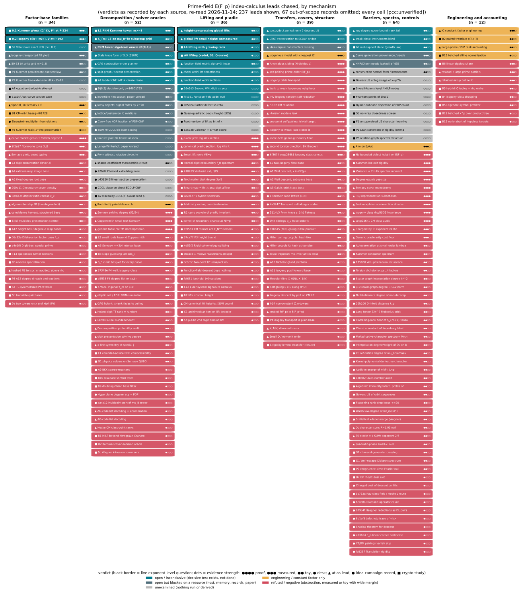
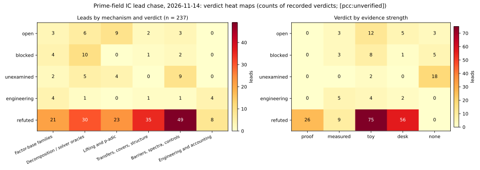

# Prime-field index-calculus leads: the whole corpus chased in parallel and drawn as a heat map (2026-11-14)

**Standing.** Every verdict, number and argument in this directory is `[pcc:unverified]`. Nothing
here is a cost, speed or security result; no pcc claim was filed, no `bench.record/v1` was written,
nothing ran on isolab/EKS, and no leaderboard, benchmark row or atlas disposition changes. This is a
search round over records (AGENTS.md "Research searches must leave visual reports"): it re-reads what
the lab has already written about every prime-field E(F_p) index-calculus lead, runs the cheapest
stdlib-Python desk checks where a record defines one, and lays the verdicts out as a figure in the
style of the factor-base encyclopedia taxonomy (`docs/ic/factor-base-encyclopedia/figures/taxonomy.svg`).

**Owner's request.** "We opened an enormous corpus of prime field leads for index calculus in the
crypto-autoresearcher repo; follow up on them, chase them down in a parallel Sonnet/Haiku workflow,
and turn the leads into a heat map like this" (the taxonomy figure, updated 2026-11-12).

## 0. Inputs and what could and could not be read

- **The corpus.** Three layers, 304 records in all (`leads.json`):
  1. **Atlas leads** (93): the 30 `ic-prime/` leads of `crypto-autoresearcher:knowledge/leads/ecdlp/`
     plus the 63 prime-relevant leads of `ic-engine/`, `structure/`, `transfer/` and `exotic/`. The
     atlas itself is vault-encrypted (AES-256-SIV, `VAULT.md`; `KEY` is not available in this
     container, so `tools/lead_atlas.py` cannot run). Lead bodies were read from the decrypted copies
     in this repository: `research/prime_field_lead_assessment_20261107/atlas_survey.md` and
     `research/lead_sweep_20261110/leads.json` with its per-lead `RESULT.md` toy runs.
  2. **Idea-campaign records** (143 in scope of the chase, 183 extracted): the "ideas: mythos ... —
     N ECDLP record(s)" pull requests #3183–#3260 of `isogeny-labs/crypto-autoresearcher`
     (2026-11-09; 50 merged, 28 open at the 2026-11-10 triage, PR #3263). Their branches predate the
     vault, so `refs/pull/N/head` holds plaintext: 183 `ledger/proposals/IDEA-20261109-*.yaml`
     records and 48 wave notes were extracted from the PR heads. 95 records sit on the prime-field
     ECDLP question `RQ-ECDLP-f655d3`, 48 on the Curve25519 questions `RQ-ECC-*`, 40 on isogeny
     questions `RQ-ISO-*` (the last were not chased: not ECDLP).
  3. **Post-atlas proposals in this repository** (68): the closure ledger routes A1–A11 and B1–B13
     (`research/prime_field_ic_closure_20261112/`), the five-lab chase L1–L5 and the D(8,3) cell
     (`research/prime_leads_chase_20261113/`), P1–P5 and S1–S3 (`research/leads_20261112/`), the
     equation-budget note's closed ideas and controls (`research/prime_ic_leads_20261110/`), the
     sub-exponential probes (`research/ecdlp_subexp_ideas_20261110/`), the Iwasawa leads
     (`research/iwasawa_leads_20261113/`), the moonshot records (`research/prime_moonshot_20261110/`)
     and the flagship cells 0.1, 0.2, A12 of the encyclopedia.
- **Not available:** the `research-kb` MCP server and CLI (no executable; AGENTS.md "Knowledge base
  first" could not be run, recorded as a gap), `ecdb`, Conductor, the vaulted atlas bodies. Every
  "not tried" or "already closed" statement therefore rests on grep over `crypto`, `cryptanalysis`
  and the extracted PR corpus.
- **Newest evidence folded in:** crypto PR #4151 (merged 2026-11-14 19:47Z) reports `d_F ≥ 6` at
  width 1, `t = 12` for the growth law, from a completed degree-5 closure; the predicted C-step
  happened, exact value untested above 15 GB.

## 1. Method: the parallel workflow

| tier | model | role | count |
|---|---|---|---|
| workers W1–W9 | Sonnet | one assignment file each (`scratchpad/assign/W*.md`); per lead: read the record and every cited or newer source, decide verdict + evidence strength, run the record's own cheapest check when it is stdlib-Python under 3 CPU-minutes, write one JSON record | 9 agents, 304 records, 71 checks run |
| validator | Haiku | schema, enum, duplicate-id and cited-path existence check over all worker files (`checks/validation.md`, `checks/validate.py`) | 1 |
| red team | Opus | adversarial re-read of every open, blocked and flagship record plus 12 sampled desk-only refutations (`checks/redteam.md`, `checks/redteam.json`) | 1 |
| main session | this session | corpus extraction, assignment, merge (`merge.py` in the scratchpad), figure, report | — |

Verdict vocabulary (one per lead): **refuted** (obstruction, measured or toy with wide margin),
**engineering** (constant factor only), **open** (a decisive test exists and is not done),
**blocked** (open but blocked on a host, memory, paper or missing records), **unexamined**,
**out-of-scope** (not E(F_p) ECDLP). Evidence strength: proof, measured, toy, desk, none. Each lead
is placed in one mechanism column: factor-base families, decomposition/solver oracles, lifting and
p-adic, transfers/covers/structure, barriers/spectra/controls, engineering/accounting. The rules the
workers followed are in the brief (`BRIEF.md`, copied here).

## 2. The heat map

Colour = verdict; black border = one of the few live exponent-level questions; dots = evidence
strength (●●●● proof, ●●● measured, ●● toy, ● desk); glyph = source (▲ atlas, ● idea-campaign
record, ■ crypto study). The counts behind it:

Data: `leads.json` (one record per lead with `sources_checked`, `why_this_verdict`,
`check_run_today`, `cheapest_next_test`); drawing code: `figures/plot.py`; tables: `TABLES.md`
(generated by `build_tables.py`).

## 3. Headline

| | count |
|---|--:|
| records | 304 |
| in scope (prime-field E(F_p) ECDLP) | 235 |
| out of scope | 69 |
| open | 13 |
| blocked | 10 |
| unexamined | 21 |
| engineering / constant factor | 13 |
| refuted | 178 |
| evidence proof / measured / toy / desk / none (in scope) | 27 / 20 / 94 / 72 / 22 |
| sources atlas / idea records / crypto studies | 93 / 143 / 68 |
| flagships (live exponent-level questions) | 2 |
| desk and toy checks run today | 71 |

The Haiku validator found 0 schema problems, 0 duplicate ids and 1,298 cited paths that all resolve (`checks/validation.md`); its 19 evidence-strength flags were reviewed by hand and one grade lowered (`LEAD-ICE-generic-oracle-arity-cost-floor`, proof to measured). The Opus red team reviewed 52 records (every open, blocked and flagship one plus 12 sampled desk-only refutations) and proposed 25 changes, applied as listed in `TABLES.md` and `checks/redteam.md`.

- **No lead in the corpus is a sub-√p prime-field ECDLP method, and none moved an exponent today.**
  The idea-campaign records are honest about this: all but one self-declare exponent delta 0 (the
  exception, `IDEA-20261109-5c783a`, is N^{3/2}, worse than rho). What the chase adds is that their
  stated predictions, run as toys, mostly hold, several falsifiers were mis-set, and one merged
  "verified construction" is empty (§4).
- **The live exponent-level questions reduce to two**, as the closure ledger of 2026-11-12 already
  said, and both narrowed again today. The workers had flagged nine cells; the Opus red team cut the
  flags to the two distinct questions (the other seven were restatements of them, or, for
  `IDEA-20261109-2debfa`, a route whose best reachable exponent is 2/(3 − e_2) ≥ 2/3 even if its open
  lemma holds; `checks/rt/exponent_check.py`, `checks/redteam.md`):
  1. **The PKM / Kummer tower fall-degree growth at m ≥ 8** (`CH-L1`; cells 0.1, 0.2 and
     `LEAD-ICP-pkm-tower-algebraic-oracle` are the same question). m ≤ 7 is closed. The D(8,3) cell
     (`CH-D83`) is no longer decisive: the Lean-checked cost floor of
     `research/prime_norm_rank_20261112/cost-floor-report/` (p < W² with c ≥ B⁴) removes the m = 8
     gain even at D(8,3) = 9, and the dense-floor exponent at m = 8 is at least 4/7 whatever D(8,3)
     is; the red team therefore marks the cell refuted (proof) and the 2026-11-13 continuation protocol
     already calls it a diagnostic. The surviving test is the positive sparse relation-finder panel A
     with the whole-call floor charged, at log_B p in {7, 8, 9}: kill if the lower confidence bound on
     the per-call exponent is ≥ 3.5. It needs the L1 closure source recovered or replaced. Today's
     growth-law cell (PR #4151, `d_F ≥ 6` at t = 12) is one more point on the C-step law, not a
     reprieve. Cell 0.2 (Vélu tower) stays open only as an unmeasured exact-LFD question; as a gain it
     is already "falsified" (`research/non_semaev_decomposition_20261113/README.md`, 1.00–1.33× a
     plain base).
  2. **Lifting with growing rank** (`CH-L4`; `CL-A8` and the two global-lift atlas rows are the same
     question). Open only because unmeasured: Theorem X (paper only, checker "sound with gaps") bounds
     per-trial success by |M|/q for every lift construction, the Q-only case closes under Lang's
     conjecture (Iwasawa R2), and the practical blocker is an unproved step (no fast small-height
     preimage of reduction). Cheapest falsification: write an executable public small-height lift
     selector, then at 8–12 bits compare the heights of successful lifts with all lifts (L4-check F1).
- **The distance to rho did not move.** Table B of `docs/ic/LEADERBOARD.md` still reads 5.47× to
  13.5× matched rho and widens with size; the chase toys that quote a distance all sit above rho
  (closure ledger B1–B3: 4.5× to 33×; S5 oracle slope 0.663 against 0.5; MITM m = 3/4 exponents
  0.69/0.80). These are distances remaining, not pass/fail gates.

## 4. What the chase changed relative to the records

- **Recorded open or proposed, read as refuted today: 112 leads (33 atlas, 74 idea records, 5 crypto studies)** (`TABLES.md` lists every
  one with its reason). For the atlas this is mostly the newest evidence overtaking an
  `open_next_step` written on 2026-10-30/11-01: Coppersmith small roots (proof of reach ≤ 0.49),
  algebraic-membership bases (closure ledger A4/A5), digit presentations (chase L3, Theorem F),
  residual partial relations (slope identical to rho), the extension-field embedding (Gaudry cost
  model), the same-field genus-g embedding (the atlas's own theorem), the p-adic jet (jet_exit note),
  the hashed tensor base (continuation protocol: composed exponent above rho).
- **Sweep verdicts not followed.** Several 2026-11-10 toy `RESULT.md` files say "falsified" or
  "inconclusive" for reasons the workers traced to artefacts (small n, a defective positive control, a
  noisy rho reference, a mis-set threshold): second-torsion direction (re-run today at 13,722 curves:
  the fraction with embedding degree ≤ 12 falls to 0 by n ≈ 2^14), endomorphism scalar action,
  isogeny-transport preprocessing, automorphism-quotient rho, class-representative selection,
  retained-setup online, lossy object propagation. Each record names the artefact.
- **One merged idea record is empty.** `IDEA-20261109-1130d0` ("anomalous sibling", merged) requires
  α ≡ 0 mod (π − 1), which forces N | Nm(α) = q, so q is never prime and no anomalous curve over F_q
  carries a point of order N; 6,000 candidate q over 20 j = 0 curves were all divisible by N
  (`[pcc:unverified]`, W5). Verdict refuted, evidence proof.
- **Mis-set falsifiers and predictions in the idea records** (toys run today, all
  `[pcc:unverified]`): the gcd identity of `179c5d` fails at its own first instance p = 13, N = 7
  (needs p ≢ ±1 mod N); `410419`'s interpolation degree is (p − 3)/2 when N > p, not |X| − 2;
  `e78107`'s "exactly 5r" holds for all but about 3/p of pairs; `00e2fd`'s autocorrelation threshold
  is exceeded by its own random control 20% of the time; `876571`'s in-sample argmax over 120
  candidates inflates success to 0.65–0.77 against a predicted ≤ 0.60; `fde21e`'s E_t is off by a
  factor N − 1; `5114b3`'s statistics are biased by the symmetry a_1(k) = a_1(N − k). None of these
  changes a verdict; all of them should be corrected in the records before any of them is run at
  scale.
- **Predictions that held as barriers** (same standing): Witt-digit degree exactly (3p − 1)/2 on the
  canonical lift at p = 31..73 and generic off it (`5dd4ab`); the affine deformation law and
  B = x_0/(3b) with 0 failures over 1,122 points (`883986`); the level-p² hybrid spectrum and the
  multiplicative spectra match their random controls (`8987a8`, `3332de`); the α* parity-threshold
  table of the equation-budget note reproduces exactly (W9); S_3 splits iff χ(f(x_1)f(x_2)) = 1 in
  119,849/119,849 pairs (monodromy lead); all constant and endomorphism assertions of the secp256k1
  CM audit pass.

## 5. What this note does not do

- It does not change any atlas disposition (the atlas is unreadable here); the proposed deltas are
  in `ATLAS_DELTA.md` for a session with `KEY`.
- The red team's 25 changes (`checks/redteam.json`) were all applied; each record keeps its prior
  verdict under a `redteam` key, and the worker files are archived unchanged in the scratchpad's
  `verdicts/` (not committed). Reviewers who disagree with a change can restore the prior value from
  the record itself.
- It does not price anything across the §5a band, add a leaderboard or benchmark row, or claim an
  improvement. "Engineering" cells are constant-factor levers already measured elsewhere
  (CM-orbit fold 1.25–1.62 net, paired translate unresolved across the band, root-find/pair-table
  oracle, class-representative selection).
- Its toys are 10–30-bit, single-host, unreplayed, stdlib Python; they discriminate predictions, not
  costs. research-kb was unavailable, so novelty was checked by grep only.

## 6. Next steps (by cost)

1. **Desk, hours:** fix the mis-set falsifiers of §4 in the idea records; record the empty
   construction `1130d0`; apply `ATLAS_DELTA.md` in a session that holds `KEY`.
2. **Local CPU, a day:** an executable small-height lift selector and the L4-check F1 height
   comparison at 8–12 bits (lifting flagship); the Vélu-tower exact LFD at k = 4..10 (`S2`, cell 0.2,
   exactness only, no gain expected).
3. **Large host, owner's call:** not D(8,3) (refuted as decisive by the Lean cost floor); the
   lead-changing cell is the positive sparse PKM relation-finder panel A at m = 8 with the whole-call
   floor charged (`research/prime_leads_chase_20261113/CONTINUATION_PROTOCOL.md`), through isolab-eks
   with a task card, once the L1 closure source is recovered or replaced.

## 7. Files

- `leads.json`: the 304 records (schema in `BRIEF.md`).
- `figures/plot.py`, `figures/lead_cells.svg|png`, `figures/verdict_matrix.svg|png`.
- `TABLES.md` (generated), `build_tables.py`.
- `checks/validation.md`, `checks/validate.py` (Haiku pass); `checks/redteam.md`, `checks/redteam.json`, `checks/rt/exponent_check.py` (Opus pass).
- `ATLAS_DELTA.md`: dispositions to apply in `crypto-autoresearcher` once unlocked.
- `REPORT.typ`, `REPORT.pdf`.
- Idea-corpus index (PR number, state, class, lead link per record): `corpus/idea_index.json`,
  `corpus/pr-triage-20261110.md`; the extracted YAML records themselves stay in the
  crypto-autoresearcher PR heads (not copied here).

## Sources checked

research-kb: unavailable (no MCP server, no CLI executable). ecdb: unavailable. Lead atlas:
vault-encrypted; read through `research/prime_field_lead_assessment_20261107/atlas_survey.md` and
`research/lead_sweep_20261110/`. Idea-campaign records: `isogeny-labs/crypto-autoresearcher`
`refs/pull/3183..3260/head` (extracted 2026-11-14, main at `022a7675f`), triage `refs/pull/3263/head`.
Every record in `leads.json` carries its own `sources_checked` list (repo:path).
