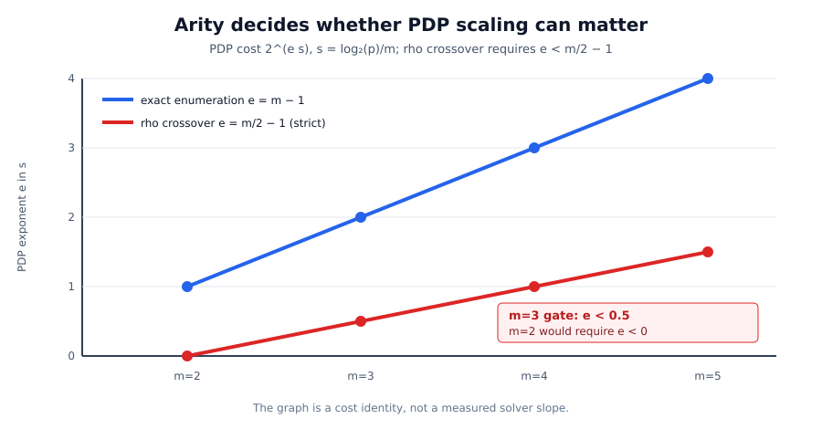

# Prime-field index-calculus lead review: where SAT actually belongs

**Date:** 2026-10-31

**Repository revision reviewed:** `2c03791383f4bb4ce200e84bdef4309065c61e7f`

**Correction audit base:** `c5d13654`

**Status:** corrected after review; no scientific run was started. The arity
and solver-model correction is recorded in
[`PDP_ARITY_CORRECTION.md`](PDP_ARITY_CORRECTION.md). Immutable decision
provenance is `DEC-20261031-b51282` plus additive hardening decision
`DEC-20261101-26f1fa`; `DEC-20261031-cd6460` remains the unrelated checker
defect. One controlled
arity-three CDCL(T)/finite-field screen is drafted but deliberately not frozen
until its native generator, theory-propagator source, solver identities, power
check and preflight cost are available.

## Result

The best prime-field index-calculus lead in the material reviewed is the
**hashed-factor-base Boolean tensor-contraction route** of Akshima et al. It is
the only inspected route with an explicit end-to-end claimed subexponential
prime-field ECDLP bound,

\[
  2^{O\!\left(b/(\log b)^{1/4}\right)},
\]

conditional on the exact Boolean tensor-contraction theorem in the pinned
OpenAI manuscript. This is a SAT-shaped lead—Boolean predicates, exact
counting and self-reduction—but it is **not evidence that an ordinary CDCL SAT
solver is the right engine**. The source explicitly preserves an
`O(mb)`-edge tensor network because a conventional circuit-to-CNF reduction
loses the required size bound.

The best experiment for the narrower practical-solver hypothesis is therefore
not another direct Semaev bit-blast and not ordinary CNF. It is a matched
arity-three tournament on a **one-hot, disjoint-window, chained-`S3`
predicate**, using hybrid CDCL(T) with an `F_p` theory, with exact enumeration
and F4 as controls. QF_FF is diagnostic at the inspected source. Pure CNF is
only an encoding-cost
control. The frozen schoolbook multiplier has `Theta((log p)^2)` gates by
construction; this is not a lower bound for all Boolean multiplication. At the
inspected cvc5 source, QF_FF is a SAT/model diagnostic because finite fields
have no proof checker.

The arity gate is structural. If a point-decomposition query at factor-base
scale `s=log2(p)/m` costs `2^(e s)` and reusable setup costs `2^(a s)`,
relation collection costs `2^(a s)+2^((e+1)s)` up to polynomial factors and
can beat rho only if `a<m/2` and `e < m/2 - 1`. At `m=2` the second gate is
impossible; exact pair enumeration is already
optimal up to polynomial factors. Every theorem and completed measurement in
the newer split-graph factor-base study is at `m=2`, so none is an
exponent-changing result. The first relevant fixed arity is `m=3`, with the
strict gates `e<0.5` and `a<1.5`.

### Ranked portfolio

The ordering below is by expected information gain toward a non-generic
prime-field relation oracle, not by implementation convenience.

| rank | lead | present evidence | next discriminating action |
|---:|---|---|---|
| 1 | Hashed factor bases + compact Boolean tensor contraction | Conditional end-to-end theorem chain; native implementation and bounded controls exist; no independent general proof/code audit or practical recursive run | Audit the theorem-to-code bridge lemma by lemma; separately execute the already frozen 84-case finite panel |
| 2 | Arity-three one-hot chained `S3`, solved by CDCL(T)/`F_p`; QF_FF diagnostic | Rationality is free under the guarded disjoint-window argument; the development oracle passes, but no production PDP exponent exists; pure CNF has a counted schoolbook expansion | Implement the source-bound `F_p` trail theory and freeze the complete-natural-panel `m=3`, `s=6..14` screen in [PROTOCOL.md](PROTOCOL.md) |
| 3 | PKM tower generalized root finding, `m >= 4` | Published prime-field construction and extensive F4/last-fall evidence; the correct generic gate is `e < m/2-1`, not “`m<=3` is impossible” | Keep as a distinct algebraic control; complete the registered `m=4, N=20` closure without using it to validate the arity-three solver claim |
| 4 | Target-parametric learned-clause / tensor-message reuse | A plausible relation-collection amortization mechanism; no controlled prime-field evidence | Compare cold one-target, reset, and target-assumption reuse while preserving target-independent state provenance |
| 5 | Special-`j`, Solinas-prime and chart-aware Boolean encodings | Sparse formulas and cheaper modular reduction are plausible constant improvements; no exponent-changing evidence | Factorial control: special versus generic curve and prime, with the same order, chart, predicate and solver |

Editable source: [lead-funnel.dot](figures/lead-funnel.dot), vector rendering:
[lead-funnel.svg](figures/lead-funnel.svg).

## Requirement-to-evidence ledger

| requested item | status | evidence |
|---|---|---|
| Identify the best prime-field index-calculus lead | **complete as a scoped assessment** | Primary-source pins below; ranked portfolio above; machine-readable [lead-matrix.json](lead-matrix.json) |
| Test the suspicion that SAT solvers are the lead | **partially complete** | The hypothesis is split into tensor/#SAT, hybrid CDCL(T)/`F_p`, and pure-CNF controls; prior direct-SAT evidence is reviewed; a corrected arity-three screen is designed but not run |
| Review prior work in `isogeny-labs/crypto` | **complete for the load-bearing prime-field paths listed below** | Current `main`, latest session log, prime IC program, SAT/SMT reports, PKM/fall-degree work, one-shot coefficient work, tensor implementation/audits and the cross-repository lead atlas |
| Identify multiple candidates | **complete** | Five ranked leads plus explicit deprioritized/closed routes |
| Devise experiments that can support or falsify the hypotheses | **complete at protocol-design scope** | Five experiment cards below; one `experiment.protocol/v1` draft; existing frozen protocols and amendments reused rather than duplicated |
| Prove or disprove a subexponential claim | **not achievable by finite timing experiments** | A proof/code audit can establish or refute the theorem chain; finite experiments can find counterexamples and enforce continuation gates but cannot prove asymptotic complexity |

## Evidence boundary

This review keeps three questions separate.

1. **Theorem question:** does the exact tensor-contraction theorem hold under
   the hypotheses used by the ECDLP reduction, and does the implementation
   realize those hypotheses with the claimed bit cost?
2. **Representation question:** can the decomposition predicate remain compact
   enough that a solver receives field constraints through an `F_p` theory,
   rather than the selected pure-CNF schoolbook expansion, whose gate count is
   quadratic by construction?
3. **Practical solver question:** on that same predicate, does proof-eligible
   CDCL(T)/`F_p` reduce the natural-query exponent below `e=0.5` while reusable
   setup remains below `a=1.5`, with complete correctness and cost accounting?

A positive answer to question 3 would not prove question 1. A failure of one
CNF encoding would not refute question 1. This distinction is the main reason
not to repeat the previously tested direct Semaev bit-blast as the lead
experiment.

## Primary sources checked directly

The PDFs were retrieved on 2026-10-31 and checked by SHA-256 before reading.
They are not vendored here.

| source | pinned object | SHA-256 | relevant statement |
|---|---|---|---|
| Akshima et al., *A Subexponential Time Algorithm for Elliptic Curve Discrete Logarithm*, v0.2 | `bochum-crypto/subexponential-ecdl@1ee44e562b1b9a50ea339f3b8f81112b5a24b96f` | `82e273629b437660607117d5e99f400141ed7aa78b25c6749b03651f42deaa11` | Conditional index calculus with `O(mb)` BTN edges and claimed `2^{O(b/(log b)^(1/4))}` total time |
| OpenAI, *The Exponential Time Hypothesis is False*, Appendix D | `openai/math@7ef5c0cc5ca4b0e072b7a050fca09ab24bc6fa3a` | `5b1612dc2eebb2cad5b4cbe62d1fed2982f01ab1908c26f70010a651487e8123` | Theorem D.1: exact contraction of bounded-degree implicit Boolean tensor networks in polynomial space and `2^{O(s/sqrt(log s))}` bit operations |
| Petit, Kosters and Messeng, *Algebraic Approaches for the Elliptic Curve Discrete Logarithm Problem over Prime Fields* | public PKC 2016 PDF | `a53030a6cde720c354aebfb65b1eb01e07766ce2d26e543d77f2516c0a49ef5b` | Low-degree rational-map tower factor bases; generalized root finding remains the open solver problem |

The Bochum theorem is explicitly conditional and asymptotic. It also states
that the source contraction algorithm falls back to brute force below an
astronomical threshold and does not imply a practical attack on deployed
curves.

## Current implementation fact that changes the immediate priority

At current `main`,
[`recursive.rs`](../../crates/hashed-ecdl-tensor/src/contraction/recursive.rs)
computes `lambda = ceil(log2(size))` in a `usize` and then
`root_u = lambda / (128 * 1024)`. On a 64-bit build `lambda <= 64`, so
`root_u = 0` for every publicly representable graph. The public dispatcher in
[`contraction.rs`](../../crates/hashed-ecdl-tensor/src/contraction.rs) therefore
selects a direct or functional finite-size fallback; only forced private tests
exercise the recursive kernel.

This is not a counterexample to the asymptotic theorem. It means that timing
the current public recursive backend cannot test the claimed asymptotic regime.
The immediate rank-1 work is consequently a proof/representation audit and an
unbounded symbolic parameter bridge, not a large timing run mislabeled as a
tensor-contraction test. The existing
[`hashed-ecdl-tensor-backend` problem](../../problems/hashed-ecdl-tensor-backend.md)
already records this obligation.

## What the repository has already tried

The cross-repository atlas at
`crypto-autoresearcher@5338aead98855d578d444fa6d8b507370847217c`
reported 153 leads: 74 closed by named obstruction, 53 open with a decided
next step, 17 blocked and 9 unexamined. The relevant rows were read in full;
the table below reconciles them with current `crypto` evidence. No atlas
disposition is changed by this assessment because it adds no new theorem or
measurement.

| area | evidence already present | reading now |
|---|---|---|
| Generic pair tables, subtraction, root-finding and MITM | The [prime IC program](../prime_ic_program_20261029/README.md) reports verified generic rows at `5.47x`–`13.5x` matched rho; the [ruling](../prime_ic_program_20261029/ruling/README.md) shows the `m=2` root oracle enumerates the base and behaves identically on a random base | Keep as the generic-decomposition reference, not an algebraic breakthrough lead |
| Naive prime Semaev Gröbner systems | Atlas row `LEAD-ICE-prime-field-semaev-solving-degree`; local reference-arm work measures rapidly growing cold solve cost | Closed as the headline formulation; retain as a correctness/reference arm |
| Direct QF_BV and QF_FF SMT | [`prime_field_smt_20261005`](../prime_field_smt_20261005/RESULT.md): coordinate and `S3` encodings all returned `unknown` at 120 s on a 20-bit case while native lookup found a witness | Do not repeat unchanged |
| Direct Z3 Semaev bit-blast and LQ-CDCL | [`sat_smt_prime_ic_design_20261030`](../sat_smt_prime_ic_design_20261030/DESIGN.md): small probes show no clean scaling; `m=3` times out; the proposed linearized-quotient method is a lattice call in disguise and its analytic lane remains above rho | Useful negative design evidence, not a universal theorem about every compact Boolean predicate |
| Binary-field SAT/XOR and WDSat | [`RESEARCH_PDP_SAT_SMT_NAGAO_SURVEY.md`](../notes/index-calculus/RESEARCH_PDP_SAT_SMT_NAGAO_SURVEY.md) and [`pdp_ml_sat_ceiling_20261027`](../pdp_ml_sat_ceiling_20261027/README.md): conflict counts track enumeration for the tested binary representation | Strong warning against assuming CDCL magic; not the prime-field CDCL(T)/`F_p` experiment |
| PKM tower bases | Published construction plus [`prime_fall_degree_20261027`](../prime_fall_degree_20261027/PREREGISTRATION.md) and the [relaunch](../prime_ic_program_20261029/fall_degree_relaunch/README.md) | Existing exponent evidence is concentrated at `m>=4`; `m=3` is structurally relevant only if a solver reaches `e<0.5`, which these rows do not show |
| Digit presentations / first-fall heuristics | Atlas row `LEAD-ICP-digit-presentation-solving-degree`; curve-free null reproduces the apparent fall | Do not use first fall alone as a solver prediction |
| Convex one-block Coppersmith small roots | [`smallroot_optimal_reach_20261026`](../smallroot_optimal_reach_20261026/README.md) and atlas row `LEAD-ICP-coppersmith-smallroot-semaev` | Closed only for the stated one-block convex construction; no current constructive joint-system advantage |
| Simple low-degree algebraic factor-base locus | Atlas row `LEAD-ICP-algebraic-membership-factor-base`; a univariate locus containing `B` distinct abscissas has degree at least `B` | Closed for simple loci, not for auxiliary-variable circuits such as PKM |
| Isogeny-transported bases and relation yield | Atlas row `LEAD-ICP-isogeny-transported-relation-yield`; measured yield conservation | No relation excess; transport may alter constants/presentation only |
| Structured coincidence / small-coordinate bases | [`prime_ic_zero_filter_20261030`](../prime_ic_zero_filter_20261030/README.md) and atlas coincidence rows | Exact zero predicates have high rank; no measured relation excess |
| Shared coefficient / remainder circuits | [`prime_one_shot_20261029`](../prime_one_shot_20261029/README.md) and its [continuation](../prime_one_shot_20261029/continuation/README.md) | Correct tiny witnesses and an exact toy solver exist; unknown-solve scaling remains untested |
| Split-graph/secant factor bases | [`prime_factor_base_degree_20261031`](../prime_factor_base_degree_20261031/README.md): written/Lean-supported top-ideal results and a completed F4 component panel | Retain the degree and rational-lift results at their stated scope; every accepted theorem and measurement is `m=2`, so the route is exponent-irrelevant under the cost bridge |
| Hashed-factor-base tensor route | [`hashed_ecdl_leads_20261030`](../hashed_ecdl_leads_20261030/README.md), [bridge map](../hashed_ecdl_leads_20261030/BRIDGE.md), native crate and audits | Highest asymptotic upside; conditional theorem and general implementation audit remain open |
| Special `j=0/1728` and special primes | Atlas rows `LEAD-ICP-xline-symmetry-special-j` and `LEAD-STR-special-j-ic-semaev` | Worth a controlled constant-factor screen, but no basis yet for exponent priority |

## Why rank 1 is SAT-shaped but not ordinary SAT

The tensor route encodes relation search as exact counting of assignments to
edge bits. Exact contraction plus prefix self-reduction finds a witness. In
that broad sense it is a structured `#SAT` algorithm.

The asymptotic saving depends on four properties that an ordinary Tseitin CNF
export need not preserve:

1. only `O(mb)` network edges;
2. maximum vertex degree below the theorem's `s^(9/10)` guard;
3. implicit vertex predicates evaluable within the stated bit cost;
4. recursive packet/mode contraction with exact reconstruction and polynomial
   space.

The Bochum paper's own “Why use tensor contraction instead of SAT” section
notes that a standard scalar-verification circuit creates too many auxiliary
variables to yield the claimed subexponential ECDLP bound. Thus the working
hypothesis should be:

> Preserve a compact Boolean relation predicate and test exact
> contraction/#SAT engines; for the practical prime-field screen use
> CDCL(T)/`F_p` or `QF_FF`, with pure CNF only as an encoding-cost control,
> not as a substitute theorem.

## Arity and solver correction

The red line is the strict cost-bridge threshold `e=m/2-1`; the blue line is
the exact enumeration exponent `e=m-1`. The graph is derived, not measured.
Its data are in
[`arity-cost-bridge.csv`](figures/arity-cost-bridge.csv). It exposes the
original review's decisive mistake: arity two cannot cross rho at any
nonnegative query exponent. Arity three is the first discriminating cell and
requires a directly fitted slope below `0.5`.

The corrected hybrid representation uses three disjoint one-hot windows and
chains `S3` through the quadratic lambda lift; it does not expand `S4`. The
disjoint-window three-summand argument makes every guarded model rational.
Arity at least four instead retains and charges explicit rationality circuits.
The rational-lift identity, its discriminant `16t^2 f(x)`, and forbidden-word
semantics are stated with their exceptional cases and compact range encoding
in the [correction analysis](PDP_ARITY_CORRECTION.md).

## Quantitative evidence currently constraining the algebraic fallback

The three points are recorded F4 solving degrees, not a fitted asymptotic
curve. The horizontal line is the derived largest degree that does not lose to
rho in the recorded `m=4` complete-cost model. Data and provenance are in
[pkm-m4-degree.csv](figures/pkm-m4-degree.csv); vector rendering:
[pkm-m4-degree.svg](figures/pkm-m4-degree.svg).

At `N=16` the recorded `m=4` run reached degree 7 with 76,837 columns, 55.5
minutes, 8.06 GB peak and about `2.7e13` multiply-adds. The projected `N=20`
F4 run is 240–380 GB. These are prior measurements/projections at their stated
scope, not new results from this review.

## Experiment portfolio

### A. Establish or refute the tensor theorem-to-code chain

**Question.** Does the pinned ECDLP reduction satisfy every hypothesis of
Theorem D.1, and does the native implementation preserve the proof's exact
objects and bit costs?

This is primarily a proof and implementation-correspondence task, not a timing
benchmark.

1. Build a declaration-to-code map for packet packing, mode orientation,
   creation-precision lifting, taper levels, child shrink, exact Hermite
   reconstruction, implicit-entry evaluation and aggregate bit cost.
2. Add an arbitrary-precision **symbolic parameter evaluator** for theorem
   guards. It must represent `s` symbolically or as a big integer; it must not
   pretend to materialize a `2^(2^17)`-scale graph.
3. For each lemma, emit a replayable transcript on exhaustive tiny networks
   and compare with direct exact contraction. Retain the first disagreement as
   a regression fixture.
4. Add mutation positive controls: reverse one mode orientation, lower one
   precision, alter one taper multiplicity and break one packet incidence.
   Each mutation must be detected by the corresponding control.
5. Independently check the asymptotic accounting from input description to
   implicit tensor-entry evaluation. A bounded equality test does not establish
   this cost statement.

**Refutation condition:** one verified counterexample to a lemma or a mismatch
between a source hypothesis and the reduction/implementation.

**Establishment condition:** an independent proof (preferably formalized for
the load-bearing lemmas) plus a checked code-correspondence argument. Passing a
finite panel alone is recorded as bounded validation only.

### B. Measure the arity-three PDP exponent with hybrid finite-field SAT

The detailed design is [PROTOCOL.md](PROTOCOL.md), with a schema-checked draft
record in [protocol.draft.json](protocol.draft.json).

**Fixed semantic object.** Use `m=3` throughout. Each summand has a disjoint
one-hot window of rational factor-base points. Chain two `S3` constraints
through the quadratic lambda lift and do not expand `S4`. The nonzero-
displacement chart, Sinz exactly-one constraints, compact unsigned range
predicate, bound lift signs and independent signed group replay are identical
across arms. The guarded
three-summand/disjoint-window argument supplies rationality without an extra
rationality circuit; any exceptional chart is explicit rather than divided
away.

**Arms.** Canonical exact two-window enumeration; msolve/F4; CaDiCaL with an
external `F_p` theory propagator and checked explanation/proof clauses; cvc5
`QF_FF` as a SAT/model diagnostic; and a frozen schoolbook pure-CNF bit-blast
as an encoding-cost control only. Retain a
byte-identical A/A rerun, planted positive controls and support/model-count
matched curve-free nulls.

**Cells.** Every integer `s=6,...,14` at fixed `m=3`, with natural, planted and
exact-UNSAT targets and held-out protocol-derived seeds. Here
the regression coordinate is actual `log2(p)/3` after prime rounding. The
selected one-hot continuation through `s=27` is not admitted: at `s=27` it has
805,306,365 Boolean variables and 1,207,959,543 exactly-one clauses before
theory auxiliaries. A later continuation needs a prospective compact-selector
equivalence/resource amendment. Exact model-set equality is required where
enumeration completes.

**Primary measurements.** Verified model set/status; complete cold, reusable
setup and online-plus-verification retired instructions; cold peak RSS; and
solver-native counters. The CDCL(T) ledger separately records Boolean decisions/conflicts,
theory calls, field operations, propagated literals and explanation clauses;
none may be omitted from the total. F4 reports solving degree, rows, columns
and multiply-adds. Wall time is secondary and requires L2 isolation.

**Advance gate.** Fit natural-only `log2(online plus verification work)` and
`log2(setup work)` against actual `log2(p)/3`. The CDCL(T)/`F_p` bundle
advances only if every preregistered natural row and every control completes
and verifies, the upper intervals are strictly below `e=0.5` and `a=1.5`, the
findings lie outside A/A spread and the stage ledger reconciles. There is one
eligible slope candidate and no artificial Holm family. Enumeration remains
the `e=2` reference and correctness control, not the normalization axis.

**Do-not-advance gate.** On the same complete valid panel, the bundle is not
advanced if either lower interval has `e>=0.5` or `a>=1.5`. Any natural
timeout, OOM, unknown, unproved UNSAT or missing rung is **inconclusive**;
completed rows are never substituted, imputed or pooled with planted/UNSAT
controls.

This gate decides whether to invest in that solver/representation family. It
does not prove or disprove a universal SAT or ECDLP complexity statement.

### C. Put the same hybrid solver on identical PKM `m=4` systems

**Question.** Can a hybrid Boolean/`F_p` solver exploit the PKM tower's sparse
local constraints before F4 reaches the measured degree/memory wall?

Use the exact Kummer systems and target identities from the registered
fall-degree study, not regenerated lookalikes. Cross `N=12,16,20` with natural
targets, planted decompositions, exact-UNSAT instances and the existing
shape-matched curve-free null. Export one canonical polynomial IR, then compile
it to F4, `QF_FF` and CDCL(T); retain pure CNF only as an explicitly charged
encoding-cost control.

**Controls:** exact census at the smallest cell; planted witness through every
backend; A/A variable permutation; same field equations and term/variable
orders recorded; natural and null target classes kept separate.

**Reading:**

- SAT advances as a PKM backend only if it completes `N=20` with verified
  output and shows a lower instruction-growth slope than F4 over all three
  cells, outside A/A spread.
- The PKM exponent lane is not advanced if the already registered closure reads
  `d_F(N=20) >= 8` after `d_F(N=16)=7`; that criterion belongs to the existing
  Amendment 8 design and must not be rewritten after data.
- A SAT completion does not erase a measured last-fall lower bound; it shows a
  different solver handles the same ideal better.

### D. Test target-parametric clause or tensor-message reuse

**Question.** Is useful learned state independent of the target, or is the
apparent reuse merely target leakage/batch amortization?

Build one fixed factor base and predicate. Solve `1,8,64,512` independently
drawn targets under three arms: cold process, warm process with only
target-independent clauses/messages retained, and full reset in the same
process. Audit every retained clause/message by dependency provenance; replay
all recovered relations and scalars independently.

The one-target cold result remains primary. Report reusable setup separately.
The reuse lead advances only if the per-target counted work decreases with
target count, retained state is proved target-independent, and the gain
exceeds the reset A/A interval. It cannot be advertised as a one-target gain.

### E. Separate special-prime and special-curve constants from structure

Use a factorial design rather than comparing one special curve with one random
curve:

- prime: Solinas/pseudo-Mersenne versus generic prime of the same bit length;
- curve: `j=0`, `j=1728`, and generic `j` with matched subgroup size/cofactor;
- representation: affine/projective and selected chart;
- solver: the same frozen hybrid CDCL(T)/`F_p` backend; pure CNF is a labelled
  encoding-cost control.

Measure clause/edge count, propagation/conflict counts, field-reduction
operations, peak RSS and verified complete solve. A special case is promoted
beyond engineering only if the growth slope or compact representation size
changes across at least four sizes; a constant shift is still a valid scoped
engineering result.

## Execution status and dependencies

- No experiment was launched in this review. This preserves the requirement
  that the new SAT screen be frozen before its first data point.
- The managed environment reports no configured AWS credentials or identities,
  so it cannot currently submit the required EKS isolation job. This is an
  access dependency, not a scientific result.
- The existing 84-case hashed-ECDL panel is prepared but not run; its frozen
  protocol remains
  [`hashed_ecdl_speed_20261029/PROTOCOL.md`](../hashed_ecdl_speed_20261029/PROTOCOL.md).
- The new SAT draft intentionally leaves the exact external-propagator source
  binding, commit, binary/image hashes, explanation checker, analysis script
  hash, power and runtime preflight unset. It must not be frozen or run until
  those fields are real. Current `main` has the native
  `solve_with_lazy_clauses` callback, not a source-identified CaDiCaL
  `ExternalPropagator`; the two are not silently equated.
- No leaderboard, boundary ledger or benchmark graph changes: this review adds
  no admitted performance row or new mathematical identity.

## Reproduction notes

Primary retrieval checks used `curl`, `sha256sum` and `pdftotext`. Repository
search used `rg`; the lead atlas used `python3 tools/lead_atlas.py --brief`,
`--match` and `--delta` in the sibling `crypto-autoresearcher` checkout. The
initial `conductor check` could not run because `conductor` is not installed;
the repository's documented warn-and-allow path was followed and no reservation
was claimed.

The concise printable source is [REPORT.md](REPORT.md) and its rendering is
[report.pdf](report.pdf). The included figures retain editable DOT/CSV/SVG
sources. The PDF was rendered after the report and figures and visually
inspected before commit.
