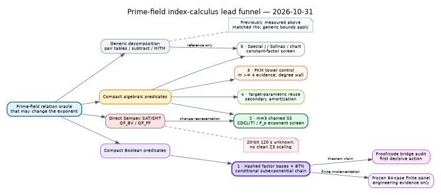
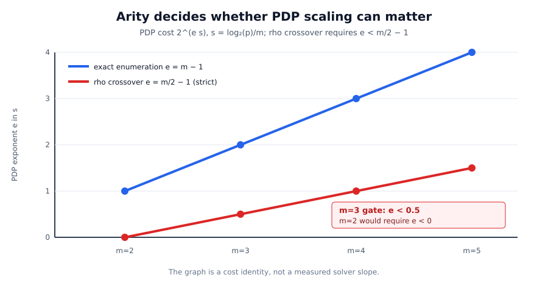
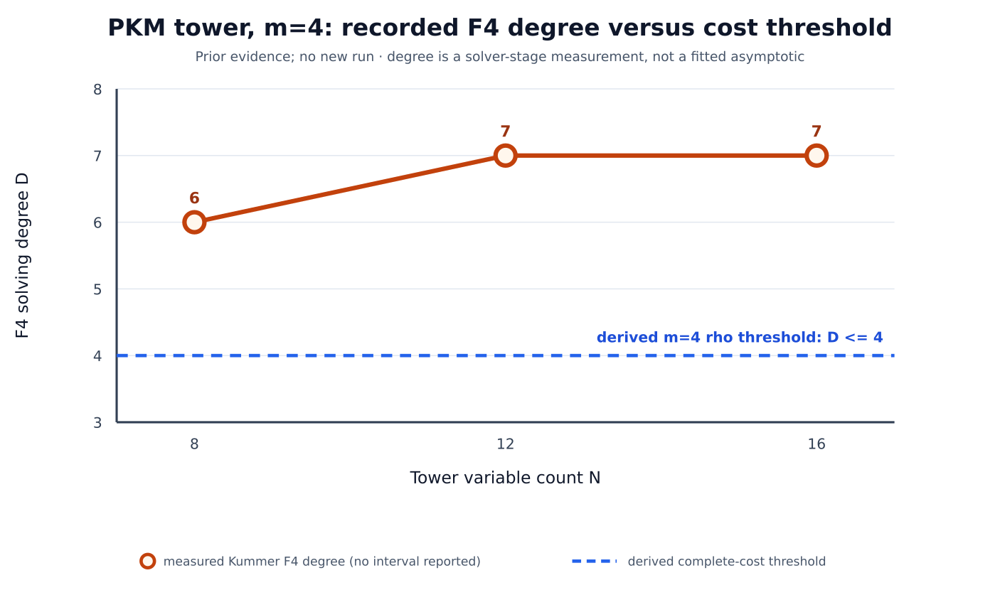
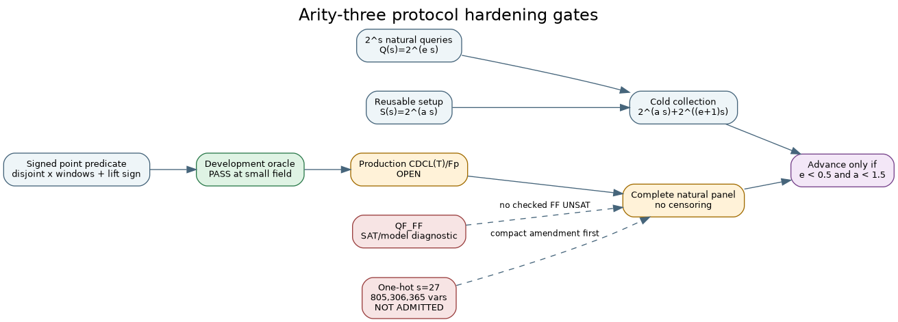

# Prime-field index-calculus lead review

**Where SAT actually belongs · 2026-10-31**

Repository reviewed: `isogeny-labs/crypto` at
`2c03791383f4bb4ce200e84bdef4309065c61e7f`; correction audit based on
`c5d13654`.

Status: corrected after review. No scientific run was started. The corrected
CDCL(T)/finite-field protocol remains an unfrozen draft until the native
instrument, exact theory-propagator source, explanation checker, solver
identities, power and runtime preflight exist.

Decision provenance is additive: `DEC-20261031-b51282` is the immutable arity
correction, `DEC-20261101-26f1fa` is this hardening, and
`DEC-20261031-cd6460` remains the unrelated checker-defect decision.

## Result

The best inspected prime-field index-calculus lead is **hashed factor bases
with compact Boolean tensor contraction**. It is the only route reviewed with
an explicit end-to-end claimed subexponential prime-field ECDLP bound,
`2^{O(b/(log b)^(1/4))}`, conditional on the exact contraction theorem in the
pinned OpenAI manuscript.
It is SAT-shaped—Boolean predicates, exact counting and witness
self-reduction—but it is not evidence that ordinary CDCL is the right engine.
The reduction preserves an `O(mb)`-edge tensor network specifically because a
conventional circuit-to-CNF path loses the required compactness.

The best empirical test of the narrower practical-solver hypothesis is a
fixed-arity-three tournament on a **one-hot, disjoint-window, chained-`S3`
predicate**. The decision candidate is hybrid CDCL(T) with an `F_p` theory;
cvc5 `QF_FF` is a SAT/model diagnostic at the inspected source because its
finite-field theory has no proof checker. Pure CNF is only an encoding-cost
control: the quotient ring `F_p[z]/(z^2-z)` avoids carries, while the selected
schoolbook multiplier has `Theta((log p)^2)` gates by construction. This is
not a universal Boolean multiplication lower bound.

The arity correction is decisive. With `s=log2(p)/m`, PDP cost `2^(e s)` and
reusable setup `2^(a s)`, relation collection costs
`2^(a s)+2^((e+1)s)` up to polynomial factors, so beating rho requires both
`a<m/2` and `e < m/2-1`.

At `m=2` this requires `e<0`; exact pair enumeration is already optimal up to
polynomial factors. Every accepted split-graph theorem and completed
measurement is two-summand. The first relevant fixed arity is `m=3`, where the
strict gates are `e<0.5` and `a<1.5`.

## Ranked leads

1. **Hashed factor bases + Boolean tensor contraction.** Conditional
   end-to-end theorem chain; highest asymptotic upside. Next: independent
   theorem-to-code audit, then the already frozen finite panel.
2. **Arity-three chained `S3` + CDCL(T)/`F_p`.** Best practical exponent
   discriminator; QF_FF remains diagnostic. The development oracle passes,
   while the production trail theory and solver scaling remain open.
3. **PKM generalized root finding, `m >= 4`.** Most mature algebraic lane and
   the right control system for a SAT backend. Existing degree/memory growth is
   unfavorable.
4. **Target-parametric clause/tensor-message reuse.** Test only as separately
   labelled multi-target amortization; cold one-target work remains primary.
5. **Special `j`, Solinas primes and chart-aware encodings.** Worth a matched
   constant-factor screen; no exponent-changing evidence yet.

The full evidence matrix and links are in [README.md](README.md) and
[lead-matrix.json](lead-matrix.json).

## What prior work rules out—and what it does not

- Generic pair tables, subtraction, root-finding and MITM remain useful
  references, but current prime rows are `5.47x`–`13.5x` matched rho and the
  methods behave identically on random bases.
- cvc5 coordinate, QF_FF and Semaev encodings returned `unknown` at 120 seconds
  on a recorded 20-bit case; later direct Z3 probes showed no clean scaling.
- The proposed LQ-CDCL formulation is a lattice call in disguise under its
  recorded analysis and remains above rho. This is not a theorem about every
  compact Boolean predicate.
- Binary WDSat/CDCL conflict counts track enumeration for the tested binary
  representation. That is a warning, not the prime-field CDCL(T)/`F_p`
  experiment.
- The split-graph/secant theorem and completed F4 panel retain valid
  presentation-specific degree results, but they are all `m=2` component
  results and cannot change the ECDLP exponent under the cost bridge.
- Convex one-block Coppersmith, simple low-degree univariate factor-base loci,
  and isogeny-transported yield have named scoped obstructions. Those scopes do
  not exclude arbitrary auxiliary-variable circuits.
- First fall alone is not predictive: a curve-free null reproduced the relevant
  digit-presentation fall behavior.

The cross-repository atlas reported 153 leads: 74 closed by named obstruction,
53 open with a decided next step, 17 blocked and 9 unexamined. This review adds
no theorem or measurement, so it changes no atlas disposition.

## Primary-source boundary

Directly retrieved and read on 2026-10-31:

- Akshima et al., v0.2, pinned commit
  `1ee44e562b1b9a50ea339f3b8f81112b5a24b96f`.
  PDF SHA-256 is recorded in full in `README.md` and `lead-matrix.json`.
- OpenAI ETH manuscript, pinned commit
  `7ef5c0cc5ca4b0e072b7a050fca09ab24bc6fa3a`.
  PDF SHA-256 is recorded in full in `README.md` and `lead-matrix.json`.
- Petit–Kosters–Messeng PKC 2016 public PDF. Its SHA-256 is recorded in full
  in `README.md` and `lead-matrix.json`.

The tensor theorem is conditional and asymptotic. The current Rust dispatcher
also cannot enter the source recursion through its public path: it stores
`lambda = ceil(log2(size))` in a `usize` and computes
`root_u = lambda / 131072`. On a 64-bit build, `root_u` is always zero. Forced
small tests exercise the kernel, but timing the public fallback cannot test the
claimed asymptotic regime.

## Correct cost bridge

The red line is the strict rho crossover `e=m/2-1`; the blue line is exact
enumeration `e=m-1`. This is a derived identity, not a solver measurement. The
data are in [arity-cost-bridge.csv](figures/arity-cost-bridge.csv). The retained
quadratic lambda lift has discriminant `16t^2 f(x)`; disjoint windows give the
guarded three-summand rationality result. Arity at least four keeps and charges
explicit rationality circuits. Field membership remains a semantic constraint,
implemented by a compact range predicate rather than an uncapped forbidden-word
list. Full assumptions are in
[PDP_ARITY_CORRECTION.md](PDP_ARITY_CORRECTION.md).

## Quantitative constraint on the algebraic control

The points are recorded F4 solver-stage measurements, not an asymptotic fit.
At `N=16`, the recorded run had 76,837 columns, 55.5 minutes, 8.06 GB peak and
about `2.7e13` multiply-adds. The existing `N=20` projection is 240–380 GB.
Data and provenance: [pkm-m4-degree.csv](figures/pkm-m4-degree.csv).

## Discriminating experiments

Green is implemented only at disclosed development-fixture scope. Amber gates
remain open; red routes are diagnostic or unadmitted, not failed scientific
results.

### A. Tensor theorem-to-code audit

Map packet packing, mode orientation, precision lifting, taper levels, child
shrink, reconstruction, implicit entry evaluation and bit cost from the pinned
proof to code. Add an arbitrary-precision symbolic guard evaluator, exhaustive
tiny direct-versus-recursive transcripts, and mutation controls.

One verified lemma counterexample or source/implementation mismatch refutes the
chain at that point. Bounded tests alone do not establish the theorem; an
independent proof and checked code-correspondence argument are required.

### B. Arity-three CDCL(T) exponent screen

Fix `m=3` and run every integer `s=6..14`. Use three disjoint one-hot windows,
two chained `S3` constraints through the quadratic lambda lift, bound every
abscissa to its rational-lift sign, and use no expanded `S4`. Cross natural,
planted and exact-UNSAT targets. Run exact two-window enumeration, msolve/F4,
CaDiCaL with an external `F_p` theory, cvc5 `QF_FF` as a diagnostic, and a
labelled pure-CNF cost control, plus byte-identical A/A and a support/model-
count matched curve-free null.

Primary metrics are verified model status, cold/setup/online-plus-verification
retired instructions, cold peak RSS, natural-query exponent `e` and reusable-
setup exponent `a`, fit directly against actual `log2(p)/3`. Planted and
exact-UNSAT rows are separately reported controls. The theory-call,
field-operation and checked-explanation ledger is included in the complete
interval. Wall time is secondary and requires L2 isolation.

Advance only if every preregistered natural row and every control completes and
verifies, upper intervals satisfy `e<0.5` and `a<1.5`, both lie outside A/A
spread and the stage ledger reconciles. There is one eligible slope candidate
and no Holm family. Any natural censoring is inconclusive. The selected one-hot
continuation through `s=27` is not admitted: its exact structure already has
805,306,365 Boolean variables and 1,207,959,543 exactly-one clauses before
theory auxiliaries, so it requires a compact-selector/resource amendment.

The detailed narrative and schema-checked draft are [PROTOCOL.md](PROTOCOL.md)
and [protocol.draft.json](protocol.draft.json).

### C. The same hybrid solver on identical PKM systems

Compile the exact registered `m=4`, `N=12,16,20` Kummer systems—not regenerated
lookalikes—to F4, `QF_FF` and CDCL(T), with pure CNF retained only as a charged
cost control. Include natural targets, planted decompositions, exact UNSAT and
the existing shape-matched null. A hybrid completion does not erase a measured
last-fall bound.

### D. Target-parametric reuse

Compare cold process, reset-in-process and target-assumption reuse for
`1,8,64,512` targets. Audit every retained clause/message as
target-independent. Keep the cold one-target result primary; reuse is a
separate amortized claim.

### E. Special-prime/curve factorial screen

Cross Solinas versus generic primes, `j=0`, `j=1728` and generic curves,
matched subgroup/cofactor, chart and one frozen solver. Promote beyond an
engineering result only if representation size or work slope changes across
four sizes.

## Scope and dependencies

Finite experiments can find counterexamples and decide continuation gates; they
cannot prove a subexponential complexity theorem. The new protocol remains
unfrozen because its generator, exact external-propagator binding, explanation
checker, solver/image hashes, analysis script, power and runtime preflight are
absent. No affected data was taken.

The managed environment has no configured AWS identity, so it cannot currently
submit the required EKS isolation job. This is an access dependency, not a
scientific result. The existing 84-case tensor panel is prepared but not run.

No leaderboard, boundary ledger or benchmark graph changes: this review adds no
admitted performance row and no new algebraic identity.
