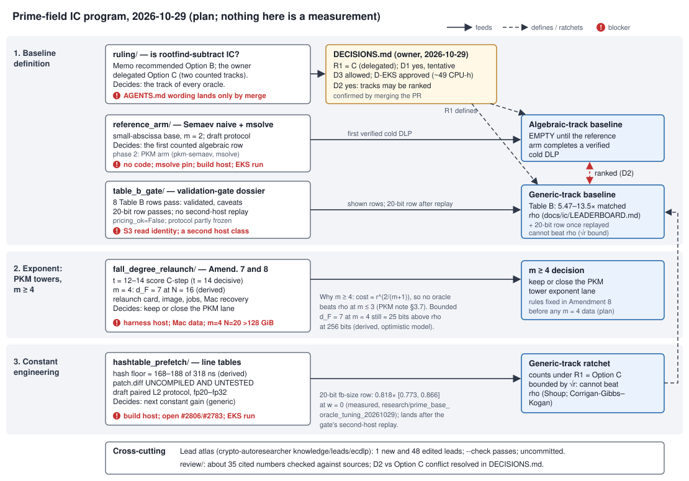

# Prime-field index calculus: the program as of 2026-10-29

**This directory is preparation, not measurement.** Nothing in it was run as an
experiment. It reports no new result, and it changes no row of the IC
leaderboard (`docs/ic/LEADERBOARD.md`, `docs/ic/leaderboard.json`,
`docs/ic-leaderboard.html`), of `benchmarks/README.md`, or of any
`VALIDATION.json`. Every number below is one of three kinds, and is labelled:
**measured** (quoted from a committed file, whose repo-relative path is given),
**derived** (worked out by hand or by a track from quoted values), or **plan**.
Checkout: crypto `main` at `7ffaab06b`.

The program has six prep tracks. Five sit in subdirectories here. The sixth is
an edit of the ECDLP lead atlas in the sibling checkout. A cross-track review
(`review/`) checked them afterwards, and the owner's answers so far are in
`DECISIONS.md`. The tracks fall into three lanes:

1. **Baseline definition.** What counts as prime-field IC, which baseline each
   result ratchets, and whether the existing rows pass the validation gate.
   Tracks: `ruling/`, `reference_arm/`, `table_b_gate/`.
2. **Exponent, through PKM towers at m ≥ 4.** The only route on record that
   could change the exponent of prime-field IC rather than its constant.
   Track: `fall_degree_relaunch/` (and phase 2 of `reference_arm/`).
3. **Constant engineering.** Making the existing relation trial cheaper.
   Track: `hashtable_prefetch/` (and the 20-bit factor-base row that
   `table_b_gate/` takes to its second-host replay).

`program.svg` shows the tracks as boxes, what each one feeds as arrows, and
each blocker as a red mark. Solid arrows mean "produces input for"; dashed
arrows mean "defines" or "ratchets".

---

## 1. Where things stand

**Incumbent prime rows (measured, `docs/ic/LEADERBOARD.md` Table B).** The
eight prime-field rows, `icv1-fp10` to `icv1-fp24` (log₂ r = 9.7 to 23.4), are
5.47× to 13.5× matched rho with the negation map. All use m = 2 and the
`mitm_m2_negfold_walk*` pair-table oracle (`docs/ic/leaderboard.json`).

**Newest constant gain (measured, `research/prime_base_oracle_tuning_20261029/README.md`).**
At 20 bits, growing the factor base from N = 32 to N = 45 gives an S ratio of
0.818 [0.773, 0.866] at w = 0 and 0.726 [0.677, 0.778] at w = 1. The gap to rho
narrows from 9.47× to 7.75× [6.92, 8.70]. The 24- and 28-bit selections are
relabelling, not improvement. The row is in `benchmarks/20261029-prime-fb-size-20bit`
but not on the leaderboard: its protocol (§13) asks for a second-host replay first.

**Owner decisions taken today (`DECISIONS.md`).**

| # | question | decision |
|:--|:--|:--|
| R1 | Is `rootfind-subtract` index calculus? | **Option C, two counted tracks** (delegated; confirmed by merging the PR that carries `DECISIONS.md`). The *generic* track holds table, pair-table and root-finding decomposition: Table B, `rootfind-*`, `mitm`, `subtract`, the 20-bit gain. Its gains count and ratchet, labelled "generic: bounded by √r; cannot beat rho". The *algebraic* track holds relations from a solver that receives the factor-base constraint inside the system. Its prime-field baseline is **empty** until the reference arm runs. |
| D1 | Is the small-abscissa base, with F_V = ∏(x − c), "algebraically defined"? | **Yes, tentatively.** So the Semaev-naive/msolve arm is the counted algebraic reference. |
| D2 | May the Table B incumbent be ranked against the algebraic reference? | **Yes** (owner). R1 is amended to match: the two tracks may be ranked against each other on the same instances, in the same unit and across the §5a band, and each track ratchets only its own baseline (`DECISIONS.md`). The reference arm's rule C3 changes from "context only" to a ranked comparison at the freeze. |
| D3 | Pinned, vendored msolve counter patch | **Allowed** (delegated); its sha256 joins the candidate identity. |
| D-PREFETCH | The hash-table prefetch L2 run on isolab-eks | **Approved.** Sub-choices in O10 are still open; the draft protocol's defaults apply. |
| D-EKS | About 49 CPU-hours (derived; range 15–150) on EKS Spot for the reference arm | **Approved.** This covers the reference arm only. |

Until that PR merges, `AGENTS.md` and `docs/ic/SWEEPER.md` still carry the
2026-10-24 wording: `prime-table` is reference only and `prime-rootfind` is
unclassified. The tracks were written against that wording. The review then
added notes pointing to `DECISIONS.md`.

---

## 2. Lane 1: baseline definition

### 2.1 `ruling/`: does the root-finding oracle count as IC?

**Delivers.** A decision memo (`ruling/README.md`) and a machine-readable
classification of every prime oracle under three candidate wordings
(`ruling/classification.json`, with `adopted_option` now set to C).

**What it found.** At m = 2, `rootfind-subtract` does one batched inversion per
target. It computes x(R ∓ F_i) for every base abscissa, which are exactly the
two roots of S₃(x_R, x_i, X), and looks each one up in a hash index of the base
(code reading: `ic_framework/plugins.rs` lines 2238–2521). Its cost is the
subtract oracle's. In the 2026-10-29 train cells `rfsub2` and `sub2` have
S = 579.571 and 579.547 at 20 bits (measured,
`research/prime_base_oracle_tuning_20261029/select/band-train-P20.md`), and
the oracle would run the same on a random base. The memo argues both sides as
strongly as it can. It recommended Option B (root finding is a table method,
not IC). The owner chose Option C instead, which counts root finding on a
separate generic track.

**Decides.** The track of every oracle (§5.4 table, column C), and therefore
which baseline the gate work and the prefetch work ratchet: the generic one.
It does not change the eight Table B rows, which were never root-finding rows.

**Blockers.** The wording reaches `AGENTS.md` only by merge (the owner, by
merging). The follow-up code relabel needs a Conductor task: `Track::Generic` in
`src/bin/ic/sweep/space.rs`, the `docs/ic/SWEEPER.md` table and the board
labels in `scripts/build_ic_leaderboard.py`. That script's line 2380 still says
prime curves have no algebraic oracle, though `pkm-semaev` is wired at
`ecbench/methods.rs` ~4171. The D2 conflict is resolved (O1; `DECISIONS.md`).

### 2.2 `reference_arm/`: the published algebraic reference

**Delivers.** A recommendation (`README.md`), a draft protocol (`PROTOCOL.md`;
`protocol.draft.json` passes `tools/experiment_protocol.py validate` as a
draft) and an implementation spec (`IMPLEMENTATION.md`).

**What it proposes (plan).** Use Semaev's naive prime-field IC as the reference:

- the small-abscissa base `prime-abscissa:size=N`, the same base the incumbent uses;
- m = 2, and m = 3 at 10–18 bits;
- each trial solves ⟨S_{m+1}(x₁…x_m, x_R), F_V(x_i)⟩ with `msolve -P 1` over F_p;
- each trial is priced as cold whole-solve S in GAE, with msolve's multiply-adds placed in the §5a band.

Because base and trial stream are shared, reference and incumbent differ only
in the decomposition oracle. That gives exact checks: identical hit sets, and
byte-identical relation streams against a grid engine. The arms are rho-neg
(+A/A), `inc`, `pub-m2`, `pub-m2-tuned`, a planted positive control, a grid
negative control, an `f4_fp` engine arm and m = 3 arms. The panel is the
Table B roster at 10–24 bits plus today's 20- and 24-bit holdout curves. PKM's
tower base (`pkm-semaev` on `prime-kummer` with an msolve engine) is phase 2.
FGHR 2-torsion symmetrisation does not apply: the Table B curves have odd
order (`docs/curves/registry.json`, checked by the review).

**Decides.** The first counted row of the algebraic track, once it completes
a verified cold DLP.

**Blockers.**

- **No code exists.** It needs an F_p solver plug point (`fp_solvers.rs`),
  `msolve.rs`, `semaev_fp.rs` and `semaev_naive.rs`, plus edits across
  `ecbench`. Unblocked by an implementation session on a host with a Rust
  toolchain and several GB of disk.
- **No sound msolve build.** No msolve build is known to be sound above
  p = 2¹⁶: Ubuntu's 0.6.5-1build2 is documented as wrong there
  (crypto-autoresearcher `msolve.py`). Unblocked by a pinned, static,
  counter-patched build (candidate commit `a18d0de4`) with a self-test.
- **The images lack msolve.** The ecbench EKS image and the CI replay workflows
  would need msolve added. Unblocked by an implementation PR merged to `main`.
- **Budget not yet measured.** The budget is about 49 CPU-hours, range 15–150
  (derived), and RAM is not measured. A preflight replaces both.

### 2.3 `table_b_gate/`: do the existing rows pass the validation gate?

**Delivers.** A dossier (`README.md`), a recomputation script and its output
(`gate_status.py`, `gate_status.out.txt`), and a band figure
(`band_ratio.svg`, `plot_band.py`).

**What it found (measured, from the committed evidence).**

- **Table B passes the gate.** All eight Table B prime rows pass:
  `docs/ic/runs/VALIDATION.json` is complete, and `validation_gate.py evidence
  docs/ic/runs` prints `valid`.
- **Two caveats remain, display only.** `pricing_ok=False`: IC's native work is
  priced by a calibration derived from wall time, while rho's
  canonicalisations are uncharged. `protocol_frozen_ok=partial`: the recipe is
  the minimum of 9 on the same 3 targets, and Round 5 was never frozen.
- **The order holds at every weight.** Across the band, IC/rho runs from 4.66
  to 16.30, and IC > rho at every weight.
- **The 20-bit row passes too, but is not on the leaderboard.** It passes the
  gate mechanically and is in `benchmarks/README.md`. Its replay certificate
  is same-host (672/672 identical, `same_host_class_as_measurement: true`).

**Decides.** Which rows the generic-track baseline may show, and the exact
steps for the second-host replay that admits the 20-bit row:

1. Hydrate `records.jsonl` from S3.
2. Build ecbench at `0e124fb1`.
3. On a host class other than `ECBENV3hc4d998f5ae3f`, run
   `ecbench verify --replay-all`.
4. Accept only 672/672 identical.

**Blockers.**

- **S3 read.** Hydrating needs S3 read on the artifact store. Unblocked by an
  executor with the lab AWS identity.
- **A second host class.** The custom-command route `isolab_k8s_run` can run
  the replay; the ecbench-only request routes cannot. So can the owner's Mac.
- **Board section.** The promotion needs a board section outside tables A–C.
  That is a local edit of the builder.

---

## 3. Lane 2: the exponent, via PKM towers at m ≥ 4

### 3.1 Why this lane exists

The end-to-end cost model in `research/notes/index-calculus/RESEARCH_PKM_TOWER_ORACLE.md`
§3.7 gives about r^{2/(m+1)} when the per-target cost is r^{o(1)}. So no oracle
beats rho at m ≤ 3, and m = 4 is the first cell that could matter (derived
there). The tower base is the prime-field base whose low-degree structure that note
studies for a Gröbner solver. D1 notes the contrast: deg F_V = |V|, so the
small-abscissa base gives a solver no low-degree structure.

### 3.2 `fall_degree_relaunch/`: relaunch the prime fall-degree study

**Delivers.**

- the relaunch card (`CARD_DRAFT.yaml`), with a proposed image, entry script
  and nine job templates under `proposed/`;
- draft Amendment 7, for t ≥ 12 (`AMENDMENT_7_DRAFT.md`);
- draft Amendment 8, the m = 4 extension (`AMENDMENT_8_DRAFT_m4.md`);
- an access request for a command-request kind (`ACCESS_REQUEST.md`), not
  performed;
- the Mac recovery steps (`MAC_RECOVERY.md`);
- 18 inconsistencies in the preregistration and launch files (README §5).

**What it found.**

- **Route (code reading).** `isolab.eks.request/v1` runs only ecbench specs.
  The only route that takes a command plus an image is `isolab_k8s_run`, which
  runs on the harness host's MCP.
- **Reproducibility check (measured).** The t ≤ 10 rows can be checked only at
  median level (3,4,4,4,4,5,5,5,5,6, from `research/prime_fall_degree_20261027/RESTART.md`),
  because the raw rows are on the owner's Mac.
- **t = 11 is not blind (measured).** The committed round-2 rows already gave
  D = 6 at t = 11 before Amendment 6 was registered
  (`research/pkm_tower_round2_20260925/runs/`). Only t = 12–14 test the C-step
  prediction, and t = 14 is the decisive cell.
- **Budget (derived).** Under the registered 1800 s F4 budget, t = 12–14 will
  run out: extrapolated F4 times are about 1.7 h, 17 h and 7 days. At t = 14,
  λ = 0.133, so about 12% of draws are decomposable and have no d_F.
  Amendment 7 proposes a two-cap bracket, larger resources, a rule for
  decomposable targets and a scorer patch.
- **m = 4 at N = 16 (derived).** The recorded F4 data give d_F = 7 at m = 4,
  N = 16, conditional on the G3 equivalence. Every engine asserts p < 2³², so
  at the toy prime only about three tower levels above t = 4 are measurable.
  That cannot resolve one degree rise per four levels.
- **m = 4 at N = 20 (derived).** Uncapped F4 is projected at 240–380 GB, above
  the lab's 128 GiB pool cap.
- **Cryptographic size (derived, optimistic model).** At p = 2²⁵⁶ and m = 4, a
  bounded d_F = 7 leaves about 25 bits to rho. A d_F that keeps growing like
  C-step leaves about 143 bits.

**Decides.** Whether the PKM-tower exponent lane stays open, under rules fixed
before data in Amendment 8 (plan):

- **Close** if C-step holds at t = 12–14 and the m = 4 closure reads
  d_F ≥ 8 at N = 20.
- **Keep, as a mechanism question for m ≥ 6 only,** if d_F stays at 7 at m = 4.
- **Undecided at m = 4** for any other reading.

None of these outcomes is an S improvement or a leaderboard row (the study's
`PREREGISTRATION.md` §8).

**Blockers.**

- **Submission route.** Submitting needs a session on the Iso Lab harness host,
  or the command-request change in `ACCESS_REQUEST.md`. Unblocked by the owner
  or the infrastructure owner.
- **The image.** It has never been built or smoke-tested. Unblocked by whoever
  holds ECR push rights.
- **The registered settings.** Under them, t ≥ 12 cannot be scored. Unblocked
  by the owner ruling on Amendment 7, plus a committed scorer patch.
- **The Mac-only raw data.** Unblocked by the owner, in person (`MAC_RECOVERY.md`).
- **Memory for m = 4 at N = 20.** It needs a 256–512 GB host, a disk-backed
  echelon, or an administrative decision on the pool cap. The cap should not
  be raised implicitly.

### 3.3 Phase 2 of `reference_arm/`

`pkm-semaev` with an msolve engine, on the `kummer-P22/P24` curves, would be
the published tower arm. It waits on the msolve engine from §2.2. The derived
F_p S_m-symmetrisation arm and an m = 4 chain probe wait on owner decision D5.

---

## 4. Lane 3: constant engineering

### 4.1 `hashtable_prefetch/`: the hash-table floor of the relation trial

**Delivers.** A design (`README.md`), a patch (`patch.diff`, **uncompiled and
untested**) and a stage split with its figure (`stage_split.py`, `.csv`, `.svg`).

**What it found.**

- **The lead's 137 ns (measured, open PR #2806, branch head `db02dd4f`,
  `research/ic_wide_ext_20261028/results.json`; not on `main`).** At 28 bits
  with 32 lanes, the guard insert costs 56.3 ns and the oracle probe 80.9 ns
  of a 318.1 ns trial. These are TSC cycles converted at 2.1 GHz, and they
  account for the 137 ns floor in `LEAD-ICP-prime-ic-constant-engineering`.
- **The real floor (derived).** The lane round also pays for a demand-read
  "touch" of both hash maps (30.6 ns at 28 bits and 47.9 ns at 32 bits, both
  at 32 lanes). That puts the real hash-table floor near 168 ns at 28 bits and
  188 ns at 32 bits, about 53% of the trial.
- **Limits of the measurement.** The diagnosis cannot separate memory stalls
  from dispatch and timer cost: the cloud host has no PMU.

**Design A (plan).** Design A is an opt-in `mitm-prime-batch:m=2,layout=lines`,
with three changes:

- the guard set and the pair table become 64-byte-line open-addressing tables;
- each key's home line is a pure function of the key;
- the existing touch becomes `prefetcht0`.

**Expected gain (derived).** Anywhere from under 5% to a relation-phase ratio
of about 0.73–0.90×. S and the §5a band cannot move by construction, because
records must stay identical.

**Draft protocol (plan).** One isolab-eks L2 session per size, at fp20 to
fp32, with arms incumbent, A/A and candidate, plus walk-arm layout-only
controls. It counts as an improvement only if the A/A-corrected relation-phase
interval lies wholly below 1. The item closes if the interval spans 1 at both
fp28 and fp32.

**Decides.** The next constant improvement on the generic track. Under R1 =
Option C it counts and ratchets there, labelled generic, because it cannot
beat rho.

**Blockers.**

- **Never compiled.** It needs a build host for `cargo fmt`, `clippy` and
  `test`.
- **Wrong base for `main`.** It is based on the open PRs #2806 and #2783, so
  it does not apply to `main`. Unblocked by merging them, or by a decision to
  stack on them.
- **No EKS identity here.** Running needs one, through the director/executor
  card flow.

### 4.2 The 20-bit factor-base row

This is the measured constant gain from §1. It ratchets the generic-track
baseline once the second-host replay in §2.3 is identical. Two items in the
study's own README come before any further claim on it: the replay, and the
random-base control the study records as absent.

---

## 5. Cross-cutting tracks

### 5.1 The lead atlas (crypto-autoresearcher `knowledge/leads/ecdlp/`)

The atlas track folded the whole `tools/lead_atlas.py --delta` into the atlas.
After the review's edits, `--check` passes with 148 leads and 2092/2092 records
mapped (as reported by the review). The track:

- added one new lead, `LEAD-ICP-pkm-tower-algebraic-oracle` (`open_blocked`);
- closed `LEAD-ICP-coppersmith-smallroot-semaev` as `closed_obstructed`. The
  closure is scoped to single-block convex lattices: with equal per-variable
  bounds a lattice reaches at most 0.3293 / 0.3536, against a demand of 8/9
  (`research/smallroot_optimal_reach_20261026`);
- set the constant-engineering lead's best measured result to the 20-bit row;
- recorded the R1 scope notes.

`--check --strict-paths` still fails with 7 errors. They predate this review:
they are paths from the unmerged PRs #2783, #2806 and #2807. Nothing is
committed. The 49 lead files, `coverage.tsv` and `REVIEW_STATE.json` belong in
one crypto-autoresearcher PR, together with the atlas report and graph refresh.

### 5.2 `review/`

The review checked about 35 cited numbers and paths against their sources, and
all matched apart from wording and rounding slips, which it fixed. It added
`DECISIONS.md` status notes to each track. It flagged the D2-versus-Option-C
conflict but did not resolve it. It also corrected three stale atlas claims:

- the PKM lead pointed at the FGHR arm;
- the root-finding lead called itself the "default oracle" of Tables A and B;
- the constant-engineering lead said Table B was "unvalidated".

---

## 6. Owner decisions still needed (deduplicated)

Already answered, so not re-asked here:

- the classification of root finding (R1 = C);
- whether the small-abscissa base counts (D1, tentative yes);
- the counter patch (D3);
- the reference-arm compute (D-EKS);
- whether a prefetch gain or the 20-bit gain counts: yes, on the generic track;
- the track of the Table B rows: generic.

| id | decision | raised by | blocks |
|:--|:--|:--|:--|
| O1 | ~~Reconcile D2 with Option C.~~ **Resolved 2026-10-29:** D2 (owner) takes precedence. Ranking across tracks is allowed, and each track ratchets only its own baseline (`DECISIONS.md` R1). Remaining work: update rule C3 in `reference_arm/PROTOCOL.md` and `protocol.draft.json` at the freeze. | review, `reference_arm`, `ruling` §5.3 | — |
| O2 | **Resolved 2026-10-29:** R1 confirmed by the merge of crypto#2820, and applied to `AGENTS.md` (D-AGENTS). Was: **Confirm R1** by merging the PR that carries `DECISIONS.md` and the Option C wording for `AGENTS.md`. | `ruling`, atlas | the generic/algebraic relabel in SWEEPER, sweeper code and board |
| O3 | **Details of the algebraic-track definition.** Does a lattice-window base count as algebraically defined? What share of grid-decided (`budget_exceeded`) systems still lets a `pkm-semaev` row count as algebraic? Confirm D1 at the freeze. | `ruling`, `reference_arm` | counting the first algebraic rows |
| O4 | **D5:** are the F_p S_m-symmetrisation arm and the m = 4 chain probe in scope for phase 2? | `reference_arm` | phase 2 |
| O5 | **Resolved 2026-10-29:** Amendments 7 and 8 adopted and registered (D-FD7, D-FD8). The image, entry script and per-job `seconds` are fixed on the relaunch card at launch. Was: **The fall-degree amendments.** Adopt, edit or reject Amendment 7 (two-cap bracket; `--budget 86400`; 56/112 Gi; decomposable draws excluded; scorer patch). Approve the corrected image and entry script, and set the per-job `seconds`. Adopt, edit or reject Amendment 8 (m = 4): widen `hky_fp_tower` to 64-bit primes, build an inconsistency certificate, or accept that the toy-prime m = 4 ladder cannot resolve the rate. Drop or condition the Stage B cell at m = 6, t = 6 (λ = 1.52). | `fall_degree_relaunch` | every t ≥ 12 row and every m = 4 row |
| O6 | **Resolved 2026-10-29:** Option 1 approved (D-ROUTE). An administrator implements it; until then, Option 0. Was: **Route for jobs that are not ecbench specs.** Option 0: the harness-host `isolab_k8s_run` only. Option 1/1b: an `isolab.eks.command/v1` request kind plus an ECR push route; this lets an authorized caller run any command in a lab-ECR image. | `fall_degree_relaunch`, `table_b_gate`, atlas | the fall-degree relaunch; the second-host replay |
| O7 | **Resolved 2026-10-29:** recover the files, which only the owner can do (D-MAC). Was: **The Mac files.** Recover the Mac-only fall-degree files, or declare them lost. If lost, the t ≤ 10 check stays at median level. | `fall_degree_relaunch`, atlas | row-level reproduction check |
| O8 | **Resolved 2026-10-29:** the replay is approved on EKS, then a claim record (D-REPLAY). Was: **The 20-bit second-host replay.** Authorise the replay of `ECBS1h685271327a8a` and choose its host: EKS `isolab_k8s_run`, or the owner's arm64 Mac. Replay only the holdout session, or the train-P20 selection sessions too? | `table_b_gate`, atlas | landing the 20-bit row |
| O9 | **The Table B `pricing_ok` caveat.** P1: supersede the 2026-10-19 sweep line or render the per-row band (accounting only). P2: re-measure in one counted unit (new rows). P3: keep it permanently. | `table_b_gate` | removing the caveat |
| O10 | **The prefetch run.** ~~Authorise the L2 run~~ **approved 2026-10-29 (D-PREFETCH).** Still open: Choose the incumbent oracle: `mitm-prime-batch` (the patch's target) or `mitm:negation_folded=1` (today's incumbent, which needs extra work). Stack on #2806/#2783, or wait? Make `layout=lines` the default if it wins? Add a cell on the ICV1 holdout curves? | `hashtable_prefetch` | the prefetch measurement |
| O11 | **Atlas dispositions.** List the residual collector as its own labelled arm (generic track under C)? Confirm the scoped closure of the Coppersmith lead: its unequal-bound value 1/2 is numerical only. | atlas | atlas dispositions |
| O12 | **Memory for m = 4 at N = 20.** Provide a large-memory host (256–512 GB, up for days), or rule on the 128 GiB pool cap. | `fall_degree_relaunch`, atlas | the decisive m = 4 cell |

---

## 7. Blockers and who unblocks them

| blocker | affects | unblocked by |
|:--|:--|:--|
| No cargo build: about 900 MB free disk in this container | reference-arm code, prefetch patch, ecbench builds | a session on a build host with several GB free |
| No pinned msolve build sound above 2¹⁶ | reference arm, PKM phase 2 | an implementation session (pinned static build plus self-test) |
| ecbench image and CI replay workflows lack msolve | running and replaying the reference arm | an implementation PR merged to `main`; the trusted publisher runs only from `main` |
| No AWS/EKS identity here | the reference-arm run, the second-host replay, the prefetch run | an executor with the lab identity (director → executor card flow) |
| Request route runs ecbench specs only | the fall-degree relaunch, the second-host replay | a harness-host session, or O6 Option 1 |
| Raw fall-degree runs exist only on the owner's Mac | t ≤ 10 row-level check | the owner (O7) |
| m = 4, N = 20 needs more than the 128 GiB pool cap | the decisive m = 4 cell | the owner or the infrastructure owner (O12) |
| Prefetch patch is based on open PRs #2806 and #2783 | applying and testing the patch | merging those PRs, or a decision to stack (O10) |
| No Conductor task attached in this container | every code edit outside this directory | the main session (`conductor check`) |

---

## 8. Ordered next steps

The order puts cheap, unblocking work first, and gates each measurement on the
decision it needs.

1. **Main session: land the prep.**
   - Record this program in `docs/session-logs/2026-10-29.md`.
   - Under a Conductor task, open one crypto PR, ready for review with
     auto-merge, carrying this directory and `DECISIONS.md`.
   - Open one crypto-autoresearcher PR with the atlas edits and the atlas
     report and graph refresh.
   - Merging the crypto PR confirms R1 (O2).
2. **O1 is resolved (ranking across tracks is allowed; see `DECISIONS.md`).** Then the
   main session, under a Conductor task, does the relabel:
   - put the Option C wording in `AGENTS.md`;
   - update the `docs/ic/SWEEPER.md` tracks table;
   - add `Track::Generic` and retire `Track::Unclassified` in
     `src/bin/ic/sweep/space.rs`;
   - relabel the board, and fix the stale line 2380 in
     `scripts/build_ic_leaderboard.py`.

   This is an accounting change, not an improvement.
3. **Second-host replay of the 20-bit session (after O8, O6).**
   - Card: `table_b_gate/README.md` "The missing piece".
   - If 672/672 replays are identical, land the row as a generic-track section
     outside tables A–C, with `replay-plan.json` entries.
   - Add the random-base control to the next prime oracle study.
4. **Reference arm, implementation (no further decision needed; D-EKS covers
   the run).** On a build host:
   - build the pinned msolve and run its self-test;
   - implement `IMPLEMENTATION.md` §2;
   - run the unit tests, a 12-bit scratch session and `ecbench verify --replay`;
   - run the preflight, which measures runtime and RAM in place of the
     derived figures.
5. **Reference arm, run (after O3; O1 is resolved).**
   - Fill the FILL-AT-FREEZE fields, then freeze the protocol.
   - Check in `.resume/RESUME.md` (`scripts/checkpoint.sh init`).
   - Run through the experiment-director card and executor-mechanical on
     isolab-eks.
   - Land the report, graphs, PDF, `VALIDATION.json` and the `benchmarks/`
     entry.

   This is the first algebraic-track row.
6. **Fall degree (after O5, O6; O7 in parallel).**
   - Commit Amendment 7 and the scorer patch.
   - Build and smoke-test the image, check in the resume checkpoint, and
     freeze the card.
   - Submit jobs A and C, then B, then the t = 12 brackets, then t = 13 and
     t = 14 one at a time.
   - Score t = 12–14 against C-step.
7. **Prefetch (after O10, and #2783/#2806 merged or a stacking decision).**
   - Compile and test the patch.
   - Confirm that #2806's ten certified sessions replay bit-identically
     (1,176 replays, plan).
   - Freeze the protocol and run the L2 sessions.
   - Apply the pre-declared rule.
8. **m = 4 extension (after Amendment 7's reading, O5 Amendment 8, O12).**
   Register Amendment 8 before any m = 4 row at t ≥ 4. Then run the t = 4
   closure to c = 7 first.
9. **Phase 2 and housekeeping.**
   - Add the PKM msolve arm, plus the O4 items if approved.
   - Add a Table B entry to `docs/ic/validation/reference-currency.json`.
   - Extend replay-plan coverage to the `ic boundary` round-5 ledger.
   - Fix the atlas `--strict-paths` errors once #2783/#2806/#2807 merge.
   - Resolve the Table B `pricing_ok` caveat per O9.

---

## 9. Files

| path | content |
|:--|:--|
| `README.md` | this program overview |
| `program.svg` | program diagram (hand-written SVG; light and dark via `prefers-color-scheme`; system fonts only) |
| `REPORT.pdf` | rendering of this README and the diagram (see below) |
| `build_pdf.py` | the script that rendered `REPORT.pdf` |
| `DECISIONS.md` | owner decisions, 2026-10-29 |
| `ruling/` | rootfind classification memo and `classification.json` |
| `reference_arm/` | published algebraic reference: recommendation, draft protocol, implementation spec |
| `table_b_gate/` | validation-gate dossier for Table B and the 20-bit row |
| `fall_degree_relaunch/` | relaunch card, Amendments 7 and 8 (drafts), access request, Mac recovery, proposed image and jobs |
| `hashtable_prefetch/` | hash-table floor design, uncompiled patch, stage split |
| `review/` | cross-track review |

**About the PDF.** pandoc 3.1.3 is installed, but none of its PDF engines are:
`pandoc README.md -o REPORT.pdf` fails with "pdflatex not found", and
`--pdf-engine=` wkhtmltopdf, weasyprint, typst, pdfroff and context are absent
too. So `REPORT.pdf` was **not** built by pandoc. It was rendered by
`build_pdf.py` with reportlab 5.0.1, the only PDF library present. That script
reads this README's text and `program.svg`, and draws the diagram itself.
Its typesetting is plain: tables are text grids, and only the light colour
scheme is used. For the research-visuals PDF, re-render with
`pandoc README.md -o REPORT.pdf --pdf-engine=typst` on a host that has typst,
when this directory lands.
