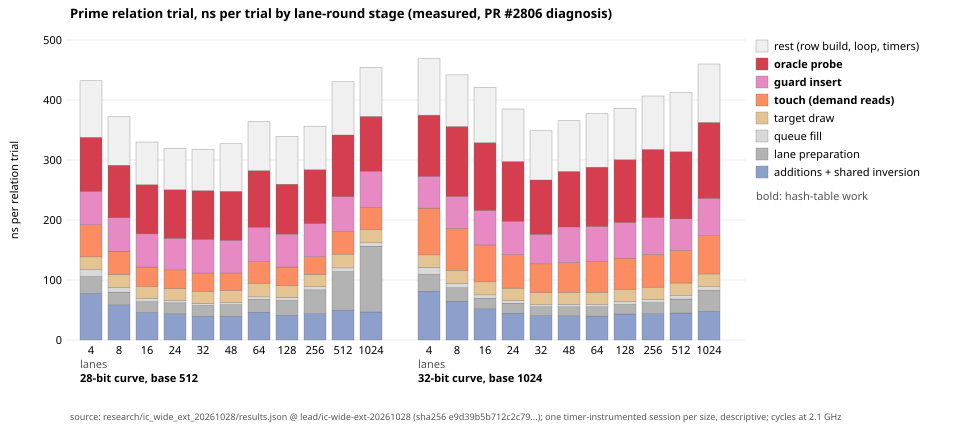

# Prime relation trial: the hash-table floor (design, 2026-10-29)

**Status: preparation only.** Nothing in this directory was built, run or measured. The patch
is **UNCOMPILED AND UNTESTED**. Every number below is labelled **measured**, with the
repository path it comes from, **derived** (arithmetic on measured numbers or a library's
documented sizing rule), or **plan** (an expectation to test).

This is the next step of lead `LEAD-ICP-prime-ic-constant-engineering`
(crypto-autoresearcher `knowledge/leads/ecdlp/ic-prime/LEAD-ICP-prime-ic-constant-engineering.yaml`,
`next_action`). That step asks for "a table with exposed slot addresses for software prefetch
or a compact lane layout". The lead's discriminator is: "a prefetchable or compact table with a
paired relation-phase ratio whose interval is below 1 is a measured constant improvement; an
interval spanning 1 closes the item."

Files here:

| file | what it is |
|:--|:--|
| `README.md` | this note: where the time goes, two designs, the patch, a draft protocol |
| `patch.diff` | the preferred design as a unified diff, **UNCOMPILED AND UNTESTED** (base below) |
| `stage_split.py` | stdlib script: reads PR #2806's `results.json`, writes the two files below |
| `stage_split.csv` | the measured per-trial stage split for every lane width, 28 and 32 bits, copied from the source |
| `stage_split.svg` | the same split as stacked bars (hash-table stages in red and pink) |

Where the evidence lives: PRs #2783 and #2806 are **open and unmerged**. Their directories
`research/ic_wide_batching_20261028`, `research/ic_wide_ext_20261028` and
`benchmarks/20261028-ic-wide-ext` exist only on branch `lead/ic-wide-ext-20261028`, head
`db02dd4f10e2ad4eccbf420b90bf4a406258a990`, not on `main` (`7ffaab06b`). I read them through
the GitHub contents API at that head. The `results.json` I used has sha256 `e9d39b5b712c2c79…`.
The code paths below (the lane touch loop, `collect_and_solve_relations_touching`,
`DecompositionOracle::touch`) also exist only on that branch.

---

## 1. Where the 137 ns goes

### 1.1 What was measured

Source: `research/ic_wide_ext_20261028/results.json`, block `diagnosis` (branch above), and
`research/ic_wide_ext_20261028/README.md`. The sessions are `diagnosis/split-diag-28-1` and
`split-diag-32-1`. Both are curve `prime_search` with bits 28 and 32 and seed 59297. The recipe is
`mitm-prime-batch:m=2`, with base `prime-abscissa:size=512` at 28 bits and `size=1024` at 32 bits.
Each session has 4 targets × 3 rounds plus 1 warm-up, and there is one session per size. The
timers are wall clock for the four round stages and TSC cycles for the loop body, converted at
2.1 GHz as the PR does. The PR itself calls these sessions "descriptive, not replayable, and not
in the certified headline". The host was an Intel Xeon @ 2.10 GHz (family 6, model 207), a 4-vCPU
cloud container below L2.

Measured, ns per relation trial (`stage_split.csv`):

| bits | lanes | total | touch (round loop) | guard insert | oracle probe | guard + oracle | touch + guard + oracle | share of trial |
|--:|--:|--:|--:|--:|--:|--:|--:|--:|
| 28 | 16 | 330.0 | 32.9 | 55.1 | 82.0 | 137.2 | 170.0 | 51.5% |
| 28 | 32 | 318.1 | 30.6 | 56.3 | 80.9 | 137.2 | 167.9 | 52.8% |
| 32 | 16 | 421.1 | 61.5 | 57.9 | 112.6 | 170.5 | 232.0 | 55.1% |
| 32 | 32 | 348.7 | 47.9 | 49.2 | 90.6 | 139.8 | 187.7 | 53.8% |
| 32 | 1024 | 460.0 | 63.6 | 62.7 | 126.3 | 189.0 | 252.6 | 54.9% |

The lead's "about 137 of about 318 ns" is the 28-bit, 32-lane row (guard + oracle). The last two
columns are derived sums.

**The first correction to the lead's framing: the floor is larger than 137 ns.** The incumbent
lane round already "touches" both tables for the whole round before the first trial. The code is
on the branch, in `ic_boundary.rs` `collect_and_solve_relations_scaled`: for each queued point it
calls `black_box(seen.contains_key(..))` and `PairTable::touch`, which is
`black_box(self.get(key))`. These are full demand lookups on two `std::collections::HashMap`s
with a `MixHasher`. That touch stage is a further 30.6 ns/trial (28 bits) and 47.9 ns/trial (32 bits) at 32 lanes, and up to 63.6 ns/trial at 1024 lanes (measured, above; all ns here are TSC cycles converted at 2.1 GHz or wall-clock round timers, as §1.1 says). So the
hash-table work per trial is touch + guard + oracle, about 168 ns at 28 bits and 188 ns at 32
bits at 32 lanes (derived). That is about 53% of the trial. Prefetching can only help by making
the touch cheaper than a demand read **and** the later probes cheaper than probes into a std map.

### 1.2 What is inside each interval (code reading, branch head)

- **Touch** (per queued point, once per round): `g.key(&point)`, the guard map's
  `contains_key` (hash, a control-group load, a SIMD tag match, and possibly a bucket load), then
  `RefCell::borrow` and a dyn call to `DecompositionOracle::touch` → `PairTable::touch` →
  `PairTable::get`. `get` checks the `packed` and `parts` layouts and then calls `map.get`. Every
  result goes through `black_box`, so each touch completes its dependent loads.
- **Guard insert** (`seen.insert(g.key(&point), ())`): a hashbrown insert of a new key in nearly
  every trial. Repeats are rare, and `repeated_targets_skipped` counts them. The insert does a
  `reserve` check, a control-group probe, a control-byte write and a bucket write, plus the
  amortised rehash, because `seen` starts at capacity 4096 and doubles. The interval also contains
  `trials += 1` and one TSC read.
- **Oracle probe**: `measurement::mark(TargetPdp)` (a thread-local `RefCell` borrow and an atomic
  load when no session is active; `src/cryptanalysis/ic_measurement.rs`). Then the
  `RefCell::borrow_mut` on the oracle, a dyn call to `decompose_relations` (the trait default),
  `decompose` → `decompose_mitm` → `PairTable::probe`, and inside it `get` with its layout
  checks. Only on a hit (rare, see below) does it do one affine addition. The interval also
  contains one TSC read.
- **Hit rate** (derived): the folded table holds about `|F_x|²` keys out of about `p`. That gives
  262,144 / 2^28 ≈ 1/1024 at 28 bits and 2^20 / 2^32 ≈ 1/4096 at 32 bits. So the probe is almost
  always a miss, and the miss path is the one to optimise.

### 1.3 Memory footprint (derived from hashbrown 0.14.5's sizing rule, `Cargo.lock`)

hashbrown allocates `next_pow2(capacity × 8/7)` buckets, plus one control byte per bucket.

| structure | 28 bits (base 512, ~144k trials) | 32 bits (base 1024, ~844k trials) |
|:--|:--|:--|
| pair table, std map (`fast_map(a²+1)`, 16 B buckets) | 8 MiB buckets + 0.5 MiB control | 32 MiB + 2 MiB control |
| pair table, line table (this patch, 8 B words, ≤ 3/4 full) | 4 MiB (load 0.50) | 16 MiB (load 0.50) |
| guard, std map (8 B keys, grows ×2) | 2 MiB + 0.25 MiB control | 8 MiB + 1 MiB control |
| guard, line table (grows ×2 above 3/4) | 2 MiB (load 0.55) | **16 MiB** (load 0.40) |

The trial counts are the diagnosis medians (measured, `results.json`).

A detail that matters for the design: **a hashbrown miss reads only the control array**, a single
16-byte group, and reads a bucket only on a 7-bit tag false match. The control array is 0.5 MiB
at 28 bits and 2 MiB at 32 bits, so it is roughly L2-sized on this host. The line table reads one
line of a 4 to 16 MiB array on every miss. Its advantage is that this line's address is known
without any load, so it can be prefetched, and the probe is one line scan with no tag indirection.

### 1.4 What the measurement cannot tell us

- **Memory stall versus instructions.** Two measured facts point in opposite directions. First,
  at 1024 lanes, where the round's touched lines no longer stay in L1, guard + oracle rise from
  49.2 + 90.6 to 62.7 + 126.3 ns at 32 bits (measured, `research/ic_wide_ext_20261028/report.html`).
  So part of the probe cost is memory, and the touch hides it only while the lines stay cached.
  Second, at 32 lanes the touched lines should still be in L1, yet guard + oracle remain at about
  137 to 140 ns. So a large part is probably instruction and dispatch work: hashing, SIMD matching,
  the `RefCell`, the dyn calls, `mark`, and the timer reads. This is a hypothesis, not measured.
  Without a hardware PMU (the cloud host has none; see the `perf-ipc` skill) the split cannot be
  resolved further.
- **Timer inflation.** Diagnosis trials × ns/trial is 45.9 ms at 28 bits/32 lanes and 294 ms at
  32 bits/32 lanes. The grid's median relation phases for the same base and width are 39.1 ms and
  253.7 ms (measured, `results.json` `grid`). The ratio is 1.16 to 1.17, and 1.33 to 1.35 at 16
  lanes (derived). These are medians from different sessions, so this is not a like-for-like
  comparison. Still, the diagnosis's absolute ns are probably inflated by its own timers (four TSC
  reads per trial and five `Instant::now` per round). **Use the split, not the absolute values.**

---

## 2. Two candidate designs

### Design A (preferred): line tables with exposed slots, prefetched by the existing round loop

**What it is.** A line is 8 × u64 = 64 bytes, aligned. A key's home line is a multiplicative hash
of the key, a pure function of the key that needs no load. A probe scans the home line in order
and moves to the next line only if that line is full. There are no deletions, so a lookup stops
at the first empty word. Two users:

1. **`GuardSet`** holds the relation guard: the point keys themselves, with a flag for key 0. It
   grows ×2 above 3/4 load and answers exactly `HashMap::insert(k, ()).is_some()`.
2. **`FlatPairIndex`** holds the batched pair table as `PackedPairTable` words: key `x+1 < 2^32` in
   the high half, `(i, j)` in 16 bits each in the low half. It is filled in the builder's emission
   order with insert-if-absent, so every key keeps the first pair that reached it, exactly as
   `entry(key).or_insert(..)` does. It is sized once (`|F_x|² + 1` bound, at most 3/4 full) and
   never grows. It is used only when `p < 2^32` and the base has at most 2^16 points; otherwise
   the builder falls back to the std map.

The lane round's touch loop then becomes two `prefetcht0` instructions per queued target, each
with a hash and no dependent load. The trial loop's guard insert and oracle probe each scan one
line that the round has already requested. Nothing else changes. Lane order, the guard's answers,
the witness per key, every counter and every record stay the same (by construction; to be checked
in §4).

**How it is switched.** It is an opt-in oracle parameter: `mitm-prime-batch:m=2,layout=lines`.
The default `layout=map` keeps the incumbent code path for every recorded spec, with one enum
match per guard call and one `Option` check per table `get`. So incumbent, A/A and candidate can
run **in one session from one binary**. The `isolab-eks` ecbench path needs exactly that: it
builds one image per commit and requires a reference and a matching A/A arm in the spec. Two
binaries would mean two images on possibly different nodes.

**Expected effect (plan, not measured).** The mechanism has three parts:

- the touch stage drops from 30.6 (28 bits) / 47.9 (32 bits) ns/trial of demand lookups at 32 lanes toward the cost of two hashes
  and two prefetches;
- the guard insert loses hashbrown's control-byte path and its insert bookkeeping;
- the probe becomes one line scan.

Bounds, as arithmetic on the measured 32-lane split (derived, not predictions):

| scenario (32 lanes) | 28-bit relation ratio | 32-bit relation ratio | whole-solve ratio if set-up unchanged (28 / 32) |
|:--|--:|--:|--:|
| touch becomes free, guard + oracle unchanged | 0.904 | 0.863 | 0.931 / 0.895 |
| touch free and guard + oracle fall by a third | 0.760 | 0.729 | 0.828 / 0.793 |
| upper bound: all hash-table work gone | 0.472 | 0.462 | n/a |

The whole-solve column uses the grid's relation share of the median solve: 39.1/54.5 = 0.717 at
28 bits (b512-L32) and 253.7/332.0 = 0.764 at 32 bits (b1024-L32). Both are measured in
`results.json` `grid`, and the shares are derived. I would plan on the first two rows bracketing
the outcome **only if** the probes are partly memory-bound. If they are mostly dispatch-bound
(§1.4), the gain could be under 5%, and the item then closes as the lead says.

**Risks.**

- **Miss path on a bigger array.** The std map's misses read an L2-sized control array; the line
  table's misses read a 4 to 16 MiB array. If a prefetch has not completed by the time its trial
  runs, the probe gets slower. This matters most for the first targets of each round, since the
  prefetches are issued just before the round is consumed. The walk arm (`targets=walk`, no touch
  loop) under `layout=lines` exposes this directly. A follow-up variant could add a one-byte tag
  array: prefetch the tag line, and read the word line only on a tag match.
- **Guard footprint at 32 bits.** It is 16 MiB against 9 MiB (§1.3), because the 3/4 growth
  threshold falls just below 844k keys. The constant can be tuned without any output effect, for
  example 7/8 with longer spills.
- **Set-up time changes.** The table build inserts into a different structure. The protocol must
  report the set-up phase separately; a faster probe with a slower build could net to zero.
- **Hardware class.** `prefetcht0` behaviour differs between Intel (the #2806 host) and AMD (EKS
  `c8a` and `m8a` are AMD EPYC). Off x86-64 the patch falls back to the old demand read. A result
  covers the class it was measured on (AGENTS.md §10, "Say which hardware class").
- **Coverage.** Only `mitm-prime-batch` gets the line table. Today's base-tuning study uses
  `mitm:negation_folded=1` as its incumbent oracle (measured label,
  `research/prime_base_oracle_tuning_20261029/README.md`). Extending the layout to that oracle
  needs a post-build map-to-line conversion: one extra pass over `a²` entries at set-up. That is
  not in this patch.
- **Track status.** Under the owner's 2026-10-24 rule (`docs/ic/SWEEPER.md`, "Tracks"),
  `prime-table` is reference only. A gain on the pair-table probe improves the reference arm and
  the shared relation loop, not a counted IC track. The guard and the lane prefetch are shared by
  every oracle that runs through this collector. See the owner decision below.
  (Cross-track review: [`../DECISIONS.md`](../DECISIONS.md) R1 has since put pair-table, `mitm`
  and `rootfind-*` pipelines in a counted *generic* track (Option C of `../ruling/README.md`,
  delegated, confirmed when its PR merges). Under it a verified relation-phase gain here would
  count as a generic-track improvement, labelled "generic: bounded by sqrt(r); cannot beat rho",
  and never as algebraic progress. Until that PR merges, the 2026-10-24 wording above applies.)

### Design B (alternative): compact SoA lane round with a batched probe pass

**What it is.** The lane queue is a `VecDeque<(usize, PrimePoint, u64, u64)>`, about 48 B per
entry. Every `PrimeWalkLane` owns a heap `Vec<usize>` permutation of 16 × 8 = 128 B. Design B
replaces these with structure-of-arrays round buffers (`keys[L]`, `a[L]`, `b[L]`) and `[u8; 16]`
permutations. It then runs a pure **probe pass** over the round: compute every queued key's
pair-table answer in one tight loop, which gives independent loads with maximal memory-level
parallelism, in the style of group prefetching or AMAC. The trial loop then consumes the stored
answers and does the counting (`lookups`, the hit's confirming addition) only when it uses an
answer. The guard stays sequential, because inserts within a round interact when two lanes meet.

**Expected effect (plan).** It removes the touch's duplicate work, since each table is read once,
and it shrinks the round's L1 footprint. But the #2806 diagnosis found that L1 reach binds only
far above the knee (measured: guard + oracle grow only at 1024 lanes). At 16 to 32 lanes the
layout gain would be small. The probe pass overlaps misses the incumbent touch already overlaps.

**Risks.** It touches the lane state machine, the restart permutation draws and the queue
semantics, which is a much larger surface for bit-identity. It performs real, uncounted lookups
for queued targets after a solve stops (up to L − 1 per run). Those must be reported as unpriced
native work for the §5a band, or skipped. It does not help the plain walk.

### Rejected

- **Double-buffered rounds** (prepare round k+1 while consuming round k, for a longer prefetch
  distance). This is not bit-identical: a guard repeat in round k sets `lane.fresh`, which changes
  round k+1's requests.
- **hashbrown's raw-table API.** hashbrown is only a transitive dependency (`Cargo.lock` 0.14.5,
  absent from `Cargo.toml`). Its bucket pointers still need the hash-then-load path, and adding the
  dependency is a larger change than about 240 lines of local table code.
- **`PREFETCHW` (`_MM_HINT_ET0`) for the guard.** Its write intent would suit the insert, but
  whether the hint is stable across the toolchains in use is unverified. It is a one-line variant
  to try later.

---

## 3. The patch (`patch.diff`, UNCOMPILED AND UNTESTED)

- **Base:** branch `lead/ic-wide-ext-20261028` at `db02dd4f10e2ad4eccbf420b90bf4a406258a990`
  (PR #2806). It does not apply to `main`. It was checked only by `patch -p1 --dry-run` against the
  four files fetched from that head, and by `rustfmt --check`, which parses `ic_boundary.rs`,
  `plugins.rs` and `stages.rs` (the patch is formatted). `mod.rs` could not be parse-checked alone,
  because its sibling modules were not fetched. **No `cargo build`, `clippy` or `test` was run**,
  per this container's limits.
- **Surface** (4 files, +462/−8 lines, 118 of the added lines tests):
  - `src/cryptanalysis/ic_boundary.rs`:
    - `Line`, `lines_for` and `prefetch_line` (x86-64 `prefetcht0`; demand read elsewhere);
    - `GuardSet`, the `Guard` enum (std map or line table) and `FlatPairIndex`;
    - `PairTable.flat`, `PairTable::build_negation_folded_prime_batch_lines`, and `get`/`touch`
      dispatch;
    - a `line_guard: bool` argument on `collect_and_solve_relations_touching` and `_scaled`, with
      the two internal callers passing `false`;
    - the round loop calls `seen.touch(key)`, and the guard calls `seen.insert(key)`;
    - three tests: `guard_set_answers_as_the_std_map`,
      `prime_batch_lines_table_matches_the_map_table` (every key `0..=p+1` at 20 bits with base
      600; the same `entries`, `insert_attempts` and `build_ops`), and
      `line_tables_leave_the_relation_stream_unchanged` (walk, 16 and 32 lanes: the same target
      stream, `recovered`, `trials`, native and `work_native` counters, group operations and
      lookups).
  - `src/cryptanalysis/ic_framework/stages.rs`: `DecompositionOracle::line_guard()`, default
    `false`.
  - `src/cryptanalysis/ic_framework/plugins.rs`: `PrimeBatchMitmOracle` accepts
    `layout=map|lines` (rejecting anything else) and reports `line_guard()`.
  - `src/cryptanalysis/ic_framework/mod.rs`: reads `oracle.line_guard()` and passes it to the
    collector.
- **Bit-identity argument.** Membership answers are layout-independent. The pair-table witness per
  key is "first emitted wins" in both layouts. The touch never decides or counts. `kind`,
  `entries`, `insert_attempts` and `index_lookups` are kept equal. Only `build_wall_ns` and the
  phase wall times may differ. Section 4's checks test this rather than assume it.
- **Compile risks to check first:**
  - `_mm_prefetch::<_MM_HINT_T0>` inside `unsafe` (the fn carries `#[allow(unused_unsafe)]` for
    toolchains where the intrinsic is safe);
  - other callers of `collect_and_solve_relations_touching` or `_scaled` that may exist in branch
    files I did not fetch (on `main` only `ic_boundary.rs` calls `_scaled`);
  - the `parameters()` slice coercion in `plugins.rs`;
  - clippy lints on the new enum and loops.

---

## 4. DRAFT paired protocol (not frozen; the experiment director freezes it)

**Question.** At fixed recipe, curve, targets and seeds, does `layout=lines` lower the
relation-phase wall time of the prime pair-table pipeline, with every record identical outside
timing?

**Instrument and route.** Use `ecbench` `ic.pipeline` from one image built from the patched commit.
Run through `isolab-eks` (CLAUDE.md; AGENTS.md §9a) on `cpu-l2-spot`, choosing `c8a.2xlarge` or
`m8a.2xlarge` (verified no-SMT L2 evidence per the skill). Use four Guaranteed CPUs,
`RAYON_NUM_THREADS=1` and `isolation_required: "L2"`. Spot loss means a fresh epoch: nothing is
resumed and no record is discarded. The marker file `/dev/shm/lane_diag.on` must be **absent** in
every measured session. Fill `.resume/RESUME.md` (`scripts/checkpoint.sh init`) before the launch.

**Sizes and curves.** Use `prime_search` seed 59297 at 20, 24, 28 and 32 bits (fp20 to fp32),
`targets_per_curve: 8`, and `target_seed: 20261002`. These are the curves of #2783 and #2806, so
the result lines up with their ladder and grid. The bases are 128, 256, 512 and 1024 (the #2783
ladder). The last two are the #2806 grid optima at 28 and 32 bits (measured, `results.json`
`grid`). A second cell on the ICV1 holdout curves of `research/prime_base_oracle_tuning_20261029`
is an optional add-on (owner or director choice).

**Arms** (one session per size; every arm on the same targets and algorithm seeds):

| arm | method | role |
|:--|:--|:--|
| `rho-neg` | `rho.negation` | matched reference (§5a band, gap to rho) |
| `inc` | `ic.pipeline` with `prime-abscissa:size=B`, `mitm-prime-batch:m=2`, `walk-prime-batch-32` | incumbent at the knee |
| `inc-aa` | identical to `inc` | A/A |
| `cand` | as `inc` with `mitm-prime-batch:m=2,layout=lines` | candidate (prefetch + line tables) |
| `w-inc` | as `inc` with `targets=walk` | layout-only control, no prefetch |
| `w-cand` | as `w-inc` with `layout=lines` | layout-only candidate (exposes the bigger-array miss risk) |

**Primary pair per size** (declared now): fp20 `w-cand/w-inc`, because the 16-lane arm loses to
the walk at 20 bits (1.172, measured, `research/ic_wide_batching_20261028/README.md`). For fp24,
fp28 and fp32 it is `cand/inc`. The other pair at each size is secondary.

**Rounds.** One warm-up, then at least 6 measured rounds with `order: alternate_measured` (even,
so it balances). Use 3 sessions per size, alternated across sizes. That gives 8 × 6 × 3 = 144
pairs per arm pair per size.

Rough cost (derived from the grid's median solves of 51 to 63 ms at 28 bits and 332 to 533 ms at
32 bits): about 6 IC arms × 8 targets × 7 rounds × 3 sessions × 0.5 s, about 17 minutes at 32
bits plus rho. Smaller sizes cost less.

**Statistics.**

1. **Primary:** the relation-phase wall ratio `cand/inc`. This is the geometric mean over (session,
   target, round) of `phases[relations].wall_ns`, which already excludes linear algebra and
   verification. Give it a 95% cluster-bootstrap interval with clusters = targets, 4,000
   resamples and a fixed seed. Correct it by the A/A: `corrected = ratio / (inc-aa/inc)`, with
   the intervals combined on the log scale.
2. **Secondary:**
   - the whole-solve wall from `ecbench compare` (`ratio_b_over_a`, `corrected_ratio`,
     `outside_noise`, ns per GAE; since GAE is identical this is a wall ratio);
   - the **set-up phase ratio**, reported on its own;
   - the same statistics for the walk pair;
   - one descriptive diagnosis session per size, with the marker file present, to show which stage
     moved. That session is not part of the headline.
3. **Whole-solve S:** `ecbench compare --weight 0`, `0.1` and `1`. The ops ratio `cand/inc` must be
   exactly 1.000 at every weight. `ecbench band` must give identical rows for `inc` and `cand`.
   The gap to matched rho (`Σ S / Σ S_rho-neg`, the distance remaining) is reported and is
   unchanged by construction. This is a wall-clock constant and cannot move S.

**Records-identical checks** (all must pass, or the run is void):

- (a) For every (session, target, round), the `cand` and `inc` records agree on every field except
  timing and isolation telemetry and the arm name and parameters: `trials`, relations, every
  native and `work_native` counter, group and field operations, `recovered` and `verified`. The
  same holds for `w-cand` against `w-inc`.
- (b) The patched binary's `ecbench verify --replay-all` reproduces #2806's ten certified sessions
  (`research/ic_wide_ext_20261028/replay-certificate.json`, 1,176 replays). This shows the default
  layout is still bit-identical.
- (c) `ecbench verify --replay-all` passes on every new session.
- (d) An independent `validator.py` recomputes every headline number from the raw records without
  sharing code with the summary, as #2806 did.

**Admission.**

- At least five admitted L2 pairs per comparison (the ecbench rule).
- The A/A `inc-aa/inc` 95% interval must contain 1 and lie within [0.9, 1.1]; otherwise the size
  is descriptive.
- Report contended runs separately and never pool them.

**Decision rule** (each size decides alone; fp28 and fp32 are the sizes where the floor was
diagnosed):

- **Improvement** (a measured constant improvement under the owner's success criterion): the
  records checks pass **and** the A/A-corrected relation-phase 95% interval lies wholly below 1.
  Report the whole-solve and set-up ratios beside it. If the whole-solve interval lies wholly above
  1, it is a **trade**, not an improvement.
- **Closes the item:** if the corrected relation-phase interval **spans 1** at both fp28 and fp32,
  the hash-table-floor item closes as measured (the lead's discriminator). Do not tune and rerun.
- **Regression:** an interval wholly above 1 rejects the design. That also closes the item for
  Design A. Design B stays as an unexplored note.

**Landing, if it is an improvement.** Use `benchmarks/<date>-ic-hashtable-prefetch/` with
`REPORT.pdf`, an SVG and PNG graph, and `VALIDATION.json` (replay certificate, validator report,
matched rho with the §5a band). Add a row in `benchmarks/README.md`. Rebuild the leaderboard with
`python3 scripts/build_ic_leaderboard.py`, as an engineering section outside tables A to C (like
"Pair-table set-up, outside tables A–C"). Table B's S does not change. Follow the second-host
replay requirement of the validation gate before the leaderboard row, and state the hardware class.

---

## 5. Open threads

- Build and test the patch on a machine with disk for `cargo` (unit tests first, then
  `cargo clippy --all-targets`).
- Decide whether to stack on #2806 or wait for #2783 and #2806 to merge. The patch base is #2806's
  head.
- Optional variants after a first result: a tag-byte array in front of the line table, a 7/8 guard
  growth threshold, `PREFETCHW` for the guard, and extending `layout=lines` to
  `mitm:negation_folded=1`.
