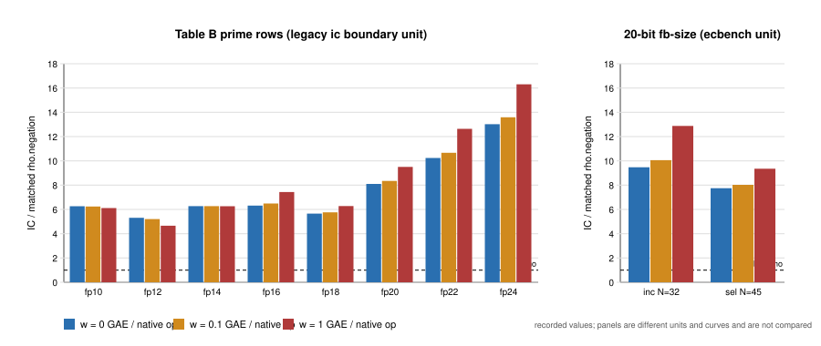

# Validation-gate dossier: Table B prime rows and the 20-bit fb-size row (2026-10-29)

This is preparation. It measures nothing and launches nothing. Each statement carries one of three labels:

- **measured**: read from a committed file, which is cited by repo-relative path;
- **derived**: my reading of those files;
- **plan**: something proposed, not done.

The read-only checks I ran are in [`gate_status.py`](gate_status.py), with their output verbatim in [`gate_status.out.txt`](gate_status.out.txt). The full `validation_gate.py check` stderr is in [`validation_gate_check.stderr.txt`](validation_gate_check.stderr.txt). The graph is [`band_ratio.svg`](band_ratio.svg), from [`plot_band.py`](plot_band.py), which uses recorded values only. No PDF was made, because the container has no PDF engine (no typst, LaTeX or wkhtmltopdf). Checkout: `main` at `7ffaab06bad1` (2026-10-28).

## Bottom line

1. **The eight Table B prime rows already pass the gate** (measured).
   - `docs/ic/runs/VALIDATION.json` covers all 13 Table B slugs. It pins:
     - `research/ic_validation_gate_20261024/B/replay-certificate.json`;
     - `research/ic_validation_gate_20261024/B/validator-report.docs-ic-runs.json`;
     - a negation-map rho reference with the §5a band.
   - `python3 scripts/validation_gate.py evidence docs/ic/runs` prints `valid`.
   - The committed board status of every prime row is `validated`, and recomputing it agrees ([`gate_status.out.txt`](gate_status.out.txt) §1–2).
   - Nothing is missing for the gate.
   - `pricing_ok=False` and `protocol_frozen_ok=partial` are caveat fields. They come from the 2026-10-19 sweep line in `research/validation_sweep_20261019/A-leaderboard/verdicts.jsonl`, and the builder prints them beside the standing. They do not block it, because a complete `VALIDATION.json` outranks the sweep verdict (`scripts/validation_gate.py`, `judge`).
2. **The 20-bit fb-size row also passes the gate mechanically** (measured).
   - `benchmarks/20261029-prime-fb-size-20bit/VALIDATION.json` → `valid`.
   - It is already admitted to `benchmarks/README.md` (line 50).
   - What it lacks is not a gate field: it is the **second-host replay that its own protocol requires before a leaderboard promotion**. `backlog/XP-20261016-prime-base-oracle-tuning/PROTOCOL.md` §13 requires it, and the manifest lists it under `promotion_blockers`.
   - The existing replay certificate says `same_host_class_as_measurement: true` and `same_binary_as_measurement: true`.
3. **Under the owner's 2026-10-24 track rule, all nine rows are on the `table` track** (derived from `docs/ic/SWEEPER.md` "Tracks" and `src/bin/ic/sweep/space.rs`).
   - The rule says `prime-table` is the "prime-field pair table (mitm) over abscissa, GLV-orbit or CM-multiplier bases", and that it is "reference only, never ranked against the algebraic track".
   - Table B's recipes are `mitm_m2_negfold_walk[_balanced]` (`docs/ic/LEADERBOARD.md` "Curve records"). The fb-size row uses `oracle: mitm:negation_folded=1`.
   - Passing the gate lets them be *shown*. It does not make them count as summation-polynomial IC. That needs an owner decision; see the last section.

## How standing is decided (measured, `docs/VALIDATION_GATE.md`, `scripts/validation_gate.py`)

**Evidence directory.** For a board row it is `dirname(row.source)`. For every Table B row that is `docs/ic/runs`, and the source is `docs/ic/runs/ic-boundary-ledger-round5-2026-09-22.json`, a file that `.artifacts/config.json` keeps in Git. For a benchmarks row it is `benchmarks/<dir>/`.

**Precedence.** The gate takes the first of these that applies:
1. a failing sweep verdict;
2. a complete `VALIDATION.json`;
3. a passing sweep verdict;
4. the pre-gate freeze.

A sweep word `validated_with_caveats` is in `VERDICT_NONPASS`, so it never validates by itself. It is only shown.

**What the gate checks.**
- The replay certificate and validator report hash to their pins.
- `status` is verified/pass, `independent: true`, `scalars_verified: true`.
- The `runs` and `raw_data` lists are non-empty, and the headline values match within `rel_tol`.
- The rho reference has `kind`, `protocol`, `unit` and `binary_or_process`, with `matches_protocol`, `strongest_available`, `same_unit` and `same_binary_or_process` all true.
- The band has exactly the keys 0 / 0.1 / 1 with positive `ic` and `rho`.
- `order_holds_across_band` is a bool.

**What the gate does not check.**
- It never reads `pricing_ok` from a manifest.
- It never checks host class. `independent: true` is self-asserted.

**Scope.** The builder applies the gate to `board` rows (Tables A–C) through `gate.annotate_board`. A section outside A–C calls `gate.check_evidence_dir` on its study itself: `postgb_linear_stage_component` in `scripts/build_ic_leaderboard.py` is the pattern.

## Table B prime rows

All eight rows share one evidence directory, `docs/ic/runs`, and one manifest. Its contents are byte-identical to `research/ic_validation_gate_20261024/B/VALIDATION.docs-ic-runs.json` (measured, `diff` of the two files). `git log -- docs/ic/runs/VALIDATION.json` lists one commit, the merge of PR #2709 (2026-10-27).

| row | log₂ r | replay certificate | validator report | matched rho with §5a band | VALIDATION.json | board standing | board x ref | band IC/rho at w = 0 / 0.1 / 1 | extended band, min |
|:--|--:|:--|:--|:--|:--|:--|--:|:--|--:|
| `icv1-fp10-t5-192cb216` | 9.7 | yes | yes | yes, negation | yes | validated | 6.34 | 6.26 / 6.24 / 6.11 | 5.00 |
| `icv1-fp12-t19-d4a315df` | 11.9 | yes | yes | yes | yes | validated | 5.47 | 5.31 / 5.21 / 4.66 | 4.05 |
| `icv1-fp14-tm43-158b6914` | 14.0 | yes | yes | yes | yes | validated | 6.43 | 6.27 / 6.27 / 6.26 | 4.81 |
| `icv1-fp16-t351-d433f24e` | 16.0 | yes | yes | yes | yes | validated | 6.71 | 6.31 / 6.49 / 7.43 | 5.80 |
| `icv1-fp18-t175-45770ebc` | 18.0 | yes | yes | yes | yes | validated | 5.82 | 5.65 / 5.76 / 6.28 | 4.97 |
| `icv1-fp20-t1293-3c2999ba` | 20.0 | yes | yes | yes | yes | validated | 8.30 | 8.10 / 8.34 / 9.50 | 7.26 |
| `icv1-fp22-tm1267-a5acaf6d` | 21.7 | yes | yes | yes | yes | validated | 10.5 | 10.24 / 10.66 / 12.64 | 9.50 |
| `icv1-fp24-t1577-77336155` | 23.4 | yes | yes | yes | yes | validated | 13.5 | 13.02 / 13.59 / 16.30 | 12.42 |

**Sources** (all measured):
- log₂ r and board x reference: `docs/ic/LEADERBOARD.md` lines 97–104.
- Band: `research/validation_sweep_20261019/A-leaderboard/verdicts.jsonl` (`recomputed.band_ratio_*`), which agrees with `research/ic_validation_gate_20261024/B/validator-run.txt`.
- Extended band minimum: `research/ic_validation_gate_20261024/README.md`. The extended band also charges IC its pair-table inserts and rho one table operation per step.
- Per-row bands: `research/ic_validation_gate_20261024/B/rho-reference.json` (`per_row`).

**Distance remaining** (derived from the table). IC is 4.05× to 16.3× its matched rho across all bands, and IC stays above rho at every weight. No row is close to rho.



The figure's two panels use different units (legacy `ic boundary` calibrated GAE, and ecbench GAE with C = 0) and different curves. They are not comparable.

### What the three artifacts are (measured)

**Replay certificate**: `research/ic_validation_gate_20261024/B/replay-certificate.json`.
- `ic boundary` was re-executed in a fresh process with the archive's frozen configuration (seed 123212651130, 3 repeats).
- 13 of 13 instances are identical, over 1,257 runs.
- An independent pure-Python verifier (`scripts/ec_verify.py`) checked [d]G = Q on 633 archive runs and 945 replay runs, and rejected 1,578 of 1,578 negative controls.
- The first replay used a tree with other agents' uncommitted edits. The coordinating session then re-ran it on the committed tree (`raw/replay_B_committed_tree/README.md`, `ic` sha256 `09a58b51…`, 13 of 13 identical).
- Host: Intel Xeon 2.80 GHz, 4 shared cores, L0. This is a fresh process, not a different host class.

**Validator report**: `validator-report.docs-ic-runs.json`. `scripts/validate_B.py` recomputes 52 headline numbers from the round-5 ledger and the re-priced rho to 1e-9.

**Rho reference**: the block inside the manifest.
- `kind: negation`, A = 2.
- Band formula `S(w) = mean[G − C + w(U + n_C)]/√r`.
- `order_holds_across_band: true`.
- The smallest ratio in the extended band is 4.05 (fp12, w = 1).

### Why `pricing_ok=False` (measured: sweep notes and `A-leaderboard/REPORT.md` "Pricing")

Two reasons, both measured from the sweep:

1. The two arms are priced in different ways.
   - IC's native operations are priced by the pinned calibration in `docs/ic/calibration.json`. Those ratios come from ns per native operation over ns per group addition, so the calibration is wall-derived, not a count.
   - Rho's canonicalisations are left uncharged. Per run, the uncharged counts are 44.7 (fp10), 112 (fp12), 184 (fp14), 289 (fp16), 581 (fp18), 1,158 (fp20), 2,034 (fp22) and 3,063 (fp24).
2. The board prints only that single mixed-pricing point (`x reference`), not the §5a band. The sweep's REPORT table says the arms are "priced in the same unit? no".

The sweep line was written on 2026-10-19. The band was computed on 2026-10-24 and put in `VALIDATION.json`, but no later verdict line replaces the old one. So the board keeps printing `pricing_ok=False` (derived, from `load_verdicts`: later lines win; and from `validation_cell` in `scripts/build_ic_leaderboard.py`, line 330).

**The order is settled; the magnitude is not** (derived). The band shows the order IC > rho holds at every weight in both formulas. What stays open is the magnitude: at w = 1 the ratio is up to 21% above the board value (fp24: 16.30 vs 13.46).

### Why `protocol_frozen_ok=partial` (measured, sweep notes)

- The recipe is the minimum over 9 recipes on the same 3 planted targets, which is a selection in IC's favour.
- `docs/ic/BOUNDARY_TARGETS.md` is a living document, edited after the data.
- Round 5's preregistered content was never frozen separately.
- The sample is small: one planted target per instance, 3 repetitions, 24 rho runs (`docs/ic/runs/VALIDATION.json` caveats).

### What would clear each caveat

Nothing here is required by the gate. These are options for the owner.

**Option P1: retire `pricing_ok=False` as a documentation fact.** Local, no EKS; plan.
- Add a verdict line that supersedes the old one, citing `research/ic_validation_gate_20261024/B/rho-reference.json`, with `pricing_ok: true` and a `row_digest`. Or teach the builder to render the per-row band from `VALIDATION.json` in Table B.
- Then run `python3 scripts/build_ic_leaderboard.py`, `python3 scripts/validation_gate.py check`, and `bash scripts/ic_audit/check_board_recompute.sh`.
- **Cost:** a builder or sweep-file edit. Editing a dated sweep slice changes a historical evidence file, so it needs the owner's consent (derived).
- **What it is:** an accounting and display change, not an improvement (CLAUDE.md: relabelling is not an improvement). It moves no number.

**Option P2: re-price Table B in one counted unit with C = 0.** Needs EKS; plan.
- Re-run the eight prime instances as one ecbench spec per size:
  - arms: `ic.pipeline` with the recorded base size and `oracle: mitm:negation_folded=1`, plus `rho.negation`, plus A/A arms, in the same session;
  - fresh targets;
  - recipe frozen in advance;
  - at least 5 rounds, to meet the isolab-eks admission.
- This would clear `pricing_ok`, because every native is counted and banded the same way. It would also clear `protocol_frozen_ok`, because the protocol is frozen and the targets are fresh.
- It is a **new measurement**. It produces new rows, not a relabel of the old ones.
- Route: `isolab-eks`, `isolab_k8s_benchmark` or an `isolab.eks.request/v1` document. Validate with `taskq/deploy/eks-karpenter/remote/validate-request`, launch with `remote/launch-remote`, or dispatch `isolab-experiment.yml` with a 40-character `source_revision`. All of these need the AWS identity (account 104186811093) or the GitHub OIDC route.
- After the run:
  1. `ecbench verify --replay-all --exit-code` on each session;
  2. a validator pass (`ecbench-measure` / `review-run`);
  3. `VALIDATION.json`;
  4. `ecbench-independent-runner` for a second host class.
- **Overlap:** the 20–32-bit "frontier" incumbents the fb-size study replayed (`research/prime_base_oracle_tuning_20261029/README.md` §7.3 check 1) already sit in this unit at 20–32 bits. Check those before designing P2 below 20 bits.

**Option P3: accept the caveats as permanent.** These are legacy rows, already shown with their caveats. No work.

### Commands that reproduce or extend the Table B evidence

| piece | command | where |
|:--|:--|:--|
| gate check (no build) | `python3 scripts/validation_gate.py evidence docs/ic/runs` | **local**: ran here, `valid` |
| re-audit the manifest | `python3 scripts/audit_runs.py --sample N --out audit.json`. This samples every `VALIDATION.json`; without `--ecbench` it does no replay. | local, no build |
| native replay | `cargo build --release --bin ic && sh research/ic_validation_gate_20261024/scripts/replay_B.sh ./target/release/ic OUT`, then `python3 research/ic_validation_gate_20261024/scripts/compare_B.py` | **local** on any x86 host with ~7 GB of disk (not this container: no cargo build allowed, 0.9 GB free). Under CLAUDE.md, an authorized replay run defaults to `isolab-eks` via `isolab_k8s_run` with a digest-pinned image, because `isolab.eks.request/v1` runs only ecbench specs and `ic boundary` is not one |
| independent [d]G = Q | `python3 research/ic_validation_gate_20261024/scripts/ec_verify.py …` (pure Python) | local |
| recompute | `python3 research/ic_validation_gate_20261024/scripts/validate_B.py` | local, no build |
| second host class | not done for Table B. The gate does not require it, and no protocol for these rows asks for it | EKS (`isolab_k8s_run`) if the owner wants it |

## The 20-bit fb-size row: `benchmarks/20261029-prime-fb-size-20bit`

**Row.** `icv1-fp20-tm565-6d7d1d32`. The curve is E: y² = x³ + 232725x + 341758 over F_803441, with r = 804007 and log₂ r = 19.62. Holdout session `ECBS1h685271327a8a`. All measured: `VALIDATION.json`, `replay-certificate.json`.

**Claim** (measured, `research/prime_base_oracle_tuning_20261029/README.md`).
- Raising the base size N from 32 to 45, with the oracle unchanged, gives Σ S_sel / Σ S_inc of:
  - 0.818 [0.773, 0.866] at w = 0;
  - 0.798 [0.752, 0.847] at w = 0.1;
  - 0.726 [0.677, 0.778] at w = 1.
- That is 96 matched pairs (48 targets × 2 rounds), with A/A exactly 1.000.
- Distance to matched rho falls from 9.47 to 7.75 at w = 0 and from 12.88 to 9.35 at w = 1.
- The 24- and 28-bit selections are relabelling, and the 32-bit selection equals the incumbent. Only the 20-bit row is a candidate.

| gate piece | present? | detail (measured) |
|:--|:--|:--|
| evidence dir | `benchmarks/20261029-prime-fb-size-20bit/`, plus the study `research/prime_base_oracle_tuning_20261029/` | both `VALIDATION.json` files → `valid` |
| replay certificate | yes, **same host** | `replay-certificate.json` (sha256 `abfda662…`): 672/672 replays `identical`, 1,008/1,008 records verified. `same_binary_as_measurement: true`, `same_host_class_as_measurement: true`, `independent_implementation: false`. The validator's stdlib [d]G = Q check is independent |
| validator report | yes | `validator-report.json` (sha256 `efe75143…`), `status: pass`. Records were read directly by `validation/recompute.py`. `ecbench compare/band` re-ran byte-identically |
| matched rho with §5a band | yes | `rho.negation`, same session, targets and seeds. Band IC/rho: sel 7.75 / 8.02 / 9.35, inc 9.47 / 10.06 / 12.88. Order `rho-neg < sel < inc` holds at every weight |
| VALIDATION.json | yes | `verdict: passed`; `promotion_blockers`: the §13 second-host replay |
| benchmarks/README row | admitted (line 50) | its text already states that the second-host replay is outstanding |
| IC leaderboard | **not on it** | PROTOCOL §13: "a prime-field pipeline section outside tables A–C. Table B's legacy calibrated unit is not mixed." |

### The missing piece: a second-host replay of `ECBS1h685271327a8a`

**What the protocol and skill ask for** (measured).
- PROTOCOL §13 says: "A second-host replay (`ecbench-independent-runner`) is required before a leaderboard promotion."
- The skill says the replay must be `ecbench verify --replay-all` "on a host whose class (`ecbench host`, `env_class_id`) differs from the session's".
- `docs/ecbench/README.md` §9 adds that the auditor needs a different measurement environment **and** a different hardware profile class. It also notes that self-reported fingerprints "cannot by themselves attest physical independence", so keep the runner's job and custody receipt.

**What the session needs** (measured, `sessions/holdout-P20/session.json`, `.artifacts.json`, `host/host.json`).
- `env_class_id` is `ECBENV3hc4d998f5ae3f`: a 4-vCPU "Intel Xeon @ 2.10 GHz" cloud container, kernel `6.18.44-fc-v185`.
- `binary_sha256` is `bf5eec6d…`, and `git_commit` is `null`. The binary's source is `code.commit` `0e124fb1b207a76ae9ef88c2bffb1f5b8d92b1b6` (README "Provenance").
- `records.jsonl` (7,824,749 bytes, sha256 `9754f196…`) is not in Git. It lives in the artifact store `s3://setec-astronomy-artifacts/store`, which has no read-only `read_url` configured. `audit_runs.digest_check` here reports `records.jsonl is missing` ([`gate_status.out.txt`](gate_status.out.txt) §4).

**Steps** (plan; card-ready apart from the job and image identifiers):

1. **Hydrate** (needs AWS S3 read): `python3 tools/artifacts/artifacts.py pull research/prime_base_oracle_tuning_20261029/sessions/holdout-P20`. Then check that `python3 scripts/audit_runs.py`'s digest check, or `sha256sum records.jsonl`, gives `9754f196068270bba8b44fe1dda0b147dc4f277ce70cfdac22a744d7a216fc15`.
2. **Build `ecbench` at `0e124fb1b207a76ae9ef88c2bffb1f5b8d92b1b6`** on the second host: `cargo build --release --bin ecbench`. Record its SHA-256 next to `bf5eec6d…`. A different toolchain can give a different binary hash; the replay compares counts, and "a different commit is a different method unless the replays still match".
3. **Replay**:
   ```
   RAYON_NUM_THREADS=1 ./target/release/ecbench verify --dir research/prime_base_oracle_tuning_20261029/sessions/holdout-P20 --replay-all --exit-code --out holdout-P20.second-host.audit.json
   ./target/release/ecbench host --json > second-host.host.json
   ```
4. **Accept only if all of these hold:**
   - exit 0;
   - 672/672 replays `identical` (the same-host figure in `replay-certificate.json`);
   - the receipt's auditor `env_class_id` ≠ `ECBENV3hc4d998f5ae3f`, with a different hardware profile class;
   - the receipt hashes every session file to the committed pins.

   Disagreement is a finding to record ("When results disagree"), not something to average away.
5. **Optional but recommended:** the same replay on `sessions/train-P20` and the six `train-ext-P20-*` sessions, which produced the selection. §13 does not require them; the README names only "the 20-bit holdout session".
6. **Land it** (local, after the receipt exists):
   1. Write `benchmarks/20261029-prime-fb-size-20bit/replay-certificate.second-host.json` (`independent: true`, `scalars_verified: true`, `same_host_class_as_measurement: false`, the receipt's SHA-256, the job/pod or machine custody pointer).
   2. Re-pin it in both `VALIDATION.json` files and drop `promotion_blockers`.
   3. Run `python3 scripts/validation_gate.py evidence` on both dirs, expecting `valid`.
   4. Add a builder section for the prime-field pipeline, outside A–C, following the `postgb_linear_stage_component` pattern.
   5. Add the cited sessions to `docs/ic/validation/replay-plan.json`.
   6. Run `python3 scripts/build_ic_leaderboard.py`, `python3 scripts/check_ic_leaderboard_paths.py`, `bash scripts/ic_audit/check_plan_coverage.sh`, and `python3 scripts/validation_gate.py check --base origin/main`.
   7. Edit the benchmarks README row text. That changes its digest, which is fine because the row is validated by `VALIDATION.json`, not frozen.
   8. Follow `research-visuals` for the report, graph and PDF.

### Route for the replay: EKS or local

| route | fits? | why (measured unless noted) |
|:--|:--|:--|
| **isolab-eks, `isolab_k8s_run`** (custom argv, digest-pinned image built from `0e124fb1`, outputs to `ISOLAB_RESULTS_URI`) | **yes, the default** | CLAUDE.md routes authorized x86 runs to EKS. `isolab_k8s_run` "accepts an argv array and digest-pinned image" (`.claude/skills/isolab-eks/references/submission.md`). An EKS c8a/m8a worker is a different host class from the 4-vCPU sandbox (derived; confirm from the receipt's `env_class_id`). The image must also run step 1's hydration (S3 read) or receive `records.jsonl` as an input. Precedent: `research/prime_fall_degree_20261027/isolab/LAUNCH.md` |
| isolab-eks `isolab_k8s_benchmark` / `isolab.eks.request/v1` / `isolab-experiment.yml` | no | These run an ecbench **spec** under the benchmark admission (L2, ≥ 5 rounds, A/A). A replay is `ecbench verify` of an existing session, not a spec run. Rerunning the holdout spec (rounds = 2) as a new session would be a new measurement and would not admit (study README "Route") |
| owner's Mac (arm64), `ecbench-independent-runner` "Reproduce a session on another machine" | yes, if the owner picks it | A clearly different class. Cross-ISA counter drift has happened before, but only for inherited-F4 `relations.solver_ops` (`research/validation_sweep_20261019/D-known-issues/README.md`, item 1). This session's arms are `rho.negation` and `ic.pipeline` with `mitm:negation_folded=1` (derived: no F4 arm here) |
| this container | no | No cargo build (task constraint), no AWS, so `records.jsonl` cannot be hydrated. It is also the same sandbox family as the measuring host (here Xeon @ 2.80 GHz, same kernel `6.18.44-fc-v185`), so its independence would be weak even if `env_class_id` differed (derived) |
| GitHub `ic-leaderboard-replay.yml` | not yet | It replays `replay-plan.json` sessions only after the row is cited. Its steps have no `tools/artifacts` pull (measured: no "artifacts" string in the file), and `check_plan_coverage.sh` skips a session whose `records.jsonl` is not on disk |

## Incidental gaps found (outside this track's scope; not fixed)

- **No reference-currency entry for Table B** (measured). `docs/ic/validation/reference-currency.json` has entries for A and C only. If the matched negation walk in `src/cryptanalysis/ic_boundary.rs` changes, nothing in CI flags Table B.
- **The daily replay plan does not cover Table B** (measured: `docs/ic/validation/replay-plan.json` has 21 entries and none references the round-5 ledger). Table B is an `ic boundary` ledger, not an ecbench session, so the "a row cannot be both validated and unreplayable" check does not re-run it. Its last replay was the 2026-10-24 one.
- **Store-hydration blind spots** (measured from the scripts; the CI effect is derived).
  - `scripts/ic_audit/check_plan_coverage.sh` `continue`s past sessions without `records.jsonl` on disk.
  - `ic-leaderboard-replay.yml` has no artifact pull.
  - A newly cited session whose records live only in the store could therefore pass coverage vacuously.
  - Verify against a real CI run before relying on either.
- **`validation_gate.py check` fails in this checkout** (measured, [`validation_gate_check.stderr.txt`](validation_gate_check.stderr.txt), exit 1). Four unrelated benchmark rows fail: `20261022-kummer-paired-replay`, `20261022-projective-law`, `20261022-pencil-degree-peeling` and `20261021-four-followups`. Their validator `raw_data` lives in the artifact store and is not hydrated here: for example, `research/four_followups_20261021/results/matched/` holds only `.artifacts.json` pointers and `.time` files. I expect a hydrated CI checkout to pass (derived; not verified).

## Owner decisions needed

1. **Track status.** All nine rows use the mitm pair-table oracle, which `docs/ic/SWEEPER.md` puts on the `table` track: "reference only".
   - Should Table B's prime rows be relabelled on the board as table-track references?
   - Should the fb-size 20-bit row, once replayed, land as a reference-track or engineering section and not as an IC improvement?
   - CLAUDE.md's success criterion counts improvements "over the current index-calculus baseline". Whether a pair-table baseline still is that baseline after 2026-10-24 is the owner's call.
   - *Cross-track review:* [`../DECISIONS.md`](../DECISIONS.md) R1 (Option C, delegated, confirmed when its PR merges) answers this item. The eight Table B prime rows and, after its second-host replay, the 20-bit fb-size row become **generic-track** rows: counted in their own ratchet and labelled "generic: bounded by sqrt(r); cannot beat rho". They are not algebraic IC. The board relabel and the new `Track::Generic` in `src/bin/ic/sweep/space.rs` are still to be done, outside this program's write scope. Items 2 and 3 stay open.
2. **`pricing_ok`.** Choose P1 (documentation: supersede the sweep line, or render the band), P2 (re-measure in one counted unit on EKS) or P3 (keep the caveat).
3. **Second-host route for `ECBS1h685271327a8a`.** Choose EKS `isolab_k8s_run` (default) or the owner's Mac. Also decide whether the train-P20 sessions must be replayed too, or only the holdout.

## Files

- [`README.md`](README.md): this dossier.
- [`gate_status.py`](gate_status.py) and [`gate_status.out.txt`](gate_status.out.txt): read-only checks via `scripts/validation_gate.py` and `scripts/audit_runs.py`, with verbatim output.
- [`validation_gate_check.stderr.txt`](validation_gate_check.stderr.txt): full `python3 scripts/validation_gate.py check` output, exit 1 here.
- [`plot_band.py`](plot_band.py) and [`band_ratio.svg`](band_ratio.svg): the band figure, from recorded values.
