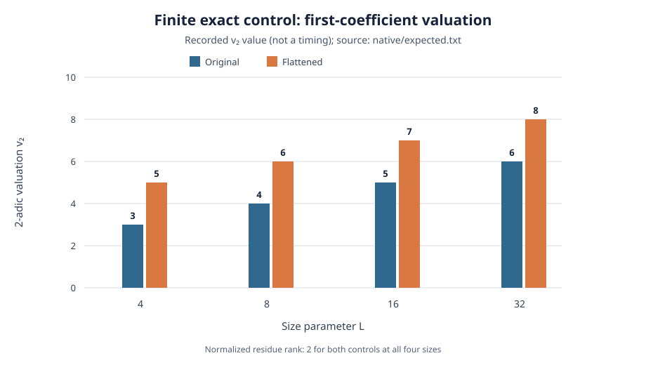

# Jet completion: finite control and proposed next search

[Rendered report PDF](report.pdf).

**Evidence scope.** The existing native exact-rational control at `L = 4, 8, 16, 32` checks the original cardinal-polynomial kernel against its ordinary first-jet flattening control. Its recorded first-coefficient valuations increase by two at each size, while both normalized residue ranks stay 2. The four rows contain 5,440 nodal value/first-derivative checks in total. These are finite exact observations; they are not a runtime comparison or a uniform theorem.

## Recorded finite observations

| `L` | Nodal checks | Original first-coefficient `v₂` | Flattened first-coefficient `v₂` | Both normalized residue ranks |
|---:|---:|---:|---:|---:|
| 4 | 64 | 3 | 5 | 2 |
| 8 | 256 | 4 | 6 | 2 |
| 16 | 1,024 | 5 | 7 | 2 |
| 32 | 4,096 | 6 | 8 | 2 |

The values are copied from [`native/expected.txt`](../../native/expected.txt) and match the committed replay lines in [`native/replay.log`](../../native/replay.log). The prospective protocol identifies the compared coefficients: the original is linear in the scaled chart and the flattened control is quadratic. Flattening roughly doubles polynomial degree and adds two valuation bits in these cases; the data do not establish that this trade is beneficial after degree and precision are priced.

*Figure 1. Exact recorded `v₂` values by `L`, from the native control. Each point is one size, not a timing sample; residue rank is 2 for both series at every size. The SVG source is [`valuation.svg`](valuation.svg).*

## Proposals kept separate from the observations

The study proposes (1) replacing the scalar origin channel with a nonscalar matrix `R(T)` whose off-node values vanish and whose crossing jets have low weighted rank, and (2) allowing free jets through `W_new(T) = W_base(T) + C(T)H(T)`. Neither construction has a supplied integral factorization certificate or a measured cost here. The finite flattening control is not evidence that either proposal works.

The next discriminating step is a bounded search that returns the candidate polynomial and entry-by-entry integral `U,V` witnesses at every retained node and stipulated precision. Its candidate domain is `deg H <= 2L-1`; initial sizes are `L=4,8`, precisions `8,12,16`, and controls are `H=0`, the recorded flattening construction, and rejection of an invalid even-denominator inverse. Before any search, freeze the rational coefficient and denominator budgets and price polynomial degree and precision. Then verify each witness independently. A successful small case would still need a uniform construction and a complete recursive proof.

The associated backlog card is [XP-20261101-rank-directed-jet-completion](../../../../backlog/XP-20261101-rank-directed-jet-completion/README.md). It is **draft, unfunded, and not scheduled**: the runner, frozen protocol, resource estimate, and authorization to execute do not exist yet.

## Sources and limits

- [`README.md`](../../README.md): proposed constructions, exact control interpretation, formal scope, and deferred search inputs.
- [`native/PROTOCOL.txt`](../../native/PROTOCOL.txt): four-size exact-rational control protocol; no timing run.
- [`native/expected.txt`](../../native/expected.txt) and [`native/replay.log`](../../native/replay.log): recorded values and replay.
- [`lean/PROOF_MAP.md`](../../lean/PROOF_MAP.md): formalized own-node value and first-derivative identities and their limits.

No new experiment, Lean build, ECDLP instance, or solver execution was performed for this report.
