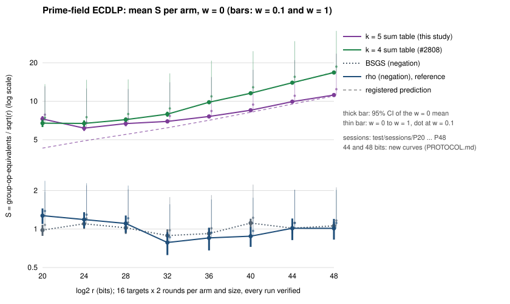
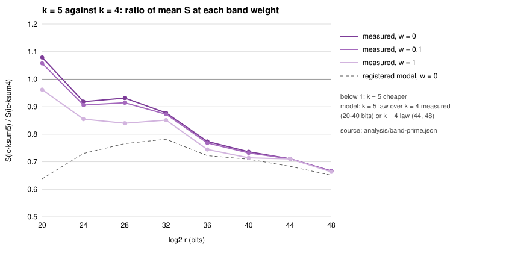

# Prime-field k-sum table: k = 5, and the law at 44 and 48 bits

**Track: generic decomposition (bounded by √r; cannot beat rho).** Engineering in that track (AGENTS.md "Tracks of index calculus", 2026-10-29); not algebraic progress.

**Result.** A table of every signed 5-sum of a smaller base
lowers the prime-field index-calculus `S` below the k = 4 table of #2808.
The registered success test holds: `ic-ksum5` is below `ic-ksum4` at 36 and
40 bits at every band weight (w = 0, 0.1 and 1).

- At 40 bits: `S` 8.51 against 11.56, which is 0.74×, and 0.71× at w = 1.
- At 48 bits: 0.67×.
- Fitted exponent on 36–48 bits: 0.547 [0.543, 0.554] against 0.565
  [0.560, 0.571].

**Distance remaining.**

- At 40 bits `ic-ksum5` is **9.7× rho** (`rho-neg`) and **7.6× BSGS**
  (`bsgs-neg`), at w = 0.
- At 48 bits it is 11.0× rho and 10.6× BSGS.
- The method is generic. Its limit is BSGS, and it is still above BSGS at
  every size.

Public synthetic curves; no security claim. This study is stacked on
[`../prime_ksum_table_20261028/`](../prime_ksum_table_20261028/README.md)
(isogeny-labs/crypto#2808). It was registered in [`PROTOCOL.md`](PROTOCOL.md)
before any timed run (hash in [`REGISTRATION.sha256`](REGISTRATION.sha256)).

**Labels.** `[measured]`: native `ecbench` records and receipts in this
directory. `[derived]`: from the registered cost law. `[predicted]`: the
registered table.

## 1. What changed

1. **`k = 5`.** `KSumTable` takes `k = 3, 4, 5`.
   - Its entries now pack the summand indices into one `u64`, 12 bits each,
     instead of `[u32; 4]`.
   - The insert order and the keep-first rule are unchanged, so group-operation counts are identical (§2).
   - Generic law: `2^{k−1}C(A,k) + c_k·A·p/(2^k C(A,k))`, with optimum
     exponent `k/(2k−1)`: 5/9 for `k = 5`, against 4/7.
2. **Two larger sizes.** The `prime_fast::find_a3_curve` rungs at 44 and 48
   bits (curves in `PROTOCOL.md`):
   - `icv1-fp44-tm6431881-43acc95d`
   - `icv1-fp48-tm15186475-c683ebfc`

## 2. Integrity `[measured]`

- **Every answer verified.** 8 sessions × 240 records = 1,920 runs, every
  one verified.
- **`ecbench verify --replay-all` on every test session.** All 8 reproduce
  every replay, with 0 problems ([`test/audits/`](test/audits/)).
- **Replication, the protocol's stop condition: passed.** At 20–40 bits,
  `ic-ksum4` reproduces #2808's per-run counts on the same targets for all
  288 of 288 runs. Cost, counters, seeds, method hash and answer are all
  identical ([`replicate.mjs`](replicate.mjs),
  [`analysis/replication.txt`](analysis/replication.txt)).
- **#2808 unchanged by this code.** The PR's binary replays all six of
  #2808's test sessions identically: 1,344 replays, 0 problems
  ([`analysis/replay-2808/`](analysis/replay-2808/)).
- **Binaries** (hashes in [`BINARY.sha256`](BINARY.sha256)).
  - The train panel ran `ecbench-k5`, an earlier build of this PR's code.
    `ecbench-v2` replays every train record identically
    ([`train/audits-v2/`](train/audits-v2/)), so the selection in
    [`params.json`](params.json) does not depend on which build measured it.
  - The test panel and every audit ran `ecbench-v2`, built from 26249b4
    plus this PR's code diff. The PR merges that diff onto a later main; the
    receipts are of the binary named here.
- **A/A control.** `rho-neg` and `rho-neg-aa` agree exactly. They share
  seeds and the walk is deterministic, so this checks determinism only.

## 3. Results

### 3.1 Mean `S` per size `[measured]`

The values are w = 0 / 0.1 / 1. There are 16 targets × 2 rounds per arm and
size, at seed `20261015200`. Full table: [`analysis/band-prime.md`](analysis/band-prime.md).

| bits | `ic-ksum5` (A) | `ic-ksum4` (A) | k5 / k4 | k5 / rho | k5 / BSGS |
|--:|:--|:--|:--|:--|:--|
| 20 | 7.27 / 7.85 / 13.08 (9) | 6.74 / 7.42 / 13.59 (10) | 1.08 / 1.06 / 0.96 | 5.7 / 5.7 / 5.5 | 7.4 / 7.3 / 6.7 |
| 24 | 6.16 / 6.80 / 12.57 (11) | 6.71 / 7.51 / 14.71 (14) | 0.92 / 0.91 / 0.85 | 5.2 / 5.3 / 5.5 | 5.6 / 5.6 / 5.7 |
| 28 | 6.69 / 7.26 / 12.45 (15) | 7.18 / 7.95 / 14.82 (21) | 0.93 / 0.91 / 0.84 | 6.1 / 6.0 / 5.7 | 6.5 / 6.5 / 6.1 |
| 32 | 6.96 / 7.67 / 14.07 (19) | 7.93 / 8.79 / 16.53 (30) | 0.88 / 0.87 / 0.85 | 8.9 / 8.9 / 9.0 | 7.8 / 7.8 / 7.9 |
| 36 | 7.60 / 8.39 / 15.47 (25) | 9.83 / 10.92 / 20.77 (44) | 0.77 / 0.77 / 0.75 | 8.9 / 9.0 / 9.1 | 8.3 / 8.3 / 8.4 |
| 40 | 8.51 / 9.42 / 17.61 (33) | 11.56 / 12.86 / 24.65 (64) | 0.74 / 0.73 / 0.71 | 9.7 / 9.7 / 10.0 | 7.6 / 7.7 / 7.9 |
| 44 | 9.93 / 11.04 / 20.97 (44) | 13.98 / 15.53 / 29.52 (95) | 0.71 / 0.71 / 0.71 | 9.8 / 9.9 / 10.3 | 9.8 / 9.9 / 10.3 |
| 48 | 11.19 / 12.43 / 23.57 (59) | 16.79 / 18.66 / 35.53 (140) | 0.67 / 0.67 / 0.66 | 11.0 / 11.1 / 11.6 | 10.6 / 10.7 / 11.1 |

**§5a verdicts** (`ecbench band --ranks`):

- `ic-ksum5` < `ic-ksum4` across the band at every size from 24 to 48 bits.
- At 20 bits the pair is unresolved: k = 5 is dearer at w = 0 and cheaper at w = 1.
- `rho-neg` < `ic-ksum5` and `bsgs-neg` < `ic-ksum5` at every size.

### 3.2 The law at 44 and 48 bits `[measured]` against `[predicted]`

| bits | arm | A (train pick, predicted) | `S` measured | `S` predicted |
|--:|:--|:--|--:|--:|
| 44 | `ic-ksum4` | 95 (95) | 13.98 | 13.9 |
| 44 | `ic-ksum5` | 44 (44) | 9.93 | 9.5 |
| 48 | `ic-ksum4` | 140 (140) | 16.79 | 16.9 |
| 48 | `ic-ksum5` | 59 (59) | 11.19 | 11.0 |

The train panel picked the model optimum `A` at every size for k = 5, and
at 44 and 48 bits for k = 4. Every pick was interior to its grid.

- **Below 32 bits the model is optimistic for k = 5.** It predicts 4.3 at 20
  bits against 7.27 measured. At small `A` the table and the walk are not in
  their asymptotic regime, and the fixed costs count.
- **From 40 bits on, the measured `S` is within 5 % of prediction** for
  k = 5 (3.8 %, 4.5 %, 1.7 %). At 36 bits it is 7 % above. At 44 and 48 bits
  k = 4 is within 1 %.

**Relations per base abscissa.** `c₅` = 1.10 at 20 bits, falling to 1.01 at
48 bits. `c₄` = 0.98–1.06, as in #2808.

**Table build.** It takes 44–57 % of `ic-ksum5`'s operations, against
34–47 % for `ic-ksum4`.

**Memory.** Peak RSS at 48 bits is 6.7 GiB (k = 5) against 8.8 GiB (k = 4).

### 3.3 Exponents `[measured]`

These come from `ecbench bound fit --weight` per tier, with cluster-bootstrap
95 % intervals ([`analysis/bounds/`](analysis/bounds/)). The toy tier is 20–32
bits and the medium tier 36–48 bits.

| arm | toy α, w = 0 / 1 | medium α, w = 0 / 1 | law |
|:--|:--|:--|--:|
| `ic-ksum5` | 0.499 [0.477, 0.528] / 0.509 | 0.547 [0.543, 0.554] / 0.552 | 5/9 = 0.556 |
| `ic-ksum4` | 0.521 [0.506, 0.538] / 0.523 | 0.565 [0.560, 0.571] / 0.565 | 4/7 = 0.571 |
| `bsgs-neg` | 0.484 [0.443, 0.520] | 0.514 [0.481, 0.538] | 1/2 |
| `rho-neg` | 0.435 [0.381, 0.492] | 0.530 [0.487, 0.576] | 1/2 |

`ic-ksum4`'s toy exponent reproduces #2808's 0.521 [0.506, 0.538] exactly.
In the medium tier the two k-sum intervals are disjoint, and each lies just
below its law.

## 4. Registered success and falsification

- **Success (engineering): holds.** At 36 and 40 bits, `ic-ksum5`'s mean `S`
  is below `ic-ksum4`'s at every `w` in the band (§3.1, `band` verdicts).
- **Falsifier: did not fire.** It required `ic-ksum5` to be not below
  `ic-ksum4` at 40 bits at some `w`. No run failed verification.
- **Law check (reported, not gating).** At 44 and 48 bits both arms are
  within 5 % of prediction, and `ic-ksum5 < ic-ksum4` holds across the band.

**Under the owner's success criterion,** this is a verified, measured
improvement of the **generic-decomposition track's** baseline on these
curves, labelled "generic decomposition (bounded by √r; cannot beat rho)". It does not ratchet the algebraic track, whose
prime-field baseline is empty until the reference arm runs
(`research/prime_ic_program_20261029/`). It runs on the frontier campaign's
curves, not the leaderboard's Table B curves or the 20-bit holdout, so it is
not ranked against the Table B incumbent; a same-session comparison is the
next check. The distance remaining to rho
is 9.7× at 40 bits (it was 13.1× with `ic-ksum4` in this panel, as in #2808), and 11.0×
at 48 bits. The gain is a constant factor, because the exponent only moves
from 4/7 to 5/9. Larger `k` converges to BSGS and never below it, so this
family cannot reach rho.

## 5. Limitations and next checks

- One curve per size, all `a = −3` prime-order curves of the frontier ladder.
- The cost is counted GAE; lookups are priced only through the §5a band.
- One host. The validation gate needs an independent-host replay and a
  `VALIDATION.json` before a `benchmarks/` results row.
- `k = 6` (exponent 6/11, about `2⁵·C(A,6)` entries) was neither modelled
  nor run. It would also need a wider entry: six 12-bit indices exceed 64 bits.

## 6. Files

- [`PROTOCOL.md`](PROTOCOL.md), [`REGISTRATION.sha256`](REGISTRATION.sha256),
  [`BINARY.sha256`](BINARY.sha256), [`params.json`](params.json),
  [`make_specs.sh`](make_specs.sh) (`bash make_specs.sh train|test`), and
  `base-specs/`.
- `train/` and `test/`: specs, native sessions and audits.
  [`analyse.sh`](analyse.sh) runs the replication, the audits, `band` and the
  fits, in that order.
- [`plot.mjs`](plot.mjs) writes the two figures from `analysis/band-prime.json`
  and the records.
- `report.pdf`: this README rendered.
