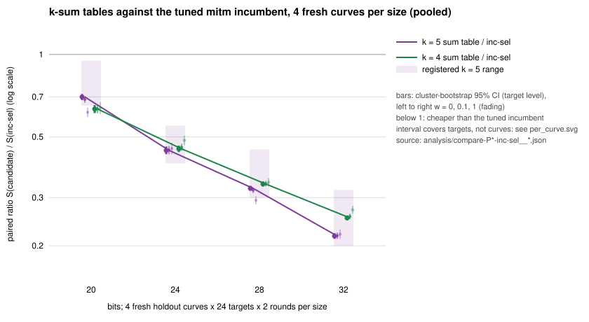
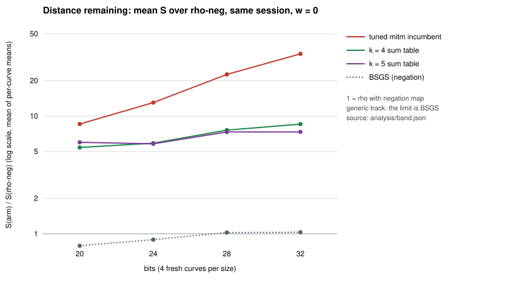
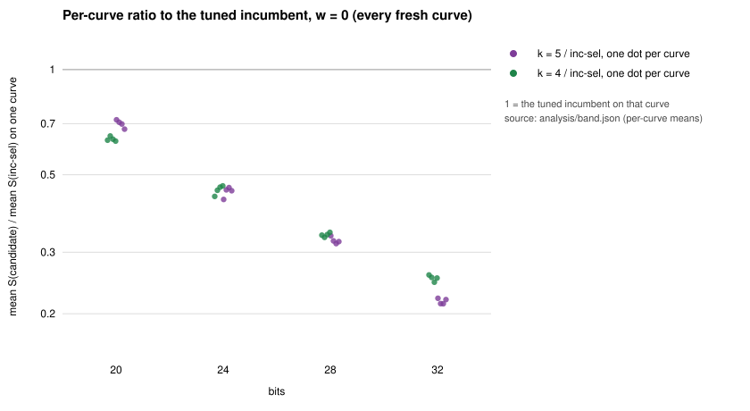

# Prime-field k-sum tables against a tuned mitm incumbent, on 16 fresh curves

**Track: generic decomposition (bounded by √r; cannot beat rho).** Both arm families are generic decomposition oracles (AGENTS.md "Tracks of index calculus", 2026-10-29). Nothing here moves the algebraic track.

**Status: UNQUALIFIED.** One host, one binary, no `claims/*.json` record. The second-host replay of #2866 is in flight (`research/prime_ksum_vs_incumbent_20261029/second-host/`); this study's own holdout has not been replayed on another host.

**Result.** The ranking of #2866 survives fresh curves, pooling and tuning. On 16 fresh curves (4 per size, 20 to 32 bits), with the incumbent re-tuned on separate train curves by the same rule as the k-sum tables, the k = 5 sum table costs 0.70×, 0.45×, 0.32× and 0.22× the tuned incumbent at 20, 24, 28 and 32 bits. The registered primary test holds. The table is paired ratios of total cost at w = 0, with the cluster-bootstrap 95% interval over targets in brackets.

| bits | `ksum5-sel / inc-sel` | `ksum4-sel / inc-sel` | registered range (k = 5) |
|--:|:--|:--|:--|
| 20 | 0.700 [0.682, 0.718] | 0.632 [0.611, 0.654] | 0.65–0.95 |
| 24 | 0.446 [0.432, 0.461] | 0.452 [0.440, 0.465] | 0.40–0.55 |
| 28 | 0.324 [0.318, 0.331] | 0.336 [0.329, 0.344] | 0.30–0.45 |
| 32 | 0.217 [0.212, 0.222] | 0.253 [0.248, 0.258] | 0.20–0.32 |

- **Every curve, every weight.** At each size the k-sum arms are below the tuned incumbent on **all 4 curves** (16 of 16), and at all three band weights in the pooled test.
- **Against the incumbent's best at w = 0.** At 24, 28 and 32 bits the k = 5 ratio to `inc-w0` (the incumbent cell with the lowest train S at w = 0) is 0.486, 0.368 and 0.248.
- **Exponent (toy tier, w = 0).** `ksum5-sel` 0.496 [0.487, 0.510], `ksum4-sel` 0.525 [0.516, 0.537], tuned incumbent 0.635 [0.627, 0.645]. For reference, rho-neg is 0.457 and bsgs-neg 0.501 on the same sessions.

**Distance remaining** (pooled, w = 0): `ksum5-sel` is 6.0×, 5.8×, 7.3× and 7.3× rho-neg, and 7.6×, 6.5×, 7.2× and 7.1× bsgs-neg at 20, 24, 28 and 32 bits. The method is generic, so its limit is BSGS, and it stays above BSGS at every size.

External comparison: not run (see §7).

Public synthetic curves and targets; no security claim. Registered in [`PROTOCOL.md`](PROTOCOL.md) before any timed run ([`REGISTRATION.sha256`](REGISTRATION.sha256)); the selection and the holdout specs were hashed before the holdout ran ([`select/FROZEN.sha256`](select/FROZEN.sha256)).

## 1. What was asked, and the answers `[measured]`

Follow-ups 2 to 4 of the #2866 list.

| question | answer |
|:--|:--|
| **Q2.** Does the ranking hold on fresh curves, pooled? | **Yes.** 16 of 16 fresh curves, and the pooled primary test at 24, 28 and 32 bits (and at 20). |
| **Q3.** How much of the gap is tuning? | **Very little at w = 1.** The incumbent's selection at w = 1 is the recorded base at 24, 28 and 32 bits, so `inc-sel` is the recorded recipe there. Tuned for w = 0 the incumbent is 8–13% cheaper (derived below), and k = 5 is still 0.25–0.49× of it. At 20 bits the grid's edge was picked (limits). |
| **Q4.** Does a train-frozen rule choose k? | **Yes at w = 1, with a caveat at 20 bits.** The rule chose k = 5 at every size. On the holdout k = 5 is not above k = 4 at w = 1 (at 24, 28 and 32 bits it is below). At 20 bits k = 4 is cheaper at w = 0 and 0.1, and the two are unresolved at w = 1. |

## 2. Method `[measured]`

- **Curves.** All fresh `prime_search` curves. The 16 holdout curves share nothing with the 24 earlier curves compared ([`plans/freshness.txt`](plans/freshness.txt)): this study's train curves, the four curves of #2866, the #2852 train and test panels, and the incumbent's train sessions.
- **Train.** 2 curves, 12 targets, 2 rounds per size. Each family got 5 sizes of base, 0.5×–2× its anchor. Per family, the cell with the lowest mean S at **w = 1** was selected. The same rule applies to the incumbent and both k-sum families; the ties rule and the grids are in [`PROTOCOL.md`](PROTOCOL.md). The selection is in [`select/selection.json`](select/selection.json).

  | bits | `inc-sel` N | `inc-w0` N | `ksum4-sel` A | `ksum5-sel` A | k* |
  |--:|--:|--:|--:|--:|--:|
  | 20 | 64 (grid edge) | 64 | 10 | 9 | 5 |
  | 24 | 162 | 115 | 14 | 11 | 5 |
  | 28 | 407 | 289 | 21 | 15 | 5 |
  | 32 | 1024 | 727 | 30 | 19 | 5 |
- **Holdout.** 4 curves, 24 targets, 2 rounds, 1 warm-up per size. Arms: `rho-neg`, `rho-neg-aa`, `bsgs-neg`, `inc-sel`, `inc-w0` (when its N differs), `inc-rec` (the recorded recipe of #2866), `ksum4-sel` and `ksum5-sel`. Every run is one cold target, with the table built and charged inside the run.
- **Binary.** `ecbench-v2` ([`BINARY.sha256`](BINARY.sha256)), the binary of #2852 and #2866.

## 3. Integrity `[measured]`

- **Every answer verified, every replay reproduced.** The train sessions have 4,896 records and the holdout sessions 8,928, all verified. `ecbench verify --replay-all` reproduces every replay with 0 problems ([`audits/`](audits/)).
- **A/A.** `rho-neg` vs `rho-neg-aa` is unresolved inside the band at every size.
- **Interval scope.** `ecbench compare` reports its interval over workloads (targets), also on these pooled sessions ([`analysis/interval-scope.txt`](analysis/interval-scope.txt)). So the pooled interval does not carry between-curve variance. As registered, robustness across curves is judged by the per-curve test below, and the primary verdict needs it.

## 4. Registered tests `[measured]`

**Primary: holds at 24, 28 and 32 bits.** `ksum5-sel` and `ksum4-sel` are below `inc-sel` at all three weights, with the interval's upper bound below 1 at w = 0, **and** below `inc-w0` at w = 0, 0.1 and 1.

**Secondary.**

- **(a) Per-curve consistency, holds at every size.** The k-sum family with the lower pooled S is below `inc-sel` on 4 of 4 curves (and below `inc-w0` on 4 of 4 at 24–32 bits). Per-curve table: [`analysis/per_curve.md`](analysis/per_curve.md).
- **(b) 20 bits, holds:** 0.700 for k = 5 and 0.632 for k = 4 at w = 0, below 1 at every weight.
- **(c) Recorded incumbent and tuning.**
  - The incumbent's w = 1 selection equals the recorded base at 24, 28 and 32 bits, so `inc-sel / inc-rec` is exactly 1.
  - At 20 bits, N = 64 against the recorded 45 is unresolved: 1.034 [1.002, 1.066] at w = 0, 1.000 at w = 0.1 and 0.863 [0.830, 0.898] at w = 1.
  - The w = 0-tuned incumbent is cheaper at w = 0 than the recorded recipe. Derived from the ratios of the two k-sum arms to each of them: 0.92, 0.88 and 0.88 at 24, 28 and 32 bits, outside the 0.9–1.05 range registered for the w = 1 selection. This is not a direct comparison.
- **(d) Rule for k: holds at every size**, scored at w = 1 on the pooled interval of `ksum5-sel / ksum4-sel`:

  | bits | k* | `ksum5-sel / ksum4-sel`, w = 1 | reading |
  |--:|--:|:--|:--|
  | 20 | 5 | 0.965 [0.918, 1.013] | unresolved |
  | 24 | 5 | 0.934 [0.893, 0.975] | k = 5 below |
  | 28 | 5 | 0.860 [0.827, 0.893] | k = 5 below |
  | 32 | 5 | 0.814 [0.787, 0.843] | k = 5 below |

  At 20 bits the w = 0 ratio is 1.106 [1.070, 1.142], so k = 4 is cheaper at the lightest pricing. The registered w = 1 rule is the conservative one, and the 20-bit choice depends on the weight.
- **(e) Exponent.** Toy tier, 16 curves × 4 sizes, every fit admissible:

  | arm | w = 0 | w = 0.1 | w = 1 |
  |:--|:--|:--|:--|
  | `inc-sel` | 0.635 [0.627, 0.645] | 0.634 [0.628, 0.644] | 0.631 [0.626, 0.638] |
  | `ksum4-sel` | 0.525 [0.516, 0.537] | 0.526 [0.517, 0.535] | 0.527 [0.518, 0.535] |
  | `ksum5-sel` | 0.496 [0.487, 0.510] | 0.497 [0.489, 0.509] | 0.504 [0.496, 0.510] |

  `ksum5-sel` is below `inc-sel` by 0.139 at w = 0, past the 0.1 registered. The fit is over four sizes (20 to 32 bits), so it is a small-size exponent, not the asymptotic 5/9 of the generic optimum. Full table: [`analysis/exponents.md`](analysis/exponents.md).
- **(f) Distance remaining.** See the results paragraph above.

## 5. Predictions scored

| registered prediction | outcome |
|:--|:--|
| `ksum5-sel / inc-sel` in 0.65–0.95 / 0.40–0.55 / 0.30–0.45 / 0.20–0.32 | all four inside |
| `inc-sel / inc-rec` in 0.9–1.05 at 24, 28, 32 bits | 1.000 (the selection kept the recorded base) |
| k = 4 chosen at least once at 20 or 24 bits; k = 5 at 28 and 32 | **missed:** k = 5 was chosen at every size |
| `ksum5-sel` exponent below `inc-sel` by at least 0.1 | 0.139 |
| k-sum stays above BSGS at every size | yes, 6.5–7.6× |

## 6. Reading

1. **Improvement of the generic-track baseline, on fresh curves, against a tuned incumbent.** The k = 5 table costs 0.70×, 0.45×, 0.32× and 0.22× the tuned incumbent at 20 to 32 bits, on every one of 16 curves. Class: engineering within the generic track.
2. **The #2866 gap is the method.** Tuning the incumbent at w = 1 changes nothing at 24 to 32 bits, and tuning at w = 0 moves it by 8–13%, against a 2.2–4.6× gap. The widening gap shows up in the exponent: 0.496 against 0.635.
3. **The 20-bit cell is the fragile one.** The incumbent's pick sat on the edge of the grid, its tuning there is unresolved, and the choice of k depends on the weight. Open #2826 (stride-renew, a reported 16% cut at 20 bits) would move 0.70 to about 0.84 if it merges. Still below 1.
4. **Neither the algebraic track nor rho is touched.** The best arm is still 5.8–7.3× rho on these curves.

## 7. Limits

- **Grid edge.** The 20-bit incumbent pick (N = 64) is on the edge of the grid, and no extension was run, as registered. The incumbent could be cheaper at larger N there.
- **One host.** UNQUALIFIED until a second-host replay and a `claims/*.json` record. The replay of #2866's sessions is in flight; this holdout has not been replayed elsewhere.
- **Counted unit only.** ecbench GAE with §5a pricing of native work; the table lookups are hash probes priced in that band. Wall time is recorded in the sessions and not analysed.
- **Four sizes, 20 to 32 bits.** The exponent is a small-size fit. No claim above 32 bits.
- **External comparison: not run.** This study ranks two generic recipes against each other and against this repository's own matched rho and BSGS, in one `ecbench` session. No external ECDLP implementation was run, so nothing here says that either recipe is the fastest known, and the AGENTS.md external-tool ratio is missing. Outstanding scope: (i) the same targets through an external prime-field ECDLP tool, for example PARI/GP `elllog`, on the same host with the same isolation, with its algorithm and version recorded and its own timer used; (ii) published rho timings at these sizes, cited with their hardware and labelled "published, not reproduced". The reference tool for prime-field ECDLP is an owner decision, so it is not guessed here.

## 8. Files

- `PROTOCOL.md`, `REGISTRATION.sha256`, `registered-at.txt`, `BINARY.sha256`: the registration. `make_specs.mjs`, `select.mjs`: tooling hashed in it.
- `specs/train-P<b>.json`, `specs/holdout-P<b>.json`, `plans/`, `select/`: the panels, resolved plans, the frozen selection and its hashes.
- `run-train.sh`, `run-holdout.sh`, `analyse.sh`: thin `ecbench` orchestration. `ECBENCH=` selects the binary.
- `sessions/`: native session records. The repository bot moves records over 64 KiB to the artifact store.
- `audits/`: the `verify --replay-all` receipts.
- `analysis/`: `band.json/md`, the paired comparisons, `ratios.md`, `per_curve.md`, `verdicts.json`, `exponents.md`, `bounds/`.
- `tables.mjs`, `plot.mjs`, `ratio.svg/png`, `rho_multiple.svg/png`, `per_curve.svg/png`: tables and figures (tooling).
- `dashboard.mjs`: the §7a update (tooling, no Python). One progress point for the best cold one-target IC cell of the holdout panel, whatever the outcome.
- `second-host/`: the replay specs and runbook of #2866's study; see its README for the launch state.
- `report.pdf`: this README.
