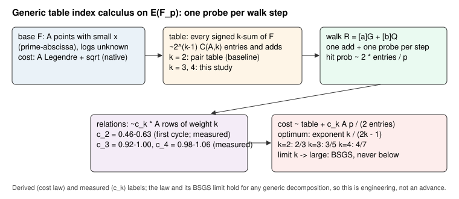
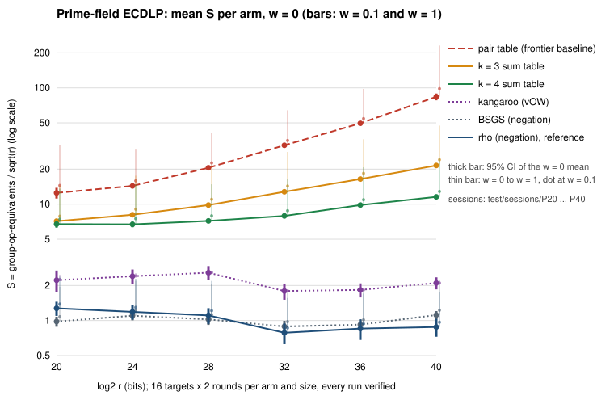

# Prime-field index calculus with a k-sum table (2026-10-28)

**Status.** Measured, replay-audited, pre-registered
([`PROTOCOL.md`](PROTOCOL.md), written before any timed run). Public synthetic
curves. **Class: engineering.** No security claim and no claim against rho:
the method is generic and its limit is baby-step giant-step.

## Question

The prime-field index-calculus baseline is the two-summand pair table of the
2026-10-15 frontier campaign
([`research/ic_frontier_campaign_20261015/`](../ic_frontier_campaign_20261015/README.md)):
`S` from 12.5 to 83.7 on the 20–40-bit `a = −3` ladder, fitted exponent
`α = 0.620`. Can a generic change to the decomposition oracle lower it?

## Where the baseline's cost goes (derived from the frontier's records)

At 40 bits the pair-table record spends 13 % on the table (`A²` additions,
`A = 3251`), 87 % on the relation walk (`p / (2A²)` steps a relation), and
nothing measurable on linear algebra: the solve stops at the relation graph's
first usable cycle, about `0.5·A` relations. Cost `A² + c₂·A·p/(2A²)` has its
optimum at `A ≈ (p/10)^{1/3}`, within 12 % of the frontier's choice, so the
baseline is already tuned; its exponent is the generic `2/3`. **Large primes do
not help here** (derived): with two summands a large-prime table of `M`
entries gives the same law `M + c·p/√M`, and was not built.

## Change

`ksum:m=k` (`src/cryptanalysis/ic_boundary.rs` `KSumTable`,
`src/cryptanalysis/ic_framework/plugins.rs` `KSumOracle`, wired into
`ecbench`'s prime pipeline): a negation-folded table of every signed `k`-sum
of a smaller base, `2^{k−1}·C(A, k)` entries, one probe per walk step, `k − 1`
additions to confirm a key match. The generic law
`2^{k−1}C(A,k) + c_k·A·p / (2^k C(A,k))` has exponent `k/(2k − 1)`: `3/5` for
`k = 3`, `4/7` for `k = 4`, falling toward `1/2` (BSGS) as `k` grows and never
below it. 

## Method

Exactly the frontier's Phase 1, with two arms added:

- **Curves:** the six `a = −3` prime-order curves `icv1-fp20-t383-4f71b2c3`,
  `icv1-fp24-tm5099-a6f137c6`, `icv1-fp28-t28201-65099091`,
  `icv1-fp32-t7319-90da43e9`, `icv1-fp36-t454193-44a20818`,
  `icv1-fp40-tm924137-0ecaaeb9` (cofactor 1), specs derived by
  [`make_specs.sh`](make_specs.sh) from the frontier's frozen ones
  ([`frontier-specs/`](frontier-specs/)).
- **Selection:** train target seed `20261015100`, 4 targets, grid
  `A* · {0.5, 0.7, 1, 1.4, 2}` per size and `k`; smallest mean `S` at
  `w = 0.1`; optimum interior in all twelve grids
  ([`train/SELECTION.md`](train/SELECTION.md)); frozen in
  [`params.json`](params.json).
- **Test:** target seed `20261015200`, 16 targets × 2 rounds, warm-up 1,
  arms `rho-neg` (reference), `bsgs-neg`, `kangaroo`, `ic-pair` (frontier
  sizes), `rho-neg-aa` (A/A control), `ic-ksum3`, `ic-ksum4`; 2,016 runs.
- **Analysis:** [`analyse.sh`](analyse.sh): `ecbench verify --replay-all` on
  every session (all six pass), `ecbench band` at `w = 0, 0.1, 1`,
  `ecbench bound fit` per arm (toy tier, 20–32 bits; the 36–40-bit tier has
  two sizes and is not fitted). Graphs: [`plot.mjs`](plot.mjs).

## Results (measured)

Every one of the 2,016 test runs recovered and verified the target's log.
`ic-pair` reproduced the frontier campaign's numbers exactly, and the A/A
control equals its reference to the last digit
([`analysis/band-prime.md`](analysis/band-prime.md)).

| bits | `rho-neg` | `bsgs-neg` | `ic-pair` (was) | `ic-ksum3` | `ic-ksum4` | `ic-ksum4` vs `ic-pair` | `ic-ksum4` / `rho-neg` |
|--:|--:|--:|--:|--:|--:|--:|--:|
| 20 | 1.27 | 0.98 | 12.5 | 7.14 | **6.74** | 1.9× | 5.3× |
| 24 | 1.19 | 1.10 | 14.3 | 8.11 | **6.71** | 2.1× | 5.7× |
| 28 | 1.11 | 1.02 | 20.6 | 9.82 | **7.18** | 2.9× | 6.5× |
| 32 | 0.79 | 0.89 | 32.1 | 12.8 | **7.93** | 4.0× | 10.1× |
| 36 | 0.85 | 0.92 | 49.6 | 16.4 | **9.83** | 5.0× | 11.5× |
| 40 | 0.88 | 1.11 | 83.7 | 21.5 | **11.6** | 7.2× | 13.1× |

Mean `S` at `w = 0`. At `w = 1` the 40-bit row is 24.7 (`k = 4`) against
231 (`ic-pair`), 9.4×; every pairwise verdict in the band file ranks
`ic-ksum4 < ic-ksum3 < ic-pair` at every size across the whole band.

| arm | fitted `α` (20–32 bits), 95 % CI, `w = 0` | `w = 1` |
|:--|:--|:--|
| `rho-neg` | 0.435 [0.381, 0.492] | 0.444 |
| `bsgs-neg` | 0.484 [0.443, 0.520] | 0.485 |
| `ic-pair` (was) | 0.620 [0.586, 0.650] | 0.594 |
| `ic-ksum3` | 0.571 [0.552, 0.589] | 0.581 |
| `ic-ksum4` | **0.521 [0.506, 0.538]** | 0.523 |

Relations per base abscissa (measured): `c₂ = 0.46–0.63`, `c₃ = 0.92–1.00`,
`c₄ = 0.98–1.06`; table build is 37–46 % of the `k`-sum arms' operations.
The registered predictions (`S = 21.5` and `11.6` at 40 bits) were met to
within 1 %.

## Against the registered criteria

- **Success (engineering) — met.** At 36 and 40 bits both `k`-sum arms are
  below `ic-pair` at every `w` in the band, and `ic-ksum4`'s `α` interval lies
  wholly below `0.557`. `ic-ksum3`'s interval (upper `0.589`) does not, so
  only the band criterion holds for `k = 3`.
- **Falsified — no.** No run failed verification; every audit replayed.
- **Distance remaining.** `ic-ksum4` is 13.1× `rho-neg` and 10.4× `bsgs-neg`
  at 40 bits, and the gap grows (`α` 0.521 against 0.435). The fitted 0.521
  sits below the asymptotic 4/7 because the table share falls with size at
  these `A`; the law's exponent is the one that extrapolates.

## Limitations

- L0 counts on one host (Apple M4 Pro, shared); lookups, Legendre symbols and
  square roots are unpriced (the band's `w` covers them). No independent-host
  replay yet, so no row in `benchmarks/README.md`'s results table.
- Memory grows as `p^{k/(2k−1)}` table entries (5.2 M at 40 bits for `k = 4`);
  rho uses none.
- Generic: this is the time–memory curve, not new structure. It cannot pass
  BSGS, and it moves no exponent that an algebraic prime-field method would
  need (program note `RESEARCH_PRIME_FIELD_BREAKTHROUGH_PROGRAM.md` §2.4).

## Next checks

- `k = 5` (exponent `5/9`) and a 44–48-bit size to show the law past the
  table-share crossover.
- An independent-host replay for admission to the results table.
- The only route that changes the picture against rho is still algebraic: an
  `m`-term decomposition costing less than `A^{m−3}`, which no known lattice
  reaches.
