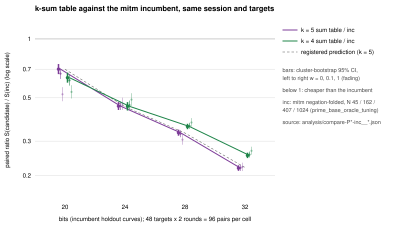
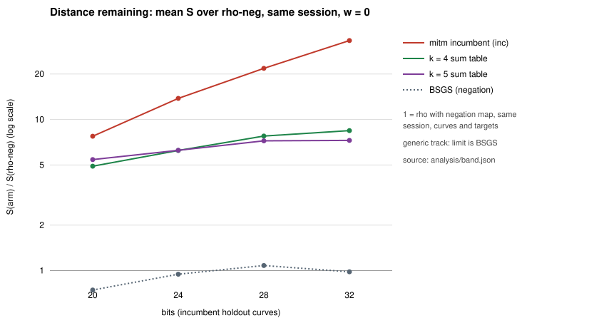

# Prime-field k-sum table against the mitm incumbent, same session and targets

**Track: generic decomposition (bounded by √r; cannot beat rho).** Both arms are generic decomposition oracles (AGENTS.md "Tracks of index calculus", 2026-10-29). Nothing here moves the algebraic track.

**Status: UNQUALIFIED.** This is one host and one binary, with no `claims/*.json` record yet. Leaderboard promotion needs a second-host replay (the incumbent study's PROTOCOL §13) and that record.

**Result.** The ranking ran on the incumbent's own four holdout curves, with its 48 targets, its method hashes and its measurement seed. The k = 5 sum table of isogeny-labs/crypto#2852 costs less than the recorded incumbent at every size, at every band weight. The incumbent is the negation-folded mitm pair table of `research/prime_base_oracle_tuning_20261029`.

| bits | `ksum5 / inc`, w = 0 | w = 0.1 | w = 1 | registered prediction |
|--:|:--|:--|:--|:--|
| 20 | 0.701 [0.661, 0.744] | 0.665 [0.624, 0.709] | 0.521 [0.480, 0.567] | ≈ 0.7 |
| 24 | 0.453 [0.433, 0.475] | 0.455 [0.433, 0.480] | 0.466 [0.434, 0.501] | ≈ 0.45 |
| 28 | 0.331 [0.320, 0.344] | 0.327 [0.314, 0.340] | 0.305 [0.288, 0.325] | ≈ 0.33 |
| 32 | 0.218 [0.211, 0.226] | 0.219 [0.211, 0.227] | 0.222 [0.211, 0.233] | ≈ 0.22 |

The curves are `icv1-fp20-tm565-6d7d1d32`, `icv1-fp24-tm4739-bb3c4b72`, `icv1-fp28-tm1499-56171ddc` and `icv1-fp32-tm36751-2eaac89e`. The table shows paired ratios of total cost with cluster-bootstrap 95% intervals: 96 pairs per cell, 48 workloads, 4,000 resamples, seed 20261002. The registered primary test (24, 28, 32 bits, `ksum5 < inc` at all three weights) **holds in all three cells**.

**What this is.**

- **A ranking.** The k-sum method itself landed in #2808 and #2852. This study adds the same-instance measurement that makes it rankable against the incumbent, as the tracks rule requires.
- **What it shows.** On these four curves, the generic track's best recipe is now a k-sum table, not the mitm pair table. The generic-track baseline on them falls by 1.4× (20 bits) to 4.6× (32 bits).
- **What it is compared against.** The recorded incumbent recipe, not a newly tuned pair table. At 32 bits the incumbent's base sat at N = 1024 in both its `inc` and `sel` arms; its own README calls that selection null by construction. The widening gap is consistent with the two generic optima, 5/9 for k = 5 against about 2/3 for the folded pair table (`[derived]`, #2852 §1). One curve per size gives no exponent claim here.

**Distance remaining** (same session, w = 0):
- `ksum5` is 5.4×, 6.3×, 7.2× and 7.3× rho-neg at 20, 24, 28 and 32 bits;
- it is 7.3×, 6.6×, 6.7× and 7.4× bsgs-neg;
- it is generic, so its limit is BSGS, and it stays above BSGS everywhere.

Public synthetic curves and targets; no security claim. Registered in [`PROTOCOL.md`](PROTOCOL.md) before any timed run; hashes are in [`REGISTRATION.sha256`](REGISTRATION.sha256).

## 1. Method `[measured]`

- **Instances.** The curves, targets and measurement settings are those of the incumbent's `specs/holdout-P<b>.json`: curve seed 20261018202, target seed 20261018211, measurement seed 20261018221, 2 rounds plus 1 warm-up, alternate order, isolation L0. None was chosen here.
- **Arms.**

  | arm | role | method |
  |:--|:--|:--|
  | `rho-neg`, `rho-neg-aa` | reference, A/A | `rho.negation` |
  | `bsgs-neg` | reference | `bsgs.negation` |
  | `inc` | baseline | the incumbent recipe, N = 45 / 162 / 407 / 1024; method hashes identical to the incumbent session's |
  | `ksum4` | candidate | A = 10 / 14 / 21 / 30, frozen from #2808's train curves |
  | `ksum5` | candidate | A = 9 / 11 / 15 / 19, frozen from #2852's train curves |

  No parameter was tuned on these curves.
- **Binary.** `ecbench-v2` ([`BINARY.sha256`](BINARY.sha256)), the #2852 test-panel binary. One binary, one session per size.
- **Accounting parity.** Every arm is one target, cold. The pair table and the k-sum table are both built inside each run and charged by the same counters, so no build is amortised.

## 2. Integrity `[measured]`

- **Every answer verified, and every replay reproduced.** 4 sessions × 864 records = 3,456 runs, every answer verified. `ecbench verify --replay-all` reproduces all 2,304 deterministic replays with 0 problems ([`audits/`](audits/)).
- **Replication gate (PROTOCOL §4): passed.**
  - `inc` and `rho-neg` reproduce the incumbent's recorded means in its `analysis/band-holdout.md`.
  - The match is exact to 3 decimals: all 24 values, 4 sizes × 2 arms × 3 weights.
  - For example, `inc` at 32 bits gives 32.240 / 35.309 / 62.931.
- **A/A.** `rho-neg` vs `rho-neg-aa` is unresolved inside the band at every size, as it should be.

## 3. Results `[measured]`

Mean `S` (group-operation equivalents / √r) at w = 0 / 0.1 / 1; full table in [`analysis/band.md`](analysis/band.md).

| bits | `inc` | `ksum4` | `ksum5` | `rho-neg` | `bsgs-neg` |
|--:|:--|:--|:--|:--|:--|
| 20 | 10.515 / 11.829 / 23.655 | 6.660 / 7.262 / 12.675 | 7.367 / 7.862 / 12.323 | 1.357 / 1.474 / 2.529 | 1.009 / 1.109 / 2.006 |
| 24 | 13.976 / 15.168 / 25.892 | 6.319 / 6.954 / 12.670 | 6.334 / 6.906 / 12.054 | 1.013 / 1.104 / 1.919 | 0.958 / 1.054 / 1.913 |
| 28 | 20.478 / 22.204 / 37.737 | 7.298 / 7.978 / 14.101 | 6.785 / 7.259 / 11.526 | 0.939 / 1.031 / 1.851 | 1.015 / 1.116 / 2.028 |
| 32 | 32.240 / 35.309 / 62.931 | 8.171 / 9.039 / 16.853 | 7.040 / 7.730 / 13.941 | 0.968 / 1.064 / 1.930 | 0.950 / 1.045 / 1.900 |

Paired ratios for every registered pair: [`analysis/ratios.md`](analysis/ratios.md), from `analysis/compare-*.json`. Verdicts from `ecbench band --ranks`:

- **`ksum5 < inc` and `ksum4 < inc` at every weight, at all four sizes.** The primary test, plus the 20-bit and `ksum4` secondaries.
- **`ksum5` vs `ksum4`.** `ksum5 < ksum4` at 28 and 32 bits (0.93 and 0.86 at w = 0). Unresolved at 20 and 24 bits. At 20 bits `ksum4` has the lower point estimate at w = 0 (1.106 [1.057, 1.161]) and w = 0.1, while at w = 1 the interval spans 1. So there is no single best k below 28 bits.
- **`rho-neg < ksum5` and `bsgs-neg < ksum5` everywhere.**

## 4. Reading

1. **Improvement of the generic-track baseline on these curves (registered test).**
   - At 24, 28 and 32 bits the k-sum table costs 0.45×, 0.33× and 0.22× the recorded incumbent, across the band.
   - The 20-bit cell is secondary. It holds at 0.70× (0.52× at w = 1), but the lower-cost k there is unresolved.
   - Every registered prediction lies inside its interval.
2. **The 20-bit cell is the fragile one.** Open isogeny-labs/crypto#2826 (stride-renew relation targets) reports a 16% cut to the incumbent at 20 bits. If it merges, the 20-bit ratio would move to about 0.84, still below 1. That would need a re-check against the post-#2826 recipe. At 24–32 bits, the other lane's open constant gains (6–22%) cannot close a 2.2–4.6× gap.
3. **This does not touch the algebraic track or rho.** Both arms are generic, and the best of them is still 5.4–7.3× rho on these curves.
4. **Wall time: recorded, not admitted** (L0, shared host at load 10–17).

   | bits | end-to-end wall `ksum5 / inc` | ns per GAE `ksum5 / inc` |
   |--:|:--|:--|
   | 20 | 0.482 [0.411, 0.566] | 0.689 [0.600, 0.790] |
   | 24 | 0.474 [0.424, 0.530] | 1.046 [0.953, 1.148] |
   | 28 | 0.366 [0.342, 0.392] | 1.106 [1.053, 1.160] |
   | 32 | 0.226 [0.215, 0.237] | 1.035 [1.010, 1.060] |

   The wall ratios follow the counted ratios.

## 5. Limits

- **Coverage.** One curve per size and one host. No exponent and no pooled claim.
- **Unit.** Counted unit only: ecbench GAE with §5a pricing of native work. The k-sum lookups are hash probes priced inside that band.
- **Baseline.** The incumbent is the recorded recipe. A pair table retuned at 32 bits would narrow that cell's gap; the derived exponents say it would not close it.
- **Status.** UNQUALIFIED: same host. The second-host replay and a `claims/*.json` record are owed before any leaderboard change.

## 6. Next checks

- **Second-host replay.** Replay the four sessions on isolab-eks or the independent runner (the incumbent's PROTOCOL §13 route), then file `claims/*.json`.
- **Re-check 20 bits** against the stride-renew recipe if #2826 merges.
- **A fresh holdout curve per size,** with A frozen as here, so the result does not rest on one curve.

## 7. Files

- `PROTOCOL.md`, `REGISTRATION.sha256`, `registered-at.txt`: the registration.
- `specs/P<b>.json`: the four frozen specs.
- `run.sh`: runs the four sessions and their `verify --replay-all` audits. `analyse.sh` produces the band, comparisons, ratio table and figures. Both are thin `ecbench` orchestration; `ECBENCH=` selects the binary.
- `sessions/P<b>/`: native session records. The repository bot may move them to the artifact store.
- `audits/P<b>.txt`: the `verify --replay-all` receipts.
- `analysis/band.md`, `analysis/band.json`: `ecbench band --weights 0,0.1,1 --ranks`.
- `analysis/compare-P<b>-<a>__<b>-w<w>.json`, `analysis/ratios.md`: the paired comparisons.
- `plot.mjs`, `ratio.svg/png`, `rho_multiple.svg/png`: the figures (tooling).
- `dashboard.mjs`: the §7a update (tooling).
  - **Progress-chart point.** One point for the session's best cold one-target IC cell: `ksum4` at 20 bits, 4.91× rho-neg. Its "was" is 7.75×, the incumbent on the same curve and targets.
  - **Other panels.** It adds the plotted-point row and a panel paragraph. The best-of row is unchanged: it keeps #2852's 40-bit frontier-comparable cell, and no cell here is at 40 bits.
  - **Leaderboard.** No change until the second-host replay.
- `report.pdf`: this README.
