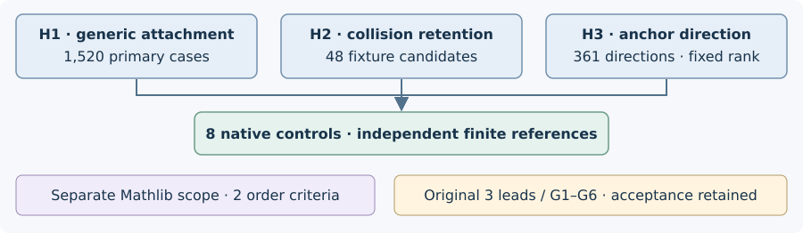

# Independent prime-field lead controls: two cycles

2026-11-09 · native/formal terminal snapshot 05:55:17 UTC · source `31410711806e73aed58cbc2bd74ed60b93de3572`

Eight native control functions completed: six H1/H2 controls and two H3 controls,
with zero failures/ignored; both standalone strict-clippy phases and formatting
exited 0. The separate Mathlib-only project built, its scoped gate reported two
theorems/zero trusted exceptions, and official module kernel replay exited 0
against imports, not `--fresh`. These are unsigned producer observations, not
independently signed execution or result standing. [pcc:unverified]

## Original requirements retained

| Lead | Actual component in this cycle | Scientific obligation still open |
| --- | --- | --- |
| Symmetric PKM | Two standard binary exact-order criteria in a new Mathlib-only project. | G1–G3/G6 partial; G4/G5 unrun. Complete supported-domain extraction, accounting/yield, paired external comparison, optimization, scaling and cold ECDLP/proof bridges remain required. |
| Five-sum | Finite cyclic collision-retention/anchor models. | Original frozen-session independent replay, scalar/provenance checks and complete-cost recomputation. No substitute replay. |
| Hecke known-log base | Generic finite bounded-shift model. | Certified source/normalization/class labels and efficient prescribed-target attachment with qualified comparison; no Hecke generator was run. |

Zero scientific panels; `comparison_admissible=false`; all cost/GAE/scaling
metrics null. Historical full-panel pin `e99f0d598cd89d839060e991b9b157efbd6f286a`
remains blocked/unfunded/unimplemented. No panel, funding, lease, IAM, quota,
pool or access change; no checkpoint/protocol/runtime bypass.

The diagram shows checked software paths because there are no comparable
performance values. Counts are finite fixture populations, not costs or timings.

## What the controls distinguish

H1 fixes four label sets, targets 0–18 and caps 0–19 over `Z/19Z`:1,520 primary
cases. Bounded attachment agrees with an independent translated-set/minimum-
distance reference; permutation, identity/cap and malformed-label controls
are additional executions. This is a generic model, not production curve or
Hecke backend qualification. [pcc:unverified]

H2 fixes three five-label fixtures and 16 sign vectors each: 48 distinct fixture
candidates. Identity final sums are excluded; off/on retention and repeated
constructions are separate real executions, not 48 total operations. Controls
check candidate/representative conservation, unchanged lookup answers,
collision equations and independent left/right-pivot ranks. Rank, coverage and
target isolation remain distinct. Repeated/all-zero fixtures are deliberate
degeneracies, not production factor bases. [pcc:unverified]

## Successor cycle and formal scope

H3 was preregistered before execution with collision rank 4, query rank 5 and
target 5. All 361 anchors `[a,b,0,0,0]` followed the finite prediction: 342 isolate
the target; 19 retain ambiguity. The partition is by nonzero/zero pairing with
`[1,1,1,1,1]`, not anchor count. Named independent, dependent, zero and malformed
controls are included; two rank algorithms must agree. This checks coefficient
row-span information assuming separately supplied anchor values; it does not
establish their public availability in a curve problem. [pcc:unverified]

`BinaryPrimitiveGuard.primitive_root_of_binary_guard_succ` and
`BinaryPrimitiveGuard.primitive_root_of_binary_guard` specialize standard
Mathlib order criteria: full binary power 1 and preceding half power not 1 imply
exact binary order, with positive depth explicit. Lean 4.34.1, Mathlib
`d13f23b723b8a846827a245b89c10fc7d3f11612`; only `propext`, `Classical.choice`,
`Quot.sound`. No old extraction module is imported. The old stack's 34-declaration
gate is separate and is not this PR's two-theorem result. Native arithmetic,
representation, polynomial/extraction and complete-cost bridges stay open.
[pcc:unverified]

## Evidence, failed attempts and next discriminator

The source-bound recipe is `../../validation/final-v2/validate.sh`; the local
terminal files are at `/workspace/prime-leads-cycle-20261109/native-final-v2/`.
Final supervisor, build/control/lint/format, Lean gate and kernel phases exited 0.
Initial formatting exit 1 and intermediate H3 documentation-lint exit 1 remain in
separate historical receipts; later success does not rewrite them. No scientific
timing denominator or price is inferred from test-run durations. [pcc:unverified]

One canonical P20 hydration attempt with an installed CLI exited 2 because no
configured credentials were available. Required `records.jsonl` remains absent:
1,622,069 bytes, SHA256
`2e24438edf33b233c5f06f0fc0b2f9a9dac3c55ff23eda30d7bc0cf4916e7b02`.
The original replay is unperformed; synthetic outputs do not replace it.
[pcc:unverified]

H4 remains an unrun successor hypothesis: directed finite coverage may depend
on label geometry beyond size alone. Freeze cap/geometry families, independent
references and held-out finite sizes before execution; distinguish exact finite
coverage from extrapolation. H3's finite result supplies no scaling conclusion.

Sources: Mathlib `orderOf_eq_prime_pow` and `IsPrimitiveRoot.iff_orderOf`;
the original three-lead README/PKM_GOALS/PROBLEM as obligation pointers, not
imported proof modules; this study's preregistrations and native source.
Canonical `docs/index-calculus-scoreboard.html`, `docs/ic/progress-timeline.json`,
curve and performance views remain unchanged: no admitted metric, curve/edge,
phase price or reference has been added. No speedup, timing, pricing or global-
novelty conclusion is claimed. [pcc:unverified]
