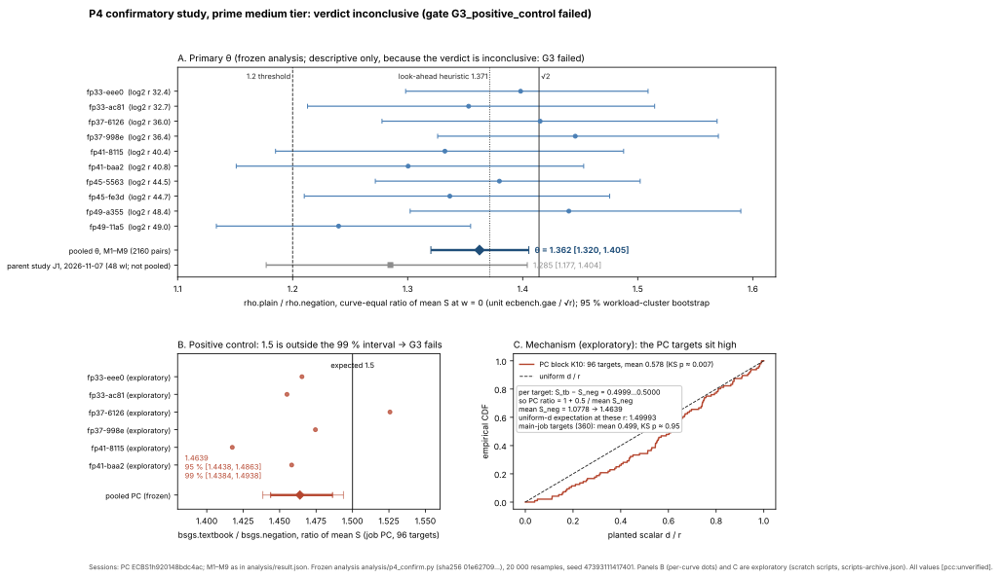

# P4 confirmatory study: results

Date: 2026-11-08. Protocol: `PROTOCOL.md` and `protocol.json`, frozen at
2026-11-08T05:12:02Z as `protocol_sha256 26fd5c57…ae0c` (commit `de0e7026b0`,
`filed_before_affected_data: true`) before any data of this study. The frozen
analysis `analysis/p4_confirm.py` (sha256 `01e62709…e194`, equal to the value
pinned in `protocol.json`) ran once, in card `CARD-prime-medium-rho-p4-confirm-20261108-ANALYZE`,
with the command of `README.md` "Ready-to-launch" step 4 over M1–M9 and PC. It wrote
`analysis/result.json` (sha256 `93dda756…54ce`).

Every number here is `[pcc:unverified]`: no pcc claim exists for this study and
no independent validator has re-derived anything. Each number names its source
file. Evidence classes: *measured* (counts in the session records), *frozen*
(output of the frozen analysis), *derived* (arithmetic on frozen or measured
numbers), *exploratory* (computed after the fact from the committed records by
the scratch scripts in `analysis/report/scripts-archive.json`; never part of the
verdict), *cited* (a committed file or source).

Report, figure and PDF: `analysis/report/p4conf_report.pdf`,
`analysis/report/p4conf_fig1.{svg,png}`, summary
`analysis/report/p4conf_summary.json`.

## Verdict (PROTOCOL.md §9, applied as written)

**`inconclusive`**, because gate **G3_positive_control failed**
(`analysis/result.json` `.verdict`, `.verdict_reason`: "gate(s) failed:
G3_positive_control").

| gate | condition (PROTOCOL.md §9) | value (frozen, `analysis/result.json`) | result |
|:--|:--|:--|:--|
| G1 | every session complete, audit `ok`, frozen binary and spec ids | 10 sessions, 12 096 records, every local `ecbench verify --replay-all` audit ok with 0 problems (`sessions/*.audit.json`) | pass |
| G2 | `rho-neg-aa` counts identical to `rho-neg` in every pair | 0 mismatched pairs of 2 160 (`.flow.aa_mismatched_pairs`) | pass |
| G3 | PC 95 % lower end > 1.2 **and** 1.5 inside the 99 % interval; PC A/A identical; ≥ 90 % of PC pairs | ratio **1.4639**, 95 % [1.4438, 1.4863], 99 % [**1.4384, 1.4938**]; 1.5 inside 99 %: **false**; detects (lower end > 1.2): true; A/A mismatches 0; 576/576 pairs (`.positive_control`) | **fail** |
| G4 | split-half A/A: 1 inside each 97.5 % interval | `rho-neg` 0.9824 [0.9325, 1.0352]; `rho-plain` 1.0207 [0.9721, 1.0721] (`.secondary.split_half_aa`) | pass |
| G5 | censored share ≤ 1 % in every main arm | 0.0 in all four arms (`.flow.censored_share`) | pass |
| G6 | complete pairs ≥ 90 % of 2 160 | 2 160 / 2 160 (`.flow`) | pass |

The tie-break rerun (§8) was not triggered (`.tie_break_rerun: false`).

The rule is that any failed gate makes the verdict `inconclusive` (§9), and
§10 says a failing positive control is reported while the main jobs still run,
with the confirmatory claim then `inconclusive`. That is what happened. This
report does not reinterpret G3, and it offers no "would have passed" verdict.
The 2026-11-07 study's own P4 verdict also stays `inconclusive` under its own
protocol; this study does not re-decide it.

## The positive control: what it is, and why 1.464 fails G3

**What it is** (cited: `PROTOCOL.md` §3 and §9, `protocol.json`
`controls.positive`, `specs/PC.json`). Job PC runs `bsgs.textbook` (arm
`bsgs-tb`, numerator), `bsgs.negation` (arm `bsgs-neg`, denominator) and an A/A
copy `bsgs-neg-aa` on the six 33–41-bit curves, with 16 targets per curve
(block K10), 6 measured rounds and 1 warm-up. That gives 2 016 executions and
576 measured pairs. The ratio of mean S, `bsgs-tb / bsgs-neg`, is put through
the primary estimator: a curve-equal ratio with a stratified workload-cluster
bootstrap of 20 000 resamples, seed tag `analysis/bootstrap-positive-control`.

**Why 1.5.** `methods::expected_s` at the frozen source `dbd587a01a` declares
S = 1.5 for `bsgs.textbook` and 1.0 for `bsgs.negation`. Each is "up to
O(log r)/√r of set-up" (cited; `src/cryptanalysis/ecbench/methods.rs`, and
`generic.rs` `bsgs_textbook`, `bsgs_negation_table`).
- `bsgs.textbook` stores m = ⌈√r⌉ baby steps. A uniform target then needs on
  average m/2 giant steps of stride m, so S ≈ 1 + ½.
- `bsgs.negation` stores m' = ⌈⌈√r⌉/2⌉ baby steps keyed by the class {P, −P}.
  The table covers ±j, so the giant stride is 2m' + 1 ≈ √r, and a uniform target
  again needs on average √r/2 giant steps. So S ≈ ½ + ½.

PROTOCOL.md §3 chose this pair because it is the only pair in the registry
with an exactly derived ratio of about the right size. It shares the harness,
the curves, the paired layout and the estimator.

**Why 1.464 fails.** G3 has two conditions on the PC interval. The 95 % lower
end, 1.4438, clears 1.2, so the detector sees the effect (`.positive_control.detects: true`).
But 1.5 must also lie inside the 99 % interval, and the 99 % upper end is
1.4938 (`.positive_control.expected_inside_ci99: false`). The shortfall is
1.5 − 1.4639 = 0.036 (derived). The PC A/A is identical (0 mismatches), and
every PC pair is complete. The 99 % condition alone fails G3.

**Descriptive only, not a verdict.** The frozen output also reports the
primary as it stands; read it as a description:
- **θ (w = 0) = 1.3624, 95 % [1.3202, 1.4054]**, half-width 0.0426 (precision
  target ≤ 0.05 met). Its `primary.verdict` field reads `exceeds_1.2_below_sqrt2`
  (`.primary`). The field is computed without the gates, and the gated verdict
  is `inconclusive`.
- The interval excludes the parent study's 1.285 (`.primary.contains_1.285: false`)
  and excludes √2 ≈ 1.4142 (U = 1.4054 < √2).
- It contains the look-ahead heuristic √2/(1 + 1/32) ≈ 1.3714
  (`.secondary.lookahead_heuristic_reference.inside_theta_ci95: true`).
- **Parent study** (cited: `research/prime_medium_tier_rho_20261107/RESULTS.md`,
  validated in its `validation/VALIDATOR_REPORT.md` C12): P4 at J1 was
  1.285 [1.177, 1.404]. That interval missed 1.2 by 0.023. The new point,
  1.362, lies inside J1's interval, and J1's point, 1.285, lies outside the new
  one. The two intervals overlap on [1.320, 1.404].
- The parent validator's pooled sensitivity was 1.3109 [1.2239, 1.4041]
  (D2: not preregistered, computed only as a sensitivity). The new interval
  overlaps it as well.

## A plausible mechanism for the PC shortfall (exploratory, does not change the verdict)

All of this comes from the committed PC records, read by `explore_pc.py` and
`g3_calibration.py` (scratch; `analysis/report/scripts-archive.json`). The
outputs are in `analysis/report/p4conf_summary.json` under
`exploratory_positive_control`. No new run was made. None of it is part of the
frozen analysis.

1. **The counts follow the code exactly** (exploratory check):
   - The giant-step counters of all 96 PC targets equal the closed form of the
     two loops: ⌊d/m⌋ for textbook, and ⌈(d − m')/(2m' + 1)⌉ for negation, with
     d the planted scalar. Both match 96/96.
   - Set-up gae is target-independent.
   - The six rounds of a target are identical.
2. **Per target, S_tb − S_neg is a constant**, in [0.49996, 0.50000] for every
   one of the 96 targets. Both variants take the same giant steps, of stride
   about √r, and differ only by their baby tables. So the PC ratio is
   1 + 0.5 / mean S_neg, and mean S_neg ≈ 0.5 + mean(d/r).
   - The PC ratio therefore measures the mean planted scalar d/r of its 96
     targets, and nothing else.
   - Observed: mean S_neg = 1.0778 and mean S_tb = 1.5778, curve-equal.
   - 1 + 0.49999/1.0778 = 1.4639, which reproduces the frozen ratio (derived).
3. **The "1.5 is asymptotic" hypothesis is ruled out at these sizes.** The
   exact expectation of the curve-equal ratio over a uniform planted d, with
   the measured set-up costs, is **1.49993**, and per curve 1.49983–1.49999.
   Finite size and set-up account for under 1 × 10⁻⁴ of the 0.036 shortfall.
   There is no size dependence to speak of on 33–41 bits.
4. **The PC target block sits high.** The 96 PC targets have mean d/r =
   **0.5776** against 0.5 for a uniform law.
   - z = 2.63, two-sided normal p ≈ 0.008; KS D = 0.169, p ≈ 0.007.
   - Per curve (16 targets each), mean d/r is 0.574, 0.599, 0.451, 0.554, 0.698
     and 0.591, giving per-curve ratios of 1.465, 1.455, 1.526, 1.475, 1.418 and
     1.458, in the order fp33-eee0, fp33-ac81, fp37-6126, fp37-998e, fp41-8115,
     fp41-baa2.
   - The law `uniform_scalar_sha256_v1` sets d = 1 + H(law, model, r, seed,
     index) mod (r − 1) (cited: `workload.rs` `planted_scalar` at `dbd587a01a`).
     It is uniform by construction up to a modulo bias below 2⁻²².
   - The **360 main-job targets**, drawn by the same law from blocks K01–K09,
     have mean d/r 0.4990 (KS p ≈ 0.95).
   - Pairwise correlations of d/r across the six PC curves, by target index,
     scatter around 0 (−0.36 to 0.47, 15 pairs of 16 points each).
5. **How unusual that is under the design** (exploratory Monte Carlo with the
   exact count model and uniform d):
   - A PC ratio at or below 1.4639 occurs in 0.41 % of 20 000 simulated designs.
   - The design's 2.5–97.5 % range of the PC ratio is [1.473, 1.531].
   - A simulation of G3 itself (2 000 designs, 4 000 resamples each, numpy RNG,
     not the frozen resampler) fails the "1.5 inside 99 %" condition in
     **1.8 % ± 0.3 %** of designs, against a nominal 1 %. The 95 %-above-1.2
     condition failed in 0 designs.

**Hypothesis (untested by any new run): the PC shortfall is a low-probability
draw of the PC target block (K10), not a defect of the harness, the estimator
or the BSGS code.** It follows from three things: the ratio depends only on
mean d/r; the expectation at these sizes is 1.4999; and the law looks uniform
on the 360 other targets. Under uniform targets, a G3 failure of this kind has
a design probability of about 1–2 %. The data cannot separate "rare draw" from
"a law defect that shows only in block K10". Separating them would need a new,
preregistered positive-control job with a fresh target block; that is not done
here. The protocol's own design remark (§3) already said the PC interval
"reflects target variance only".

A design observation, also exploratory: because S_tb − S_neg is a constant,
this positive control tests the estimator on a ratio whose spread comes
entirely from where the targets fall in [0, r). It is not a test of the
harness's ability to resolve a cost difference, which is exact. The
G3-calibration simulation suggests the 99 % condition, with 16 clusters per
stratum, is somewhat anti-conservative.

## Everything else, as measured (counts; no wall time is admissible, §10)

From `analysis/result.json` `.secondary`. These are secondaries: none moves the
verdict.

| quantity | value | 95 % interval |
|:--|--:|:--|
| θ, w = 0 (primary estimator) | 1.3624 | [1.3202, 1.4054] |
| θ, w = 0.1 | 1.2388 | [1.2003, 1.2778] |
| θ, w = 1 | 0.6817 | [0.6606, 0.7032] |
| `theta_steps` (steps/√r in place of S) | 1.4098 | [1.3660, 1.4542] |
| `theta_v2` (plain / `rho.negation_v2`) | 1.3876 | [1.3477, 1.4283] |
| R = S / floor, `rho.negation` | 1.0755 | [1.0526, 1.0990] |
| R, `rho.plain` | 1.0362 | [1.0144, 1.0581] |
| R, `rho.negation_v2` | 1.0560 | [1.0346, 1.0783] |
| size slope of ln θ_c per log2 r | −0.00294 | [−0.00816, 0.00216] |
| v2 lost-walk share | 0.0 | [0.0, 0.0] |

- **§5a band:** the order of `rho.plain` and `rho.negation` is "unresolved
  inside the band" (`.secondary.band.order`). rho.negation is cheaper at w = 0
  and w = 0.1, and dearer at w = 1.
- **Attribution (§9a):** `charged_overhead`. The `theta_steps` interval
  contains √2, and θ's upper end is below √2.
  - `rho.negation` charged overhead per step, look-ahead additions: 0.03326
    [0.03324, 0.03329]. The heuristic is 1/32 = 0.03125.
  - Cycle-escape doublings: 0.00117. Starts: 0.00149. Set-up additions and
    doublings: 0.00057 and 0.00076. Verification: 0.00018.
  - Derived: these sum to 0.0374, and √2 / 1.0374 = 1.363. This rough
    accounting ignores `rho.plain`'s own set-up and start overhead.
- **Curve heterogeneity:** Cochran Q = 9.27 on 9 dof, p = 0.41.
- **Per-curve θ_c** (95 %): 1.398 [1.298, 1.509] and 1.353 [1.213, 1.515]
  (33 bits); 1.415 [1.278, 1.569] and 1.446 [1.326, 1.570] (37); 1.332
  [1.185, 1.488] and 1.300 [1.151, 1.453] (41); 1.380 [1.272, 1.502] and 1.337
  [1.210, 1.476] (45); 1.440 [1.302, 1.590] and 1.240 [1.134, 1.355] (49).
- **Fruitless cycles per walk** (`rho.negation`): 4-cycles rise from 0.25 at
  33 bits to 4.1 at 49 bits, following 2^dp. Capped walks are at most 0.0014
  per walk.

### The preregistered predictions (§12), graded descriptively

| id | prediction | observed | reading |
|:--|:--|:--|:--|
| P1 | θ ≈ 1.30; interval in [1.2, √2); 1.285 inside | 1.362 [1.320, 1.405]; 1.285 outside | fails (interval placement as predicted; point higher; 1.285 excluded) |
| P2 | `theta_steps` ≈ 1.35, interval below √2 → `walk_level_shortfall` | 1.410 [1.366, 1.454]; `charged_overhead` | fails |
| P3 | PC 1.50 ± 0.05; lower end above 1.2 | 1.464 [1.444, 1.486] | holds as worded; G3 is stricter and fails |
| P4 | A/A identical; split-half intervals contain 1 | 0 mismatches; 0.982 and 1.021, both containing 1 | holds |
| P5 | ≈ 1.18 at w = 0.1, ≈ 0.65 at w = 1; order unresolved | 1.239 [1.200, 1.278]; 0.682 [0.661, 0.703]; unresolved | order holds; both point predictions fall below the measured intervals |
| P6 | size-slope interval contains 0 | [−0.0082, 0.0022] | holds |
| P7 | `theta_v2` within 0.05 of θ | difference 0.025 | holds |

## Execution record

Measured: pod exits from `receipts/<job>/s3/job-exit.json` and
`cards/*.admit-*.stdout`. Launcher wall from the benchmark record's `commands`.
Audits from `sessions/<job>.audit.json` and the card receipts.

| job | card | pod exit | executions | replays reproduced | records below L2 | launcher wall (s) | pod run (UTC) |
|:--|:--|--:|--:|--:|--:|--:|:--|
| PC | -1 | **43** | 2 016 | 1 728 | 0 | 493 | 05:22:38–05:28:54 |
| M1 | -2 | 42 | 6 048 | 5 184 | 42 | 918 | 05:36:39–05:49:54 |
| M2 | -2 | 42 | 1 008 | 864 | 64 | 1 311 | 06:00:37–06:20:30 |
| M3 | -3 | 42 | 1 008 | 864 | 52 | 1 313 | 06:39:05–06:58:46 |
| M4 | -4 | 42 | 336 | 288 | 152 | 1 646 | 07:16:12–07:41:17 |
| M5 | -5 | 42 | 336 | 288 | 139 | 1 692 | 08:05:17–08:31:08 |
| M6 | -6 | 42 | 336 | 288 | 145 | 1 678 | 08:53:17–09:19:15 |
| M7 | -7 | 42 | 336 | 288 | 176 | 2 008 | 09:40:53–10:12:21 |
| M8 | -8 | 42 | 336 | 288 | 174 | 1 978 | 10:38:17–11:09:27 |
| M9 | -9 / V-M9 | 42 | 336 | 288 | 158 | 2 138 | 11:35:11–12:09:06 |

- **Ten jobs, once each, PC first.** They ran on Iso Lab EKS, instance type
  `c8a.2xlarge` (in every request and receipt). The queue `cpu-l2-spot` is
  named in PROTOCOL.md §11; no receipt field records the queue name. All ran
  with the frozen image `isolab/tasks@sha256:292bdc3d…cae5`, ecbench sha256
  `a18af09f…d3b9`, source `dbd587a01a`. The build-identity checks in every
  card receipt pass. No session was incomplete and nothing was rerun, so there
  is no amendment.
- **Pod exits.**
  - **M1–M9 exited 42**, the L2 wall gate of `run-ecbench`: some records were
    graded L1 because their solve was under the 1.0 ms minimum.
  - **PC exited 43, not 42.** All 2 016 PC records are L2 (`l2-gate.json`
    `accepted: true`). The later gate on the reference/control wall comparison
    (`run-ecbench`, the `control-comparison.json` check) did not pass. That
    comparison file was not fetched, so which of its conditions failed is not
    recorded here.
  - The launcher reported `state: failed, exit_code 23` for every job, and
    `launch-remote` exited 26.
- **Admitted for counts only.** Every session is complete, and its local
  `ecbench verify --replay-all` audit is `ok` with 0 problems and every replay
  reproduced. All ten are admitted for counts under §10 (`admitted_for_counts:
  true` in every admission). No wall time is reported.
- **Card -9.** It ran through launch, admission, fetch and session identity.
  Its process was killed during the local `verify-m9` replay when the
  executor's turn ended, so it has no receipt. The finish card **V-M9** has no
  launch, wait or fetch step. It bound the fetched files at their sha256 and
  ran card -9's own `session-identity-m9`, `verify-m9`, `audit-pass-m9` and
  `add-raw-m9` steps unchanged: audit OK, 336 records, 288 replays, 0
  problems. The resume cards R-PC and R-M1…R-M9 were prepared and never
  needed (no receipts).
- **Benchmark record**
  `benchmarks/records/20261108T0512Z-prime-medium-rho-p4-confirm.json`:
  - ten launch commands;
  - 21 raw entries: the ten `records.jsonl` files and ten `*.audit.json`, plus
    `analysis/report/scripts.tar.gz` (the scripts of this report; it lives in
    S3 only, at sha256 `144e1718…1aec`);
  - all 21 uploaded to `s3://setec-astronomy-artifacts/store/sha256/…`;
  - metrics `theta_w0` and `positive_control_ratio` (unit `ratio`; the spread
    is the 95 % interval).
  
  The record is still **open**; closing it is the main session's step.
- **Analysis card.** `ANALYZE` checked the protocol's frozen hash, that the
  script sha was pinned, and every audit. It then ran the frozen command once
  (13 s), with stdout `verdict: inconclusive theta: 1.362445350898039 ci95:
  [1.3201856254764677, 1.405351464380865]`.

## Caveats

- **Not validated.** Nothing here has an independent validator report, a
  replay certificate from another host class, or a pcc claim. The study is a
  rho-only control and has no IC arm, so it does not touch the IC leaderboard
  or `benchmarks/README.md`.
- **The verdict is `inconclusive`.** θ and its interval are descriptive. The
  question the study asked is still open: does the pooled ratio exclude 1.2
  under a passing positive control?
- **The PC mechanism is a hypothesis.** It rests on scratch Python
  (`analysis/report/scripts-archive.json`), not on the frozen script. The G3
  calibration uses numpy's RNG and 4 000 resamples per design, and the KS
  p-values use the asymptotic formula.
- **Exit 43 on PC** is not explained by the fetched receipts. It does not
  affect admission for counts (§10).
- **Spot and host.** Counts do not depend on host or co-location (§6 ledger).
  Wall time is not a metric of this study.
- **No experiment export.** An `experiment.export/v1` of the ten sessions was
  not produced; this is the same tooling gap as in the parent study.
- **research-kb and Conductor are not installed** in this environment. The
  literature in PROTOCOL.md §9a stays *recalled*.

## Files

- `RESULTS.md` (this file).
- `analysis/report/p4conf_fig1.svg`, `analysis/report/p4conf_fig1.png`: the
  figure. Panel A shows per-curve θ_c and the pooled θ with 95 % intervals,
  the 1.2, √2 and 1.371 lines, and the parent J1. Panel B shows the PC ratio
  with its 95 % and 99 % intervals against 1.5, plus exploratory per-curve PC
  ratios. Panel C shows the exploratory ECDF of the PC targets' d/r.
- `analysis/report/p4conf_report.pdf`: a three-page report (inspected).
- `analysis/report/p4conf_summary.json`: the frozen fields, the predictions,
  the execution table, and the exploratory PC block with all 96 targets. Its
  `inputs_sha256` entry for the benchmark record is a snapshot of the open
  record at report time, after the metrics were added; it will not match once
  the record is closed.
- `analysis/report/scripts-archive.json`: the scripts tarball's sha256 and S3
  location.
