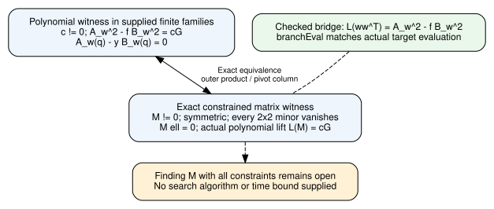
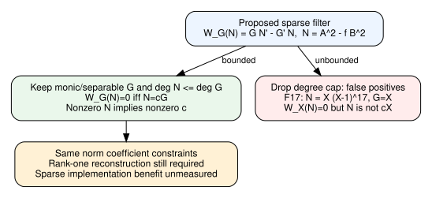
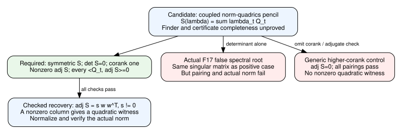
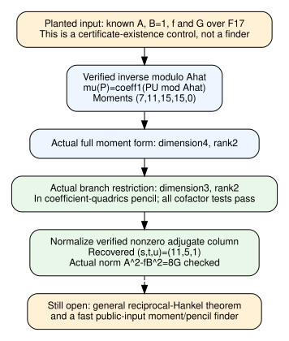

# Prime-field norm/rank search audit

Continuation, 2026-11-13: [public branch coordinates](coordinates-report/README.md)
now derive numerical corank one and a nonzero diagonal adjugate entry for the
actual reduced quotient-moment matrix. Its actual coefficient recovery has
derived structural guards. There are 25 new statements; whole-study source
audit 201/0 extra trusted axioms and import-inclusive fresh replay exit 0.
The public-input finder and full norm/scalar attachment remain separate.
Unsigned source bindings are in coordinates-evidence/claim-pins.json
[pcc:unverified].

No novel sub-exponential ECDLP algorithm was obtained. Read [REPORT.md](REPORT.md),
[DERIVATION.md](DERIVATION.md), or the [three-page PDF](report/report.pdf).
The classical norm representation isolates an unresolved constructive rank-one
search. A Lean counterexample rejects its unrestricted linear relaxation
[pcc:unverified].

## Reproduce the formal checks

With Lean4.35.0 and the pinned lake-manifest dependencies available:

```sh
lake -d research/prime_norm_rank_20261112/lean build
lake -d research/prime_norm_rank_20261112/lean env leanchecker --fresh --verbose NormRank
```

The existing identity issuer is included unchanged by a small standalone Rust
adapter. It performs certificate checks, not a discrete-log experiment:

```sh
cargo run --release --locked --manifest-path research/prime_norm_rank_20261112/certificate/Cargo.toml -- research/prime_norm_rank_20261112/lean/NormRank.lean /tmp/norm-defect.identity.json
```

Original logs retain failed attempts alongside successful receipts. These are
unsigned producer evidence; certificate checking does not itself execute Lean.
No empirical scaling, new algorithm or independent signed standing is claimed.

The prior nonscalar-origin and rank-directed jet-completion suggestions remain
unproved research proposals. Preserving interpolation node values does not by
itself establish a useful crossing-rank bound or a sub-exponential total cost.
This separate norm audit does not establish either suggestion.

## Structural extraction addition, November12 evening

[RankOneExtraction.lean](lean/RankOneExtraction.lean) checks the postprocessing
step for a supplied matrix. Let K be any field and M an entry function I×I→K.
Assume symmetry, at least one nonzero entry, and

    M(i,j) M(k,l) = M(i,l) M(k,j)  for all i,j,k,l.

These are explicit vanishing-minor assumptions. A diagonal pivot k exists with
M(k,k) nonzero. Set w(i)=M(i,k) and s=1/M(k,k). The proof gives

    M(i,j) = s w(i) w(j),   s != 0,   w(k) != 0.

No square root, quadratic-residue test, positivity assumption or extension field
is needed. In particular, the scalar s need not be a square [pcc:unverified].

For a finite index set, if M annihilates the branch vector ell, then w satisfies
sum_j w(j)ell(j)=0. For any linear map L on the matrix-entry space, a supplied
norm coefficient equation L(M)=c*g transfers to

    L(w w^T) = (c/s)*g.

If c is nonzero then c/s is nonzero. This is the structural bridge used by the
written norm reduction; its coefficient map is abstract in the new theorem.
Instantiating that map with the polynomial norm and proving the complete
curve/divisor equivalence in Lean remain separate obligations [pcc:unverified].

| Statement | Declaration | Hypotheses |
|---|---|---|
| Nonzero diagonal pivot | RankOneExtraction.diagonalPivot | Field, symmetry, nonzero entry, all minors vanish |
| Explicit scaled column factor | RankOneExtraction.pivotFactor | Field, symmetry, all minors vanish, supplied nonzero diagonal pivot |
| Nonzero vector and scale exist | RankOneExtraction.factorExists | Same assumptions as diagonalPivot |
| Branch constraint transfer | RankOneExtraction.extractBranch | Field, finite index set, symmetry, M*ell=0 |
| Free norm scalar stays nonzero | RankOneExtraction.absorbScale | Nonzero field elements c and s |
| Linear coefficient equation transfers | RankOneExtraction.extractLinearImage | Field, vector space, supplied factorization with nonzero scale, linear image equation |

The statements use the vanishing-minor equations directly; this addition does
not formalize an equivalence with Mathlib's numerical matrix-rank definition.
It constructs the factor once those equations hold, rather than assuming a
rank-one oracle [pcc:unverified].

On a finite d×d matrix supplied explicitly over F_p, one can scan the diagonal,
invert the pivot and copy its column. This takes O(d) field operations after
obtaining M. Reading a dense input costs O(d²) field elements; even checking all minors directly takes polynomial work. These
operation counts are a written analysis, not a Lean time theorem or a timing
measurement. They do not bound the work needed to find an admissible M
[pcc:unverified].

The expanded default build passed3141 jobs. The actual tracked-source gate
passed21 declarations with0 additional trusted axioms. All six new declarations
print only propext, Classical.choice and Quot.sound. The import-inclusive fresh
replay exited0; its receipt is in extraction-evidence/fresh-status.json.
Original source and earlier receipts remain unchanged [pcc:unverified].

Five structural statements have canonical unsigned PCC bindings in
[extraction-evidence/claim-pins.json](extraction-evidence/claim-pins.json).
The nonzero-division helper is included in the source audit but is not promoted
as a separate research claim. All standing is unsigned producer evidence
[pcc:unverified].

## What an existence proof would still require

For the user's classical general prime-field objective, a positive result must
supply a uniform executable algorithm, its correctness on the specified curve
and subgroup family, and a2^{o(n)} bit bound including sampling, failed attempts,
memory access and witness recovery. A conditional implication that assumes such
a search routine does not establish its existence. A nonexistence result would
have to quantify over the stated class of classical coordinate-using algorithms;
a generic-group bound or a restricted XL lower bound does not do that.

The newly merged [prime-field IC closure note](../notes/index-calculus/PRIME_FIELD_IC_CLOSURE_20261112.md)
explicitly leaves F4 and growing towers outside its established bounds and
identifies unproved load-bearing hypotheses. It is prior research context, not
a universal nonexistence certificate. Neither that note nor this extraction
addition decides the full existence question [pcc:unverified].

Sources checked for this addition: pinned Mathlib
LinearAlgebra/Matrix/Rank.lean (rank conventions), the earlier Galbraith norm
references in sources.json, and the newly merged closure note. KB remained
unavailable (no MCP tools and wrapper reported no executable); no novelty is
claimed for elementary field linear algebra.

## Exact polynomial lift addition, November13

[NormLift.lean](lean/NormLift.lean) instantiates the previously abstract
coefficient map. For any field K, finite index set I, polynomial families
A_i,B_i, polynomial f and weights w, define

    A_w = sum_i w_i A_i,       B_w = sum_i w_i B_i,
    L(M) = sum_ij M_ij (A_i A_j - f B_i B_j),
    ell_i = A_i(q) - y B_i(q).

Lean proves L(w w^T)=A_w²-f B_w² and
sum_i w_i ell_i=A_w(q)-y B_w(q). These are actual polynomial/evaluation
identities, not assumed properties of an unspecified map [pcc:unverified].

For a nonzero prescribed polynomial G, it then proves the following exact
equivalence [pcc:unverified]:

- There exist w and c!=0 with A_w²-f B_w²=cG and A_w(q)-y B_w(q)=0.
- There exist a nonzero symmetric M and c!=0 with all2x2 minors vanishing,
  M*ell=0 and L(M)=cG.

The forward direction uses the outer product. The reverse direction extracts a
pivot column and rescales c. No square root, numerical-rank oracle or relaxed
linear feasibility assumption is used [pcc:unverified].



[Two-page report PDF](norm-lift-report/report.pdf), editable diagram source
[norm-lift-report/equivalence.dot](norm-lift-report/equivalence.dot) and
[LaTeX source](norm-lift-report/report.tex).

| Statement | Declaration | Exact scope |
|---|---|---|
| Outer-product norm expansion | NormLift.outerNorm | Any field, finite polynomial families, defined actual lift |
| Target-branch identity | NormLift.branchEval | Actual polynomial evaluation at q,y |
| Nonzero-vector condition | NormLift.witnessVectorNonzero | c!=0, G!=0 and actual norm equation |
| Forward witness construction | NormLift.normToMatrix | Norm witness and G!=0 |
| Reverse witness construction | NormLift.matrixToNorm | Every explicit matrix constraint; no G!=0 assumption needed in this direction |
| Two-way equivalence | NormLift.witnessEquivalence | Any field and finite families; G!=0 |
| Outer-product minor constructor | RankOneExtraction.outerMinors | Any field; no nonzero hypothesis required |

These statements apply to the spans of the supplied polynomial families. They
do not yet formalize that a chosen monomial family spans exactly the degree
bounds in DERIVATION.md, or the complete elliptic-curve divisor/group bridge.
They provide no matrix-search algorithm or search-time theorem
[pcc:unverified].

Source commit9cba2446b. Default build004 passed3143 jobs; actual tracked-source
project audit passed28 declarations with0 additional trusted axioms. Builds002
and003 are preserved as failed module-interface attempts, not proof evidence.
Fresh import-inclusive replay exited0; its receipt is recorded in
norm-lift-evidence/fresh-status.json [pcc:unverified].

Native identity certificate
[IDC1h2e7ff8ae9d53fc24](norm-lift-evidence/norm-lift.identity.json) covers the
four-component expansion only and binds the NormLift source hash. The existing
issuer/checker accepted32 statement-derived and32 extra stream points. It does
not execute Lean, establish an algorithmic bound or certify all arities by
sampling; the universal finite-index theorem is separately checked in Lean.
No certificate confidence number is used as an algorithmic success claim
[pcc:unverified].

Reproduce the native certificate with the standalone adapter (the old default
binary remains selected by default-run):

```sh
cargo run --release --locked --manifest-path research/prime_norm_rank_20261112/certificate/Cargo.toml --bin norm-lift -- research/prime_norm_rank_20261112/lean/NormLift.lean /tmp/norm-lift.identity.json
lake -d research/prime_norm_rank_20261112/lean build
lake -d research/prime_norm_rank_20261112/lean env leanchecker --fresh --verbose NormLift
```

Canonical source bindings are in
[norm-lift-evidence/claim-pins.json](norm-lift-evidence/claim-pins.json).
The five earlier extraction theorem declaration hashes remain unchanged;
outerMinors is an addition to that module. Historical full-file replay receipts
remain tied to their original commits, not relabelled as current receipts.
All new claims remain unsigned producer standing [pcc:unverified].

Sources: earlier Galbraith norm/divisor references in sources.json; pinned
Mathlib polynomial evaluation/sum and linear-map declarations; the Nov13
non-Semaev note, read as scoped context rather than a universal exclusion.
KB unavailable (MCP absent; wrapper has no executable). No novelty claim for
this elementary lifting construction. No empirical campaign, performance row or
existing canonical graph was changed; the new diagram describes the formal
bridge only.

## Algorithmic shortcut test: sparse differential filter, November13

The proposed filter is W_G(N)=G*N'-G'*N with N=A²-fB². It replaces coefficient
matching by sparse derivative/convolution equations. The test asks whether this
supplies new constraints or loses witnesses in characteristic p. It is an exact
algebraic test, not a timing or scaling experiment [pcc:unverified].

[NormWronskian.lean](lean/NormWronskian.lean) establishes:

- If G is monic and coprime with G', and deg N<=deg G, then W_G(N)=0 exactly
  when N=cG. Nonzero N forces c!=0.
- A product of distinct rational node factors X-x is monic and coprime with
  its derivative. The usual norm pole-degree bounds imply the degree cap.
- Applied to the actual NormLift output, the filter and nonzero scalar norm
  matching admit exactly the same matrices under the stated degree cap.
- Without that cap, characteristic-p factors are invisible. In F17, every
  G*H^17 passes; specifically X*(X-1)^17 passes W_X but is not cX.

These are kernel-checked implications and a finite-field counterexample;
the full project source audit is separate from independent signed standing
[pcc:unverified].



[Two-page PDF](wronskian-report/report.pdf), editable [DOT source](wronskian-report/filter.dot),
[LaTeX source](wronskian-report/report.tex).

The useful result is a precise filter contract. Within the correct window,
differentiation does not strengthen the norm coefficient constraints and does
not remove rank one. Outside that window, accepting its solutions can be wrong.
Kernel equivalence alone does not rule out an implementation benefit from the
sparse representation; no runtime comparison was run [pcc:unverified].

The derivative remains

    N' = 2*A*A' - f'*B² - 2*f*B*B'.

It is quadratic in the unknown A,B coefficients. Returning N=cG from a linear
solver does not return its decomposition A²-fB², the remaining constructive
problem [pcc:unverified].

| Statement | Declaration | Exact scope |
|---|---|---|
| Zero filter forces divisibility | NormWronskian.filterDivisibility | G coprime with G'; no degree cap needed |
| Differential kernel is scalar span | NormWronskian.filterZeroIff | Monic G, coprimality, natDegree N<=natDegree G |
| Nonzero scalar recovered | NormWronskian.nonzeroFilterIff | Previous hypotheses and N!=0 |
| Actual matrix lift has same feasible set | NormWronskian.liftedFilterIff | Same conditions on the defined NormLift output |
| Actual norm derivative | NormWronskian.normDerivative | Any field and polynomials f,A,B |
| Norm degree cap | NormWronskian.normDegreeBound | 2*natDegree A<=D and natDegree f+2*natDegree B<=D |
| Split-node conditions | NormWronskian.splitProductConditions | Finite set of distinct field nodes |
| Characteristic-p ghost | NormWronskian.frobeniusGhost | G,H over F17; no degree cap |
| Explicit ghost passes | NormWronskian.ghostPasses | G=X, N=X*(X-1)^17 |
| Explicit ghost is not cG | NormWronskian.ghostNotScalar | Same F17 fixture |

Default build004 passed3145 jobs. Actual-source gate passed39 declarations with
0 additional trusted axioms. Failed builds001--003 are retained as failures.
Import-inclusive replay exited0; the receipt is in
wronskian-evidence/fresh-status.json. Source commit923a40182; pinned Lean4.35.0/dependencies unchanged
[pcc:unverified].

The existing native identity issuer/checker accepted
[IDC1hd9711b7c88619f6b](wronskian-evidence/residual.identity.json), binding the
expanded differential residual and NormWronskian source hash. It is an expression
identity supplement with32 statement-derived and32 separate-stream points;
it does not execute Lean, prove the finite-characteristic implications, or
establish solver success. Those mathematical implications are checked in Lean.
No certificate confidence value is used as an algorithmic claim [pcc:unverified].

Reproduce with:

```sh
lake -d research/prime_norm_rank_20261112/lean build
lake -d research/prime_norm_rank_20261112/lean env leanchecker --fresh --verbose NormWronskian
cargo run --release --locked --manifest-path research/prime_norm_rank_20261112/certificate/Cargo.toml --bin norm-wronskian -- research/prime_norm_rank_20261112/lean/NormWronskian.lean /tmp/norm-wronskian.identity.json
```

Seven canonical unsigned bindings are in
[wronskian-evidence/claim-pins.json](wronskian-evidence/claim-pins.json).
Earlier theorem modules and historical reports remain unchanged. New evidence
is appended and source-pinned; all producer standing remains unsigned
[pcc:unverified].

Sources: pinned Mathlib polynomial derivative, separability, coprime-divisibility
and monic-degree results; existing norm references in sources.json; the primary
barrier-map blob's stated p-adic scope. KB unavailable; bounded searches of
sparsely available notes do not establish novelty. Main's journal records the
monthly isolab budget exhausted, so no paid experiment was launched. No new
empirical panel, timing result, benchmark row or historical graph is changed.

The next live question is constructive: can the coupled Hankel structure of the
norm-lift constraints support nonlocal rank-one reconstruction? The differential
operator is characterized here; that question remains a research target rather
than a claimed algorithm or a reason to declare the full family impossible.

## Cofactor-pencil reconstruction candidate, November13

[NormDualPencil.lean](lean/NormDualPencil.lean) checks a sufficient reconstruction
criterion. For supplied homogeneous quadratic forms
q_t(w)=sum_ij Q_t(i,j)w_iw_j, consider a symmetric matrix pencil
S(lambda)=sum_t lambda_t Q_t. The proposed search asks for a singular S with
corank one, nonzero adjugate and all cofactor pairings
sum_ij Q_t(i,j)*adj(S)(i,j)=0. It is not enough to find a determinant root
[pcc:unverified].

The generic Lean recovery theorem proves: if a supplied symmetric S has det S=0,
rank(S)+1=dimension, nonzero adjugate and every required pairing zero, then a
nonzero vector satisfying all q_t exists. It proves adjugate rank<=1 from actual
matrix rank, derives every minor identity, then uses the scaled outer-product
extraction. No square root or assumed rank-one primal witness is used. The
recovery theorem itself does not require S to belong to a particular pencil;
restricting the search to the norm-derived pencil is the algorithmic proposal
[pcc:unverified].

For the two-support norm after eliminating the target branch, w=(v,u) gives

    q1 = v²-Uu²,       q2 = 2yvu-Vu²,
    Q1 = [[1,0],[0,-U]],     Q2 = [[0,y],[y,-V]],
    S(a,b) = [[a,by],[by,-aU-bV]].

Here U=q+x1+x2 and V=q²+curve_a+qU-x1*x2. Lean proves [pcc:unverified]

    det S = -Ua²-Vab-y²b²,
    <Q1,adj S> = -2Ua-Vb,
    <Q2,adj S> = -Va-2y²b.

These are actual determinant and adjugate formulas, not assumed stationarity
properties [pcc:unverified].

Two exact controls use y²=x³+2x+2 over F17 with support points (5,1),(6,3):

| Target | U,V | S(3,1) | Adjugate-column slope | Actual norm |
|---|---|---|---|---|
| Q=(10,6) | 4,10 | [[3,6],[6,12]] | 15 | Satisfied; both cofactor pairings zero |
| Q=(0,6) | 11,6 | The same matrix | The same15 | Not satisfied; a cofactor pairing is nonzero |

Both matrices have determinant zero and nonzero adjugate. Normalizing its
second column gives slope15; Lean checks the actual positive norm and the
actual negative norm failure. These are finite kernel-checked controls, not a
DLP-solving or empirical timing campaign [pcc:unverified].

A separate generic higher-corank control uses S=diag(1,0,0) in the pencil of
coordinate-square forms. It is nonzero and singular, adj S=0, and every
cofactor pairing vanishes, but the coordinate quadrics have no nonzero common
witness. This control is not an elliptic norm instance. It shows why the
corank/nonzero-adjugate checks cannot be omitted [pcc:unverified].



[Two-page PDF](dual-pencil-report/report.pdf), editable
[DOT source](dual-pencil-report/certificate.dot) and
[LaTeX source](dual-pencil-report/report.tex).

| Statement | Declaration | Formal scope |
|---|---|---|
| Rank<=1 supplies minor identities | NormDualPencil.minorsOfRank | Field, finite matrix |
| Corank one bounds adjugate rank | NormDualPencil.adjugateRank | det S=0 and rank(S)+1=dimension |
| Cofactor certificate recovers quadratic witness | NormDualPencil.recoverQuadratic | Symmetry, previous rank condition, nonzero adjugate and all supplied pairings zero |
| Actual two-support determinant | NormDualPencil.pencilDet | Any field |
| Actual two-support cofactor pairings | NormDualPencil.pencilCofactors | Any field |
| Same spectral matrix for two targets | NormDualPencil.sameMatrixDifferentTargets | Explicit F17 settings |
| Positive normalized column and norm | NormDualPencil.positiveRecoveredSlope, NormDualPencil.positiveRecoveredNorm | Explicit positive F17 target |
| False spectral root | NormDualPencil.falseRoot | det0, nonzero adjugate, nonzero required pairing |
| False root's actual norm failure | NormDualPencil.falseRootNormResidual | Explicit negative F17 target |
| Higher-corank negative control | NormDualPencil.spuriousControl | Explicit coordinate-quadrics pencil over F17 |

The new entry-minor constructor is a public API addition to RankOneExtraction;
all earlier extraction/norm/filter theorem declaration hashes remain unchanged.
No earlier mathematical definition or proof body was changed [pcc:unverified].

The remaining research obligations are distinct. The higher-dimensional
norm-to-pencil bridge and its nonzero norm check need faithful formalization;
completeness of the restricted-pencil certificate needs a general proof.
A constructive finder must supply a2^{o(n)} bit bound, n=ceil(log2 r).
Polynomial determinant evaluation, a successful
small fixture, or a singular-point finder returning higher-corank points does
not discharge either obligation. No such finder or complexity theorem is
supplied here [pcc:unverified].

Build005 passed3147 jobs. Actual tracked-source audit passed62 declarations
with0 additional trusted axioms. Fresh import-inclusive replay exited0; the receipt is in
dual-pencil-evidence/fresh-status.json. Eight canonical unsigned
bindings are in [dual-pencil-evidence/claim-pins.json](dual-pencil-evidence/claim-pins.json).
Source71f1bfb22 and file hashes in dual-pencil-evidence/source-inputs.sha256
[pcc:unverified].

The existing native issuer/checker accepted the determinant expression record
[IDC1h25bf8a5444f4976f](dual-pencil-evidence/det.identity.json) and cofactor
expression record [IDC1h76b1a590e132b252](dual-pencil-evidence/cofactors.identity.json).
Each uses32 statement-derived plus32 extra stream points and binds the formal
source hash. These supplement only the two-support expression identities;
they do not execute Lean or establish general search, completeness or success
probability. All producer standing remains unsigned [pcc:unverified].

Reproduce:

```sh
lake -d research/prime_norm_rank_20261112/lean build
lake -d research/prime_norm_rank_20261112/lean env leanchecker --fresh --verbose NormDualPencil
cargo run --release --locked --manifest-path research/prime_norm_rank_20261112/certificate/Cargo.toml --bin norm-dual-pencil -- research/prime_norm_rank_20261112/lean/NormDualPencil.lean /tmp/norm-dual-pencil-identities
```

Sources reviewed: pinned Mathlib Matrix.Adjugate/Matrix.Rank, actual NormRank
and NormLift, previous common-kernel/jet-completion READMEs and their source
scope. KB unavailable; no novelty asserted for cofactor or matrix-pencil
methods. The earlier tensor-origin jet proposal and this norm-pencil candidate
have different variables and correctness obligations. No old finite failure is
used as a blanket rejection. No paid run, timing experiment, new benchmark row
or historical graph change; this addition has its own source-linked diagram.

The next concrete test is recorded separately as the unproved
[quotient-moment hypothesis](dual-pencil-report/NEXT_HYPOTHESIS.md), with an
explicit three-support control prediction. No prediction there is a measured or
kernel-checked result yet, and the construction takes A,B as input for a
completeness argument rather than providing a public-input finder.

## Quotient-moment prediction validated, November13

The planted three-support prediction in NEXT_HYPOTHESIS.md now has checked
proofs in [NormQuotientMoment.lean](lean/NormQuotientMoment.lean). All earlier
mathematical sources and theorem declaration hashes remain unchanged. This
phase validates a certificate construction from a supplied A,B; it is not a
public-input finder [pcc:unverified].

Two new general field lemmas support the proposed quotient pairing. For monic
F and nonzero P with natDegree P<natDegree F, a complementary monomial Q below
F makes the top coefficient of P*Q modulo F nonzero. If F is coprime with U,
the same detection is possible for P*U*Q modulo F. No separability or field
characteristic hypothesis is required. These are explicit polynomial detection
statements, not a full general Hankel-radical theorem [pcc:unverified].

For the exact F17 control,

    f=X³+2X+2, A=5X²+11X+6, B=1,
    G=X*(X-5)*(X-6)*(X-3), target Q=(0,6),
    A²-fB²=8G.

With Ahat=(X-16)*(X-9), U=7X+6, the inverse identity is verified
[pcc:unverified], and

    mu(P)=coeff1((P*U) modulo Ahat)=12*(P(16)+P(9))

is proved for every polynomial P over F17. The moments are exactly
(7,11,15,15,0), and mu(f)=0 [pcc:unverified].

The full4x4 moment form has rank2. Its actual target-branch restriction is

    S=[[15,15,15],[15,0,5],[15,5,14]],
    adj(S)=[[9,1,7],[1,2,14],[7,14,13]].

It has rank2, lies in the actual coefficient-quadrics pencil with parameters
(15,15,11), and passes every required cofactor pairing. The normalized third
adjugate column is (11,5,1), giving the original A and B=1. The actual norm
identity is checked again using those recovered coefficients. A polynomial
expansion for arbitrary coordinates verifies that the three matrices really
encode the coefficient constraints [pcc:unverified].



[Report PDF](quotient-moment-report/report.pdf), editable
[DOT source](quotient-moment-report/control.dot),
[LaTeX source](quotient-moment-report/report.tex).

| Claim | Declaration | Scope |
|---|---|---|
| Complementary-monomial detection | NormQuotientMoment.topCoefficientDetects | Any field, monic F, nonzero P below F |
| Unit-weighted detection | NormQuotientMoment.twistedCoefficientDetects | Previous hypotheses and IsCoprime F U |
| Actual inverse identity | NormQuotientMoment.inverseIdentity | Explicit F17 modulus/curve |
| Actual norm | NormQuotientMoment.actualNorm | Planted three-support fixture |
| Quotient/evaluation moment equality | NormQuotientMoment.momentEvaluation | Every P over F17 |
| Actual branch restriction | NormQuotientMoment.momentRestriction | Defined moment form and branch basis |
| Actual pencil membership | NormQuotientMoment.inActualPencil | Defined coefficient matrices |
| Full/restricted rank | NormQuotientMoment.fullDualRank, NormQuotientMoment.candidateRank | Ranks2 of dimensions4 and3 |
| All cofactor pairings | NormQuotientMoment.candidateStationary | Three actual forms |
| Actual coefficient equations | NormQuotientMoment.formsEvaluate, NormQuotientMoment.normQuadricsExpansion | Arbitrary coordinates over F17 |
| Generic recovery theorem applies | NormQuotientMoment.genericRecoveryApplies | All required input conditions checked |
| Actual normalized recovery | NormQuotientMoment.recoveredCoordinates, NormQuotientMoment.recoveredActualNorm | Explicit nonzero adjugate pivot and norm |
| Integer lifts | NormQuotientInteger.normLift, NormQuotientInteger.inverseLift | Every commutative ring |

Core source3d8417de4; universal integer-lift sourcecbb5e6372. Core build005
passed3149 jobs; expanded build passed3151 jobs. Actual-source gate passed90
declarations with0 additional trusted axioms. Core and integer-module fresh import-inclusive
replays both exited0; their separate receipts are retained in
quotient-moment-evidence
[pcc:unverified].

Native records [IDC1h91f69b513509f342](quotient-moment-evidence/norm.identity.json)
and [IDC1he7eb817a6f348de6](quotient-moment-evidence/inverse.identity.json)
check the universal integer-lift expressions and bind their exact universal
Lean source, not just a finite-field specialization. Each has32 statement-derived
and32 separate stream points. The native checker does not execute Lean or
establish solver success/runtime. Ten canonical unsigned bindings are in
[quotient-moment-evidence/claim-pins.json](quotient-moment-evidence/claim-pins.json)
[pcc:unverified].

Reproduce:

```sh
lake -d research/prime_norm_rank_20261112/lean build
lake -d research/prime_norm_rank_20261112/lean env leanchecker --fresh --verbose NormQuotientMoment
lake -d research/prime_norm_rank_20261112/lean env leanchecker --fresh --verbose NormQuotientInteger
cargo run --release --locked --manifest-path research/prime_norm_rank_20261112/certificate/Cargo.toml --bin norm-quotient-moment -- research/prime_norm_rank_20261112/lean/NormQuotientInteger.lean /tmp/quotient-moment-identities
```

This checks a=2 with constant B. It does not establish the general reciprocal
identity needed for the lower Hankel block at higher a, handle all degree/chart
cases, or find A,B or the moments from public data. The next mathematical test
is a generic CRT coefficient-reciprocity lemma and its Hankel-radical consequence.
A sub-exponential public-input finder remains absent [pcc:unverified].

Sources: pinned polynomial monic-division/degree/quotient-coordinate declarations,
proof-producing ReduceModChar and actual cofactor recovery. Old-style imports
exposed equations that required explicit import all in the new module, following
existing Mathlib usage; no old theorem source was changed. KB unavailable,
no novelty asserted for classical quotient-pairing ingredients. This is exact
proof checking of a planted control, not a timing/empirical scaling campaign.
No paid compute, benchmark row or old graph was changed.

The unproved [next general proof outline](quotient-moment-report/NEXT_GENERAL_PROOF.md)
records the CRT coefficient-reciprocity statement and the remaining radical and
branch-restriction obligations separately from these checked results.

## 2026-11-13: general CRT and polynomial block radical

[Continuation report](crt-report/README.md) / [PDF](crt-report/report.pdf):
Lean modules NormCRTReciprocity and NormPairingRadical replace the constant-B
control's missing reciprocal-pairing dependency with general symbolic CRT,
weighted remainder and exact polynomial radical components. Under explicit
monic/Bezout/degree-gap hypotheses, the full block radical is precisely(cF,dH).
An abstract branch-test lemma identifies when restriction adds no radical
vectors. Final tracked-source gate covers104 declarations, zero failing/extra
trusted; both fresh replays include imports. All claim standing remains
unsigned. Matrix/pencil assembly and a public-input finder remain separate
[pcc:unverified].

## 2026-11-13: actual functional coefficient-pencil identity

[Functional report](functional-report/README.md) / [PDF](functional-report/report.pdf):
NormPencilFunctional derives mu(G)=0 from the supplied actual scaled norm
witness and gives the moment-weighted expansion in the actual coefficient
constraints for every admissible trial norm. Moment linearity and norm degree
bounds are explicit. This completes the functional pencil-membership step;
concrete coefficient matrices, branch/corank assembly and public-input finder
remain separate. Producer standing is unsigned [pcc:unverified].

## 2026-11-13: actual matrix pencil and complete bounded families

[Matrix report](matrix-report/README.md) / [PDF](matrix-report/report.pdf):
NormMomentMatrix connects actual coefficient-matrix quadratics to assembled
norm residuals and gives exact moment-weighted matrix-pencil equality. The
canonical even-degree chart has derived entry bounds and product-basis
families representing every bounded polynomial pair. Actual branch transfer,
coordinate injectivity/corank and a public-input finder remain separate.
Producer standing is unsigned [pcc:unverified].

## 2026-11-13: nonconstant two-line correctness control

[Nonconstant report](nonconstant-report/README.md) /
[PDF](nonconstant-report/report.pdf): the a3,b1 F17 control has exact two-line
norm construction, explicit quotient inverse, six distinct nodes, actual
branch and all canonical matrix-pencil hypotheses instantiated. Dimension6 is
proved; restricted rank/corank/recovery are separate preregistered checks.
Source audit143 and fresh kernel replay complete, with all standing unsigned.
No search-cost or runtime improvement is claimed [pcc:unverified].

## 2026-11-13: single-target whole-call accounting correction

[Cost-model audit](cost-floor-report/README.md) / [PDF](cost-floor-report/report.pdf):
PrimeICCostFloor formalizes the at-least-one-solve floor in the incoming m8
entropy-charge projection. Its exact inequality concerns the declared charge
model; actual sparse solver costs require separate evidence. The accompanying
bounded source review preserves censored measurements, cleared target-validity
concerns and replay gaps. The revised relation-finder protocol is unexecuted.
This is separate from the norm certificate/finder work [pcc:unverified].

## 2026-11-13: actual target-branch polynomial radical

[Branch report](branch-report/README.md) / [PDF](branch-report/report.pdf):
NormBranchRadical supplies a degree-preserving target-branch projection and
proves that the actual restricted polynomial radical is the nonzero supplied
witness line. Its norm scales exactly by the square of the line parameter.
Explicit monic/Bezout/degree/nonzero guards remain in the theorem; faithful
coordinate/corank transfer and the public-input finder are separate. Producer
standing is unsigned [pcc:unverified].

## 2026-11-13: faithful coordinates and actual finite branch radical

[Faithful-coordinate report](faithful-report/README.md) /
[PDF](faithful-report/report.pdf): NormMatrixFaithful establishes actual
product-basis projections, injectivity, assembled degree caps and the
arbitrary-pair bilinear matrix identity. The coordinate-space branch radical
is exactly the witness line, with nonzero witness coordinates supplied by
completeness. Reduced branch-basis corank/adjugate recovery and the public-input
finder remain separate. Producer standing is unsigned [pcc:unverified].
