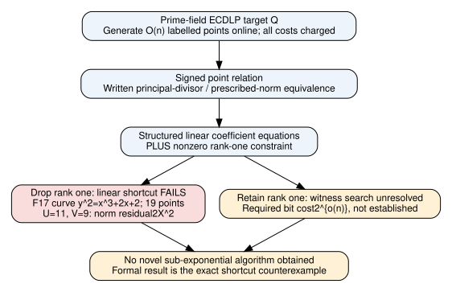

# Search result: prescribed norms do not yet give a new ECDLP algorithm

November12,2026. General prime-field/large prime-subgroup setting. No novel
sub-exponential algorithm was found in this round. The result is a written
norm-to-signed-relation reduction, its full cost contract, and a Lean-checked
counterexample to the proposed linear shortcut. The norm/divisor background
is established mathematics, not claimed as a new algorithm [pcc:unverified].

## Mechanism examined

After receiving public target Q, generate k=ceil(log2 r)+kappa points
R_i=[u_i]P with known independent random labels. All generation is charged
online; no reusable precomputation or amortized table is assumed. Require
nonzero points with distinct x coordinates and no ±Q fibre. A signed sum
sum epsilon_i R_i=Q gives the logarithm sum epsilon_i u_i modulo r.

On E/F_p:y²=f(x), p>3, this sign witness is equivalently represented by

    A²-fB²=c*product_i(X-x_i)*(X-x_Q), c!=0,
    A(x_Q)-y_Q B(x_Q)=0,
    deg A<=floor((k+1)/2), deg B<=floor((k-2)/2).

The written proof uses poles of x,y of orders2,3, the simple norm roots and
the genus1 divisor/group correspondence. All assumptions and both directions
are in [DERIVATION.md](DERIVATION.md). This full reduction is a written proof,
not a Lean theorem or an implemented witness finder [pcc:unverified].

The coefficient system has a structured linear lift in a symmetric matrix M,
but actual solutions require a nonzero rank-one matrix. This is a potentially
useful representation for research, not a demonstrated complexity improvement [pcc:unverified].

## A shortcut actually rejected

For k=2, normalize B=1 and A=v(X-q)+y. Put U=q+x1+x2. Linear coefficient
matching enforces2yv=q²+a+qU-x1x2, but the remaining norm defect is exactly

    (v²-U)(X-q)².

The missing rank-one condition is v²=U. Lean proves this equivalence over any
commutative coefficient ring. On y²=x³+2x+2 over F17, use R1=(5,1),R2=(6,3),
Q=(0,6). The linear relaxation admits U=11,V=9,W=1, while V²-U=2 and the
actual norm residual is2X². The Gram matrix [[11,9],[9,1]] has determinant15.
The slope satisfying the linear equation is unique, so the normalized norm
problem has no solution on this fixture [pcc:unverified].

Lean also checks nonsingularity, the three point equations and18 affine
solutions plus O=19. These are exact kernel-checked finite facts, not a timing
or empirical scaling panel. They refute the linear relaxation as a complete
norm solver only. They do not refute the full norm approach or the existence
of a non-generic sub-exponential ECDLP algorithm [pcc:unverified].

## The cost that remains

| Component | Status/bound |
|---|---|
| Online label/point sampling, norm construction and final verification | Polynomial bit cost under stated large-subgroup regime; written derivation |
| Existence of a signed relation | Failure bound at most(r-2)/2^k+(k²+2k)/r; written second-moment/union-bound argument |
| Solving the linear matrix equations | Does not solve the norm problem; explicit checked counterexample |
| Finding the rank-one witness | No2^{o(n)} bit-cost algorithm established |
| Complete prime-field ECDLP algorithm | Not obtained |

Here n=ceil(log2 r) and log p=O(n). Existence of many witnesses does not make
search cheap: a randomly tested sign still hits a fixed target with probability
1/r on the unfiltered distribution. A high yes-rate decision method also does
not construct a witness or handle conditioned search subproblems. The solver
must actually return A,B and c with every condition checked [pcc:unverified].

The norm instance contains Theta(n²) coefficient bits when k=Theta(n). A generic
“sub-exponential in its input size” claim for that larger problem would not
establish2^{o(n)} ECDLP time. Direct sign enumeration is2^k polynomial(n).
Lower degree and polynomial-size equations do not supply the missing bound.
This audit does not hide that step behind an assumed fast norm oracle
[pcc:unverified].

## Evidence and scope

Mathematical source476fe06d1576e81045735c6e39dfaa143c46a9d6. Lean4.35.0 and
pinned dependencies in lean/. Build004 passed3139 jobs; actual tracked-source
gate passed15 declarations with0 additional trusted axioms. Fresh import-inclusive
replay completed with exit code0; see evidence/fresh-status.json [pcc:unverified].

Identity record [IDC1h8b0c962f231d89d5](norm-defect.identity.json) uses the
repository's unchanged native issuer/checker,32 hash-derived statement points
and32 separate checker-stream points, plus a source-hash pointer to the Lean
proof. That finite-field certificate does not execute the proof; the universal
Lean statement is the algebraic evidence. No random-point confidence value is
used as a runtime or success claim [pcc:unverified].

Canonical unsigned PCC bindings: ee178f(defectIdentity),ef0ca9(normEquationIff),
1b689b(nonsingularity),3325a1(point count),aa5a10(point equations),e1609f(no norm
for the relaxed fixture); prefix PCC-20261112-. The written reduction/cost audit
is statement070fa2, explicitly not Lean-formalized. Full hashes in claim-pins.json.
All remain unsigned producer standing [pcc:unverified].

## Prior work and novelty boundary

Primary source: Steven Galbraith, *Mathematics of Public Key Cryptography*,
author-hosted version2.0,7.7.12/proof7.7.11,7.9.8--7.9.9,8.4 and10.3.6--10.3.12.
[Author PDF](https://www.math.auckland.ac.nz/~sgal018/crypto-book/main.pdf),
SHA256 ca75ee62b96daa0d46faaa2d4dc28205683455ad3a2a48586b9b39299c25022d.
The norm and divisor construction is classical. No priority is asserted for
rank completion either.

Internal reviews include the prime-field October31 synthesis, prime-IC/SAT
review, November9 representation study and atlas entries for function-field
lifting/elliptic nets. The earlier quadratization result warned precisely that
lower degree need not reduce solver work. The existing hashed-factor-base/tensor
route is conditional and already in the repository, so it is not presented as
this request's novel algorithm. KB/ecdb availability and bounded search scope
are recorded in [sources.json](sources.json); unavailable search does not prove
that an idea is new [pcc:unverified].

No experiment, target solve, speed/memory gain, universal lower bound, benchmark
row or ecdb update is claimed. Historical graphs remain unchanged; this round
adds only its proof/cost diagram. Next decisive work would need an actual
constructive algorithm exploiting the norm operator's structure, with a uniform
2^{o(n)} bound. Repeating the rejected linear relaxation is not that work.
