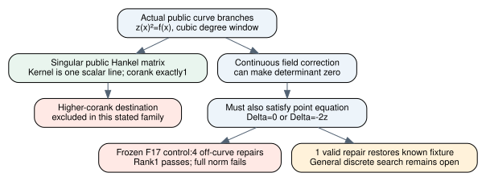

# Exact public kernel line and curve-constrained rank repair

2026-11-13. Frozen proof/native source4b6ed788df362b6071fae425c9e374d2a2152443.
Unsigned producer evidence [pcc:unverified].

The actual public signed Hankel matrix has exactly one kernel direction
whenever it is singular under the cubic chart hypotheses. This numerical
corank is derived, not supplied as a guard. A separate fixed control shows
why a continuous rank repair is not automatically a valid branch change:
four of five repairs of the frozen matrix leave the curve and fail the full
norm check [pcc:unverified].

[PDF report](report.pdf), [editable DOT](repair.dot), [diagram SVG](repair.svg),
[Lean source](../lean/NormBranchRepair.lean),
[native source](../native-recovery-control/src/branch_repair.rs),
[prospective contract](../BRANCH_REPAIR_PROTOCOL.md),
[original fixed artifact](../branch-repair-evidence/native-control.json),
[exact source claims](../branch-repair-evidence/claim-pins.json).



## Exact theorem and actual hypotheses

Over a field K, let S be a finite set with |S|=2a, a>=2, let f have degree3,
and let z(x)²=f(x) at every x in S. Let M be the exact public barycentric
Hankel matrix from NormSignedHankel, of size(a-1)-by-(a-1). If detM=0 then

    rank(M)+1=a-1.

More precisely, for any nonzero actual kernel vector u,

    M b=0  iff  exists t in K, b=t*u.

No successful A/B, normalization oracle, rank oracle, square-root oracle,
primitive-polynomial premise or cofactor guard is assumed in this line or
corank conclusion. The earlier actual public reconstruction supplies the norm
for each nonzero kernel vector. The theorem is algebraic and needs no curve
nonsingularity/subgroup assumptions beyond those explicitly stated; applying
it to the original ECDLP objective retains those additional obligations
[pcc:unverified].

Unsigned kernel-line claim PCC-20261113-98d020; numerical corank
PCC-20261113-a3591d.

The proof follows actual polynomial coordinates. Construct B0,B1 by ofFn and
A0,A1 by the actual public interpolation/remainder map. All share the specified
node branches, so G divides A0B1-A1B0. Its degree is less than degG=2a; hence
it is zero. The two derived nonzero norm identities imply

    c0 B1²=c1 B0²

after cancellation of the actual nonzero G. Compare leading coefficients to
construct t and factor a difference of polynomial squares; this yields
B1=C t*B0 without asking for a square root. Faithfulness of ofFn gives the
kernel line. Rank-nullity and the nonzero singleton span give the numerical
corank. Zero vectors are treated separately [pcc:unverified].

Within this family, demanding a singular matrix of larger corank contradicts
the stated hypotheses. This excludes that particular rank-descent destination,
not a target-aware discrete search, a different matrix family or the original
W-base jet proposal. No global ECDLP lower bound is derived [pcc:unverified].

## Exact point constraint

For every field and z,Delta,

    (z+Delta)²=z²  iff  Delta=0 or Delta=-2z.

Factor Delta*(2z+Delta) and use the field's no-zero-divisors property. In
characteristic2 the two alternatives coincide; no distinct-sign claim is
made there. For the original prime-curve domain p>3 and z!=0, the only
nontrivial allowed correction is the opposite branch. A continuous determinant
repair must satisfy this constraint as well as singularity
[pcc:unverified].

Unsigned exact branch constraint PCC-20261113-59cebf.

## Frozen native repair control

Use f=X³+2X+2 over F17 and supplied public branches
(0,6),(3,1),(5,1),(6,3),(10,11),(13,10). The initial matrix is
[[9,14],[14,3]], determinant1. With v=(1,x), compute
q=v^T adj(M) v and h=w_x*q. When h!=0 choose Delta=-detM/h, rebuild the
actual matrix and check its determinant independently. Preserve h=0; that
frozen direction is tested at all17 field corrections and cannot repair
this matrix by itself. These are fixed identity checks, not statistical trials
or a random branch-search run [pcc:unverified].

| x | h | Delta | New y | Actual point / full norm |
|---:|---:|---:|---:|---|
| 0 | 12 | 7 | 13 | fails / fails; target branch would change |
| 3 | 0 | — | — | no continuous repair in this direction |
| 5 | 11 | 3 | 4 | fails / fails |
| 6 | 16 | 1 | 4 | fails / fails |
| 10 | 6 | 14 | 8 | fails / fails |
| 13 | 6 | 14 | 7 | passes / passes |

All five repaired matrices have determinant0 and rank1. Every returned kernel
B is reconstructed to A, checked for the original pole degree, and checked
against the full norm N=cG. For the four off-curve changes, this full norm
fails despite the rank check. The original allowed sign flip's determinant
is also checked separately, and all289 pairs(z,Delta) over F17 check the exact
branch-square predicate [pcc:unverified].

All-coordinate summary:5 repairs,4 off-curve,1 valid,1 zero-coefficient
direction. With target branch x0 fixed:4 eligible repairs,3 off-curve,1 valid,
and the same one zero direction. These are two views of the same cases,
not independent samples. The valid repair restores the previously known
positive fixture at13; it is not evidence of a general branch-selection
algorithm or its success probability [pcc:unverified].

Native artifact SHA2566ebb9593df2d4ce90732b8505ee2c93d4a4ad1c435b7724946d644343edba83c;
unsigned data claim PCC-20261113-49efb0. Eleven tests and strict clippy pass;
release build001 and write-once artifact invocation001 exit0. No timing,
scaling, statistical yield, actual DLP search or paid/EKS run was performed.

## Source map and validation

Eleven new statements in NormBranchRepair. Source build001 fails on two
interface details;002 passes and prints only propext, Classical.choice and
Quot.sound. The whole-study source gate passes256 statements with0 additional
trusted axioms. The separate import-inclusive fresh replay has its actual
receipt in checks.json and fresh-status.json; a still-running empty log never
counts as a pass [pcc:unverified].

| Component | Declaration |
|---|---|
| Scalar ratio of polynomial squares | squaresProportional |
| Shared-node cross product vanishes | crossZero |
| Norms give proportional squares | normSquareRelation |
| Exact two-branch predicate | branchDeltaIff |
| Actual numerator at nodes | numeratorAtNode |
| Actual vector coefficient equations | kernelEquations |
| Faithful nonzero vector conversion | ofFnNonzero |
| Actual numerator pole bound | kernelNumeratorBound |
| Actual kernel vector's nonzero norm | kernelNorm |
| Exact public kernel line | kernelLine |
| Actual singular numerical corank | singularCorankOne |

All exact qualified bindings are unsigned. Maintained default-PATH source-only
checks are not_covered, separate from the explicit-toolchain kernel evidence.
No scientific signature or independent signed verdict is supplied.
Lean4.35.0/CryptoLean148f5dc389b341401e06d76abe7783c4ccf42f2e/
Mathlibcfc55fc58714a59dc06e6e79edc6d1d95140d3c2 remain pinned. Reproduce:

```sh
lake -d research/prime_norm_rank_20261112/lean build NormBranchRepair
lake -d research/prime_norm_rank_20261112/lean env leanchecker --fresh --verbose NormBranchRepair
bash tools/lean/proof-gate.sh --out /tmp/new-branch-repair-gate research/prime_norm_rank_20261112/lean
cargo test --locked --release --manifest-path research/prime_norm_rank_20261112/native-recovery-control/Cargo.toml
```

Sources checked (KB unavailable: tools absent, wrapper no executable): actual
NormSignedHankel/publicInputCertificate, existing rank-nullity code, pinned
polynomial degree/leading-coefficient declarations, and the previously opened
primary Li-Wan-Zhang1501.01138 Proposition4.1 and Cheng cs/0507026 principal-
divisor discussion. The present proof is direct polynomial algebra; no primary
paper or theorem is used as an unproved Lean axiom. No novelty/exhaustive claim.

## Research decision and next discriminating action

Retain actual branch/curve constraints in any public rank-repair objective.
The proposed arbitrary-field single-coordinate repair is an incomplete
relaxation, and a higher-corank target is excluded in this public family.
Neither closes the original broader research objective [pcc:unverified].

The next candidate should use a genuinely discrete, possibly multi-coordinate
branch search or a materially different public factor-base construction, with
an explicit reason for fewer counted attempts. Its acceptance must keep the
target branch, norm/divisor/scalar validity and total exp(o(log r)) bit cost.
Do not replace that unknown with more given-certificate lemmas. See the
[problem record](../../../problems/prime-norm-public-branch-selection.md).
Earlier source/evidence/claims and their historical snapshots remain unchanged;
new native routes/visibility annotations are not relabelled as old evidence.
No performance/leaderboard graph is promoted; this new diagram covers the
specific geometry and relaxation test only.

Bounded cross-repository follow-up: the connected GitHub search queried
Hankel/barycentric/continuous-rank-repair terms across five explicitly named
repositories. Read the selected H067/H075 sections of
[cryptanalysis handbook IDEAS.md at c5e98ac36](https://github.com/isogeny-labs/cryptanalysis/blob/c5e98ac3618327cb03eac69f564efdd7ea6a82a3/research/handbook-ff-ic-ideas-20261103/IDEAS.md).
H067 explicitly leaves shift closure and the matrix-rank interpretation
assumed. H075 explicitly leaves the general Daykin count and the rank-to-yield
bridge assumed; only small finite cases are described there. Their exact
source gaps are not a proved search bound for this actual branch family.
No code replay or kernel status of those entries was established here
[pcc:unverified].

Queries, exact opened source revision and selected excerpts are in
[sources-checked.json](../branch-repair-evidence/sources-checked.json).
Search crypto hits are at17e78cf98, older than this work. A broad token match
or missing hit is not a current/exhaustive absence result. This review does
not authorize a random/scaling run or change the original acceptance criteria.
