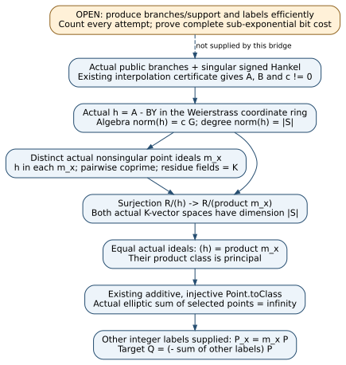

# Actual norm certificate to elliptic point and scalar relations

2026-11-13. Proof/native source6ba718256377342c60d7aa5851d18bc006dc0f4a.
All claims and execution receipts are unsigned producer evidence [pcc:unverified].

The actual signed public Hankel certificate now implies a relation in the
actual elliptic-curve point group. Given the other point labels, that relation
explicitly supplies the target integer scalar. The proof constructs the
coordinate-ring ideal factorization; neither a divisor/group relation nor
that factorization is assumed by the final public theorem. The established
Mathlib class-group foundation is reused, without a novelty claim
[pcc:unverified].

[PDF](report.pdf), [editable diagram](bridge.dot), [SVG](bridge.svg),
[Lean module](../lean/NormGroupBridge.lean),
[fixed native control](../native-recovery-control/src/group_bridge.rs),
[prospective contract](../GROUP_BRIDGE_PROTOCOL.md),
[actual artifact](../group-bridge-evidence/native-control.json),
[claims and exact declaration hashes](../group-bridge-evidence/claim-pins.json),
[checks](../group-bridge-evidence/checks.json),
[bounded source review](../group-bridge-evidence/sources-checked.json).

## Exact scope and theorem

Let K be a field and W an actual Weierstrass affine curve with a1=a3=0.
Write f=X^3+a2*X^2+a4*X+a6. Let S be a finite set of distinct x coordinates,
z(x) the chosen branches, and require W.Nonsingular(x,z(x)) at each node.
The actual coordinate-ring element h=A-BY has algebra norm A^2-f*B^2.
If its branch rows satisfy A(x)=z(x)B(x) and its full norm is cG for c!=0,
G=product over S of(X-x), then the sum of those actual nonsingular points
is zero. Empty supports are allowed in this norm theorem; repeated x
coordinates are outside the finite-set formulation [pcc:unverified].

For |S|=2a, a>=2, define the exact signed public matrix already formalized
in NormSignedHankel:

    M[j,k] = sum over x in S of z(x)*x^(j+k) / product_(t in S, t!=x)(x-t),
    0 <= j,k < a-1.

If det(M)=0, existing actual interpolation/kernel reconstruction supplies
the required full norm, so the actual elliptic sum is zero. This theorem
assumes no successful A/B, numerical rank, scalar oracle, principal ideal,
divisor relation or interpolation oracle. Nonsingularity is an explicit
point premise. K has a DecidableEq instance for the library's point group;
no characteristic restriction is hidden. The original general-prime-curve
objective remains in its p>3 domain [pcc:unverified].

For a target node t, public base P and supplied integers m_i for all other
nodes with P_i=m_i P, the composed theorem gives

    Q = (- sum_(i != t) m_i) P.

The target's label is not a premise. Producing the successful branches and
the other labels efficiently is still required. The theorem gives an integer
relation directly; it does not assert a subgroup order or silently perform
a reduction modulo an unestablished order [pcc:unverified].

Core unsigned claims: full norm PCC-20261113-fde916; actual public point
sum PCC-20261113-c0da71; target corollary PCC-20261113-3f21d1.

## Readable proof

1. In the actual ring R=K[X,Y]/(W), use Mathlib's rank-two K[X] basis(1,Y).
   The algebra norm formula specializes faithfully to h=A-BY. At each node,
   X-x divides A-z(x)B. Writing h as that polynomial minus B(Y-z(x)) puts
   h in the actual point ideal m_x=(X-x,Y-z(x)). This is polynomial division,
   not an evaluation-membership oracle [pcc:unverified].
2. Distinct x coordinates make the actual point ideals coprime: subtract
   their X generators and multiply by the inverse of the nonzero coordinate
   difference to obtain1. The actual quotient by each nonsingular point
   ideal is K. CRT therefore identifies R/(product m_x) with K^S and gives
   dimension |S| [pcc:unverified].
3. The actual nonzero principal quotient R/(h) is finite dimensional,
   obtained through the Smith-factor direct-sum decomposition. Its dimension
   is degree(norm h)=|S|. Finite dimensionality is constructed separately;
   a finrank equation alone is not used as a finiteness assumption. Membership
   gives (h) contained in product m_x, since the coprime product equals their
   intersection [pcc:unverified].
4. The canonical quotient map is surjective between equal finite dimensions,
   hence injective; this identifies the actual ideals. Map their principal
   product through the existing ClassGroup construction. The existing
   additive, injective Point.toClass then gives the actual point sum zero.
   Separate the target summand and substitute the other supplied integer
   labels to obtain the explicit target scalar [pcc:unverified].

This applies established ideal-class mathematics from Angdinata-Xu ITP2023,
sections3.1–3.3, to this actual certificate family. It avoids assuming a
projective divisor/Picard library. It does not identify this public Hankel
family with the earlier W-base jet family; that would require its own map.
In particular, it supplies no new higher-corank destination for the earlier
rank-directed jet proposal [pcc:unverified].

## Fixed native controls and predictions

The prospective contract fixed the same F17 curve f=X^3+2X+2 and six branches
before the native source/artifact invocation. No random sign search, timing,
statistical yield panel, paid job or target logarithm search was performed.
The artifact invokes the frozen source once; unit tests exercise the same
fixtures separately, not independent samples [pcc:unverified].

| Control | Predicted and recorded result |
|:--|:--|
| (0,6),(3,1),(5,1),(6,3),(10,11),(13,7) | All on curve; sum infinity; det(M)=0 |
| Reconstruct actual positive norm | A=[14,2,7,3], B=[8,1], c=9, exact norm cG |
| Change only(13,7) to(13,10) | Sum(10,6), equal to minus twice the original point13; det(M)=1, no kernel |
| Base(5,1), predetermined labels[7,4,1,2,16,8] | Every multiplication matches its stated public point |
| Target fixed at node0 | Negative sum of other labels=-31;(-31)P=(0,6) |
| Off-curve repair(0,13) | Rejected before group addition |
| Noncanonical field coordinates | Rejected before group addition |

Unsigned native claim PCC-20261113-476fe0; artifact SHA256
`3875f7bce92f789b273d026b3ea1aabada4eca4c559e92a65c9363f21432e0e5`.
Infinity is encoded as JSON null. No subgroup-order claim is needed for
the directly replayed integer relation [pcc:unverified].

The separate minimal identity-control target reuses the unchanged canonical
identity issuer/checker and SHA256 source. Certificate IDC1hedd7e46a60a6ad5c
seals only the literal polynomial expansion of det[[A,-FB],[-B,A]], using32
statement-derived and16 extra replay points over the v1 fixed modulus.
It neither interprets the algebra norm nor checks the point theorem; its
Lean proof pointer is separate. Canonical checker/hash tests002 pass22.
Its strict clippy001 fails on four existing chunks_exact style warnings in
the unchanged canonical SHA256 source under Rust1.99.1. That failure is
preserved, without a lint allowance or checker edit. Unsigned certificate
attestation PCC-20261113-f11937 [pcc:unverified].

## Formal statement map and verification scope

Pinned Lean4.35.0, CryptoLean148f5dc389b341401e06d76abe7783c4ccf42f2e,
Mathlibcfc55fc58714a59dc06e6e79edc6d1d95140d3c2. Module build010 passes;
the current whole-study source gate audits270 statements with0 additional
trusted axioms, exit0. Each new theorem uses only propext, Classical.choice
and Quot.sound. Import-inclusive fresh replay exits0 (session36245); its exact source and
command are recorded separately in checks.json. All execution receipts and claims remain unsigned;
default-PATH PCC checks are source-only not_covered, distinct from explicit
toolchain gate/replay [pcc:unverified].

| NormGroupBridge declaration | Exact additional input and conclusion |
|:--|:--|
| quotientFinite | Nonzero actual h; finite-dimensional R/(h) |
| idealsEqualOfDimension | Inclusion and both finite equal quotient dimensions; ideal equality |
| pointIdealsCoprime | Distinct x coordinates; actual point ideals coprime |
| pointQuotientDimension | Injective x, actual nonsingular points; quotient dimension=node count |
| principalPointProduct | Same points, actual membership, nonzero h, exact norm degree; principal product |
| pointSumOfPrincipal | Actual nonsingular points and principal product; actual zero point sum |
| normDegreePointSum | Derives preceding principal product from degree/membership |
| normFunctionNorm | a1=a3=0; actual norm of actual A-BY |
| normFunctionAtPoint | Actual row A(x)=yB(x); actual point-ideal membership |
| fullNormPointSum | Actual rows, nonsingular points, norm=cG,c!=0; actual zero point sum |
| cubicDegree | Actual cubic degree3, all lower coefficients arbitrary |
| publicHankelPointSum | Exact cardinality, a>=2, actual public determinant0; actual zero point sum |
| targetScalarFromSum | Actual zero point sum and other supplied labels; target integer |
| publicHankelTargetScalar | Composes actual public certificate, point relation and supplied-label recovery |

The noncomputable pointQuotientEquiv is the actual CRT/residue-field linear
equivalence used inside the dimension proof, not an oracle premise. Every
declaration's normalized statement hash and source commit appears in claim-pins.
Failed prototype001/002 and module001–009 logs remain. Failed identity
build001 records a missing hex dependency; tests001 record an attempted
include_str before sparse hydration finished. Dependency/hydration fixes
are retained alongside later passing records [pcc:unverified].

Sources checked (KB): no KB MCP or executable wrapper in this runtime;
bounded fallback opens the named pinned Mathlib files and Angdinata-Xu
[primary paper](https://doi.org/10.4230/LIPIcs.ITP.2023.6), sections3.1–3.3.
Source-only references are not proof verdicts. Scope and hashes are in the
source-review receipt, unsigned claim PCC-20261113-cee56b [pcc:unverified].

No benchmark/leaderboard/canonical performance graph changes: this study has
no timing, yield or speed claim. The study diagram and current problem record
are updated. Next discriminating obligation is an actual constrained discrete
branch/support finder with counted attempts and complete expected bit cost;
the original exp(o(log r)) objective remains unchanged [pcc:unverified].

Repository-wide benchrec gate001 exits1 on1672 historical sparse-checkout
artifact/entry issues across160 unchanged records. Its complete diagnostic
log and SHA are retained compressed. This component touches no benchmark,
progress, gate or canonical-checker path; no unrelated archive hydration,
report regeneration or gate bypass substitutes a pass. Both scoped Cargo
format checks and prose lint pass. Final PDF build002 has3 pages, no layout
warnings, and every final page was visually inspected [pcc:unverified].
