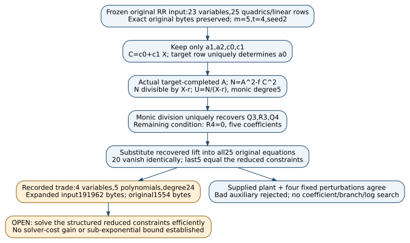

# Lossless coefficient projection of the unfinished m5 norm system

2026-11-13. Frozen sourceccd9e23f13a522d0b1fa6b56114450107c1e7071.
Unsigned producer construction/evidence [pcc:unverified].

The actual old RR input can be represented by four function coefficients,
with the other19 coefficient variables recovered uniquely. Native symbolic
substitution checks all25 original equations:20 vanish identically and the
last5 are exactly the reduced membership equations. The trade is explicit:
the five expanded equations have degree24 and occupy191962 bytes, against
the original23-variable, degree<=2,1554-byte input. This is a lossless
representation trade; solver cost has not been measured [pcc:unverified].

[PDF](report.pdf), [editable DOT](projection.dot), [SVG](projection.svg),
[prospective contract](../MEMBERSHIP_ELIMINATION_PROTOCOL.md),
[Lean model](../lean/NormMembershipElimination.lean),
[native construction](../membership-elimination-control/src/main.rs),
[original fixture bindings](../membership-elimination-evidence/fixture-inputs.json),
[full reduced input](../membership-elimination-evidence/native-output-001/reduced.ms),
[actual native artifact](../membership-elimination-evidence/native-output-001/native-control.json),
[source audit](../membership-elimination-evidence/sources-checked.json),
[claims](../membership-elimination-evidence/claim-pins.json),
[checks](../membership-elimination-evidence/checks.json).

## The actual construction and its exactness boundary

The fixed P1 Dickson input has p=14680063, m=5,t=4,seed2, curve
f=X^3+3607823X+6826282, actual target(r,z)=(5400989,8855456), and terminal
c=12691281. These are copied from the original emitted fixture, not a newly
selected curve or target. Original input SHA256:
`9ba376d81c05109b11102c645153f9204df233600fec5851993a6bd5787e3cff`.
All original source/evidence bytes remain at their historical paths
[pcc:unverified].

Keep a1,a2,c0,c1. With C=c0+c1X and D=X^3+a2X^2+a1X, compute

    a0 = z*C(r)-D(r),  A=D+a0,
    N=A^2-f*C^2,       U=N div (X-r).

Actual target incidence makes N(r)=0, so the division is exact. Its monic
degree window makes N degree6 and U monic degree5. No variable denominator
or additional saturation/nonzero guard is introduced. The original sat=0
system's exceptional algebraic solutions are not discarded by a new chart
rule [pcc:unverified].

Let D0=X and D_(j+1)=D_j^2-2. Compute the actual monic divisions

    D3 = U*Q3+R3,
    R3^2-2-c = U*Q4+R4.

The only remaining equations are the five coefficients of R4. Q3,R3,Q4
and U are functions of the four retained coefficients; their degree guards
follow from monic polynomial division. The direct(D4-c) mod U equals R4.
Every original equation is independently parsed from the unchanged concrete
input, then substituted into exact sparse polynomials over F14680063.
All first20 expressions become the zero polynomial; the last5 become the
R4 coefficients in descending X degree. This is coefficient equality, not
random evaluation alone [pcc:unverified].

The universal Lean model establishes actual target completion, exact norm
division/uniqueness, degree windows, tower recovery/existence/bounds and the
direct membership criterion. The concrete23-variable compiler binding is
the separate native symbolic check. No claim presents the native comparison
as a Lean-verified compiler, or the universal model as an expanded formal
proof of all25 literal fixture expressions [pcc:unverified].

Core unsigned statements: canonical norm quotient PCC-20261113-c1ec0b;
tower uniqueness PCC-20261113-9816f2; terminal membership
PCC-20261113-a3e4cb; support window PCC-20261113-642249. Native concrete
binding/control attestation PCC-20261113-b465d8.

## Actual controls and recorded construction sizes

The protocol froze exactly five core assignments before native execution:
the original supplied plant and one increment of each retained coordinate.
The original plant reconstructs every one of the23 supplied coefficients
and all25 residuals vanish. Each perturbation preserves the first20 zero
rows; its five original residuals match the reduced system exactly and are
nonzero in this fixture. A separate corrupted Q3 leading coefficient is
rejected by the original equations. All cases remain in the artifact; no
search for a passing coefficient assignment was run [pcc:unverified].

| Reduced X coefficient | Total degree | Terms |
|:--|--:|--:|
| 4 | 24 | 1103 |
| 3 | 24 | 1445 |
| 2 | 24 | 1830 |
| 1 | 24 | 2171 |
| 0 | 24 | 2366 |

The program records682901 sparse coefficient-pair products and a peak2366
observed terms, below the frozen100000000 and500000 guards. The single
write-once artifact exits0 under256MiB virtual memory and120 CPU-second caps.
These are bounded construction/control counts, not solver time, an arithmetic
cost model for ECDLP, a statistical sample or a speed comparison. Unit tests
reuse the same cases. Source/input/reduced-file hashes are retained
[pcc:unverified].

Literal certificate IDC1hb49f2953ff1e646f, unsigned attestation
PCC-20261113-5e61c7, seals only(D+ZB-D)^2-Z^2 B^2=0. The unchanged canonical
native checker replays32 statement-derived and16 extra points over the v1
fixed modulus. It neither interprets monic division nor certifies the full
input projection. Its Lean pointer is checked separately. The driver builds;
its strict clippy records the same four existing style errors in unchanged
canonical SHA256 under Rust1.99.1, without suppression or checker edits
[pcc:unverified].

## Why revisit the old experiment, and what the raw audit establishes

The actual m5,t4 RR cell did not complete. The R2b log records a timeout;
the three R3 RR attempts were interrupted. For RRa2, the raw system SHA
matches the original, its last log line begins the degree7 matrix
464562 by390983, and the raw CloudTrail object records BidEvictedEvent at
2026-11-09T11:09:30Z. That line is an unfinished step; the frozen protocol
grants no degree/width bound from Spot-lost partial attempts. The capped
reference and earlier RR timeout stay censored. A completion-capable retry
could decide this one cell; it would not establish an asymptotic growth law
[pcc:unverified].

The root CloudTrail object does not identify a pod or node. Its time/input
agreement is observed; the instance-to-pod association still relies on the
historical assessment/attempt log. Empty msolve-at-start output, nproc1,
and close completed degree6 CPU/real pairs do not establish continuous host
isolation or completed degree7 timing. We do not adopt the old report's
stronger suggestion that computation itself was already known not to be the
obstacle. No independent cloud query or experiment rerun was performed
[pcc:unverified].

The construction changes the representation before requesting more runtime.
It replaces generic handling of19 uniquely determined auxiliaries with
explicit monic division, and quantifies the corresponding degree/input
growth. The broader source survey's generic target-attachment sketch does
not rule out non-generic algorithms. The source audit is unsigned claim
PCC-20261113-08f893; it records exact source hashes and limitations
[pcc:unverified].

## Proof map, validation and next discriminating action

Pinned Lean4.35.0, CryptoLean148f5dc389b341401e06d76abe7783c4ccf42f2e,
Mathlibcfc55fc58714a59dc06e6e79edc6d1d95140d3c2. Build004 passes the16 new
statements with only propext, Classical.choice and Quot.sound. Current whole
source gate286/0 additional trusted exits0. Fresh import-inclusive replay76692 exits0,
with its own source-bound receipt in checks.json. Native tests002 pass3, strict
clippy002 passes and the release build passes. Earlier failed module/native
lint attempts remain. Default PCC checks are source-only not_covered; all
claims and execution receipts are unsigned [pcc:unverified].

| NormMembershipElimination declaration | Exact scope |
|:--|:--|
| completionRow, completionUnique | Actual constant completion; target row and uniqueness |
| normAtTarget, canonicalNormQuotient | Actual curve/target rows; zero norm evaluation and computed exact quotient |
| normQuotientUnique, divisionUnique | Actual monic division determines old factor/quotient/remainder variables |
| reducedStep, reducedMaster | Actual modular squaring and direct master remainder agree |
| canonicalTowerLift, canonicalTowerBound | Construct actual tower auxiliaries and their degree guard |
| towerUnique | Every old bounded tower equals the constructed one |
| terminalMembership | Nontrivial ring, positive-degree monic modulus; terminal iff actual divisibility |
| normWindow, supportWindow | Field, monic cubic A, cubic f, degree<=1 B; norm/support monic degrees6/5 |
| completionWindow, quotientWindow | Completion preserves degree3; degree5 modulus/degree4 remainder gives quotient degree<=3 |

Sources checked (KB): no MCP or executable wrapper; bounded direct public
repository/raw-record review and primary PKC2016 sections3.1–3.5/4.1/Table4,
Cheng cs0507026 Lemma3, Caminata-Gorla2112.05579v2 section4. The existing
binary Nagao coefficient/support work is adjacent, not prime-field evidence.
GitHub query matches may be token-level and revisions vary; no exhaustive
absence or novelty claim. Two ePrint full texts returned403 and remain
unassessed beyond available metadata. Exact paths/URLs/hashes and query
receipts are retained [pcc:unverified].

Next: determine whether a module-aware or circuit-preserving solver can use
the exact projection without paying for expansion, compared with the strongest
matched original formulation. Degree24 and four variables alone establish
neither a gain nor a loss. Such a solver/cost experiment needs its own actual
generator, prospective controls and live finite admission; none was launched.
The original exp(o(log r)) complete bit-cost target remains unchanged. No
benchmark/leaderboard/performance graph values change; this study adds its
own exactness/trade diagram and updates the current problem record
[pcc:unverified].

Repository benchrec gate001 exits1 on1680 historical sparse artifact/entry
issues across162 unchanged records; full diagnostic/hash/exit are retained
compressed. No benchmark/config/progress/gate paths differ and no unrelated
archives or records were changed to obtain a pass. Both scoped Cargo format
checks and prose lint pass. Final PDF build002 has3 pages, no layout warnings,
and all final pages were visually inspected [pcc:unverified].
