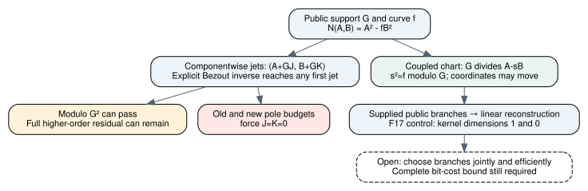

# Public norm jets and coupled branch reconstruction

2026-11-13. Source-bound producer evidence, unsigned [pcc:unverified].
Proof source8892e447768f38065f06d32c575209661ca512b9; final native source
 a5b04b3e547a17d59d977574386a191ae536425b. This round tests the actual
reachability of a specified polynomial correction and implements a public
branch reconstruction control. It does not identify this polynomial family
with the earlier W_base+C(T)H(T) matrix family.

The exact first quotient jet is reachable with an explicit polynomial inverse,
but componentwise support-multiple corrections cannot move a bounded pair
inside the relation window. The successor uses coupled coordinates and a
public square-root residue; the native control reconstructs A/B from supplied
public branches without supplying A/B to the solve [pcc:unverified].



[Two-page PDF](report.pdf), [editable DOT](jets.dot), [LaTeX](report.tex),
[prospective contract](../PUBLIC_JET_PROTOCOL.md),
[Lean source](../lean/NormPublicJets.lean),
[native source](../native-recovery-control/src/public_jets.rs),
[original write-once artifact](../public-jet-evidence/native-control.json),
[exact claim pins](../public-jet-evidence/claim-pins.json).

## Exact map and its degree constraint

Over any field K, put N(A,B)=A²-fB². For corrections A'=A+GJ, B'=B+GK,

    N(A',B') = N(A,B) + G(2AJ-2fBK) + G²(J²-fK²).

If 2u=1 and AU+fBV+GW=1, choose J=u U Delta and K=-u V Delta. Then

    N(A',B')-N(A,B)-G Delta = G²(J²-fK²-W Delta).

No norm witness is assumed in this map. An inverse and Delta are explicit
inputs. Characteristic2 is excluded by the requirement2u=1. For the public
root-residue case s²-f=GR, B=1 and fV+GW=1 suffice: choose J=0 and
Delta=c-R. This reaches N=cG modulo G² and retains its full higher-order
residual. It is classical Hensel algebra, not a new lifting algorithm
[pcc:unverified].

If both the old and new coordinate polynomials have degree strictly below
degG, the difference between each pair is divisible by G and has smaller
degree. It must be zero. Consequently J=K=0 for G nonzero. The actual bounds
2degA<=degG and degf+2degB<=degG, with degG>0, imply these strict coordinate
bounds. The same bounds for the new pair therefore prevent any new norm via
this componentwise correction. This theorem concerns exactly the stated
polynomial correction, not all node-preserving rational or matrix operations
[pcc:unverified].

Unsigned source claims: first jet PCC-20261113-4969cb, public root lift
PCC-20261113-82d1b6, actual-window no-new-norm PCC-20261113-f8bb46.
The broader W-family reachability question remains separate.

## Coupled successor and direct certificate

Fix s with G|(s²-f). The branch congruence G|(A-sB) specifies a choice of
branches when G has distinct rational support with nonzero y coordinates.
Coupled corrections

    A'=A+sH+GJ,       B'=B+H

preserve that congruence. They can move individual residues and are therefore
not excluded by the preceding componentwise rigidity theorem. Algebra gives

    A²-fB² = (A-sB)(A+sB)+(s²-f)B².

Thus G divides the actual norm. If G is monic, the actual pole bounds hold,
and the norm is nonzero, its degree is at most degG, so it equals C c*G for
c!=0. This target-aware certificate uses no moment/rank/cofactor inputs.
It still requires choosing s and finding a nonzero bounded pair in the branch
congruence. Choosing a favorable s is not solved by the certificate
[pcc:unverified].

Unsigned coupled-residue claim PCC-20261113-a528a0; direct certificate
PCC-20261113-41d872. A supplied-branch rational reconstruction is standard,
not a novel sign-selection method.

## Fixed native controls and actual outcomes

One exclusive artifact invocation contains289 prescribed Delta inputs over
F17, each of degree at most1, with f=X³+2X+2, G=X, A=6, B=1,
V=9, W=16+8X². This is an algebra correctness fixture; its support degree1
is not an ECDLP relation instance satisfying the cubic pole budget.
The explicit inverse fV+GW=1 is checked. Coefficient identities, node values,
derivatives at0, and evaluations at all17 field values are checked. Exactly
288 of289 cases retain a nonzero full residual; Delta=0 is the unchanged
control. These are deterministic cases in one development control, not289
independent physical trials [pcc:unverified].

For target c=1, the computed Delta is3+X², and

    B'=1+12X+4X³,
    N(6,B')-G = 4X²+X³+6X⁴+4X⁵+11X⁶+8X⁷+X⁹.

The residue vanishes moduloG², but the full residual is nonzero and the degree
window fails. Accepting this local lift as a completed certificate would be
incorrect. The original complete residual is retained in the JSON
[pcc:unverified].

The separate fixed six-point reconstruction takes only
(0,6),(3,1),(5,1),(6,3),(10,11),(13,7). It first constructs the public Lagrange
square-root residue s moduloG and then solves the original six homogeneous
point equations for degA<=3 and degB<=1. No known A/B is supplied to that solve.
Every returned vector is checked against the original rows, the branch
congruence, original public point equations, actual degree bounds and full norm
identity [pcc:unverified].

| Supplied branch assignment | Kernel dimension | Reconstructed result |
|---|---:|---|
| Listed six public points | 1 | A=[14,2,7,3], B=[8,1], c=9 |
| Change only (13,7) to (13,10) | 0 | No nonzero pair in this bounded linear chart |

Coefficients are ascending, modulo17. The positive result is exactly3 times
both original fixture polynomials A=[16,12,8,1], B=[14,6]; its norm scales by9.
That comparison is readback against a known-answer control, not a hidden input
to reconstruction. The flipped result concerns one supplied sign assignment;
it does not assert infeasibility for the unsigned support, whose positive
assignment is already exhibited. No branch search was run [pcc:unverified].

Unsigned native artifact claim PCC-20261113-e63c86. Native tests001 and002 each
pass7 tests;002 follows the actual strict-lint loop repair. Clippy001 fails on
needless_range_loop, then clippy002 passes with warnings denied. Original
failed/success logs and exact exits are retained. No statistical yield, timing,
comparison ratio, EKS run, paid experiment or DLP recovery is claimed.

## Formal proof map and replay

All14 statements are in NormPublicJets.lean. Each theorem has its own
qualified source binding in claim-pins.json [pcc:unverified].

| Component | Declaration |
|---|---|
| Exact polynomial expansion | expansion |
| Support-node values | preserveNode |
| Explicit linear quotient jet | bezoutLinear |
| Exact first-jet remainder | firstJet |
| Public root-residue lift | publicRootLift |
| Low-degree representative uniqueness | residueRigidity |
| One component correction is zero | correctionZero |
| Both components are zero | boundedPairRigid |
| Actual pole budget implies strict bounds | poleWindowStrict |
| Squared congruence plus degree cap is exact | squaredCongruenceExact |
| Actual-window norm equivalence | poleWindowNoNewNorm |
| Coupled coordinate residue identity | coupledResidue |
| Branch residue implies norm divisibility | residueNormDivides |
| Direct nonzero scalar certificate | publicResidueCertificate |

Pinned Lean4.35.0, CryptoLean148f5dc389b341401e06d76abe7783c4ccf42f2e,
Mathlibcfc55fc58714a59dc06e6e79edc6d1d95140d3c2. Whole-study tracked-source gate
passes231 statements with0 additional trusted axioms. Build001 fails on a
natDegree_pow invocation, retained; build002 passes. The gate uses the current
repository's maintained tools/lean/proof-gate.sh, whose hash differs from the
older pinned CryptoLean copy; both hashes and the exact choice are recorded.
No dependency/gate source was changed [pcc:unverified].

The separate import-inclusive fresh replay receipt is finalized in checks.json.
Source-only maintained PCC checks all report not_covered because their default
PATH lacks Lean; that is separate from the explicit-toolchain source gate and
fresh kernel replay. No signed verdict or fabricated signature is supplied.
Original logs include the source-only check result and explicit actual exits.

Reproduce with the pinned toolchain on PATH:

```sh
lake -d research/prime_norm_rank_20261112/lean build NormPublicJets
lake -d research/prime_norm_rank_20261112/lean env leanchecker --fresh --verbose NormPublicJets
bash tools/lean/proof-gate.sh --out /tmp/fresh-public-jet-gate research/prime_norm_rank_20261112/lean
cargo test --locked --release --manifest-path research/prime_norm_rank_20261112/native-recovery-control/Cargo.toml
```

## Research decision, prior art and next obligation

The tested componentwise jet construction supplies arbitrary local jets but
cannot itself move a pair within the pole window. Retain the coupled residue
chart as a direct target-aware representation. The next technical problem is
jointly selecting square-root branches and finding a nonzero bounded pair
with all work charged; a polynomial-time solve for an already supplied sign
assignment does not supply that selection. See the
[problem record](../../../problems/prime-norm-public-branch-selection.md).
This leaves general prime curves and exp(o(log r)) bit cost as the acceptance
criterion, rather than substituting the fixture for it [pcc:unverified].

Sources checked (KB): no MCP status/search/theorem tools; canonical repository
wrapper exits127, no research-kb executable. Bounded fallback: committed
DERIVATION.md, NormCertificateRecovery, NEXT_FINDER.md, pinned Mathlib
polynomial degree/divisibility lemmas, and Galbraith's author-hosted textbook
sections2.13 and8.4, cached primary text read in this round. Primary PDF SHA256
ca75ee62b96daa0d46faaa2d4dc28205683455ad3a2a48586b9b39299c25022d;
https://www.math.auckland.ac.nz/~sgal018/crypto-book/main.pdf .
Hensel lifting, norm representations and rational reconstruction are prior
art. No exhaustive review, priority or novelty claim is made.

Graphs checked and left unchanged: all earlier rank/cofactor/CRT/native-control
reports and their immutable artifacts. This new diagram describes the tested
correction family and coupled successor. No performance or leaderboard row is
changed, so no performance dashboard result is promoted.

Final replay readback: import-inclusive fresh kernel replay exits0 (session54644);
[fresh-status.json](../public-jet-evidence/fresh-status.json) and
[checks.json](../public-jet-evidence/checks.json) retain the exact scope
[pcc:unverified]. The required pre-push administrative benchrec gate was run;
in this sparse view it reports1672 issues across160 pre-existing records,
primarily missing historical raw files/graphs/entry directories. No benchmark
record, configuration, progress file or gate code differs from the base. No
benchmark data was regenerated or bypassed for this proof/control result.
