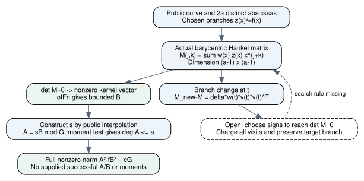

# Actual public signed Hankel reconstruction

2026-11-13. Source17fd598fdfb9860b819d590c7986f959274b7558.
Unsigned producer evidence [pcc:unverified].

The public branch reconstruction problem now has an explicit smaller Hankel
matrix and a source-bound certificate theorem. For D=2a distinct abscissas,
the bounded branch equations with degA<=a, degB<=a-2 compress to an(a-1)-square
matrix. Its entries depend directly on the chosen public branches. A branch
change gives an explicit outer-product-form matrix update. The theorem
publicInputCertificate constructs the actual interpolant and obtains a nonzero
bounded norm pair from singularity of this matrix; no planted F/H, supplied
successful A/B, moment oracle or numeric rank is assumed [pcc:unverified].



[Report PDF](report.pdf), [editable DOT](hankel.dot), [LaTeX](report.tex),
[prospective contract](../SIGNED_HANKEL_PROTOCOL.md),
[Lean module](../lean/NormSignedHankel.lean),
[native source](../native-recovery-control/src/signed_hankel.rs),
[original fixed-control artifact](../signed-hankel-evidence/native-control.json),
[claim pins](../signed-hankel-evidence/claim-pins.json).

## Public construction and exact hypotheses

Let K be a field, S a finite set of abscissas, |S|=2a, a>=2, and f a polynomial
of degree exactly3. Public branch values z(x) satisfy z(x)²=f(x). Define

    G = product_(x in S)(X-x),
    w_x = 1 / product_(t in S, t!=x)(x-t),
    M(j,k) = sum_(x in S) w_x z(x) x^(j+k),   0<=j,k<a-1.

Distinctness is supplied by the set S; its product is the actual monic G, not
an arbitrary polynomial assumed to have the right evaluations. The matrix is
symmetric and Hankel by its literal entries. On cryptographic prime curves,
restrict to p>3 and valid nonzero branches/prime subgroup points as in the
original reduction. The algebraic certificate itself needs only the explicit
field, degree, cardinality and point-equation hypotheses [pcc:unverified].

Set s=Lagrange.interpolate(S,id,z). For any B of degree<a-1, set A=sB modG.
The actual degree cutoff is

    degA<=a  iff  M*coeff(B)=0.

Given detM=0, standard finite-field linear algebra supplies a nonzero kernel
vector. Polynomial.ofFn constructs its B and degree bound, rather than assuming
the coordinate conversion. The actual Lagrange interpolant gives branch values
at every node; the actual product divides s²-f and A-sB. The prior direct
certificate then gives

    A²-fB²=cG, c!=0.

No nonzero-norm oracle is needed: for f of odd cubic degree and B!=0, a zero
norm would force the contradictory degree identity2degA=3+2degB. Non-singularity,
subgroup membership, final group/scalar interpretation and complete bit cost
are not replaced by this polynomial statement [pcc:unverified].

Central unsigned claims: degree equivalence PCC-20261113-864c3f;
finite singular-matrix extraction PCC-20261113-227e72; explicit public-input
certificate PCC-20261113-e1c10e.

## Why the compression is not an assumed parity-check oracle

For any monic G and R of degree<degG, the formal finite test is

    degR<=a  iff  coeff_(degG-1)((R X^j) modG)=0
                    for all j<degG-a-1.

Forward: the degree of each tested product is below degG-1, so reduction does
nothing and the coefficient vanishes. Reverse: if R had a forbidden highest
coefficient, choose j=degG-1-degR. The product has degree exactly degG-1 and
its top coefficient is nonzero, contradicting that test. Zero R is handled
separately; no generic-rank assumption appears [pcc:unverified].

For actual node products, Mathlib's Lagrange.coeff_eq_sum gives

    coeff_(|S|-1)(P modG) = sum_(x in S) w_x P(x).

Remainder evaluation at each actual node is proved, then the finite B
coefficient sum is expanded and exchanged. For |S|=2a, the number of tested
moments is a-1, producing exactly the displayed Hankel matrix. This is a
faithful target-aware public family, distinct from the earlier moment matrices
constructed from supplied F/H and independent of the target G
[pcc:unverified].

## Actual branch update and the search still required

Changing z(t) by Delta changes M by

    M_new-M = Delta*w_t*v_t*v_t^T,   v_t=(1,t,...,t^(a-2)).

This identity is universal for the displayed finite matrix, including singular
M. A sign flip has Delta=-2z(t). It is a different family from the original
W_base+C(T)H(T) jet proposal; no map from that family is asserted. For a
DLP-oriented use with a fixed target node, keep that node's branch fixed.
The native tests flip all nodes only to check the update identity, not as a
claimed target-valid search procedure [pcc:unverified].

The remaining finder must choose signs so that this actual M is singular.
A continuous matrix repair must also retain z(x)²=f(x); arbitrary field-valued
weight corrections are not sign choices. Exact entry updates and faster
singularity checking do not supply a bound on the number of branch assignments
visited [pcc:unverified].

A direct fixed-target sign scan still has2^(D-1) assignments. Rebuilding and
solving M by ordinary polynomial-time field arithmetic gives that exponential
factor times a polynomial in D and log p. Structured Hankel solvers or updates
can change the polynomial factor; no exponent change or measured speedup is
established by this component. For D=Theta(log r), the full required bound
remains exp(o(log r)), including point/base construction, rejected assignments,
linear algebra, divisors and final scalar verification [pcc:unverified].

## Fixed native comparison, not a branch-search panel

One write-once artifact uses f=X³+2X+2 over F17 and the same two supplied public
branch assignments as the parent protocol. Actual barycentric weights for
abscissas[0,3,5,6,10,13] are[4,9,15,14,16,10]. The full6-by6 public point rows
and compressed2-by2 matrix have matching kernels in both directions. Every
returned B is interpolated to A and checked against original rows, all point
equations, degree bounds and the full nonzero norm [pcc:unverified].

| Supplied branches | Actual Hankel matrix mod17 | Determinant | Kernel dimension |
|---|---|---:|---:|
| (0,6),(3,1),(5,1),(6,3),(10,11),(13,7) | [[13,15],[15,16]] | 0 | 1 |
| Only (13,7) changes to (13,10) | [[9,14],[14,3]] | 1 | 0 |

The positive reconstruction returns A=[14,2,7,3], B=[8,1], c=9, ascending
coefficients. For each of the two assignments, all six single-branch matrix
updates are checked entrywise. A separate Leibniz determinant computation also
checks the cofactor-quadratic determinant-update formula for these2-by2
fixtures. That determinant formula is a finite native check here; the universal
Lean statement in this component concerns the literal matrix update
[pcc:unverified].

The positive single-flip determinants are[14,8,16,15,14,1], in the listed node
order. Those exact finite observations do not establish a distribution or
search advantage. Wrong-weight construction must change the literal matrix
and reject the returned positive candidate:1 actual positive candidate check.
The flipped assignment has no candidates and explicitly records0 such checks;
no vacuous rejection is counted as an executed candidate test
[pcc:unverified].

Artifact SHA256cd8309d1676f30582e391dc788d7d78b812e32b381b58cc0f3b05e83e2afbb90;
unsigned data claim PCC-20261113-a6a482. Two original tests plus the earlier
seven pass:9 total in tests001 and002. Clippy001 fails on an unnecessary
allocation;002 passes after a slice-only repair. Tests002 additionally check
the explicit candidate-check count. No timing, statistical yield, random sign
search, DLP search, EKS or paid run was executed.

## Formal proof map and evidence

All declarations below are in NormSignedHankel.lean. Fourteen new statements;
source build005 passes and prints only propext, Classical.choice and Quot.sound.
Whole-study source gate passes245 statements with0 additional trusted axioms.
The separate fresh import-inclusive replay has its actual status/exit in
[checks.json](../signed-hankel-evidence/checks.json) and fresh-status.json;
do not infer success from an empty still-running log [pcc:unverified].

| Exact component | Declaration |
|---|---|
| Finite degree-cutoff equivalence | momentDegreeIff |
| Actual remainder evaluation | remainderAtNode |
| Explicit barycentric top coefficient | barycentricMoment |
| Actual node-product divisibility | nodalDivides |
| Literal coefficient/Hankel row identity | rowExpansion |
| Public Hankel/degree equivalence | hankelDegreeIff |
| Cubic norm nonzero | cubicNormNonzero |
| Kernel equations give full norm | publicHankelCertificate |
| One public-branch moment update | branchUpdate |
| Finite matrix/ofFn coefficient identity | matrixRow |
| Actual singular matrix supplies B | singularHankelCertificate |
| Symmetry of actual matrix | hankelSymmetric |
| Literal rank-one-form matrix update | matrixBranchUpdate |
| Constructed public interpolant and norm pair | publicInputCertificate |

Build001 and002 fail on proof-interface details;003 passes with an unused
section-variable warning;004 removes it;005 supplies the public interpolant.
All original logs/exits remain. No proof source, old artifact or old source
receipt is rewritten. The native extension changes only three helper
visibility annotations plus a new route/module in the earlier source tree;
older evidence remains tied to its original commits, not relabelled current.
Maintained default-PATH source-only PCC checks are all not_covered, separate
from the actual explicit-toolchain source gate and fresh replay. No signature
or independent signed verdict is supplied.

Pinned Lean4.35.0, CryptoLean148f5dc389b341401e06d76abe7783c4ccf42f2e,
Mathlibcfc55fc58714a59dc06e6e79edc6d1d95140d3c2. Reproduce:

```sh
lake -d research/prime_norm_rank_20261112/lean build NormSignedHankel
lake -d research/prime_norm_rank_20261112/lean env leanchecker --fresh --verbose NormSignedHankel
bash tools/lean/proof-gate.sh --out /tmp/new-signed-hankel-gate research/prime_norm_rank_20261112/lean
cargo test --locked --release --manifest-path research/prime_norm_rank_20261112/native-recovery-control/Cargo.toml
```

## Primary-source review and effect on this attempt

KB unavailable: MCP status/search/theorem tools absent; canonical repository
wrapper exits127 (no executable). Bounded fallback includes prior committed
norm/moment/public-jet sources and the following opened primary papers:

- [Zeh, Gentner, Augot,1110.3898](https://arxiv.org/abs/1110.3898), sectionsII/III: equation3 supplies the GRS dual barycentric weights; Hankel/key-equation structure is prior art, not a novelty claim for this representation.
- [Cheng,cs/0507026](https://arxiv.org/abs/cs/0507026), sections3/4: worst-case elliptic-code distance reductions and a conditional DLP connection; these do not establish a lower bound for our ordinary-curve/random-input distribution or forbid sub-exponential algorithms.
- [Li, Wan, Zhang,1501.01138v2](https://arxiv.org/abs/1501.01138), introduction and Proposition4.1: code-distance/subset-sum equivalence and dense-evaluation-set results. The large setup and decision/witness distinction must be charged, not replaced by a small public finder.
- [Iwata,ISAAC2017](https://doi.org/10.4230/LIPIcs.ISAAC.2017.1), section2: linear matroid parity seeks independent unions of pairs. The present dependent one-from-each-pair search has not been reduced to it; its polynomial bound cannot simply be imported.
- [Mahalanobis,2607.09814v2](https://arxiv.org/abs/2607.09814v2), introduction: fixed-defect work and success probability are distinct; the author explicitly accounts for the latter. This prevents treating a polynomial determine step as a total-cost breakthrough [pcc:unverified].

The UCI mirror and one adjacent matroid preprint returned502; accessible arXiv
primary versions supplied the former's content. No exhaustive or novelty claim.
No source text or whole external paper is republished.

## Research decision and next test

Retain the actual public signed Hankel family and exact branch-update map as
the next search interface. The next discriminating question is whether a
constrained branch update/search rule yields fewer counted visits to a singular
matrix, while retaining the target branch and full norm/degree checks. In
particular test continuous determinant repair against the point equations,
and investigate the corank/uniqueness structure before proposing a rank gradient.
No such advantage is established by these fixed controls [pcc:unverified].

[Problem record](../../../problems/prime-norm-public-branch-selection.md).
The original goal remains general prime curves, a novel non-generic finder
and a uniform complete sub-exponential bit-cost proof. No global existence or
nonexistence theorem follows from this component. Prior rank/cofactor/jet
reports and graphs remain unchanged; the new diagram covers the explicit
public family only. No performance/leaderboard result is promoted.
