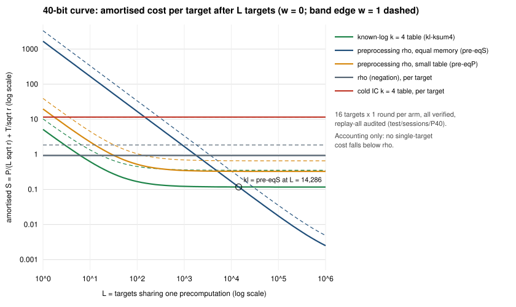
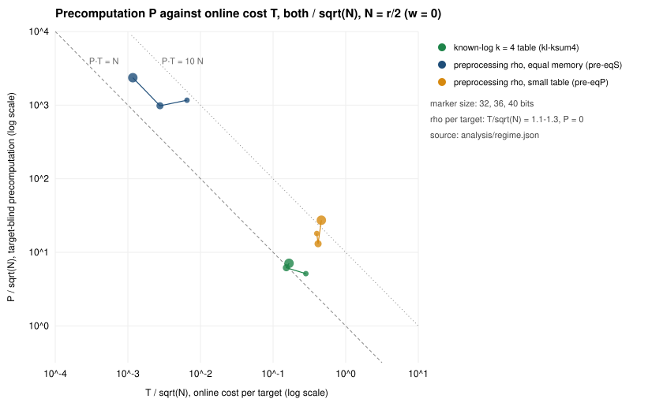

# Prime-field precomputation regime: known-log k-sum table against preprocessing rho

**Class: control and accounting.** Nothing here is an improvement under the
success criterion. Multi-target and precomputation numbers are accounting.
They are not a cheaper single-target attack, and no single-target cost in
this study falls below rho's. Public synthetic curves; no security claim.

This study covers leads 2 and 3 of the 2026-10-28 prime-field list:

- **lead 2:** compare at equal memory against preprocessing rho;
- **lead 3:** share the table across many targets.

It is stacked on [`../prime_ksum_table_20261028/`](../prime_ksum_table_20261028/)
(isogeny-labs/crypto#2808).

**Labels.** `[measured]`: a native `ecbench` record in this directory.
`[derived]`: computed by [`derive.mjs`](derive.mjs) from those records.
`[predicted]`: from the registered cost laws in [`PROTOCOL.md`](PROTOCOL.md).

## 1. Question and arms

The k = 4 sum table of #2808 is built before any target arrives. Two
questions follow from that:

- At equal memory, how does it compare with the fair generic rival,
  preprocessing rho (Bernstein–Lange 2013)?
- Once the base logs are known, how many targets does the table take to pay
  for itself?

The arms are registered in [`PROTOCOL.md`](PROTOCOL.md) (hash in
[`REGISTRATION.sha256`](REGISTRATION.sha256)):

| arm | method | what it is |
|:--|:--|:--|
| `kl-ksum4` | `ic.known_log_ksum_v1` (new) | Known-log base `[s_i]G` with the k = 4 sum table. Online: `Q + [a]G`, one probe per query. A hit gives the log directly, with no matrix. |
| `pre-eqS` | `rho.preprocessing` (new) | Preprocessing rho on `{P, −P}` with the same number of stored entries as `kl-ksum4`'s table (equal memory). |
| `pre-eqP` | `rho.preprocessing` | Preprocessing rho sized for equal precomputation: `entries = round(P²/(r/2))`, with `P` measured on the train panel (frozen in [`params.json`](params.json)). |
| `ic-ksum4` | `ic.pipeline`, `ksum:m=4` | The cold IC row of #2808 (frozen A). |
| `rho-neg`, `rho-neg-aa` | `rho.negation` | Reference and A/A control. |

**Curves.** The frontier's `a = −3` rungs:

- `icv1-fp32-t7319-90da43e9`
- `icv1-fp36-t454193-44a20818`
- `icv1-fp40-tm924137-0ecaaeb9`

**Targets.** Seed `20261015200`, 16 targets per curve:

- 32 and 36 bits: 2 rounds;
- 40 bits: 1 round, as registered, because `pre-eqS` precomputes about
  1.7·10⁹ operations per run there.

**Sessions.**

- `ECBS1h762cf9a17c62` (P32)
- `ECBS1hf392452a7546` (P36)
- `ECBS1hdc75deb894a4` (P40)

## 2. Integrity `[measured]`

- **Every answer verified.** 288 + 288 + 192 records, no failures.
- **`ecbench verify --replay-all` reproduces every replay.** 192, 192 and 96
  replays, 0 problems. Receipts: [`analysis/verify-P32.json`](analysis/verify-P32.json),
  [`analysis/verify-P36.json`](analysis/verify-P36.json) and
  [`analysis/verify-P40.json`](analysis/verify-P40.json).
- **Binaries** (hashes in [`BINARY.sha256`](BINARY.sha256)).
  - The train panel ran `ecbench-k5`, an earlier build of this PR's code.
  - The test panel and every audit ran `ecbench-v2`, built from 26249b4
    plus this PR's code diff.
  - `ecbench-v2 verify --replay-all` reproduces all 24 train records
    ([`train/audits-v2/`](train/audits-v2/)), so the frozen `S_P` does not
    depend on which build measured it.
  - The PR merges that diff onto a later main. The receipts are of the
    binary named here, not of the merged tree.
- **Order of events.** Registration (18:35:10 PDT), then the train panel,
  then `params.json` (18:35:36), then the test specs (18:35:37).
- **A/A control.** `rho-neg` and `rho-neg-aa` agree exactly. They share
  seeds and the walk is deterministic, so this checks determinism only.
  `band` calls the pair "unresolved inside the band", as it should.
- **Cross-check.** The cold `ic-ksum4` reproduces the k = 5 study's panel
  (same targets): identical at 32 and 36 bits. At 40 bits it is within 0.3 %,
  because this panel has one round and that one has two.

## 3. Results `[measured]` and `[derived]`

Online `S = T/√r` and set-up `S = P/√r`, each at `w = 0 / 0.1 / 1` GAE per
unpriced operation (AGENTS §5a). Full table: [`analysis/regime.md`](analysis/regime.md).

| bits | arm | online S (±95 %) at w = 0 | online S, w = 0.1 / 1 | set-up S, w = 0 | entries | L* vs rho | P·T/N (w = 0 / 0.1 / 1) |
|--:|:--|--:|:--|--:|--:|--:|:--|
| 32 | kl-ksum4 | 0.200 ± 0.068 | 0.240 / 0.597 | 3.63 | 219,240 | 6.2 | 1.45 / 1.90 / 8.33 |
| 32 | pre-eqS | 0.0046 ± 0.0006 | 0.0049 / 0.0078 | 825 | 219,240 | 1,057 | 7.60 / 8.94 / 25.7 |
| 32 | pre-eqP | 0.283 ± 0.170 | 0.311 / 0.564 | 12.7 | 26 | 25.4 | 7.20 / 8.71 / 28.7 |
| 36 | kl-ksum4 | 0.108 ± 0.035 | 0.129 / 0.322 | 4.36 | 1,085,963 | 5.9 | 0.94 / 1.23 / 5.48 |
| 36 | pre-eqS | 0.0020 ± 0.0004 | 0.0021 / 0.0035 | 694 | 1,086,008 | 815 | 2.72 / 3.23 / 9.76 |
| 36 | pre-eqP | 0.295 ± 0.162 | 0.324 / 0.589 | 9.24 | 38 | 16.6 | 5.44 / 6.59 / 21.8 |
| 40 | kl-ksum4 | 0.117 ± 0.049 | 0.141 / 0.351 | 5.01 | 5,082,963 | 6.2 | 1.18 / 1.55 / 6.93 |
| 40 | pre-eqS | 0.0008 ± 0.0003 | 0.0009 / 0.0015 | 1,668 | 5,083,008 | 1,802 | 2.76 / 3.30 / 10.3 |
| 40 | pre-eqP | 0.327 ± 0.306 | 0.359 / 0.653 | 19.3 | 50 | 32.2 | 12.6 / 15.3 / 50.5 |
| 40 | rho-neg | 0.926 ± 0.163 | 1.019 / 1.852 | — | — | — | — |
| 40 | ic-ksum4 | 11.52 ± 0.43 | 12.82 / 24.54 | — | — | — | — |

The crossover between `kl-ksum4` and `pre-eqS` in amortised cost, at
w = 0 / 0.1 / 1:

| bits | crossover (targets) |
|--:|:--|
| 32 | 4.2 k / 3.9 k / 2.8 k |
| 36 | 6.5 k / 6.0 k / 4.3 k |
| 40 | 14.3 k / 13.1 k / 9.5 k |

Against `pre-eqP` there is no positive crossover at 36 and 40 bits: `kl`
costs less in both P and T.

### Predictions against measurement (40 bits, w = 0)

| quantity | predicted | measured |
|:--|--:|--:|
| `kl-ksum4` set-up S | 5.3 | 5.01 |
| `kl-ksum4` online S | 0.10 | 0.117 |
| `pre-eqS` set-up S | 1,594 | 1,668 |
| `pre-eqS` online S | 0.0006 | 0.0008 |
| `pre-eqP` online S | 0.19 | 0.33 |
| `L*` for `kl-ksum4` | 7 | 6.2 |
| kl/pre-eqS crossover | 15 k | 14.3 k |

## 4. Registered readings

1. **Equal memory, online: holds.** At 40 bits `pre-eqS`'s online S is below
   `kl-ksum4`'s by 142×, 157× and 229× at w = 0, 0.1 and 1, against the
   registered ≥ 10×. Its precomputation costs 333–339× more. The advice
   comparison stands: preprocessing rho sits on `E·T² ≈ N` (6.96 at w = 0).
   The known-log table sits about `N/E` above it (1.4·10⁵).
2. **Products: partly holds.** At 40 bits `P·T/N` is:
   - `kl-ksum4`: 1.18 and 1.55 at w = 0 and 0.1, inside [0.5, 2]. At w = 1
     it is 6.93, outside.
   - `pre-eqS`: 2.76 and 3.30, inside [1.5, 6]. At w = 1 it is 10.3,
     outside.
   - `pre-eqP`: 12.6, 15.3 and 50.5, outside at every w.

   For `kl` and `pre-eqS`, only the w = 1 values fail. There each lookup is
   priced, which the count law does not include.

   For `pre-eqP` the failure has two causes, both read off its counters:
   - Its precomputation overshot the equal-P target by 3.85×. To keep 50
     distinct distinguished points at 40 bits it ran 91 walks: 37 ended on a
     point already stored and 4 were capped. The sizing rule
     `S_P = P²/(r/2)` ignores this trail merging.
   - Its online walk is 1.7× the predicted length.

   **So `pre-eqP` is not at equal precomputation.** It spent about 4× more
   than `kl-ksum4` and still has a larger online cost.
3. **Equal precomputation ranking: not resolved.** `kl-ksum4`'s online S is
   below `pre-eqP`'s at 36 and 40 bits at every w, as point estimates.
   - At 32 bits the order flips at w = 1 (0.597 against 0.564), as the
     protocol anticipated.
   - The 95 % intervals overlap at every size. `pre-eqP`'s spread is wide,
     because each online walk ends at one of only 26–50 stored points.

   So no §5a ranking is claimed. What does hold, as point estimates at 36
   and 40 bits, is that `kl-ksum4` used less precomputation **and** less
   online work than this `pre-eqP`.
4. **Break-even: holds.** `L*` for `kl-ksum4` is 6.2 at 40 bits, against the
   predicted 7.

## 5. What this means

- **For the success criterion: nothing changes here.** This study's cold
  single-target arm is #2808's `ic-ksum4`, at S = 11.5 on 40 bits, 12.4×
  rho. The k = 5 table, landed in the same PR
  ([`../prime_ksum_k5_20261028/`](../prime_ksum_k5_20261028/)), is the new
  generic-decomposition baseline on these curves (generic decomposition (bounded by √r; cannot beat rho)). The known-log
  table's online cost (0.117) is below rho's only after a target-blind
  precomputation of 5.0 √r. That is the ordinary precomputation trade, and
  preprocessing rho makes it better at equal memory beyond about 14 k
  targets.
- **The table method sits on `P·T ≈ N` but far above `E·T² ≈ N`.** For a
  fixed memory budget, preprocessing rho is the stronger generic method by a
  factor of about `N/E`. A table method is competitive only when
  precomputation, not memory, is the constraint, and only for fewer than
  about 10⁴ targets.
- **The equal-P comparison needs a better sizing rule.** A rerun would size
  `pre-eqP` by measured precomputation cost, not by `P²/N`. That would lower
  its entries below 50 and make its online walk even longer, so the
  qualitative outcome should not change. It is listed as a next check, not
  run.

## 6. Limitations

- Toy sizes only, 32–40 bits, on one curve family (`a = −3`, prime order).
- 40 bits has 16 runs per arm. `pre-eqP`'s interval there is ±94 % of its
  mean.
- The GAE pricing of lookups is the §5a band, not a hardware model.
- `pre-eqP` missed equal precomputation (reading 2).

## 7. Files

- [`PROTOCOL.md`](PROTOCOL.md), [`REGISTRATION.sha256`](REGISTRATION.sha256),
  [`BINARY.sha256`](BINARY.sha256), [`params.json`](params.json),
  [`make_specs.sh`](make_specs.sh) (`bash make_specs.sh train|test`), and
  `base-specs/`.
- `train/` and `test/`: specs and native sessions (`records.jsonl`, `plan.json`, …).
- [`derive.mjs`](derive.mjs) writes [`analysis/regime.json`](analysis/regime.json)
  and [`analysis/regime.md`](analysis/regime.md). [`plot.mjs`](plot.mjs) writes
  the two figures. Both are thin tooling over the native records.
- `analysis/verify-P*.{json,log}` (test) and `train/audits-v2/` (train): replay-all audits.
  [`analysis/band.txt`](analysis/band.txt) and `analysis/band.json`: the
  §5a band of the cold per-run costs.
- `report.pdf`: this README rendered.
