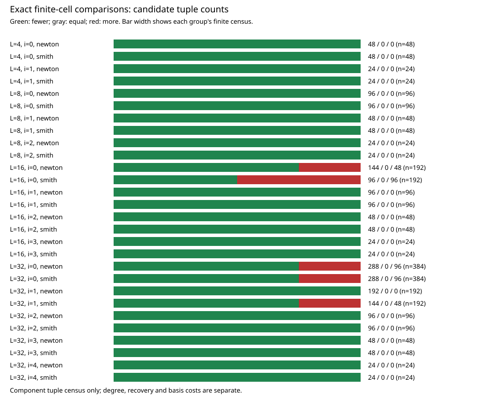

# Approved local panel: gains, regressions and exact replay

Both frozen panel invocations completed with exit0. Each contains1344 input
cells and2688 method rows. Replay is byte-identical. A separate native grouped-
generating-function implementation recomputes all5376 original/candidate tuple
counts from the recorded histograms. The outcome is mixed, with no uniform
tuple-count improvement on this panel. Producer claim PCC-20261107-a69063 has
standing unverified pending trusted signed verification. [pcc:unverified]

| Factorization | Candidate fewer tuples | Equal | Candidate more tuples |
| --- | ---: | ---: | ---: |
| Newton moments | 1200 | 0 | 144 |
| Smith modes | 1104 | 0 | 240 |

These are counts of matched finite cells, not runtimes or ECDLP speed ratios.
All cells, ties and losses are retained. No sample or precision was expanded
after seeing the outcome. [pcc:unverified]

[Publication figure](reports/local-20261107/comparisons.pdf),
[two-page report](reports/local-20261107/report.pdf),
[all per-level counts](reports/local-20261107/per-level.csv),
[exact summary](reports/local-20261107/summary.json).

## A concrete regression and its mechanism

For L32,t=-31,zeta=-1,q16, the original Smith factorization admits16 exponent
tuples and the normalized square admits33. The original surviving mode
histogram is6:2,8:2,12:2,14:2; the candidate is12:2,13:30. Thus the minimum
weight rises6 to12 while the number of surviving modes rises8 to32. Since
two candidate modes already exceed the budget, its count is exactly
1+2+30=33. This is the worst recorded Smith ratio,33/16 more candidate tuples.
[pcc:unverified]

The regression repeats at multiple odd nodes and all three registered zeta
samples. Newton also regresses at some L16/L32 level0 cells; Smith additionally
regresses at some L32 level1 cells. The complete per-level table is linked
above. Largest observed tuple-count reductions occur elsewhere, but do not
cancel these failures of uniformity. [pcc:unverified]

This gives a specific reason the valuation-only intuition fails in these
cells: dividing by the difference-dependent unit normalizer introduces many
additional surviving directions. The previous fixed unit counterexample to
naive normalizer-difference weights is consistent with this observation.
CPU contention cannot change these exact integer counts; the identical replay
is a reproducibility check, not an isolation or timing certificate.
[pcc:unverified]

## What ran and what was checked

The unchanged [version1 protocol](protocol.json), frozen before affected data,
has hash44899fb67b85f2c1403e92bc24057f58e56e08e29d8734e3c5ab94ff3cff5de6.
Instrument source4d8292ec8b4194c51f0648176e306ec0f430dc6f and binary
83de01c9153210582abd6417eab13e58379ef25794c01fb758bae41bb67c4d2e match
the published preflight. The user-approved backend exception is recorded in
[local-override-20261107.json](local-override-20261107.json).

Each invocation used one pinned logical CPU, a2GiB address-space limit and a
900s deadline. Both completed; there were0 panel failures,0 retries,0 excluded
cells and0 cloud jobs. The fixed positive/negative units ran before the panel.
Every row, tile and mode histogram is retained. Native code asserts exact
Newton reconstruction, full modular Smith reconstruction, unit normalizers,
pointwise valuation doubling and the doubled-original positive control.
The independent analyzer checks every expected identity once, rejects missing/
duplicate/extra cells and recomputes tuple counts with a different formula.
[pcc:unverified]

Raw native CSVs are timestamp-free gzip archives under runs/. Their original
byte counts and hashes are in raw-bindings.json. Two OS panel invocations
produce10752 logical arm/factorization/cell/replicate observations in the
export representation; these are not10752 independent process executions.
No clock values are used as measurements. [pcc:unverified]

The original native checker computes the primary metrics. analyze.cpp was
implemented after launch, before inspecting the data, to implement the already
specified strict integer comparisons and per-level grouping and to independently
validate counts. It is not claimed to be the preregistered analysis source.
No threshold, input, exclusion or metric was changed. render.py only lays out
the already-native counts; it performs no scientific recomputation.

## Protocol/export error: retained, not waived

Version1 incorrectly declared the embedded positive/negative checks and whole-
panel replay as separate full-panel arms. It also counted input cells rather
than including factorization in the logical instance identity. The native
workload in PROTOCOL.md is complete, but that JSON row model cannot faithfully
represent it. The original full protocol/export cross-check reports5384
findings, including the missing separate control arms and cardinality mismatch.
No additional measurements were invented to fill those rows.

A [retrospective export-layout draft](protocol-export-v2.json) records the
correct two-arm logical mapping and explicitly marks the amendment as filed
after affected data. The maintained tool refuses to freeze it for that reason.
Both export documents pass JSON schema validation; neither passes full
protocol validation. The corrected draft has one full-check finding: the
post-data amendment. The checker and gates were not changed or bypassed.
These results remain descriptive component observations, not a validated
comparative claim or leaderboard promotion. [pcc:unverified]

Both export versions, the failed initial formatter output, the freeze refusal
and all validation findings are preserved in compressed form. Archive hashes
and original byte counts are in export-archive-bindings.json. The first
formatter schema error (string notes instead of observation objects) is also
retained and corrected without altering any experimental values.

## Interpretation and next discriminating construction

The candidate does not deliver uniform improvement in the tested q8--24
range. Its polynomial degree is4L-2 rather than2L-1; recovery and basis costs
are additional, and were not included in the same-q tuple comparison. The
panel samples rational integer chart points, not every extension-ring jet.
It therefore neither establishes nor rules out a different asymptotic result
at the source recursion's larger precisions. [pcc:unverified]

A post-data idea for the next proof/test is to move normalization out of the
row/column difference: interpolate inverse node normalizers into one common
scalar R(T), then examine R(T)*B_delta(T)^2. The aim is to retain a simple
two-pole moment expansion rather than import the rough delta-dependent
normalizer into every entry. Its node identity, chart unit/integrality,
polynomial degree, recovery precision and total mode cost need proof or a
separately registered test. It has not been run here and is not a novelty or
performance claim. The atlas query and pinned Cauchy/Lagrange sources are
finding aids, not a priority certificate. [pcc:unverified]

## Reproduce the saved-data analysis

`verify_saved.sh OUTPUT_DIR` unpacks both raw archives, builds the native
analyzer, reruns its fixed units, recomputes the complete census and compares
its summary/per-level table with the retained results. This does not launch
a third panel invocation. Signed independent replay is still outstanding.
[pcc:unverified]

The repository artifact service migrated the three larger XZ metadata archives
to content-addressed storage. Their .artifacts.json manifests retain exact
hashes/byte counts, matched against the retained local payloads. Raw CSV gzip
archives and the saved-data verifier remain in Git. Hydrate the larger exports
with the repository's maintained artifact-pull tool when inspecting them from
a fresh checkout; the original data and recorded validation failures are intact.
