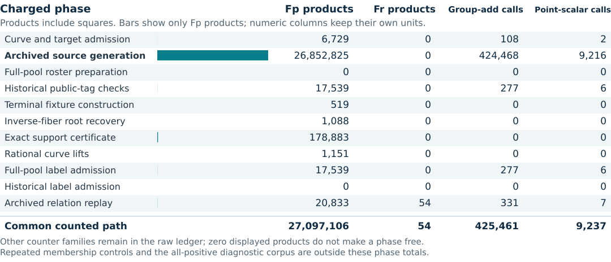
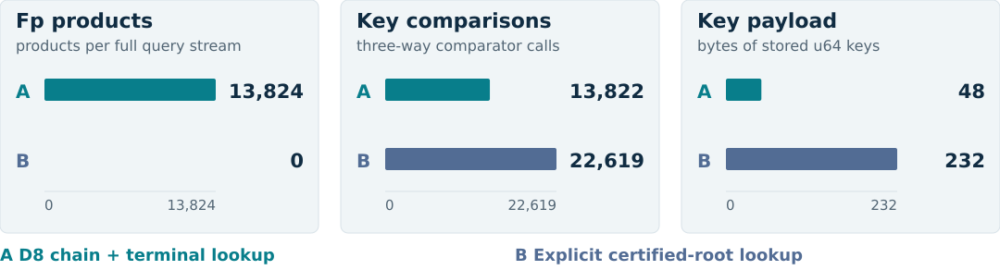

# M31 shared-selector operation census

**The fixed construction and archived-relation replay uses 27,097,106 counted Fp modular-product helper calls before a membership pass; 26,852,825 of those calls construct the archived public source.** On the same 4,608 coordinates, shared-chain membership uses 13,824 Fp products and 13,822 key comparisons, while explicit-root lookup uses no Fp products and 22,619 key comparisons. These are separate operation counts, not a timing or combined-cost ranking. [pcc:unverified]

The full 4,608-column source supplies exactly **3 of the 17 rational abscissae** in the selected support. Two measured invocations produced byte-identical JSON, and the six-test correctness suite passed. The selected terminals and useful row are historical fixtures; this measurement performs no new relation search. [pcc:unverified]

Start with the [PDF report](report/REPORT.pdf), [initial raw result](results/attempt-001/initial.json), [exact replay](results/attempt-001/replay.json), and [prospective protocol](PROTOCOL.md). The [parent study](../README.md) contains the capacity argument and construction background. Tracking: [PR #5217](https://github.com/isogeny-labs/crypto/pull/5217), following integrated [PR #5213](https://github.com/isogeny-labs/crypto/pull/5213).

## Fixed source problem and measured boundary

The [fixture identity](fixture-identity.json) specifies the original prime-field curve, subgroup, generator, representation, and public target:

```text
p = 2147483647
E: y^2 = x^3 + 847514846*x + 2087444724 over F_p
r = 2147446831
G = (625037715, 2100627251)
Q = (1477799919, 824532935)
```

The source reconstructs three lists of 1,536 publicly tagged points. The historical SplitMix64 seed, source order, selected indices, and signs are fixed by the [seed manifest](seed-manifest.json). The measurement replaces the source's ambient randomized HashSet builder with `BuildHasherDefault<DefaultHasher>`, pinned to Rust 1.100.0. It retains the original PRNG, duplicate-x predicate, arithmetic calls, rejection semantics, and accepted-point order. The full ordered x stream is stored in each raw result.

The counted path includes curve/target admission, the entire archived source, canonical roster preparation, historical public-tag checks, terminal construction, inverse fibers, exact support certification, rational lifts, full-pool and historical-roster admission, and archived relation replay. Repeated validation inside that path remains charged. Membership control repetitions and the all-positive diagnostic corpus are reported separately.

The final scalar is an archived expected output checked after public-tag and point replay. This is a known-answer construction/verification measurement. Time to a newly found relation, new relation yield, and an end-to-end ECDLP cost remain unset. [pcc:unverified]

## Counted work by phase

The following table transcribes Rust's `presentation_summary.phases`. Fp and Fr helper products include squarings and exponentiation products. Group-add calls and EC scalar calls retain their own units. All rows are unsigned producer observations. [pcc:unverified]

| Phase | Fp helper products | Fr helper products | Group-add calls | EC scalar calls |
|---|---:|---:|---:|---:|
| Curve and target admission | 6,729 | 0 | 108 | 2 |
| Archived source construction | 26,852,825 | 0 | 424,468 | 9,216 |
| Canonical full-pool roster | 0 | 0 | 0 | 0 |
| Historical columns and public tags | 17,539 | 0 | 277 | 6 |
| Terminal fixture construction | 519 | 0 | 0 | 0 |
| Recursive root recovery | 1,088 | 0 | 0 | 0 |
| Exact support certificate | 178,883 | 0 | 0 | 0 |
| Rational curve lifts | 1,151 | 0 | 0 | 0 |
| Full 4,608-pool label admission | 17,539 | 0 | 277 | 6 |
| Historical three-column admission | 0 | 0 | 0 | 0 |
| Archived relation replay | 20,833 | 54 | 331 | 7 |
| **Common counted path** | **27,097,106** | **54** | **425,461** | **9,237** |



Source construction's share of common-path Fp helper products is the exact unreduced fraction **26,852,825 / 27,097,106**. It is a share of this named counter, not a fraction of runtime. The 11 before/after/delta records reconcile with the cumulative vector. [pcc:unverified]

Zero displayed products do not make a phase free. Canonical roster preparation also records 58,502 point-tuple comparisons, 4,608 Fp subtractions, and 4,610 Fr subtractions. Historical-roster admission records 17 lookup queries and 33 point-tuple comparisons. The raw ledger preserves these additional counters. [pcc:unverified]

## Same-input membership comparison

Arm A evaluates the three-step chain `z -> z^2 - 2` once and binary-searches six terminals. Arm B binary-searches the 29 explicit roots of the identical support. Both use the same three-way binary-search comparison convention and reject noncanonical inputs before reduction.

Each corpus receives two A/A controls followed by five ordered pairs `AB, BA, AB, BA, AB`: 12 passes, seven A and five B. The same-arm counters and all output bitmaps agree. These repetitions check determinism; they are not independent instances or timing replicates. [pcc:unverified]

| Corpus and quantity, one pass | A: chain plus terminals | B: explicit roots |
|---|---:|---:|
| Full source: queries | 4,608 | 4,608 |
| Full source: accepted queries | 3 | 3 |
| Full source: Fp helper products | 13,824 | 0 |
| Full source: Fp subtractions | 13,824 | 0 |
| Full source: three-way key comparisons | 13,822 | 22,619 |
| All-positive support: queries and accepts | 29 | 29 |
| All-positive support: Fp helper products | 87 | 0 |
| All-positive support: three-way key comparisons | 59 | 119 |
| Stored u64 key payload | 48 bytes | 232 bytes |



The 48 and 232 bytes cover stored terminal/root keys only. They exclude vector headers, spare capacity, common modulus/depth parameters, source/roster data, and other live allocations. Heap use and RSS are unmeasured. The implementation holds shared construction/certificate data as well, so these payloads are not whole-process memory figures.

For the declared construction/replay path, adding exactly one full-source membership pass gives the following computed charged totals. The repeated controls and all-positive corpus are excluded. [pcc:unverified]

| Typed total | Common path + A | Common path + B |
|---|---:|---:|
| Fp helper products | 27,110,930 | 27,097,106 |
| Fr helper products | 54 | 54 |
| Group-add calls | 425,461 | 425,461 |
| EC scalar calls | 9,237 | 9,237 |

Arm A trades field arithmetic for fewer key comparisons and a smaller key array. This count vector does not establish a speed winner. A ratio against B's zero Fp-product count would not express a meaningful combined cost. [pcc:unverified]

## Full-pool admission and historical relation

The six fixed depth-three terminals produce 29 distinct field roots, 17 rational abscissae, and 34 signed curve lifts. The executable compares the inverse-fiber root product with the exact monic gcd against `X^p-X` and matches the frozen coefficient arrays. [pcc:unverified]

| Admission scope | Available source columns | Admitted canonical columns | Rejected rational abscissae |
|---|---:|---:|---:|
| Full reconstructed pool | 4,608 | 3 | 14 |
| Historical acceptance roster | 3 | 3 | 14 |

The complete-pool join admits exactly original column IDs **437, 2783, and 3951**. Thus the observed labeled support is `H=3` among `B=17` rational abscissae; it is not an inference from the three-column roster alone. The terminals were selected using the archived relation, so this ratio is a fixed-fixture observation, not a population yield estimate. [pcc:unverified]

The canonical signed row produces the archived values below and checks the final scalar against the original public Q. It was replayed using supplied historical indices, not discovered by this program. [pcc:unverified]

```text
alpha = 1144570523
beta  = 2011873483 != 0 mod r
d     = -alpha/beta mod r = 1038579171
[d]G  = Q
```

## Counter semantics and exclusions

The implementation counts native and custom modular-product helper calls, including squares and products inside exponentiation. The presentation summary adds those counts only within the same field. Fp products, Fr products, comparison calls, group calls, and EC scalar calls are never combined into an uncalibrated scalar cost.

Inversion and square-root call counters overlap their underlying products. Polynomial coefficient products overlap custom Fp products; polynomial division steps and updates are structural counters. Native group-add calls include identity, inverse-pair, doubling, and general-add cases and are not GAE. EC scalar-call counters are distinct from the legacy native field named `scalar_multiplications`, which counts Fr products.

Excluded work is explicit: hash-bucket probes, tree comparisons, allocation, copying, primality integer trials, native direct integer additions/subtractions and small-constant products, snapshot/assertion bookkeeping, frozen-value comparisons, formatting, and I/O. Native point/tag and curve checks are included in their named phases. This is an operation census with stated coverage, not an instruction-count or complete machine-cost measurement.

No clock calls, wall-time comparison, CPU-instruction claim, rho ratio, fastest-implementation claim, or new relation search is admitted. Command timestamps and the test harness's incidental duration remain provenance only. [pcc:unverified]

## Source, test, and replay custody

The measured source was published before execution at [84d656e47987be9b932276c25c6b9ee6cd8d318e](https://github.com/isogeny-labs/crypto/commit/84d656e47987be9b932276c25c6b9ee6cd8d318e). The [qualifier](QUALIFIER.md), [protocol](PROTOCOL.md), and [seed manifest](seed-manifest.json) fix inputs, counting semantics, execution order, and scope. The source tree was separately copied, hash-bound, and checked before each call; this is not a claim of OS-enforced read-only file permissions.

Both measured JSON files have SHA-256:

```text
c15d06b52255e93bc0ebd304da97fe670d1d62649e322a0c43aba797221c629d
```

The original run used Rust 1.100.0 (`0ef1bc386`, 2026-11-09), `--edition=2021 -O`, one logical CPU, one test thread, a 512-MiB virtual-memory limit, and a 60-second per-call limit with a three-second kill grace. The budget was one full-fixture correctness invocation inside the six-test suite plus two measured invocations. All six tests and both measured calls completed successfully; raw stderr files are empty. [pcc:unverified]

| Evidence | Purpose |
|---|---|
| [Initial result](results/attempt-001/initial.json), [replay result](results/attempt-001/replay.json) | Full ordered input stream, phase vectors, support, admissions, relation, and comparison passes |
| [Test output](results/attempt-001/tests.stdout) | Chain count, sqrt count, Fr inversion, phase accounting, membership equivalence, and complete-fixture tests |
| [Source inventory](results/attempt-001/source-manifest.sha256) | Copied source, qualifier, protocol, seed, and compile-time parent result hashes |
| [Binary inventory](results/attempt-001/binaries.sha256) | Historical executable hashes; rebuildable ELF files excluded from Git |
| [Build pre-call](results/attempt-001/build-precall.json), [build post-call](results/attempt-001/build-postcall.json) | Published source commit, compiler identity, flags, and build status |
| [Tests pre-call](results/attempt-001/pre-call-tests.json), [tests post-call](results/attempt-001/post-call-tests.json) | Correctness-call boundary |
| [Initial pre-call](results/attempt-001/pre-call-initial.json), [initial post-call](results/attempt-001/post-call-initial.json) | First measured-call boundary and output hash |
| [Replay pre-call](results/attempt-001/pre-call-replay.json), [replay post-call](results/attempt-001/post-call-replay.json) | Exact-replay boundary and output hash |
| [Frozen qualifier](results/attempt-001/frozen/measurement/QUALIFIER.md), [frozen source](results/attempt-001/frozen/measurement/src/main.rs) | Actual copied inputs to the original build |
| [Toolchain](results/attempt-001/toolchain.txt), [host](results/attempt-001/host.txt) | Execution environment metadata |
| [Benchmark record](../../../benchmarks/records/20261126T0236Z-m31-shared-selector-counts-r1.json) | Repository measurement-custody record |

Standing is unsigned producer evidence. Native arithmetic reuse and independent source review do not supply a separately signed PCC verdict. This archived fixture does not satisfy the exhaustive coordinate-input/matched-rho gate for a new PCC claim; this study mints no PCC ID. [pcc:unverified]

## Reproduction

The Rust crate has no external dependencies. Linux replay additionally uses Bash, `jq`, GNU `sha256sum`, `timeout`, `taskset`, `readlink`, and `rg`. The repository's benchmark-custody wrapper uses Python only to record commands and evidence; all scientific computations remain Rust. Use Rust 1.100.0, a clean checkout of the published study containing the retained attempt, and source files matching the measured revision above. CPU 0 must be available to the process for the frozen affinity command.

Run from the repository root. Choose a fresh record slug and an absolute attempt path that does not already exist. Initialize the record before building or executing the new attempt so it identifies the clean source checkout:

```bash
set -euo pipefail
cd "$(git rev-parse --show-toplevel)"
test -z "$(git status --porcelain)"
measurement_dir="research/primefield_relations_20261125/measurement"
measurement_attempt="$(pwd)/$measurement_dir/results/attempt-002"
test ! -e "$measurement_attempt"
export RUSTC="$(rustup which --toolchain 1.100.0 rustc)"
export BENCHREC_ISOLATION="local-counts-only-no-timing-admission"
BENCHREC=$(python3 tools/benchrec.py init \
  --slug m31-shared-selector-counts-replay-r2 \
  --problem component:m31/shared-selector-v1 \
  --curve urn:ec-record:1:sha256:25f8c5da71783a2f24c22f31fc6d8a2f4fb7e13151feb1555b9cca0b5e397194)
export BENCHREC

# Compilation creates frozen inputs and build manifests; it executes no workload.
bash "$measurement_dir/build.sh" "$measurement_attempt"
python3 tools/benchrec.py run "$BENCHREC" -- \
  bash "$measurement_attempt/frozen/measurement/run.sh" "$measurement_attempt" tests
python3 tools/benchrec.py run "$BENCHREC" -- \
  bash "$measurement_attempt/frozen/measurement/run.sh" "$measurement_attempt" initial
python3 tools/benchrec.py run "$BENCHREC" -- \
  bash "$measurement_attempt/frozen/measurement/run.sh" "$measurement_attempt" replay
cmp "$measurement_attempt/initial.json" "$measurement_attempt/replay.json"
cmp "$measurement_dir/results/attempt-001/initial.json" "$measurement_attempt/initial.json"
```

`benchrec.py init` prints the new repository-relative record path on **stdout** and an `export BENCHREC=...` hint on stderr. The command substitution above captures the path directly; it does not evaluate the hint. `benchrec.py run` then records each command, status, and duration under that record. Duration remains provenance, with no timing admission.

This recipe deliberately leaves the new benchmark record **open**. Before closing it, attach that attempt's raw results, source/build/pre/post-call manifests and test evidence with `add-raw`, register its typed native metrics with `metric`, and attach a source-linked report and figures. Use `close` with the appropriate measured/invalid/censored status only after the new evidence and interpretation are complete; closing also regenerates global progress. Do not repoint or reuse the original closed record. The [benchmark-record contract](../../../docs/benchmark-records.md) specifies custody and closeout.

The build and execution wrappers refuse replacement of the attempt or an existing call. They preserve separate manifests and raw streams. Retain any failed or capped attempt; a correction uses a new attempt directory and record. Existing source hashes can be checked from the repository root without executing the workload:

```bash
(cd research/primefield_relations_20261125/measurement/results/attempt-001 && \
  sha256sum --check source-manifest.sha256)
cmp research/primefield_relations_20261125/measurement/results/attempt-001/initial.json \
  research/primefield_relations_20261125/measurement/results/attempt-001/replay.json
```

For maintenance correctness checks, the main-push/manual study workflow also runs:

```bash
cargo test --manifest-path research/primefield_relations_20261125/measurement/Cargo.toml \
  --offline --locked --release --bins -- --test-threads=1
```

Maintenance CI is correctness-only and does not publish a new measured result or close a benchmark record. Its full-fixture unit test performs a complete counted path; the other tests exercise fixed counter and membership contracts. These checks remain separate from the bounded measured attempt and its benchmark custody.

## Publication scope and storage

**Dashboard exclusion (AGENTS §7d):** this unsigned typed census has no priced S/GAE value, IC/rho ratio, new-best result, ecbench session, or verdict change. It therefore does not promote a priced leaderboard row or alter the curve scoreboard. The global `benchmarks/progress/` report is regenerated from the closed benchmark record; this README and the local figures remain linked diagnostics. [pcc:unverified]

**Loose-file exception (AGENTS §13a):** replay manifests, report links, and hash inventories name individual `attempt-001` paths. Those records and frozen inputs stay loose so the references continue to resolve. `initial.json` and `replay.json` are each 168,207 bytes. The current artifact policy applies its generic 1-MiB threshold to `.json`, which is not a `DATA_EXT` suffix; these files are not compressed or archived. Rebuildable ELF binaries are excluded while their historical hashes remain in the binary inventory.

The counted result identifies the arithmetic work and the exact membership tradeoff of this fixed construction/replay. A newly useful relation extractor and a qualified whole-pipeline comparison remain separate work.
