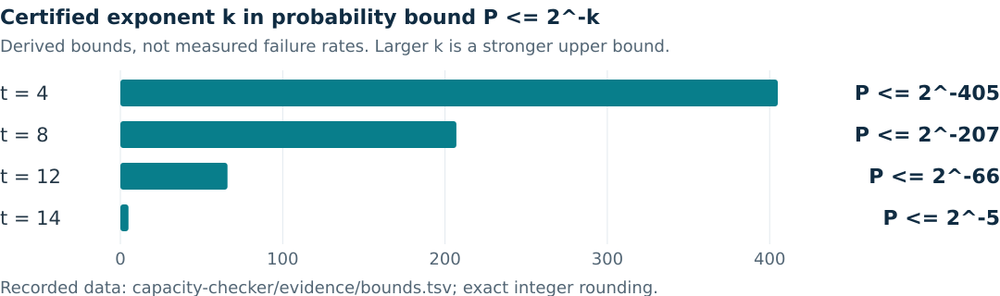
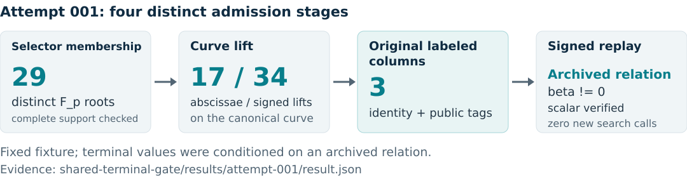

# Prime-field relation finding: shared selectors and public tags

25 November 2026. **Standing: [pcc:unverified]. Impact: 3/10.**

This fixed-content brief typesets the completed study. It introduces no new research calculation, experiment, or algorithm. Research implementations and arithmetic certificates are Rust; `render_report.py` only renders recorded data and text using ReportLab.

## Completed components

A scoped capacity bound and a native M31 replay connect selector membership to original public labels. The canonical field prime is `p = 2147483647 = 2^31 - 1`, and the group order is `r = 2147446831`.

The capacity model samples `N = 32768` distinct nonidentity negation classes uniformly without replacement from `M = 1073723415`. Chains contain at most ten reduced quadratic rational maps; each fiber has capacity at most 1024. The event is capture of at least 128 sampled classes in at most `t` selected fibers. Both chain fitting and terminal selection are adaptive.

| Selected fibers t | Certified probability upper bound |
|---:|---:|
| 4 | 2^-405 |
| 8 | 2^-207 |
| 12 | 2^-66 |
| 14 | 2^-5 |

These are conditional mathematical probability bounds, not measured failure rates or universal ECDLP lower bounds. Four Rust tests passed and 62 full exact rational certificates were retained. See [the recorded table](../capacity-checker/evidence/bounds.tsv), [exact certificates](../capacity-checker/evidence/certificates.json), and [test output](../capacity-checker/evidence/tests.txt).

## Exact support and archived signed replay

Attempt 001 used the depth-three Dickson chain with six selected terminals. The terminals were conditioned on an archived relation; this is a fixed correctness fixture. The gate passed two Rust tests and all 47 recorded assertion entries, covering 31 distinct check names.

| Admission stage | Recorded count |
|---|---:|
| Distinct selector roots in F_p | 29 |
| Rational curve abscissae | 17 |
| Signed curve lifts | 34 |
| Original publicly labeled columns in the replay roster | 3 |

The archived relation has `alpha = 1144570523` and `beta = 2011873483 != 0 mod r`. Its replay recovers `d = 1038579171` and verifies `[d]G = Q`. The program makes **zero relation-search or pair-table calls**. The historical indices and signs are inputs; the known scalar is expected verifier data. This is not a blinded new-target discovery. [pcc:unverified]

Evidence: [raw result](../shared-terminal-gate/results/attempt-001/result.json), [Rust test output](../shared-terminal-gate/results/attempt-001/tests.stdout), and [full provenance and qualifier](../shared-terminal-gate/README.md).

## Tagged reflection control

The curve map `h_A(R) = x(R - [1/2]A)` has the complete fiber `{R, A-R}` away from the fixed point and pole. Both points receive public tags by transport. The constructed identity `R + (A-R) - A` has `alpha = beta = 0` and is rejected as useless. This validates a concrete tagged fiber while preserving the nonzero-target-coefficient requirement; it does not discover another useful relation.

## Standing, scope, and next dependency

**[pcc:unverified]** Producer-run correctness evidence. The general mathematical statements have reviewed hand proofs, **not Lean proofs**. The exact-integer checker validates evaluation of the formulas. No new relation search, timing comparison, or speedup claim is made.

The remaining dependency is to co-design a public-tag source, selector, and extractor that skips candidate classes and returns a new relation with nonzero aggregate target coefficient. The impact score of **3/10** reflects a concrete capacity result and reusable admission checks; extraction remains open.

Proof sources: [adaptive chain proof](../notes/adaptive-chain-proof.md) and [selector-tag bridge](../notes/selector-tag-bridge.md). Source and evidence paths in the PDF are relative to `research/primefield_relations_20261125/`.

## Rendering and figures

Run `python3 render_report.py` with ReportLab and DejaVu Sans installed. The script creates the PDF and two editable SVGs from fixed recorded values. `capacity-bounds.csv` is the literal plotted data. No research computations or formula evaluations occur in this rendering step.

The PDF embeds the same SVG vector content. The graph reports recorded bound exponents, while the stage diagram explains the deterministic replay. No benchmark copy is required: this cycle reports neither timing measurements nor a speedup. PDF QA renders are kept outside this report directory.
 [pcc:unverified]