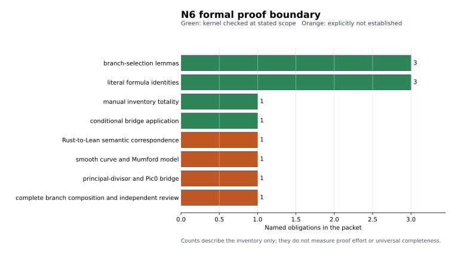

# N9 formal proof-boundary report

**Status:** partial mechanization with executable abstractions
**Generated:** 2026-10-25
**Schema:** `projective-law-formal-report/v1`

## Recorded result

Lean 4.34.1 with Mathlib revision
`d13f23b723b8a846827a245b89c10fc7d3f11612` kernel-checks the prior three
branch-selection lemmas, three literal formula identities, manual 17-row
inventory totality, and conditional bridge theorem. It now also checks a
manual executable abstraction of the 1+2 branch decision order, selected 1+2
intermediates with a conditional identity, a proof-side 2+2 polynomial witness
with two identities, and the abstract
principal-divisor residual-class step.

Four exact Rust function fragments are separately SHA-256 bound and re-extracted
by the packet verifier. This identifies the source bytes associated with each
manual abstraction; it is not a translation proof. The packet does not establish Rust-to-Lean semantic equivalence, a smooth
genus-2 curve or Mumford representation in Lean, the principal-divisor and
`Pic^0` bridge, the complete exceptional-branch composition, or independent
mathematical review. The conditional theorem `formula_to_divisor_class`
constructs no bridge and assumes no bridge globally.

The graph counts named obligations in this packet. Counts are an inventory;
they are not measures of proof effort, importance, or universal coverage.

## Standardized source table

| Evidence | Recorded status | Scope or limit |
|---|---|---|
| `equal_or_opposite_of_sq_eq_sq` | kernel checked | Abstract field; assumes equality of squares. |
| `same_u_zero_slope_delta_is_inverse` | kernel checked | Abstract field; assumes the two coefficient identities and characteristic not two. |
| `shared_zero_q_delta_unreachable` | kernel checked | Abstract field; assumes distinct coefficient pair and `B=0`. |
| `generic12_output_v_clearing` | kernel checked | Literal commutative-ring identity; no divisor argument. |
| `generic22_interpolates_first` | kernel checked | Exact factorization by explicit `u1=X^2+q1*X+r1`. |
| `generic22_interpolates_second` | kernel checked | Exact factorization by explicit `u2=X^2+q2*X+r2`. |
| `runtime_certificate_mapping_total` | kernel checked, manual scope | Total only over the manually transcribed Lean inventory; the Rust source is hash-bound, not parsed by Lean. |
| `formula_to_divisor_class` | kernel checked, conditional | Applies a caller-supplied implication; supplies no geometric bridge. |
| `classify12_ne_mismatch_of_valid` | kernel checked, conditional abstraction | The manually abstracted decision order excludes mismatch from a supplied equal-square ordinate hypothesis. |
| `generic12Runtime_cleared` | kernel checked, conditional abstraction | Selected 1+2 intermediates satisfy the identity when two defining equations are supplied. |
| `generic22Runtime_mod_first`, `generic22Runtime_mod_second` | kernel checked, proof-side witness | Exact remainder identities for a constructed `N`; no derivation from a Rust `N` variable is asserted. |
| `residual_represents_input` | kernel checked, conditional | Proves the final class-group implication through an explicit principal-divisor interface; supplies no concrete curve instance. |
| `runtime-bindings.json` | integrity checked | Exact byte spans for four Rust functions are associated with exact Lean declaration sets; equivalence remains unproved. |
| `source-bindings.json` | integrity checked | SHA-256 binds runtime source, written audit, and eight native certificate sources/results. |
| `branch-coverage.json` | integrity checked | 17 mapped labels and five rejected or unresolved labels; semantic correspondence remains unproved. |

## Validation

- `lake build` completed 742 jobs in the retained pinned environment.
- The axiom audit found only subsets of `propext`, `Classical.choice`, and
  `Quot.sound`; it found no unexpected dependency.
- `python3 verify.py` verified source bindings, result schemas, status, branch
  counts, exact Lean declarations, and retained build/axiom receipts. Its live
  negative self-tests rejected duplicate and substituted bindings and a
  comment-only declaration name.
- `sha256sum -c SHA256SUMS` verifies the packet files listed there.

The retained build and axiom outputs are `build.log` and `axiom-audit.log`.
The exact formal environment is pinned by `lean-toolchain`, `lakefile.toml`,
and `lake-manifest.json`.

## Reviewer boundary

The next proof obligation is a mechanically derived Rust semantics or a proved
translation joining the hashed source fragments to Lean, plus a concrete
smooth-curve/Mumford construction satisfying the principal-divisor interface
for every branch, including exceptional compositions and degree drops. Until that is
supplied and independently reviewed, this packet records algebraic sublemmas
and manual executable abstractions rather than a universal group-law proof.
