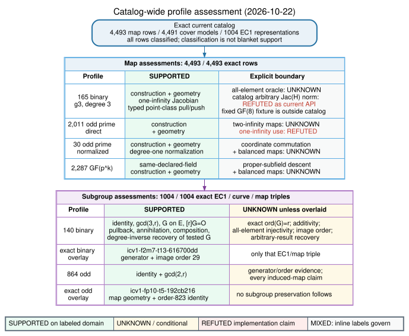
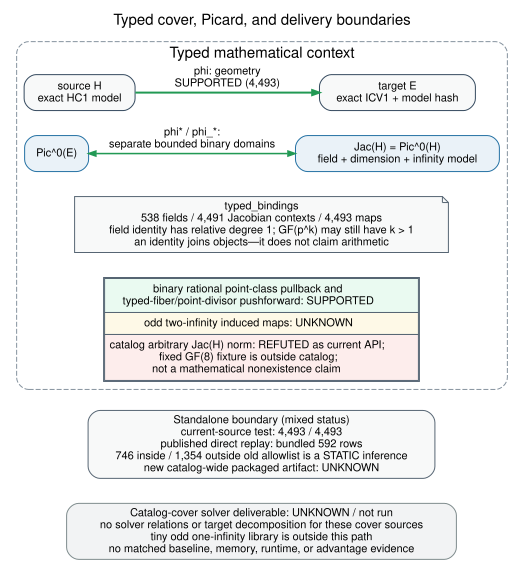

<!-- cover-transfer-assessments/v2; catalog_maps=4493; unique_cover_models=4491; geometry_verified_maps=4493; ec1_representations=1004; assessed_maps=4493; unassessed_maps=0; assessed_subgroups=1004; unassessed_subgroups=0 -->

# Expanded catalog and retained boundaries

The quadratic-twist native study added 1,921 exact models and 27 selected EC1
representations. This follow-up regenerates the existing same-field cover
catalog and its assessment for all 4,493 registry models. It corrects catalog
integration failures found by CI; it adds no transfer algorithm or solver result.
The registry remains byte-identical to the input at
`4711f1c73887f01ef8f348d98d57e0c09b221afd`.

The [earlier dated report](../../../cover_transfer_assessment_20261013/README.md),
its diagrams, published-artifact replay receipt, PDF, and other frozen evidence
are retained. They describe earlier populations. The generated current assessment
now links this versioned report and diagrams.

| Map profile | Exact models | Same-field cover |
| --- | ---: | --- |
| Ordinary binary | 165 | genus 3, degree 3 |
| Direct odd prime | 2,011 | genus 2, degree 2 |
| Normalized odd prime | 30 | genus 2, degree 2, explicit target normalization |
| Direct odd extension | 2,287 | genus 2, degree 2 over the declared extension |
| Total | 4,493 | 4,491 distinct HC1 cover models |

The graph contains 1,004 selected EC1 representations: 140 binary and 864
odd-characteristic. Exact memberships bind 538 declared fields, 4,491 Jacobian
contexts, and 4,493 maps. Models without an experimental generator retain that
unknown. Every map and EC1/curve/map triple receives one profile; an assessment
can explicitly be supported, unknown, refuted, or not applicable.

The existing native Rust checker recomputes defining-equation identities,
smoothness and field-validity checks within its documented boundary, and exact
content-addressed links. The independent assessment verifier replays every cover
formula, field/context binding, membership join, and source digest. The standalone
constructor test visits every current model; its exact count is now 4,493 and
all per-model assertions are retained.

# Evidence and interpretation

The [CI follow-up record](../../validation/catalog-ci-20261022/README.md) retains
the two local failing reproductions, source hashes, native generation and replay,
constructor tests, and assessment verification. The prior current-head native
study workflow already passed the complete 434-field parity check, independent IC
certificates, corruption controls, native metadata tests, and byte-exact replay.
Those frozen mathematical runs remain unchanged.

Supported geometry does not establish an efficient DLP transfer. Binary typed
point-class operations keep their original domain; a general catalog Jacobian
norm and independent all-element map oracle remain open. Odd-characteristic
balanced-Jacobian maps and proper-subfield descent remain open. A numeric EC1
order or its coprimality with the map degree is not an exact-order proof or an
induced-map certificate. The 27 added representations do not promote the entire
864-row odd profile to arithmetic or transfer support.

The exact fixed-GF(8) arbitrary-class fixture remains outside the catalog
population. The old published artifact was replayed on its bundled 592 rows;
the historical 746/1,354 allowlist comparison is not a replay of the expanded
catalog. No new packaged-artifact replay is claimed.

No matched IC/rho comparison, end-to-end solver cost, speedup, general GHS
algorithm, or general ECDLP hardness conclusion follows from this refresh.
All experimental points remain valid; invalid-curve attacks are outside scope.
The twist embedding's Frobenius-negation proof and the other formal bridges and
shared coordination obligations remain in the [problem record](../../../../problems/quadratic-twist-evidence-native-parity.md).

# Visuals and reproduction





The [PDF](report.pdf) includes this report's population, evidence, limitations,
and both diagrams. Diagram sources and SVG/PNG/PDF renders are adjacent.
The [PDF source](report.tex) and [build script](build.sh) use only Graphviz and
LaTeX; no Python research path is executed.

From the repository root, use the pinned Rust toolchain and run:

```sh
cargo run --release --locked --bin curve_cover_check
cargo run --release --locked --bin curve_cover_check -- --check
cargo test --release --locked --bin hyperelliptic-cover
node scripts/build_cover_transfer_assessments.mjs --check
node research/cover_transfer_assessment_20261013/verify_assessment.mjs
bash research/quadratic_twist_evidence_20261021/reports/catalog-20261022/build.sh
```

Canonical IC/rho cost graphs are unchanged because this is a correctness and
metadata refresh with no admissible new cost comparison. The earlier native
coverage graph and its finite mathematical results are unchanged as well.
