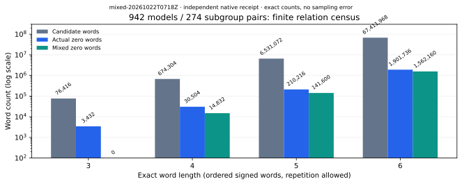
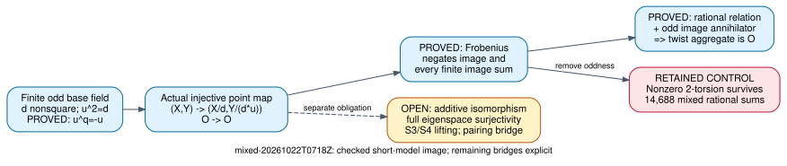

# Mixed twist relations: exhaustive finite falsification and a checked image bridge

Run group `mixed-20261022T0718Z`, 22 October 2026. This continues the user's
request to find and test twist/index-calculus routes and disprove unjustified
claims. The [protocol](../../MIXED_RELATIONS_20261022_PROTOCOL.md) was committed
as `6aa9212b4` before execution, after syncing PR #2381 at `036c2a1a329276ef94c4e104d447c426181cf26c`.

**Observed:** C++ and an independent Rust arithmetic/enumeration replay agree
on all 942 models, 274 shared odd-prime subgroup cases and **74,693,760 ordered
signed words** of lengths 3–6. All **2,145,888 zero words**, including
**1,718,592 mixed zero words**, were checked against actual valid points. Every
mixed zero word has zero contribution in each Frobenius component, and adding
mixed rows gives **zero rank gain** over pure rows under the same length bound.
This is a finite null result for this relation mechanism, not a proof that
twists have no connections to ECDLP or that no faster solver exists.

[Raw per-model words/rows](../../native/mixed-20261022T0718Z/results.json) ·
[Independent replay and native aggregates](../../native/mixed-20261022T0718Z/audit.json) ·
[Commands, failures and final checks](../../validation/mixed-20261022T0718Z/README.md) ·
[Inspected three-page PDF](report.pdf), starting at page 1.

## Exact experiment and identities

The population is every nonsingular short model over p=5,7,11,13,17,19 with
0<=a,b<p: 942 models, not the 4,493-model global cover catalog. Each record
contains the already registered ICV1 identifiers of E and its monic twist,
exact coefficients and field parameter d, group orders and selected generators.
No curve, EC1 record or registry value was added. These bounded internal
arithmetic checks do not join across repositories; the newly selected generator
choices are fully recorded in the run, without inventing canonical EC1 aliases.

For each p, d is its least positive nonsquare and K=F_p[u]/(u²-d), with integer
encoding a+p*b for a+b*u. A twist point on d*y²=x³+a*x+b maps to (x,u*y) on
E(K). Its normalized monic model is Y²=X³+d²*a*X+d³*b with
(X,Y)=(d*x,d²*y). The Lean map below uses the inverse normalization explicitly.
All inputs are points on valid nonsingular curves. Invalid-curve attacks are
outside scope. Both ordinary and supersingular models are included; no
ordinary-only endomorphism-order assumption is used.

For each odd prime r dividing both rational group orders, choose the first
lexicographic nonzero order-r generator on each model. The alphabet is every
nonzero point of both chosen cyclic subgroups, expressed as signed multiples
of representatives j=1,...,(r-1)/2. Enumerate all ordered words, with repetition,
of each declared length. Relation rows retain separate rational and twist
columns. Counts include dependent, repeated and zero-coefficient words; they
are not counts of independent information.

| Word length | Candidate words | Zero words | Mixed zero words | Mixed zero integer-coefficient words |
| --- | ---: | ---: | ---: | ---: |
| 3 | 76,416 | 3,432 | 0 | 0 |
| 4 | 674,304 | 30,504 | 14,832 | 14,832 |
| 5 | 6,531,072 | 210,216 | 141,600 | 0 |
| 6 | 67,411,968 | 1,901,736 | 1,562,160 | 637,200 |

The quantities are exact enumerations, so there is no sampling uncertainty.
The last column counts literally zero integer coefficient vectors; further
nonzero integer rows can also become zero after reduction modulo r.
The raw records preserve counts by rational-letter arity, all distinct signed
rows and the cumulative ranks at every maximum length. All 1,096 subgroup/length
comparisons pass. The length-six ranks are:

| r | Subgroup cases | Pure rational rank | Pure twist rank | All-row rank | Gain |
| --- | ---: | ---: | ---: | ---: | ---: |
| 3 | 186 | 0 | 0 | 0 | 0 |
| 5 | 72 | 1 | 1 | 2 | 0 |
| 7 | 16 | 2 | 2 | 4 | 0 |



The C++ producer reuses the existing native field/curve backend and walks
ordered words. It verifies every accepted word by actual point addition and
checks an injective r²-entry table of actual subgroup sums, binding its residue
acceptance and rejection to curve points. The Rust auditor independently uses
coefficient pairs, inversion by exponent p²-2, q-power Frobenius and forward
Gaussian elimination. It enumerates coefficient rows with multiplicities using
a dynamic program and decides every resulting state with actual point
arithmetic. Only JSON, SHA-256 and the existing IDC1 backend are shared; this
is a separate arithmetic/enumeration implementation on the same host, not an
independent-host performance replay.

## What the exceptions and controls say

All **260,064** rational/twist pairs are checked. A sum A+B is rational exactly
when the twist image B is killed by two. **14,688** such pairs have B nonzero;
the run retains actual common two-torsion witnesses on **606** models. Thus
dropping the odd-order hypothesis is false, on valid curves.

A square-parameter control, d=1 and u=1, produces an actual rational image
that is fixed and not negated on **939** models. On the other three every
rational point is killed by two, so that discriminating control is explicitly
null. This exposes why the nonsquare hypothesis cannot be silently removed.
For all 274 odd-prime cases the false scalar-label equation P-T=O is rejected
by point addition. Changing a saved row coefficient is rejected as a nonzero
actual curve sum; deleting a model is rejected as missing coverage. False-plus-one
IDC1 issuance is rejected too. These are separate controls, not new relations.

## Checked mathematical progress

There are **28 named research theorems** in the pinned Lean project, ten new
in this round. The final proof gate audits **36 declarations**, including eight
generated helper lemmas, with **zero failures and zero trusted native proofs**.
Only propext, Classical.choice and Quot.sound occur. This is a kernel-checked
proof of the stated implications, not a native exhaustive search promoted to
a general theorem. [Complete proof map](../../lean/README.md).

Let k be a finite field of odd characteristic, d a nonsquare, and K a field
algebra containing u with u²=d. For an elliptic short model
E:y²=x³+a*x+b, let E_d:Y²=X³+d²*a*X+d³*b. The actual point map is
psi(O)=O and psi(X,Y)=(X/d,Y/(d*u)). It is well-defined and injective.
Euler's criterion gives d^((q-1)/2)=-1, so
u^q=u*(u²)^((q-1)/2)=-u. Frobenius therefore fixes the x-coordinate and negates
the y-coordinate of psi(P), including the point at infinity.

If A and R are rational and A+psi(P)=R, applying Frobenius also gives
A-psi(P)=R. Hence 2*psi(P)=O. Any odd annihilator of the actual image forces
psi(P)=O, then P=O by injectivity. The same argument applies to an aggregate
of finitely many images, since Frobenius preserves addition. It forces the
aggregate to vanish, not each summand separately. These declarations discharge
the earlier hB hypothesis for these explicit images.



The cleared polynomial part has source-bound identity certificate
**IDC1h9dc35b198cc2fa02**, with 32 derived and 16 extra native evaluation points,
and a universal Lean ring proof. The final [certificate](../../native/mixed-20261022T0718Z/certificate/cleared-monic-twist.json)
binds the exact current Lean source. The initial certificate and initial audit
receipt are retained alongside their final versions.

The point map is not yet a formal additive isomorphism, nor is full minus-eigenspace
surjectivity proved. Its odd-annihilator hypotheses are explicitly on the image
or sum. General-model normalization, full eigenspace identifications, exceptional
S3/S4 lifting, pairing nondegeneracy/reduction and universal trace-zero geometry
remain open. The existing pairing connection and finite IC recoveries are not
refuted by these new obstructions. General hardness, GHS and speedup are not
established. Shared Conductor access remains unavailable (exit 127).

## Reproduction, accounting, and next test

Run from the repository root:

```sh
bash research/quadratic_twist_evidence_20261021/run-mixed.sh /tmp/twist-mixed-fresh
tools/lean/proof-gate.sh --out /tmp/twist-proof-fresh research/quadratic_twist_evidence_20261021/lean
```

The native replay requires C++17/OpenSSL, Rust/Cargo and ripgrep; the proof uses
Lean 4.34.1 and Mathlib d13f23b723b8a846827a245b89c10fc7d3f11612. On a restricted
home filesystem, set MATHLIB_CACHE_DIR to an accessible cache directory. Exact
commands and source/input hashes are in the validation record. The fresh library
suite passes **4,479** tests with **119 existing ignores**, after the current-main
refresh. The isolated native auditor's backend suite passes **22** tests.

The host is an uncontrolled Linux x86-64 managed workspace. No timed algorithm
comparison was requested or admitted: setup, relation search, recovery, memory,
rho costs and fastest-external-tool comparisons are unmeasured, and no end-to-end
speed or security conclusion follows. The 300-second native limits were not hit.
Raw failures are retained: initial oversized-registry integer parsing, Lean
elaboration, Rust visibility, and local cache-path setup. They are implementation
or environment failures, not evidence for mathematical impossibility.

Next discriminating work: formally prove the additive isomorphism/full eigenspaces
and exceptional-case summation-polynomial lifting; then preregister a new
field-defined factor-base family and test actual lifted relations against pure
components. The literal claim of no connection between twists and ECDLP is false;
the known pairing route remains a concrete connection. No general no-advantage
theorem is claimed.

Canonical graphs checked and left unchanged: `docs/index-calculus-scoreboard.html`,
`docs/ic/progress-timeline.json`, the leaderboard twins, the global curve/cover
catalog and cover-transfer assessment diagrams, and prior dated study graphs.
This round adds no curve identity, transfer support status or measured IC/rho
cost. The new study-local quantitative graph and proof diagram carry its new
findings; historical reports, sources and measurements are preserved.
